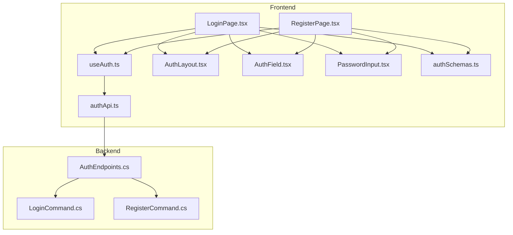
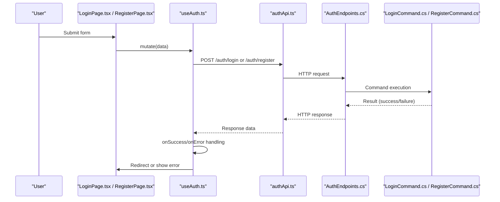
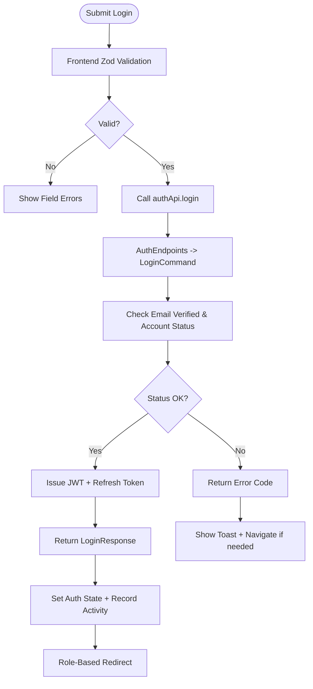
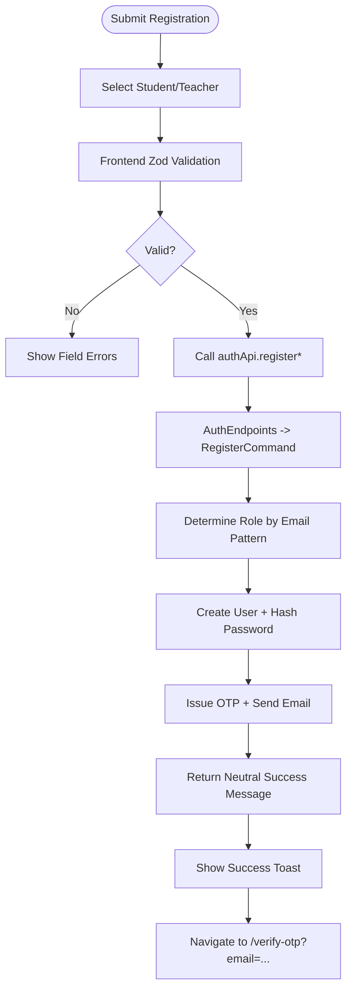
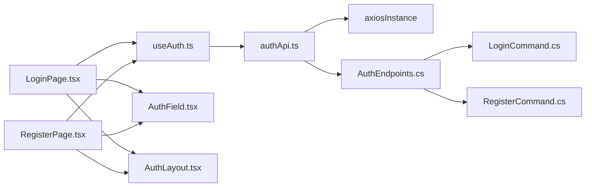

# Login & Registration Flow

<cite>
**Referenced Files in This Document**
- [AuthEndpoints.cs](file://api/src/Api/CodePath.Api/Endpoints/AuthEndpoints.cs)
- [LoginCommand.cs](file://api/src/Application/CodePath.Application/Auth/Commands/LoginCommand.cs)
- [RegisterCommand.cs](file://api/src/Application/CodePath.Application/Auth/Commands/RegisterCommand.cs)
- [authApi.ts](file://frontend/src/features/auth/api/authApi.ts)
- [useAuth.ts](file://frontend/src/features/auth/hooks/useAuth.ts)
- [LoginPage.tsx](file://frontend/src/features/auth/pages/LoginPage.tsx)
- [RegisterPage.tsx](file://frontend/src/features/auth/pages/RegisterPage.tsx)
- [AuthLayout.tsx](file://frontend/src/features/auth/components/AuthLayout.tsx)
- [AuthField.tsx](file://frontend/src/features/auth/components/AuthField.tsx)
- [PasswordInput.tsx](file://frontend/src/features/auth/components/PasswordInput.tsx)
- [authSchemas.ts](file://frontend/src/features/auth/schemas/authSchemas.ts)
</cite>

## Table of Contents
1. [Introduction](#introduction)
2. [Project Structure](#project-structure)
3. [Core Components](#core-components)
4. [Architecture Overview](#architecture-overview)
5. [Detailed Component Analysis](#detailed-component-analysis)
6. [Dependency Analysis](#dependency-analysis)
7. [Performance Considerations](#performance-considerations)
8. [Troubleshooting Guide](#troubleshooting-guide)
9. [Conclusion](#conclusion)

## Introduction
This document explains the complete login and registration user flows, from form submission to successful authentication and role-based redirects. It covers frontend components (AuthLayout, AuthField, PasswordInput), validation schemas, API integration, backend endpoints and handlers, error handling, and redirect logic. It also provides guidance for customizing authentication forms and handling different response states.

## Project Structure
The authentication feature spans both frontend and backend:
- Frontend: React pages and hooks under features/auth, including login/register pages, auth API client, validation schemas, and reusable UI components.
- Backend: ASP.NET Core endpoints and MediatR commands that implement login, register, OTP verification, and token management.

**Diagram sources**
- [LoginPage.tsx:1-26](file://frontend/src/features/auth/pages/LoginPage.tsx#L1-L26)
- [RegisterPage.tsx:1-42](file://frontend/src/features/auth/pages/RegisterPage.tsx#L1-L42)
- [useAuth.ts:1-150](file://frontend/src/features/auth/hooks/useAuth.ts#L1-L150)
- [authApi.ts:1-54](file://frontend/src/features/auth/api/authApi.ts#L1-L54)
- [AuthEndpoints.cs:104-294](file://api/src/Api/CodePath.Api/Endpoints/AuthEndpoints.cs#L104-L294)
- [LoginCommand.cs:44-215](file://api/src/Application/CodePath.Application/Auth/Commands/LoginCommand.cs#L44-L215)
- [RegisterCommand.cs:15-157](file://api/src/Application/CodePath.Application/Auth/Commands/RegisterCommand.cs#L15-L157)
- [AuthLayout.tsx:1-56](file://frontend/src/features/auth/components/AuthLayout.tsx#L1-L56)
- [AuthField.tsx:1-31](file://frontend/src/features/auth/components/AuthField.tsx#L1-L31)
- [PasswordInput.tsx:1-45](file://frontend/src/features/auth/components/PasswordInput.tsx#L1-L45)
- [authSchemas.ts:1-71](file://frontend/src/features/auth/schemas/authSchemas.ts#L1-L71)

**Section sources**
- [LoginPage.tsx:1-26](file://frontend/src/features/auth/pages/LoginPage.tsx#L1-L26)
- [RegisterPage.tsx:1-42](file://frontend/src/features/auth/pages/RegisterPage.tsx#L1-L42)
- [AuthEndpoints.cs:104-294](file://api/src/Api/CodePath.Api/Endpoints/AuthEndpoints.cs#L104-L294)

## Core Components
- AuthLayout: Shared layout for authentication pages with branding, title/subtitle, optional back button, and responsive two-column design.
- AuthField: Accessible input component with label, hint, error display, and built-in password visibility toggle when type is password.
- PasswordInput: Alternative password input with a simple show/hide toggle and error message support.
- authSchemas: Zod schemas for login, student/teacher registration, OTP verification, forgot/reset password.
- authApi: Axios-based client wrapping backend endpoints for login, register, verify OTP, resend OTP, logout, forgot/reset password.
- useAuth: React Query hooks orchestrating mutations, success/error handling, toast notifications, and navigation based on roles and error codes.

Key responsibilities:
- Form validation occurs in the frontend using zod schemas before sending requests.
- Backend performs additional validation and business rules via FluentValidation and command handlers.
- Role-based redirects are handled after successful login.
- Error responses map to user-friendly messages and specific navigations (e.g., OTP verification or pending approval).

**Section sources**
- [AuthLayout.tsx:1-56](file://frontend/src/features/auth/components/AuthLayout.tsx#L1-L56)
- [AuthField.tsx:1-31](file://frontend/src/features/auth/components/AuthField.tsx#L1-L31)
- [PasswordInput.tsx:1-45](file://frontend/src/features/auth/components/PasswordInput.tsx#L1-L45)
- [authSchemas.ts:1-71](file://frontend/src/features/auth/schemas/authSchemas.ts#L1-L71)
- [authApi.ts:1-54](file://frontend/src/features/auth/api/authApi.ts#L1-L54)
- [useAuth.ts:1-150](file://frontend/src/features/auth/hooks/useAuth.ts#L1-L150)

## Architecture Overview
End-to-end flow for login and registration:

**Diagram sources**
- [LoginPage.tsx:11-23](file://frontend/src/features/auth/pages/LoginPage.tsx#L11-L23)
- [RegisterPage.tsx:12-39](file://frontend/src/features/auth/pages/RegisterPage.tsx#L12-L39)
- [useAuth.ts:11-42](file://frontend/src/features/auth/hooks/useAuth.ts#L11-L42)
- [authApi.ts:11-25](file://frontend/src/features/auth/api/authApi.ts#L11-L25)
- [AuthEndpoints.cs:108-156](file://api/src/Api/CodePath.Api/Endpoints/AuthEndpoints.cs#L108-L156)
- [LoginCommand.cs:88-191](file://api/src/Application/CodePath.Application/Auth/Commands/LoginCommand.cs#L88-L191)
- [RegisterCommand.cs:70-110](file://api/src/Application/CodePath.Application/Auth/Commands/RegisterCommand.cs#L70-L110)

## Detailed Component Analysis

### Login Flow
- Validation: Frontend uses zod schema to validate email and password before submission.
- Submission: LoginPage calls useLogin hook which invokes authApi.login.
- Backend: AuthEndpoints maps POST /api/auth/login to LoginCommand. The handler validates inputs, checks account status, verifies password, issues tokens, stores refresh token, and returns a result.
- Success: useLogin sets auth state, records activity, shows success toast, and navigates based on user role (Admin -> /admin, Teacher -> /teacher, else -> /home).
- Errors:
  - UNVERIFIED_EMAIL: Navigate to /verify-otp with email parameter.
  - ACCOUNT_PENDING: Navigate to /pending-approval.
  - Other errors: Display generic error message via errorService.

**Diagram sources**
- [LoginPage.tsx:11-23](file://frontend/src/features/auth/pages/LoginPage.tsx#L11-L23)
- [authSchemas.ts:9-13](file://frontend/src/features/auth/schemas/authSchemas.ts#L9-L13)
- [useAuth.ts:11-42](file://frontend/src/features/auth/hooks/useAuth.ts#L11-L42)
- [AuthEndpoints.cs:132-156](file://api/src/Api/CodePath.Api/Endpoints/AuthEndpoints.cs#L132-L156)
- [LoginCommand.cs:88-191](file://api/src/Application/CodePath.Application/Auth/Commands/LoginCommand.cs#L88-L191)

**Section sources**
- [LoginPage.tsx:11-23](file://frontend/src/features/auth/pages/LoginPage.tsx#L11-L23)
- [authSchemas.ts:9-13](file://frontend/src/features/auth/schemas/authSchemas.ts#L9-L13)
- [useAuth.ts:11-42](file://frontend/src/features/auth/hooks/useAuth.ts#L11-L42)
- [AuthEndpoints.cs:132-156](file://api/src/Api/CodePath.Api/Endpoints/AuthEndpoints.cs#L132-L156)
- [LoginCommand.cs:88-191](file://api/src/Application/CodePath.Application/Auth/Commands/LoginCommand.cs#L88-L191)

### Registration Flow
- Validation: Frontend uses separate schemas for student and teacher registration, enforcing HanU email patterns and password requirements.
- Submission: RegisterPage toggles between student/teacher forms and calls useRegisterStudent or useRegisterTeacher accordingly.
- Backend: AuthEndpoints maps POST /api/auth/register to RegisterCommand. The handler normalizes email, determines role by email pattern, creates user, issues OTP, and sends OTP email.
- Success: useRegister* hooks show success toast and navigate to /verify-otp with email parameter.
- Errors: Generic error messages displayed via errorService.

**Diagram sources**
- [RegisterPage.tsx:12-39](file://frontend/src/features/auth/pages/RegisterPage.tsx#L12-L39)
- [authSchemas.ts:15-45](file://frontend/src/features/auth/schemas/authSchemas.ts#L15-L45)
- [useAuth.ts:44-70](file://frontend/src/features/auth/hooks/useAuth.ts#L44-L70)
- [AuthEndpoints.cs:108-114](file://api/src/Api/CodePath.Api/Endpoints/AuthEndpoints.cs#L108-L114)
- [RegisterCommand.cs:70-110](file://api/src/Application/CodePath.Application/Auth/Commands/RegisterCommand.cs#L70-L110)

**Section sources**
- [RegisterPage.tsx:12-39](file://frontend/src/features/auth/pages/RegisterPage.tsx#L12-L39)
- [authSchemas.ts:15-45](file://frontend/src/features/auth/schemas/authSchemas.ts#L15-L45)
- [useAuth.ts:44-70](file://frontend/src/features/auth/hooks/useAuth.ts#L44-L70)
- [AuthEndpoints.cs:108-114](file://api/src/Api/CodePath.Api/Endpoints/AuthEndpoints.cs#L108-L114)
- [RegisterCommand.cs:70-110](file://api/src/Application/CodePath.Application/Auth/Commands/RegisterCommand.cs#L70-L110)

### AuthLayout Component Structure
AuthLayout provides a consistent visual structure for authentication pages:
- Left column: Branding image area (hidden on small screens).
- Right column: Form container with logo, title, subtitle, and children content.
- Optional back button positioned absolutely at top-left.
- Responsive design using Tailwind classes.

Usage:
- LoginPage and RegisterPage wrap their forms within BrightAuthLayout (a variant of AuthLayout) and pass title/subtitle props.

Customization tips:
- Replace background image URL to match brand assets.
- Adjust max-width, padding, and colors via Tailwind classes.
- Add or remove sections by modifying children and header elements.

**Section sources**
- [AuthLayout.tsx:1-56](file://frontend/src/features/auth/components/AuthLayout.tsx#L1-L56)
- [LoginPage.tsx:14-23](file://frontend/src/features/auth/pages/LoginPage.tsx#L14-L23)
- [RegisterPage.tsx:25-39](file://frontend/src/features/auth/pages/RegisterPage.tsx#L25-L39)

### Form Field Components: AuthField and PasswordInput
AuthField:
- Accessible input with label, hint, and error message.
- Built-in password visibility toggle when type="password".
- Uses aria attributes for accessibility (aria-invalid, aria-describedby).

PasswordInput:
- Simpler password input with show/hide toggle.
- Displays error message below the field.

Integration:
- LoginPage and RegisterPage use AuthField for all inputs, ensuring consistent styling and behavior.
- PasswordInput can be used where a minimal password field is preferred.

Customization tips:
- Extend props to include additional accessibility attributes.
- Customize styles via className prop or by updating Tailwind classes.
- For complex fields (e.g., OTP), consider building specialized components following the same patterns.

**Section sources**
- [AuthField.tsx:1-31](file://frontend/src/features/auth/components/AuthField.tsx#L1-L31)
- [PasswordInput.tsx:1-45](file://frontend/src/features/auth/components/PasswordInput.tsx#L1-L45)
- [LoginPage.tsx:17-19](file://frontend/src/features/auth/pages/LoginPage.tsx#L17-L19)
- [RegisterPage.tsx:32-35](file://frontend/src/features/auth/pages/RegisterPage.tsx#L32-L35)

### Backend Authentication APIs
Endpoints:
- POST /api/auth/register: Creates user, issues OTP, sends email.
- POST /api/auth/verify-otp: Verifies OTP code.
- POST /api/auth/resend-otp: Resends OTP.
- POST /api/auth/login: Authenticates user, sets refresh token cookie, returns access token and user info.
- POST /api/auth/refresh-token and /api/auth/refresh: Rotates refresh token.
- POST /api/auth/logout and /api/auth/refresh-token/logout: Clears refresh token cookie.
- GET /api/auth/me: Returns current user profile.
- PUT /api/auth/me: Updates current user profile.

LoginCommand:
- Validates email/password.
- Checks login attempt limits and concurrency.
- Verifies email verification and account status.
- Issues JWT access token and refresh token; persists refresh token.
- Records successful login and resets attempt counters.

RegisterCommand:
- Normalizes email and determines role by email pattern.
- Creates user with hashed password.
- Issues OTP and sends email; neutral success response hides internal state.

Error handling:
- Returns structured results with error codes (e.g., UNVERIFIED_EMAIL, ACCOUNT_PENDING, TooManyRequests).
- Rate limiting applied to sensitive endpoints.

**Section sources**
- [AuthEndpoints.cs:104-294](file://api/src/Api/CodePath.Api/Endpoints/AuthEndpoints.cs#L104-L294)
- [LoginCommand.cs:44-215](file://api/src/Application/CodePath.Application/Auth/Commands/LoginCommand.cs#L44-L215)
- [RegisterCommand.cs:15-157](file://api/src/Application/CodePath.Application/Auth/Commands/RegisterCommand.cs#L15-L157)

## Dependency Analysis
Frontend dependencies:
- Pages depend on hooks for mutation orchestration.
- Hooks depend on authApi for HTTP calls.
- authApi depends on axios instance and shared error utilities.
- Pages depend on schemas for validation and components for UI.

Backend dependencies:
- Endpoints depend on MediatR commands.
- Commands depend on domain services (password hashing, JWT, OTP, email).
- Commands interact with persistence layers for users and refresh tokens.

**Diagram sources**
- [LoginPage.tsx:1-26](file://frontend/src/features/auth/pages/LoginPage.tsx#L1-L26)
- [RegisterPage.tsx:1-42](file://frontend/src/features/auth/pages/RegisterPage.tsx#L1-L42)
- [useAuth.ts:1-150](file://frontend/src/features/auth/hooks/useAuth.ts#L1-L150)
- [authApi.ts:1-54](file://frontend/src/features/auth/api/authApi.ts#L1-L54)
- [AuthEndpoints.cs:104-294](file://api/src/Api/CodePath.Api/Endpoints/AuthEndpoints.cs#L104-L294)
- [LoginCommand.cs:44-215](file://api/src/Application/CodePath.Application/Auth/Commands/LoginCommand.cs#L44-L215)
- [RegisterCommand.cs:15-157](file://api/src/Application/CodePath.Application/Auth/Commands/RegisterCommand.cs#L15-L157)

**Section sources**
- [useAuth.ts:1-150](file://frontend/src/features/auth/hooks/useAuth.ts#L1-L150)
- [authApi.ts:1-54](file://frontend/src/features/auth/api/authApi.ts#L1-L54)
- [AuthEndpoints.cs:104-294](file://api/src/Api/CodePath.Api/Endpoints/AuthEndpoints.cs#L104-L294)

## Performance Considerations
- Use React Query caching and retries judiciously for auth mutations to avoid unnecessary network calls.
- Debounce OTP resend actions to respect rate limits.
- Avoid re-rendering heavy layouts by memoizing components where appropriate.
- On the backend, ensure database queries are indexed appropriately (e.g., email lookup) and leverage connection pooling.

[No sources needed since this section provides general guidance]

## Troubleshooting Guide
Common issues and resolutions:
- Unverified email after login:
  - Symptom: Navigation to /verify-otp with error toast.
  - Cause: Backend returned UNVERIFIED_EMAIL.
  - Resolution: Complete OTP verification flow.
- Pending approval:
  - Symptom: Navigation to /pending-approval.
  - Cause: Backend returned ACCOUNT_PENDING.
  - Resolution: Wait for admin approval.
- Rate limiting:
  - Symptom: 429 responses on OTP resend.
  - Resolution: Respect Retry-After and inform user.
- Invalid credentials:
  - Symptom: Generic error toast.
  - Resolution: Verify email/password and check account status.

**Section sources**
- [useAuth.ts:30-42](file://frontend/src/features/auth/hooks/useAuth.ts#L30-L42)
- [useAuth.ts:87-101](file://frontend/src/features/auth/hooks/useAuth.ts#L87-L101)
- [LoginCommand.cs:137-156](file://api/src/Application/CodePath.Application/Auth/Commands/LoginCommand.cs#L137-L156)

## Conclusion
The login and registration flows integrate robust frontend validation, clear component architecture, and secure backend processing. Role-based redirects provide tailored user experiences, while comprehensive error handling ensures informative feedback. Customization points exist across UI components, schemas, and hooks to adapt to evolving requirements.

[No sources needed since this section summarizes without analyzing specific files]