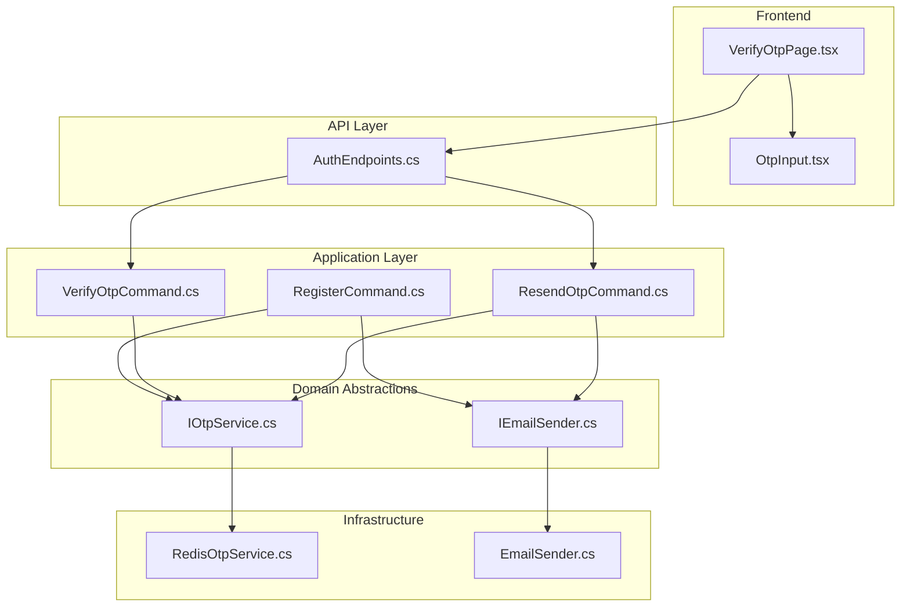
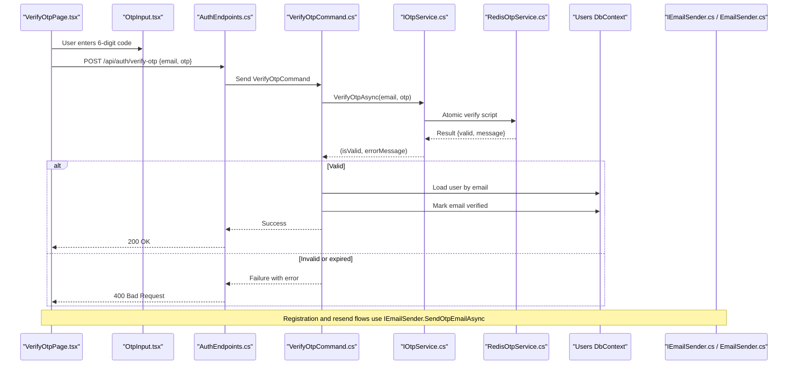
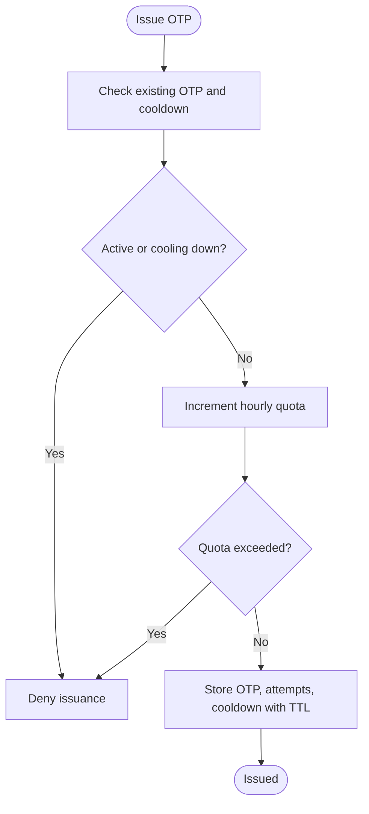
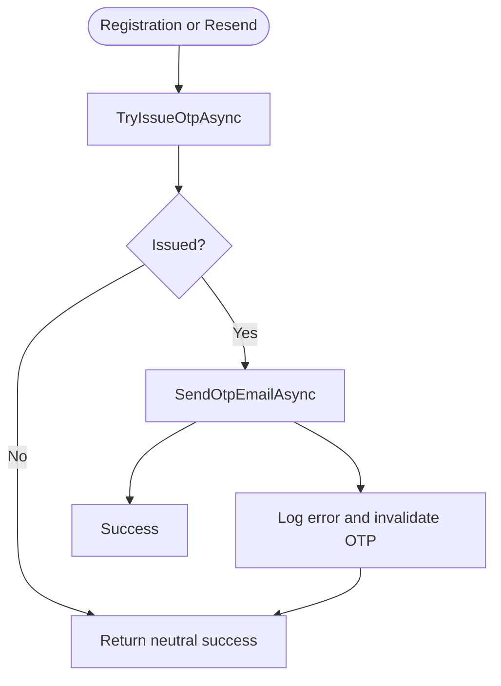
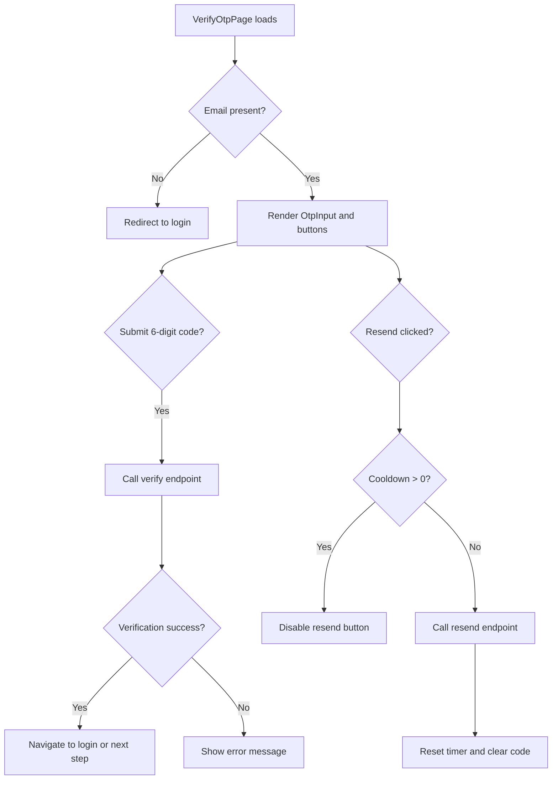
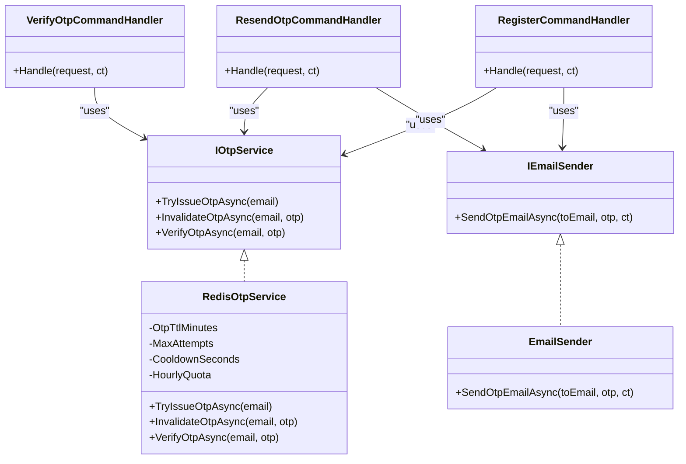
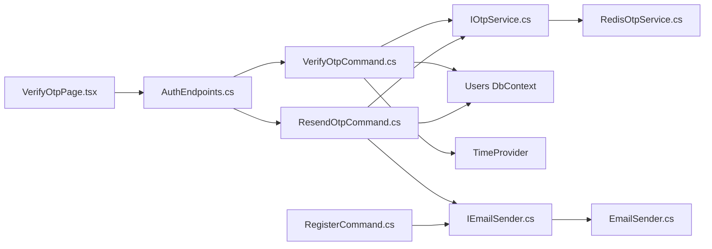

# OTP Verification System

<cite>
**Referenced Files in This Document**
- [RedisOtpService.cs](file://api/src/Infrastructure/CodePath.Infrastructure/Auth/Services/Otp/RedisOtpService.cs)
- [IOtpService.cs](file://api/src/Application/CodePath.Application/Auth/Abstractions/IOtpService.cs)
- [VerifyOtpCommand.cs](file://api/src/Application/CodePath.Application/Auth/Commands/VerifyOtpCommand.cs)
- [ResendOtpCommand.cs](file://api/src/Application/CodePath.Application/Auth/Commands/ResendOtpCommand.cs)
- [RegisterCommand.cs](file://api/src/Application/CodePath.Application/Auth/Commands/RegisterCommand.cs)
- [AuthEndpoints.cs](file://api/src/Api/CodePath.Api/Endpoints/AuthEndpoints.cs)
- [IEmailSender.cs](file://api/src/Application/CodePath.Application/Auth/Abstractions/IEmailSender.cs)
- [EmailSender.cs](file://api/src/Infrastructure/CodePath.Infrastructure/Auth/Services/Email/EmailSender.cs)
- [OtpInput.tsx](file://frontend/src/features/auth/components/OtpInput.tsx)
- [VerifyOtpPage.tsx](file://frontend/src/features/auth/pages/VerifyOtpPage.tsx)
</cite>

## Table of Contents
1. [Introduction](#introduction)
2. [Project Structure](#project-structure)
3. [Core Components](#core-components)
4. [Architecture Overview](#architecture-overview)
5. [Detailed Component Analysis](#detailed-component-analysis)
6. [Dependency Analysis](#dependency-analysis)
7. [Performance Considerations](#performance-considerations)
8. [Troubleshooting Guide](#troubleshooting-guide)
9. [Conclusion](#conclusion)

## Introduction
This document explains the One-Time Password verification system implemented across the backend API and frontend. It covers OTP generation, delivery via email, verification, expiration handling, resend behavior, and security controls such as rate limiting, attempt limits, cooldowns, and input validation. It also documents the frontend `OtpInput` component and the `VerifyOtpPage` workflow for code entry and user interaction.

## Project Structure
The OTP feature spans multiple layers:
- Frontend React components handle user input and UI flow.
- Backend endpoints expose REST APIs for verification and resending.
- Application commands implement business logic using MediatR.
- Infrastructure services provide OTP storage with Redis and email delivery through SMTP.

**Diagram sources**
- [AuthEndpoints.cs:104-130](file://api/src/Api/CodePath.Api/Endpoints/AuthEndpoints.cs#L104-L130)
- [VerifyOtpCommand.cs:24-56](file://api/src/Application/CodePath.Application/Auth/Commands/VerifyOtpCommand.cs#L24-L56)
- [ResendOtpCommand.cs:18-67](file://api/src/Application/CodePath.Application/Auth/Commands/ResendOtpCommand.cs#L18-L67)
- [RegisterCommand.cs:38-156](file://api/src/Application/CodePath.Application/Auth/Commands/RegisterCommand.cs#L38-L156)
- [IOtpService.cs:3-8](file://api/src/Application/CodePath.Application/Auth/Abstractions/IOtpService.cs#L3-L8)
- [RedisOtpService.cs:7-152](file://api/src/Infrastructure/CodePath.Infrastructure/Auth/Services/Otp/RedisOtpService.cs#L7-L152)
- [IEmailSender.cs:3-8](file://api/src/Application/CodePath.Application/Auth/Abstractions/IEmailSender.cs#L3-L8)
- [EmailSender.cs:12-37](file://api/src/Infrastructure/CodePath.Infrastructure/Auth/Services/Email/EmailSender.cs#L12-L37)

**Section sources**
- [AuthEndpoints.cs:104-130](file://api/src/Api/CodePath.Api/Endpoints/AuthEndpoints.cs#L104-L130)
- [VerifyOtpCommand.cs:24-56](file://api/src/Application/CodePath.Application/Auth/Commands/VerifyOtpCommand.cs#L24-L56)
- [ResendOtpCommand.cs:18-67](file://api/src/Application/CodePath.Application/Auth/Commands/ResendOtpCommand.cs#L18-L67)
- [RegisterCommand.cs:38-156](file://api/src/Application/CodePath.Application/Auth/Commands/RegisterCommand.cs#L38-L156)
- [RedisOtpService.cs:7-152](file://api/src/Infrastructure/CodePath.Infrastructure/Auth/Services/Otp/RedisOtpService.cs#L7-L152)
- [IEmailSender.cs:3-8](file://api/src/Application/CodePath.Application/Auth/Abstractions/IEmailSender.cs#L3-L8)
- [EmailSender.cs:12-37](file://api/src/Infrastructure/CodePath.Infrastructure/Auth/Services/Email/EmailSender.cs#L12-L37)

## Core Components
- OTP service abstraction defines issuance, invalidation, and verification operations.
- Redis-backed OTP service implements secure generation, TTL-based expiration, attempt limits, cooldowns, and hourly quotas.
- Commands orchestrate verification and resend flows, integrating with user persistence and email delivery.
- Endpoints expose HTTP routes with rate limiting.
- Frontend provides a digit-only OTP input component and a page that manages verification and resend UX.

**Section sources**
- [IOtpService.cs:3-8](file://api/src/Application/CodePath.Application/Auth/Abstractions/IOtpService.cs#L3-L8)
- [RedisOtpService.cs:7-152](file://api/src/Infrastructure/CodePath.Infrastructure/Auth/Services/Otp/RedisOtpService.cs#L7-L152)
- [VerifyOtpCommand.cs:24-56](file://api/src/Application/CodePath.Application/Auth/Commands/VerifyOtpCommand.cs#L24-L56)
- [ResendOtpCommand.cs:18-67](file://api/src/Application/CodePath.Application/Auth/Commands/ResendOtpCommand.cs#L18-L67)
- [AuthEndpoints.cs:116-130](file://api/src/Api/CodePath.Api/Endpoints/AuthEndpoints.cs#L116-L130)
- [OtpInput.tsx:12-79](file://frontend/src/features/auth/components/OtpInput.tsx#L12-L79)
- [VerifyOtpPage.tsx:8-50](file://frontend/src/features/auth/pages/VerifyOtpPage.tsx#L8-L50)

## Architecture Overview
The OTP verification architecture follows a layered design:
- The frontend collects a six-digit code and triggers verification or resend requests.
- The API layer maps HTTP requests to MediatR commands.
- Command handlers validate inputs, call the OTP service, and perform domain actions (e.g., marking an email verified).
- The OTP service uses Redis Lua scripts for atomic operations, including generation, verification, attempt tracking, cooldown, and quota enforcement.
- Email delivery is delegated to an email sender abstraction, which can be configured for development/testing environments.

**Diagram sources**
- [VerifyOtpPage.tsx:32-45](file://frontend/src/features/auth/pages/VerifyOtpPage.tsx#L32-L45)
- [AuthEndpoints.cs:116-122](file://api/src/Api/CodePath.Api/Endpoints/AuthEndpoints.cs#L116-L122)
- [VerifyOtpCommand.cs:40-55](file://api/src/Application/CodePath.Application/Auth/Commands/VerifyOtpCommand.cs#L40-L55)
- [RedisOtpService.cs:53-81](file://api/src/Infrastructure/CodePath.Infrastructure/Auth/Services/Otp/RedisOtpService.cs#L53-L81)
- [IEmailSender.cs:3-8](file://api/src/Application/CodePath.Application/Auth/Abstractions/IEmailSender.cs#L3-L8)
- [EmailSender.cs:31-37](file://api/src/Infrastructure/CodePath.Infrastructure/Auth/Services/Email/EmailSender.cs#L31-L37)

## Detailed Component Analysis

### OTP Generation, Delivery, and Expiration
OTP generation is handled by the Redis-backed service:
- A new OTP is issued only if no active OTP exists and the user is not in cooldown.
- An hourly quota prevents excessive issuance per email.
- The OTP and attempt counters are stored with a short TTL.
- On successful verification, all related keys are deleted.
- On failure, attempts are decremented; exceeding the limit blocks further verification until a new OTP is issued.

**Diagram sources**
- [RedisOtpService.cs:15-43](file://api/src/Infrastructure/CodePath.Infrastructure/Auth/Services/Otp/RedisOtpService.cs#L15-L43)

Delivery occurs in command handlers:
- Registration and resend flows call the email sender after issuing an OTP.
- If email delivery fails, the generated OTP is invalidated to prevent reuse.

**Diagram sources**
- [RegisterCommand.cs:80-156](file://api/src/Application/CodePath.Application/Auth/Commands/RegisterCommand.cs#L80-L156)
- [ResendOtpCommand.cs:40-67](file://api/src/Application/CodePath.Application/Auth/Commands/ResendOtpCommand.cs#L40-L67)
- [IEmailSender.cs:3-8](file://api/src/Application/CodePath.Application/Auth/Abstractions/IEmailSender.cs#L3-L8)
- [EmailSender.cs:31-37](file://api/src/Infrastructure/CodePath.Infrastructure/Auth/Services/Email/EmailSender.cs#L31-L37)

Expiration is enforced by Redis TTLs and server-side checks:
- OTPs expire after a fixed number of minutes.
- Verification returns explicit errors when OTPs are missing or attempts are exhausted.

**Section sources**
- [RedisOtpService.cs:9-12](file://api/src/Infrastructure/CodePath.Infrastructure/Auth/Services/Otp/RedisOtpService.cs#L9-L12)
- [RedisOtpService.cs:53-81](file://api/src/Infrastructure/CodePath.Infrastructure/Auth/Services/Otp/RedisOtpService.cs#L53-L81)
- [RedisOtpService.cs:122-146](file://api/src/Infrastructure/CodePath.Infrastructure/Auth/Services/Otp/RedisOtpService.cs#L122-L146)
- [RegisterCommand.cs:139-156](file://api/src/Application/CodePath.Application/Auth/Commands/RegisterCommand.cs#L139-L156)
- [ResendOtpCommand.cs:55-67](file://api/src/Application/CodePath.Application/Auth/Commands/ResendOtpCommand.cs#L55-L67)

### OtpInput Component
The `OtpInput` component provides a secure, accessible, and user-friendly interface for entering a six-digit code:
- Accepts only numeric characters.
- Supports single-character input, backspace navigation, and paste handling.
- Focus management improves usability.
- Displays validation errors and supports disabled state during pending operations.

Key behaviors:
- Input filtering ensures digits only.
- Paste handler validates pasted content and fills slots up to the configured length.
- Keyboard navigation moves focus on backspace when the current slot is empty.
- Accessibility attributes include labels and aria-invalid for screen readers.

**Section sources**
- [OtpInput.tsx:12-79](file://frontend/src/features/auth/components/OtpInput.tsx#L12-L79)

### VerifyOtpPage Workflow
The verification page coordinates user input, countdown timers, and API calls:
- Extracts the email from query parameters and redirects if missing.
- Renders the `OtpInput` component and submits a six-digit code.
- Disables interactions while verifying or resending.
- Implements a 60-second cooldown before allowing resend.
- Resets the timer and clears the code on successful resend.

**Diagram sources**
- [VerifyOtpPage.tsx:8-50](file://frontend/src/features/auth/pages/VerifyOtpPage.tsx#L8-L50)

**Section sources**
- [VerifyOtpPage.tsx:8-50](file://frontend/src/features/auth/pages/VerifyOtpPage.tsx#L8-L50)

### Backend OTP Services Integration
HTTP endpoints map to application commands:
- `/api/auth/verify-otp` invokes `VerifyOtpCommand`.
- `/api/auth/resend-otp` invokes `ResendOtpCommand`.
- Both endpoints are protected by rate limiting.

Command responsibilities:
- `VerifyOtpCommand`: Validates input, verifies OTP via service, marks user email verified, and persists changes.
- `ResendOtpCommand`: Ensures the account is eligible, issues a new OTP, sends email, and handles delivery failures gracefully.

**Diagram sources**
- [IOtpService.cs:3-8](file://api/src/Application/CodePath.Auth/Abstractions/IOtpService.cs#L3-L8)
- [RedisOtpService.cs:7-152](file://api/src/Infrastructure/CodePath.Infrastructure/Auth/Services/Otp/RedisOtpService.cs#L7-L152)
- [VerifyOtpCommand.cs:24-56](file://api/src/Application/CodePath.Application/Auth/Commands/VerifyOtpCommand.cs#L24-L56)
- [ResendOtpCommand.cs:18-67](file://api/src/Application/CodePath.Application/Auth/Commands/ResendOtpCommand.cs#L18-L67)
- [RegisterCommand.cs:38-156](file://api/src/Application/CodePath.Application/Auth/Commands/RegisterCommand.cs#L38-L156)
- [IEmailSender.cs:3-8](file://api/src/Application/CodePath.Application/Auth/Abstractions/IEmailSender.cs#L3-L8)
- [EmailSender.cs:12-37](file://api/src/Infrastructure/CodePath.Infrastructure/Auth/Services/Email/EmailSender.cs#L12-L37)

**Section sources**
- [AuthEndpoints.cs:116-130](file://api/src/Api/CodePath.Api/Endpoints/AuthEndpoints.cs#L116-L130)
- [VerifyOtpCommand.cs:24-56](file://api/src/Application/CodePath.Application/Auth/Commands/VerifyOtpCommand.cs#L24-L56)
- [ResendOtpCommand.cs:18-67](file://api/src/Application/CodePath.Application/Auth/Commands/ResendOtpCommand.cs#L18-L67)
- [RegisterCommand.cs:38-156](file://api/src/Application/CodePath.Application/Auth/Commands/RegisterCommand.cs#L38-L156)
- [IEmailSender.cs:3-8](file://api/src/Application/CodePath.Application/Auth/Abstractions/IEmailSender.cs#L3-L8)
- [EmailSender.cs:12-37](file://api/src/Infrastructure/CodePath.Infrastructure/Auth/Services/Email/EmailSender.cs#L12-L37)

## Dependency Analysis
- The frontend depends on the API endpoints for verification and resend.
- The API endpoints depend on MediatR commands.
- Commands depend on abstractions (`IOtpService`, `IEmailSender`) and data access.
- Infrastructure implements these abstractions with Redis and SMTP.

**Diagram sources**
- [VerifyOtpPage.tsx:8-50](file://frontend/src/features/auth/pages/VerifyOtpPage.tsx#L8-L50)
- [AuthEndpoints.cs:116-130](file://api/src/Api/CodePath.Api/Endpoints/AuthEndpoints.cs#L116-L130)
- [VerifyOtpCommand.cs:24-56](file://api/src/Application/CodePath.Application/Auth/Commands/VerifyOtpCommand.cs#L24-L56)
- [ResendOtpCommand.cs:18-67](file://api/src/Application/CodePath.Application/Auth/Commands/ResendOtpCommand.cs#L18-L67)
- [RegisterCommand.cs:38-156](file://api/src/Application/CodePath.Application/Auth/Commands/RegisterCommand.cs#L38-L156)
- [IEmailSender.cs:3-8](file://api/src/Application/CodePath.Application/Auth/Abstractions/IEmailSender.cs#L3-L8)
- [RedisOtpService.cs:7-152](file://api/src/Infrastructure/CodePath.Infrastructure/Auth/Services/Otp/RedisOtpService.cs#L7-L152)
- [EmailSender.cs:12-37](file://api/src/Infrastructure/CodePath.Infrastructure/Auth/Services/Email/EmailSender.cs#L12-L37)

**Section sources**
- [VerifyOtpPage.tsx:8-50](file://frontend/src/features/auth/pages/VerifyOtpPage.tsx#L8-L50)
- [AuthEndpoints.cs:116-130](file://api/src/Api/CodePath.Api/Endpoints/AuthEndpoints.cs#L116-L130)
- [VerifyOtpCommand.cs:24-56](file://api/src/Application/CodePath.Application/Auth/Commands/VerifyOtpCommand.cs#L24-L56)
- [ResendOtpCommand.cs:18-67](file://api/src/Application/CodePath.Application/Auth/Commands/ResendOtpCommand.cs#L18-L67)
- [RegisterCommand.cs:38-156](file://api/src/Application/CodePath.Application/Auth/Commands/RegisterCommand.cs#L38-L156)
- [IEmailSender.cs:3-8](file://api/src/Application/CodePath.Application/Auth/Abstractions/IEmailSender.cs#L3-L8)
- [RedisOtpService.cs:7-152](file://api/src/Infrastructure/CodePath.Infrastructure/Auth/Services/Otp/RedisOtpService.cs#L7-L152)
- [EmailSender.cs:12-37](file://api/src/Infrastructure/CodePath.Infrastructure/Auth/Services/Email/EmailSender.cs#L12-L37)

## Performance Considerations
- Redis Lua scripts ensure atomicity and reduce round-trips for OTP issuance and verification.
- Short-lived OTP keys minimize memory usage and enforce expiration automatically.
- Attempt counters and cooldown keys prevent brute-force attacks without heavy database load.
- Hourly quotas limit spam and abuse at the Redis level.
- Frontend disables UI during network operations to avoid redundant requests.

[No sources needed since this section provides general guidance]

## Troubleshooting Guide
Common issues and resolutions:
- OTP expired or does not exist: Indicates TTL expiry or deletion after successful verification. Reissue an OTP.
- Too many invalid attempts: The attempt counter reached zero. Reissue an OTP after cooldown.
- Rate limiting: Requests may be throttled by endpoint-level rate limiting. Respect retry hints and cooldowns.
- Email delivery failures: The system logs and invalidates the generated OTP. Ensure SMTP configuration is correct and check environment-specific behavior.

Operational tips:
- Inspect Redis keys for OTP state: OTP value, attempts, cooldown, and quota.
- Validate frontend input constraints and ensure only digits are accepted.
- Confirm that verification endpoints are rate-limited and that clients handle errors gracefully.

**Section sources**
- [RedisOtpService.cs:53-81](file://api/src/Infrastructure/CodePath.Infrastructure/Auth/Services/Otp/RedisOtpService.cs#L53-L81)
- [RedisOtpService.cs:122-146](file://api/src/Infrastructure/CodePath.Infrastructure/Auth/Services/Otp/RedisOtpService.cs#L122-L146)
- [AuthEndpoints.cs:116-130](file://api/src/Api/CodePath.Api/Endpoints/AuthEndpoints.cs#L116-L130)
- [RegisterCommand.cs:139-156](file://api/src/Application/CodePath.Application/Auth/Commands/RegisterCommand.cs#L139-L156)
- [ResendOtpCommand.cs:55-67](file://api/src/Application/CodePath.Application/Auth/Commands/ResendOtpCommand.cs#L55-L67)

## Conclusion
The OTP verification system combines secure backend logic with a responsive frontend. OTP generation and verification are performed atomically in Redis with strict limits on attempts, cooldowns, and quotas. Commands encapsulate business rules, while endpoints expose controlled APIs with rate limiting. The frontend provides a robust input component and a clear verification workflow, including resend functionality and error handling. Together, these components deliver a secure, scalable, and user-friendly OTP experience.

[No sources needed since this section summarizes without analyzing specific files]