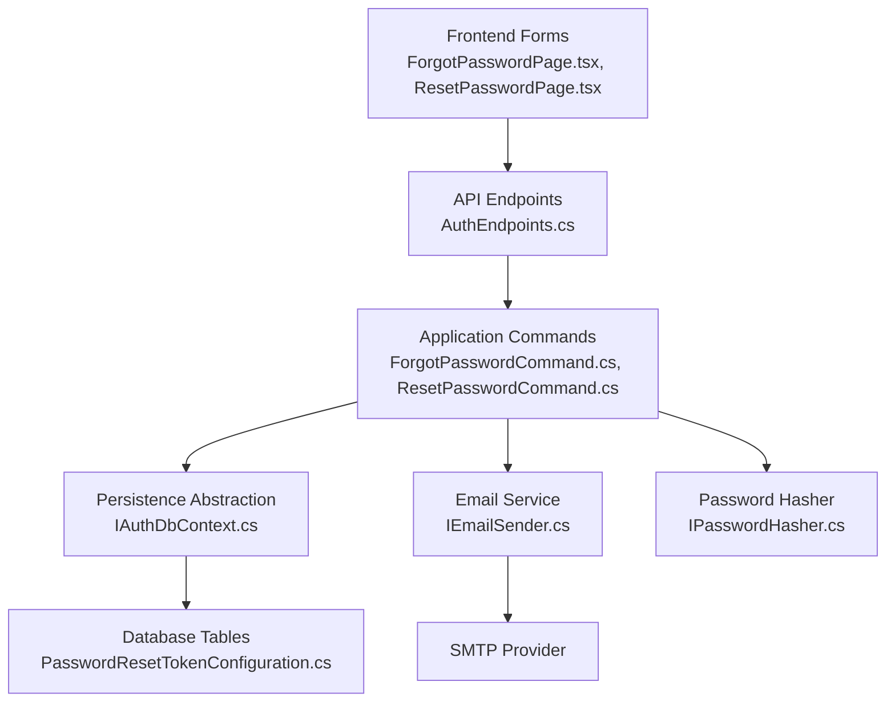
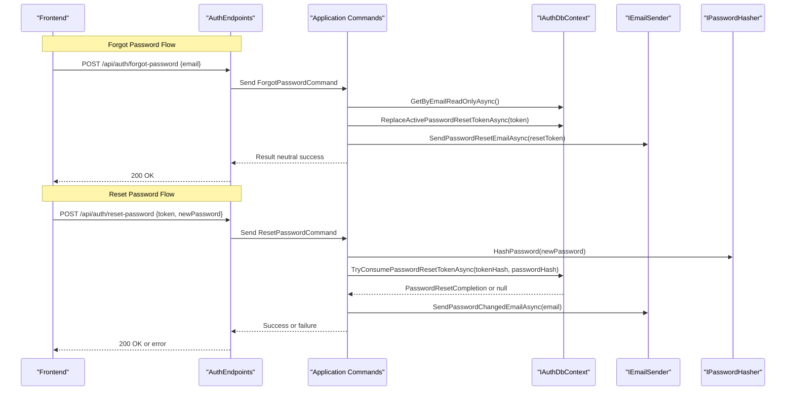
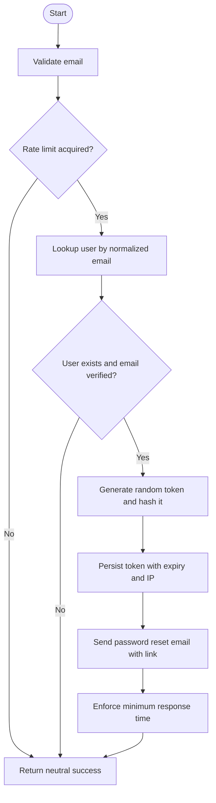
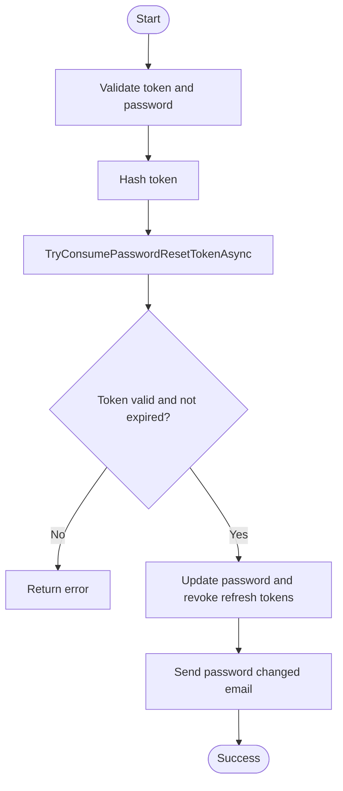
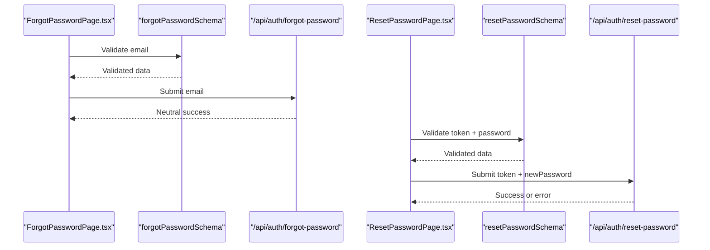
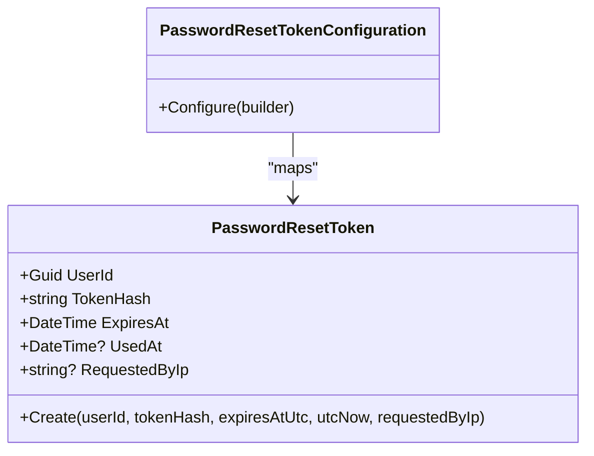
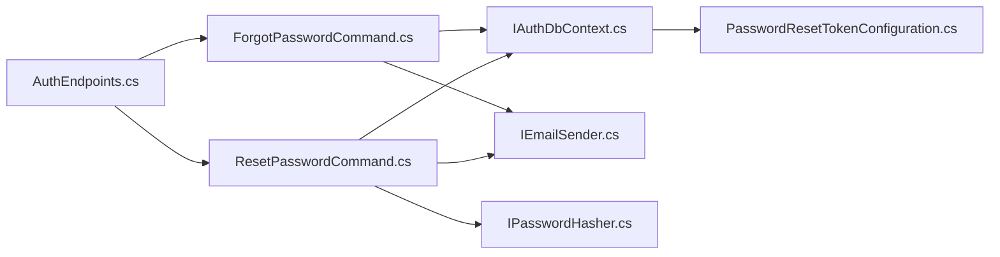

# Password Management

<cite>
**Referenced Files in This Document**
- [AuthEndpoints.cs](file://api/src/Api/CodePath.Api/Endpoints/AuthEndpoints.cs)
- [ForgotPasswordCommand.cs](file://api/src/Application/CodePath.Application/Auth/Commands/ForgotPasswordCommand.cs)
- [ResetPasswordCommand.cs](file://api/src/Application/CodePath.Application/Auth/Commands/ResetPasswordCommand.cs)
- [PasswordPolicy.cs](file://api/src/Application/CodePath.Application/Auth/PasswordPolicy.cs)
- [IEmailSender.cs](file://api/src/Application/CodePath.Application/Auth/Abstractions/IEmailSender.cs)
- [IPasswordHasher.cs](file://api/src/Application/CodePath.Application/Auth/Abstractions/IPasswordHasher.cs)
- [IAuthDbContext.cs](file://api/src/Application/CodePath.Application/Auth/Abstractions/IAuthDbContext.cs)
- [PasswordResetToken.cs](file://api/src/Domain/CodePath.Domain/Auth\Entities\PasswordResetToken.cs)
- [PasswordResetTokenConfiguration.cs](file://api/src/Infrastructure/CodePath.Infrastructure\Persistence\Configurations\PasswordResetTokenConfiguration.cs)
- [AppDbContext.cs](file://api/src/Infrastructure/CodePath.Infrastructure\Persistence\AppDbContext.cs)
- [EmailSender.cs](file://api/src/Infrastructure/CodePath.Infrastructure\Auth\Services\Email\EmailSender.cs)
- [authSchemas.ts](file://frontend/src/features/auth/schemas/authSchemas.ts)
- [ForgotPasswordPage.tsx](file://frontend/src/features/auth/pages/ForgotPasswordPage.tsx)
- [ResetPasswordPage.tsx](file://frontend/src/features/auth/pages/ResetPasswordPage.tsx)
</cite>

## Table of Contents
1. [Introduction](#introduction)
2. [Project Structure](#project-structure)
3. [Core Components](#core-components)
4. [Architecture Overview](#architecture-overview)
5. [Detailed Component Analysis](#detailed-component-analysis)
6. [Dependency Analysis](#dependency-analysis)
7. [Performance Considerations](#performance-considerations)
8. [Troubleshooting Guide](#troubleshooting-guide)
9. [Conclusion](#conclusion)

## Introduction
This document explains the password management features, focusing on the forgot password and reset password workflows. It covers email verification requirements, password validation rules, security best practices, form schemas, validation logic, and integration with backend APIs. It also provides guidance for customizing password policies, handling password change notifications, and implementing secure password storage patterns.

## Project Structure
The password reset feature spans multiple layers:
- API endpoints expose HTTP routes for forgot and reset password operations.
- Application commands implement business logic, including rate limiting, token generation, persistence, and email delivery.
- Domain entities model password reset tokens.
- Infrastructure implements persistence configuration and email sending.
- Frontend forms validate inputs using Zod schemas and call the backend APIs.

**Diagram sources**
- [AuthEndpoints.cs:158-183](file://api/src/Api/CodePath.Api/Endpoints/AuthEndpoints.cs#L158-L183)
- [ForgotPasswordCommand.cs:23-104](file://api/src/Application/CodePath.Application/Auth/Commands/ForgotPasswordCommand.cs#L23-L104)
- [ResetPasswordCommand.cs:31-79](file://api/src/Application/CodePath.Application/Auth/Commands/ResetPasswordCommand.cs#L31-L79)
- [IAuthDbContext.cs:21-22](file://api/src/Application/CodePath.Application/Auth/Abstractions/IAuthDbContext.cs#L21-L22)
- [IEmailSender.cs:3-8](file://api/src/Application/CodePath.Application/Auth/Abstractions/IEmailSender.cs#L3-L8)
- [IPasswordHasher.cs:3-9](file://api/src/Application/CodePath.Application/Auth/Abstractions/IPasswordHasher.cs#L3-L9)
- [PasswordResetTokenConfiguration.cs:8-41](file://api/src/Infrastructure/CodePath.Infrastructure\Persistence\Configurations\PasswordResetTokenConfiguration.cs#L8-L41)

**Section sources**
- [AuthEndpoints.cs:158-183](file://api/src/Api/CodePath.Api/Endpoints/AuthEndpoints.cs#L158-L183)
- [ForgotPasswordCommand.cs:23-104](file://api/src/Application/CodePath.Application/Auth/Commands/ForgotPasswordCommand.cs#L23-L104)
- [ResetPasswordCommand.cs:31-79](file://api/src/Application/CodePath.Application/Auth/Commands/ResetPasswordCommand.cs#L31-L79)
- [PasswordResetTokenConfiguration.cs:8-41](file://api/src/Infrastructure/CodePath.Infrastructure\Persistence\Configurations\PasswordResetTokenConfiguration.cs#L8-L41)

## Core Components
- Forgot password flow: validates email, enforces rate limiting, generates a secure token, persists its hash, and sends an email with a reset link.
- Reset password flow: validates token format and new password policy, consumes the token atomically, updates the user’s password, revokes active refresh tokens, and sends a password changed notification.
- Password policy: enforces minimum length, uppercase, lowercase, digit, and special character requirements.
- Email service: constructs reset emails and change-of-password notifications; supports testing suppression.
- Persistence: stores hashed tokens with expiration and usage tracking; indexes optimize lookups.

Key responsibilities:
- API layer maps HTTP requests to commands and applies rate limits.
- Application layer encapsulates domain rules (token lifecycle, email delivery, hashing).
- Domain layer defines the password reset token entity.
- Infrastructure layer configures database mappings and sends emails.

**Section sources**
- [AuthEndpoints.cs:158-183](file://api/src/Api/CodePath.Api/Endpoints/AuthEndpoints.cs#L158-L183)
- [ForgotPasswordCommand.cs:23-104](file://api/src/Application/CodePath.Application/Auth/Commands/ForgotPasswordCommand.cs#L23-L104)
- [ResetPasswordCommand.cs:31-79](file://api/src/Application/CodePath.Application/Auth/Commands/ResetPasswordCommand.cs#L31-L79)
- [PasswordPolicy.cs:3-22](file://api/src/Application/CodePath.Application/Auth/PasswordPolicy.cs#L3-L22)
- [IEmailSender.cs:3-8](file://api/src/Application/CodePath.Application/Auth/Abstractions/IEmailSender.cs#L3-L8)
- [PasswordResetToken.cs:5-41](file://api/src/Domain/CodePath.Domain/Auth\Entities\PasswordResetToken.cs#L5-L41)
- [PasswordResetTokenConfiguration.cs:8-41](file://api/src/Infrastructure/CodePath.Infrastructure\Persistence\Configurations\PasswordResetTokenConfiguration.cs#L8-L41)

## Architecture Overview
The end-to-end flows are implemented as follows:

**Diagram sources**
- [AuthEndpoints.cs:158-183](file://api/src/Api/CodePath.Api/Endpoints/AuthEndpoints.cs#L158-L183)
- [ForgotPasswordCommand.cs:37-104](file://api/src/Application/CodePath.Application/Auth/Commands/ForgotPasswordCommand.cs#L37-L104)
- [ResetPasswordCommand.cs:39-79](file://api/src/Application/CodePath.Application/Auth/Commands/ResetPasswordCommand.cs#L39-L79)
- [IAuthDbContext.cs:21-22](file://api/src/Application/CodePath.Application/Auth/Abstractions/IAuthDbContext.cs#L21-L22)
- [IEmailSender.cs:3-8](file://api/src/Application/CodePath.Application/Auth/Abstractions/IEmailSender.cs#L3-L8)
- [IPasswordHasher.cs:3-9](file://api/src/Application/CodePath.Application/Auth/Abstractions/IPasswordHasher.cs#L3-L9)

## Detailed Component Analysis

### Forgot Password Workflow
- Input validation: email is required and must be a valid email address.
- Rate limiting: per-email limiter prevents abuse before querying users.
- User lookup: only proceeds if the account exists and has a verified email timestamp.
- Token generation: cryptographically random 32-byte token, stored as SHA-256 hex hash.
- Persistence: replaces any active token for the user with the new one and records creation time and IP.
- Email delivery: sends a message containing a frontend URL with the raw token in the fragment.
- Timing defense: ensures a minimum response time to mitigate timing-based enumeration.
- Neutral response: always returns a non-revealing success message.

**Diagram sources**
- [ForgotPasswordCommand.cs:37-104](file://api/src/Application/CodePath.Application/Auth/Commands/ForgotPasswordCommand.cs#L37-L104)
- [EmailSender.cs:48-67](file://api/src/Infrastructure/CodePath.Infrastructure\Auth\Services\Email\EmailSender.cs#L48-L67)

**Section sources**
- [ForgotPasswordCommand.cs:17-21](file://api/src/Application/CodePath.Application/Auth/Commands/ForgotPasswordCommand.cs#L17-L21)
- [ForgotPasswordCommand.cs:37-104](file://api/src/Application/CodePath.Application/Auth/Commands/ForgotPasswordCommand.cs#L37-L104)
- [EmailSender.cs:48-67](file://api/src/Infrastructure/CodePath.Infrastructure\Auth\Services\Email\EmailSender.cs#L48-L67)

### Reset Password Workflow
- Input validation: token must be exactly 64 hex characters; new password must satisfy the password policy.
- Token consumption: hashes the provided token and attempts an atomic consume operation that marks the token used and updates the user’s password.
- Security side effects: increments the user’s security version and revokes active refresh tokens to invalidate existing sessions.
- Notification: sends a password changed email; failures are logged without exposing details.
- Response: returns a success message instructing the user to sign in again.

**Diagram sources**
- [ResetPasswordCommand.cs:16-29](file://api/src/Application/CodePath.Application/Auth/Commands/ResetPasswordCommand.cs#L16-L29)
- [ResetPasswordCommand.cs:39-79](file://api/src/Application/CodePath.Application/Auth/Commands/ResetPasswordCommand.cs#L39-L79)
- [AppDbContext.cs:192-220](file://api/src/Infrastructure/CodePath.Infrastructure\Persistence\AppDbContext.cs#L192-L220)

**Section sources**
- [ResetPasswordCommand.cs:16-29](file://api/src/Application/CodePath.Application/Auth/Commands/ResetPasswordCommand.cs#L16-L29)
- [ResetPasswordCommand.cs:39-79](file://api/src/Application/CodePath.Application/Auth/Commands/ResetPasswordCommand.cs#L39-L79)
- [AppDbContext.cs:192-220](file://api/src/Infrastructure/CodePath.Infrastructure\Persistence\AppDbContext.cs#L192-L220)

### Password Policy and Validation Rules
- Backend policy:
  - Minimum length and maximum length constants.
  - Requires at least one lowercase letter, one uppercase letter, one digit, and one non-alphanumeric character.
- Frontend schema:
  - Enforces the same pattern and length constraints for consistency.
  - Validates token format (64 hex characters) and confirms password match.

Customization points:
- Adjust minimum/maximum lengths and character class requirements in the backend policy.
- Mirror changes in the frontend Zod schema to keep client and server validations aligned.

**Section sources**
- [PasswordPolicy.cs:3-22](file://api/src/Application/CodePath.Application/Auth/PasswordPolicy.cs#L3-L22)
- [authSchemas.ts:7-7](file://frontend/src/features/auth/schemas/authSchemas.ts#L7-L7)
- [authSchemas.ts:58-70](file://frontend/src/features/auth/schemas/authSchemas.ts#L58-L70)

### Form Schemas and Frontend Integration
- Forgot password page:
  - Uses a Zod schema requiring a valid email.
  - Submits via a hook that calls the backend endpoint.
  - Displays a neutral success message indicating instructions were sent if the email exists.
- Reset password page:
  - Extracts the token from the URL fragment or query string.
  - Validates token format and password policy using Zod.
  - Calls the backend reset endpoint with the token and new password.

**Diagram sources**
- [ForgotPasswordPage.tsx:11-20](file://frontend/src/features/auth/pages/ForgotPasswordPage.tsx#L11-L20)
- [authSchemas.ts:53-56](file://frontend/src/features/auth/schemas/authSchemas.ts#L53-L56)
- [ResetPasswordPage.tsx:11-35](file://frontend/src/features/auth/pages/ResetPasswordPage.tsx#L11-L35)
- [authSchemas.ts:58-70](file://frontend/src/features/auth/schemas/authSchemas.ts#L58-L70)

**Section sources**
- [ForgotPasswordPage.tsx:11-20](file://frontend/src/features/auth/pages/ForgotPasswordPage.tsx#L11-L20)
- [ResetPasswordPage.tsx:11-35](file://frontend/src/features/auth/pages/ResetPasswordPage.tsx#L11-L35)
- [authSchemas.ts:53-70](file://frontend/src/features/auth/schemas/authSchemas.ts#L53-L70)

### Data Model and Persistence
- Password reset token entity:
  - Stores user ID, hashed token, expiration, optional usage timestamp, and requestor IP.
  - Factory method enforces UTC times and non-empty fields.
- Database configuration:
  - Maps to a dedicated table with ASCII collation for token hash.
  - Unique index on token hash and composite index on user ID and expiration.
  - Cascade delete on user deletion.

**Diagram sources**
- [PasswordResetToken.cs:5-41](file://api/src/Domain/CodePath.Domain/Auth\Entities\PasswordResetToken.cs#L5-L41)
- [PasswordResetTokenConfiguration.cs:8-41](file://api/src/Infrastructure/CodePath.Infrastructure\Persistence\Configurations\PasswordResetTokenConfiguration.cs#L8-L41)

**Section sources**
- [PasswordResetToken.cs:5-41](file://api/src/Domain/CodePath.Domain/Auth\Entities\PasswordResetToken.cs#L5-L41)
- [PasswordResetTokenConfiguration.cs:8-41](file://api/src/Infrastructure/CodePath.Infrastructure\Persistence\Configurations\PasswordResetTokenConfiguration.cs#L8-L41)

### Email Verification and Notifications
- Forgot password email:
  - Contains a reset link with the raw token embedded in the URL fragment.
  - Includes an expiration notice.
- Password changed notification:
  - Sent after successful password update.
  - Failures are logged without leaking sensitive information.

Security considerations:
- In test environments, email delivery can be suppressed for deterministic tests.
- Always treat email content as untrusted; never log tokens or passwords.

**Section sources**
- [EmailSender.cs:48-67](file://api/src/Infrastructure/CodePath.Infrastructure\Auth\Services\Email\EmailSender.cs#L48-L67)
- [ResetPasswordCommand.cs:60-75](file://api/src/Application/CodePath.Application/Auth/Commands/ResetPasswordCommand.cs#L60-L75)

### Secure Password Storage Patterns
- Use a strong, adaptive hashing algorithm via the password hasher abstraction.
- Verify whether rehashing is needed and migrate hashes when necessary.
- Never store plaintext passwords or logs containing secrets.
- Invalidate all active sessions upon password change to prevent replay attacks.

**Section sources**
- [IPasswordHasher.cs:3-9](file://api/src/Application/CodePath.Application/Auth/Abstractions/IPasswordHasher.cs#L3-L9)
- [AppDbContext.cs:215-220](file://api/src/Infrastructure/CodePath.Infrastructure\Persistence\AppDbContext.cs#L215-L220)

## Dependency Analysis

**Diagram sources**
- [AuthEndpoints.cs:158-183](file://api/src/Api/CodePath.Api/Endpoints/AuthEndpoints.cs#L158-L183)
- [ForgotPasswordCommand.cs:23-104](file://api/src/Application/CodePath.Application/Auth/Commands/ForgotPasswordCommand.cs#L23-L104)
- [ResetPasswordCommand.cs:31-79](file://api/src/Application/CodePath.Application/Auth/Commands/ResetPasswordCommand.cs#L31-L79)
- [IAuthDbContext.cs:21-22](file://api/src/Application/CodePath.Application/Auth/Abstractions/IAuthDbContext.cs#L21-L22)
- [IEmailSender.cs:3-8](file://api/src/Application/CodePath.Application/Auth/Abstractions/IEmailSender.cs#L3-L8)
- [IPasswordHasher.cs:3-9](file://api/src/Application/CodePath.Application/Auth/Abstractions/IPasswordHasher.cs#L3-L9)
- [PasswordResetTokenConfiguration.cs:8-41](file://api/src/Infrastructure/CodePath.Infrastructure\Persistence\Configurations\PasswordResetTokenConfiguration.cs#L8-L41)

**Section sources**
- [AuthEndpoints.cs:158-183](file://api/src/Api/CodePath.Api/Endpoints/AuthEndpoints.cs#L158-L183)
- [ForgotPasswordCommand.cs:23-104](file://api/src/Application/CodePath.Application/Auth/Commands/ForgotPasswordCommand.cs#L23-L104)
- [ResetPasswordCommand.cs:31-79](file://api/src/Application/CodePath.Application/Auth/Commands/ResetPasswordCommand.cs#L31-L79)

## Performance Considerations
- Rate limiting:
  - Per-email limiter reduces brute-force attempts on forgot password.
  - Endpoint-level rate limiting protects both forgot and reset endpoints.
- Timing defenses:
  - Minimum response delay mitigates timing-based user enumeration.
- Database indexing:
  - Unique index on token hash and composite index on user ID and expiration improve lookup performance.
- Asynchronous operations:
  - All IO-bound operations are asynchronous to avoid blocking threads.

[No sources needed since this section provides general guidance]

## Troubleshooting Guide
Common issues and resolutions:
- Invalid or expired token:
  - Ensure the token is present in the URL fragment and matches the expected 64-hex format.
  - Confirm the token has not been used previously and is within the expiration window.
- Email not received:
  - Check SMTP configuration and environment settings.
  - In test environments, email delivery may be suppressed intentionally.
- Password validation errors:
  - Verify the password meets the policy: length, uppercase, lowercase, digit, and special character.
  - Ensure frontend and backend validation rules are synchronized.
- Session still active after password change:
  - The system revokes active refresh tokens; ensure clients clear stored tokens and require re-authentication.

Operational tips:
- Inspect logs for email delivery failures and token consumption errors.
- Use neutral messages to avoid leaking user existence information.

**Section sources**
- [ResetPasswordCommand.cs:53-58](file://api/src/Application/CodePath.Application/Auth/Commands/ResetPasswordCommand.cs#L53-L58)
- [EmailSender.cs:48-67](file://api/src/Infrastructure/CodePath.Infrastructure\Auth\Services\Email\EmailSender.cs#L48-L67)
- [ForgotPasswordCommand.cs:97-102](file://api/src/Application/CodePath.Application/Auth/Commands/ForgotPasswordCommand.cs#L97-L102)

## Conclusion
The password management implementation follows secure-by-default principles:
- Tokens are generated securely and stored as hashes with strict expiration and usage controls.
- Passwords are validated against a robust policy and hashed using a dedicated hasher.
- Email flows include appropriate warnings and suppressions for testing.
- Frontend and backend validations are aligned through shared rules.
- Sessions are invalidated on password change to maintain security.

Adopt these patterns to customize policies safely, extend notifications, and maintain consistent behavior across client and server.