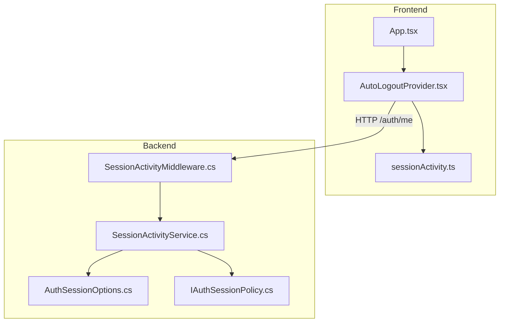
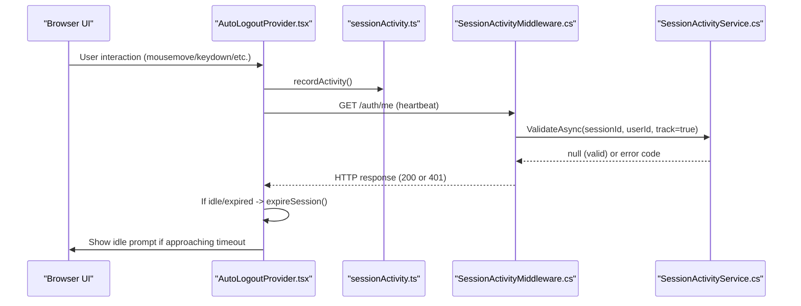
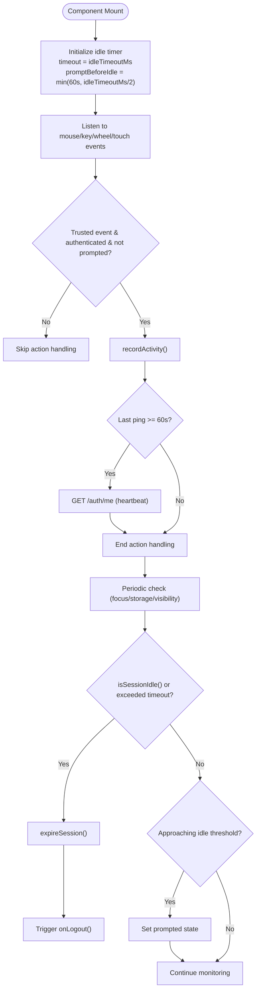
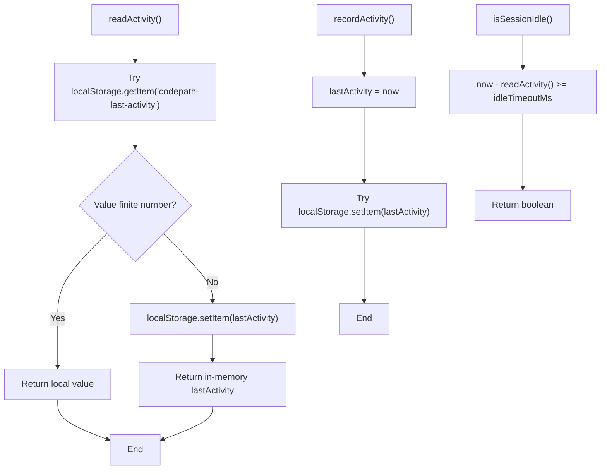
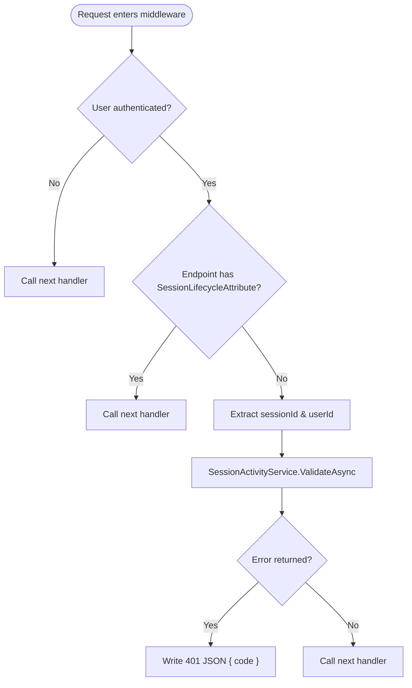
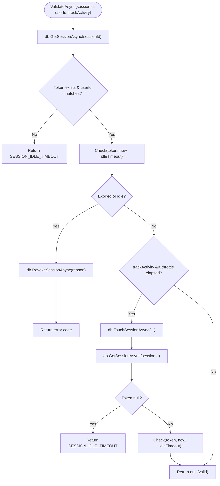
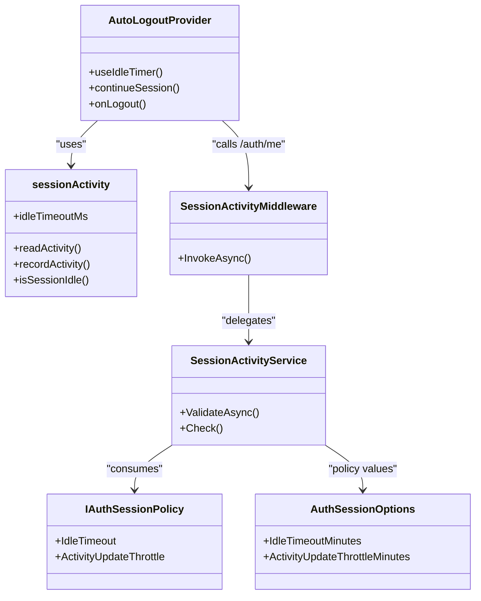

# Session Security & Auto-Logout

<cite>
**Referenced Files in This Document**
- [AutoLogoutProvider.tsx](file://frontend/src/features/auth/components/AutoLogoutProvider.tsx)
- [sessionActivity.ts](file://frontend/src/features/auth/sessionActivity.ts)
- [SessionActivityMiddleware.cs](file://api/src/Api/CodePath.Api/Middleware/SessionActivityMiddleware.cs)
- [SessionActivityService.cs](file://api/src/Application/CodePath.Application/Auth/Services/SessionActivityService.cs)
- [AuthSessionOptions.cs](file://api/src/Infrastructure/CodePath.Infrastructure/Auth/Options/AuthSessionOptions.cs)
- [IAuthSessionPolicy.cs](file://api/src/Application/CodePath.Application/Auth/Abstractions/IAuthSessionPolicy.cs)
- [App.tsx](file://frontend/src/App.tsx)
- [SessionActivityMiddlewareTests.cs](file://api/tests/CodePath.Unit.Tests/Auth/SessionActivityMiddlewareTests.cs)
</cite>

## Table of Contents
1. [Introduction](#introduction)
2. [Project Structure](#project-structure)
3. [Core Components](#core-components)
4. [Architecture Overview](#architecture-overview)
5. [Detailed Component Analysis](#detailed-component-analysis)
6. [Dependency Analysis](#dependency-analysis)
7. [Performance Considerations](#performance-considerations)
8. [Troubleshooting Guide](#troubleshooting-guide)
9. [Conclusion](#conclusion)

## Introduction
This document explains the session security and auto-logout functionality across the frontend and backend. It covers how user activity is tracked, how idle timeouts are enforced, and how automatic logout is implemented. It also documents the AutoLogoutProvider component, session indicator management on the client, and integration with backend session validation via middleware and services.

## Project Structure
The session security feature spans both the frontend (React) and backend (.NET):
- Frontend:
  - AutoLogoutProvider orchestrates idle detection, prompts, and logout.
  - sessionActivity manages last activity timestamps and idle checks.
- Backend:
  - SessionActivityMiddleware validates sessions per request and updates activity when appropriate.
  - SessionActivityService encapsulates idle/expired logic and persistence operations.
  - AuthSessionOptions provides configuration for idle timeout and throttling.

**Diagram sources**
- [AutoLogoutProvider.tsx:1-95](file://frontend/src/features/auth/components/AutoLogoutProvider.tsx#L1-L95)
- [sessionActivity.ts:1-28](file://frontend/src/features/auth/sessionActivity.ts#L1-L28)
- [App.tsx:10-10](file://frontend/src/App.tsx#L10-L10)
- [App.tsx:158-160](file://frontend/src/App.tsx#L158-L160)
- [SessionActivityMiddleware.cs:1-42](file://api/src/Api/CodePath.Api/Middleware/SessionActivityMiddleware.cs#L1-L42)
- [SessionActivityService.cs:1-39](file://api/src/Application/CodePath.Application/Auth/Services/SessionActivityService.cs#L1-L39)
- [AuthSessionOptions.cs:1-15](file://api/src/Infrastructure/CodePath.Infrastructure/Auth/Options/AuthSessionOptions.cs#L1-L15)
- [IAuthSessionPolicy.cs:1-10](file://api/src/Application/CodePath.Application/Auth/Abstractions/IAuthSessionPolicy.cs#L1-L10)

**Section sources**
- [AutoLogoutProvider.tsx:1-95](file://frontend/src/features/auth/components/AutoLogoutProvider.tsx#L1-L95)
- [sessionActivity.ts:1-28](file://frontend/src/features/auth/sessionActivity.ts#L1-L28)
- [SessionActivityMiddleware.cs:1-42](file://api/src/Api/CodePath.Api/Middleware/SessionActivityMiddleware.cs#L1-L42)
- [SessionActivityService.cs:1-39](file://api/src/Application/CodePath.Application/Auth/Services/SessionActivityService.cs#L1-L39)
- [AuthSessionOptions.cs:1-15](file://api/src/Infrastructure/CodePath.Infrastructure/Auth/Options/AuthSessionOptions.cs#L1-L15)
- [IAuthSessionPolicy.cs:1-10](file://api/src/Application/CodePath.Application/Auth/Abstractions/IAuthSessionPolicy.cs#L1-L10)
- [App.tsx:10-10](file://frontend/src/App.tsx#L10-L10)
- [App.tsx:158-160](file://frontend/src/App.tsx#L158-L160)

## Core Components
- AutoLogoutProvider (frontend):
  - Uses an idle timer to detect inactivity and prompt before idle timeout.
  - Sends a lightweight heartbeat by calling /auth/me on user interactions to keep the server aware.
  - Triggers automatic logout when idle or when the session is no longer valid.
- sessionActivity (frontend):
  - Stores and reads last activity timestamp from localStorage with memory fallback.
  - Computes whether the session is idle based on configured timeout.
- SessionActivityMiddleware (backend):
  - Validates active sessions on each authenticated request.
  - Skips tracking for specific endpoints using metadata attributes.
  - Returns 401 with a structured error code when idle or expired.
- SessionActivityService (backend):
  - Encapsulates idle/expired checks and persists activity updates with throttling.
  - Revokes sessions on expiration/idle and re-validates after touch.
- AuthSessionOptions (backend):
  - Provides idle timeout, activity update throttle, token lifetimes, and cookie settings.
- IAuthSessionPolicy (backend):
  - Defines the policy interface consumed by SessionActivityService.

**Section sources**
- [AutoLogoutProvider.tsx:1-95](file://frontend/src/features/auth/components/AutoLogoutProvider.tsx#L1-L95)
- [sessionActivity.ts:1-28](file://frontend/src/features/auth/sessionActivity.ts#L1-L28)
- [SessionActivityMiddleware.cs:1-42](file://api/src/Api/CodePath.Api/Middleware/SessionActivityMiddleware.cs#L1-L42)
- [SessionActivityService.cs:1-39](file://api/src/Application/CodePath.Application/Auth/Services/SessionActivityService.cs#L1-L39)
- [AuthSessionOptions.cs:1-15](file://api/src/Infrastructure/CodePath.Infrastructure/Auth/Options/AuthSessionOptions.cs#L1-L15)
- [IAuthSessionPolicy.cs:1-10](file://api/src/Application/CodePath.Application/Auth/Abstractions/IAuthSessionPolicy.cs#L1-L10)

## Architecture Overview
The system enforces session security through coordinated client-side activity tracking and server-side validation:

**Diagram sources**
- [AutoLogoutProvider.tsx:14-37](file://frontend/src/features/auth/components/AutoLogoutProvider.tsx#L14-L37)
- [sessionActivity.ts:15-27](file://frontend/src/features/auth/sessionActivity.ts#L15-L27)
- [SessionActivityMiddleware.cs:16-39](file://api/src/Api/CodePath.Api/Middleware/SessionActivityMiddleware.cs#L16-L39)
- [SessionActivityService.cs:18-36](file://api/src/Application/CodePath.Application/Auth/Services/SessionActivityService.cs#L18-L36)

## Detailed Component Analysis

### AutoLogoutProvider (Frontend)
Responsibilities:
- Idle detection and prompting before timeout.
- Heartbeat requests to keep server activity updated.
- Automatic logout on idle or invalid session.
- Cross-tab synchronization via storage events.

Key behaviors:
- Idle timer triggers onPrompt/onIdle; onIdle calls expireSession.
- On trusted user actions, records activity and conditionally pings /auth/me every 60 seconds.
- Periodic check compares browser last active time and stored activity to decide idle vs prompt.
- Listens to focus/storage/visibilitychange to stay consistent across tabs.

**Diagram sources**
- [AutoLogoutProvider.tsx:14-37](file://frontend/src/features/auth/components/AutoLogoutProvider.tsx#L14-L37)
- [AutoLogoutProvider.tsx:46-67](file://frontend/src/features/auth/components/AutoLogoutProvider.tsx#L46-L67)
- [AutoLogoutProvider.tsx:69-93](file://frontend/src/features/auth/components/AutoLogoutProvider.tsx#L69-L93)

**Section sources**
- [AutoLogoutProvider.tsx:1-95](file://frontend/src/features/auth/components/AutoLogoutProvider.tsx#L1-L95)

### sessionActivity (Frontend)
Responsibilities:
- Persist last activity timestamp to localStorage with memory fallback.
- Provide helpers to read, record, mark ended, and determine idle state.

Behavior highlights:
- idleTimeoutMs derived from environment variable VITE_IDLE_TIMEOUT_MINUTES (default 60 minutes).
- isSessionIdle compares current time with last activity.

**Diagram sources**
- [sessionActivity.ts:1-28](file://frontend/src/features/auth/sessionActivity.ts#L1-L28)

**Section sources**
- [sessionActivity.ts:1-28](file://frontend/src/features/auth/sessionActivity.ts#L1-L28)

### SessionActivityMiddleware (Backend)
Responsibilities:
- Enforce session validation on authenticated requests.
- Allow skipping activity tracking for specific endpoints.
- Respond with 401 and structured error codes when idle/expired.

Key points:
- Skips validation for unauthenticated users or endpoints marked with SessionLifecycleAttribute.
- Calls SessionActivityService.ValidateAsync with trackActivity flag unless endpoint has SkipActivityTrackingAttribute.
- Writes JSON { code } with status 401 when validation fails.

**Diagram sources**
- [SessionActivityMiddleware.cs:14-40](file://api/src/Api/CodePath.Api/Middleware/SessionActivityMiddleware.cs#L14-L40)

**Section sources**
- [SessionActivityMiddleware.cs:1-42](file://api/src/Api/CodePath.Api/Middleware/SessionActivityMiddleware.cs#L1-L42)

### SessionActivityService (Backend)
Responsibilities:
- Determine if a session is expired or idle.
- Revoke sessions on expiration/idle.
- Throttle activity updates to reduce database writes.

Logic summary:
- Check(token, now, idleTimeout) returns:
  - SESSION_EXPIRED if absolute or access token expired.
  - SESSION_IDLE_TIMEOUT if revoked or idle beyond threshold.
- ValidateAsync:
  - Fetches session and verifies ownership.
  - Revokes and returns error code if invalid.
  - Touches session if activity tracking is enabled and throttle interval elapsed.
  - Re-reads session to prevent resurrection after concurrent logout/rotation.

**Diagram sources**
- [SessionActivityService.cs:11-36](file://api/src/Application/CodePath.Application/Auth/Services/SessionActivityService.cs#L11-L36)

**Section sources**
- [SessionActivityService.cs:1-39](file://api/src/Application/CodePath.Application/Auth/Services/SessionActivityService.cs#L1-L39)

### Configuration and Policy
- AuthSessionOptions:
  - IdleTimeoutMinutes controls server-side idle threshold.
  - ActivityUpdateThrottleMinutes controls how often activity is persisted.
  - CookieSameSite and token lifetime settings influence security posture.
- IAuthSessionPolicy:
  - Exposes TimeSpan values used by SessionActivityService.

Configuration guidance:
- Adjust IdleTimeoutMinutes to align with business requirements.
- Tune ActivityUpdateThrottleMinutes to balance accuracy and DB load.
- Ensure CookieSameSite is set appropriately for your deployment topology.

**Section sources**
- [AuthSessionOptions.cs:1-15](file://api/src/Infrastructure/CodePath.Infrastructure/Auth/Options/AuthSessionOptions.cs#L1-L15)
- [IAuthSessionPolicy.cs:1-10](file://api/src/Application/CodePath.Application/Auth/Abstractions/IAuthSessionPolicy.cs#L1-L10)

## Dependency Analysis
The following diagram shows how components depend on each other:

**Diagram sources**
- [AutoLogoutProvider.tsx:1-95](file://frontend/src/features/auth/components/AutoLogoutProvider.tsx#L1-L95)
- [sessionActivity.ts:1-28](file://frontend/src/features/auth/sessionActivity.ts#L1-L28)
- [SessionActivityMiddleware.cs:1-42](file://api/src/Api/CodePath.Api/Middleware/SessionActivityMiddleware.cs#L1-L42)
- [SessionActivityService.cs:1-39](file://api/src/Application/CodePath.Application/Auth/Services/SessionActivityService.cs#L1-L39)
- [AuthSessionOptions.cs:1-15](file://api/src/Infrastructure/CodePath.Infrastructure/Auth/Options/AuthSessionOptions.cs#L1-L15)
- [IAuthSessionPolicy.cs:1-10](file://api/src/Application/CodePath.Application/Auth/Abstractions/IAuthSessionPolicy.cs#L1-L10)

**Section sources**
- [AutoLogoutProvider.tsx:1-95](file://frontend/src/features/auth/components/AutoLogoutProvider.tsx#L1-L95)
- [sessionActivity.ts:1-28](file://frontend/src/features/auth/sessionActivity.ts#L1-L28)
- [SessionActivityMiddleware.cs:1-42](file://api/src/Api/CodePath.Api/Middleware/SessionActivityMiddleware.cs#L1-L42)
- [SessionActivityService.cs:1-39](file://api/src/Application/CodePath.Application/Auth/Services/SessionActivityService.cs#L1-L39)
- [AuthSessionOptions.cs:1-15](file://api/src/Infrastructure/CodePath.Infrastructure/Auth/Options/AuthSessionOptions.cs#L1-L15)
- [IAuthSessionPolicy.cs:1-10](file://api/src/Application/CodePath.Application/Auth/Abstractions/IAuthSessionPolicy.cs#L1-L10)

## Performance Considerations
- Client-side heartbeat:
  - The provider sends a GET /auth/me only on user interactions and at most once per minute, minimizing unnecessary network traffic while keeping the server aware of activity.
- Server-side activity throttling:
  - Activity updates are throttled by ActivityUpdateThrottleMinutes to reduce database write pressure.
- Idle prompt timing:
  - The prompt appears when approaching idle threshold (half of idle timeout or capped at 60 seconds), balancing user experience and security.
- Storage fallback:
  - Activity timestamp uses localStorage with memory fallback to avoid blocking UI when storage is unavailable.

[No sources needed since this section provides general guidance]

## Troubleshooting Guide
Common issues and resolutions:
- Unexpected 401 responses:
  - The middleware returns 401 with a structured error code when the session is idle or expired. Inspect the response body for the error code to differentiate between idle and expired states.
- Session not updating activity:
  - Verify that endpoints requiring activity tracking do not have SkipActivityTrackingAttribute applied unintentionally.
- Idle prompt not appearing:
  - Confirm that the frontend idle timeout is configured correctly via VITE_IDLE_TIMEOUT_MINUTES and that the provider is mounted around protected routes.
- Cross-tab inconsistencies:
  - The provider listens to storage and visibility events to synchronize state across tabs. Ensure these events are not blocked by browser policies.

Validation references:
- Unit tests assert behavior for skipped tracking, idle timeout, and error response structure.

**Section sources**
- [SessionActivityMiddlewareTests.cs:18-45](file://api/tests/CodePath.Unit.Tests/Auth/SessionActivityMiddlewareTests.cs#L18-L45)
- [SessionActivityMiddleware.cs:25-39](file://api/src/Api/CodePath.Api/Middleware/SessionActivityMiddleware.cs#L25-L39)
- [sessionActivity.ts:3-3](file://frontend/src/features/auth/sessionActivity.ts#L3-L3)

## Conclusion
The session security and auto-logout mechanism combines proactive client-side activity tracking with robust server-side validation. AutoLogoutProvider ensures users are warned before idle timeout and automatically logs out when necessary. The backend middleware and service enforce idle and expiration rules, revoking sessions and returning clear error codes. Configuration options allow tuning idle thresholds and activity update frequency to meet security and performance goals.

[No sources needed since this section summarizes without analyzing specific files]