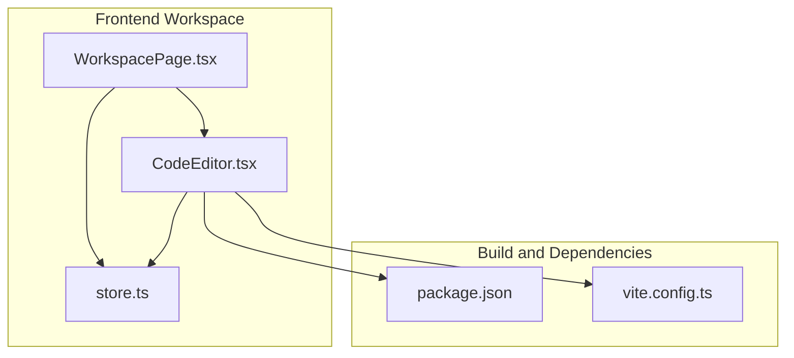
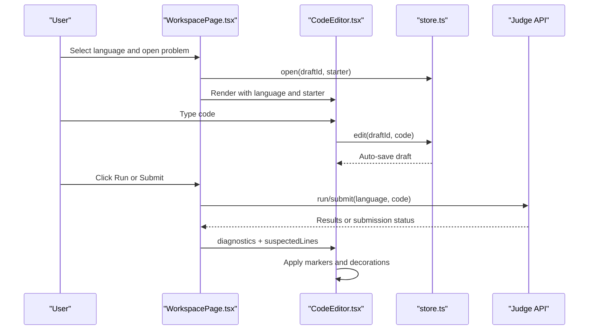
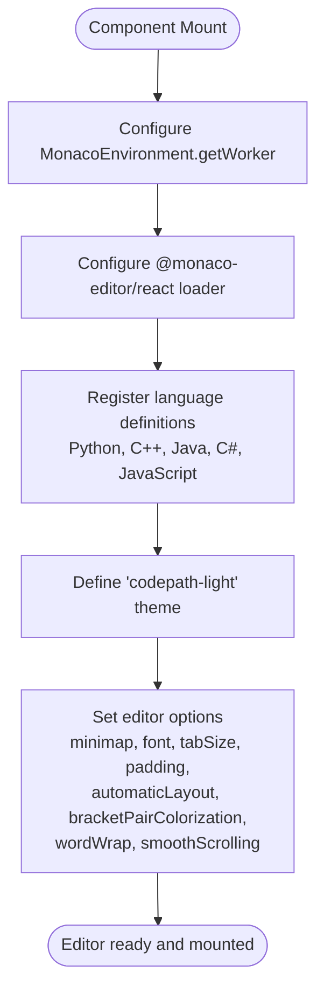
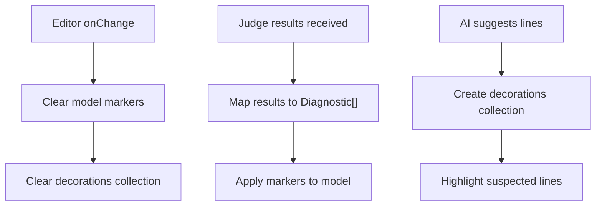
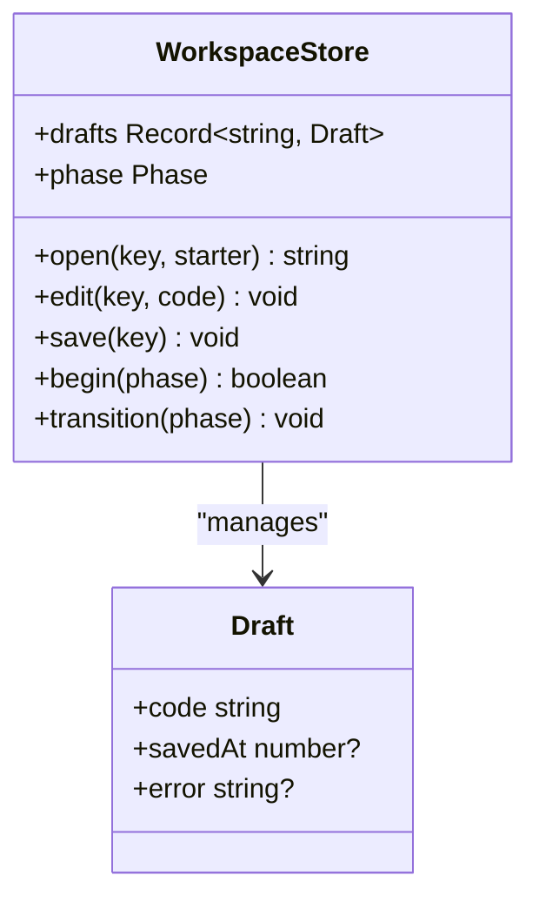
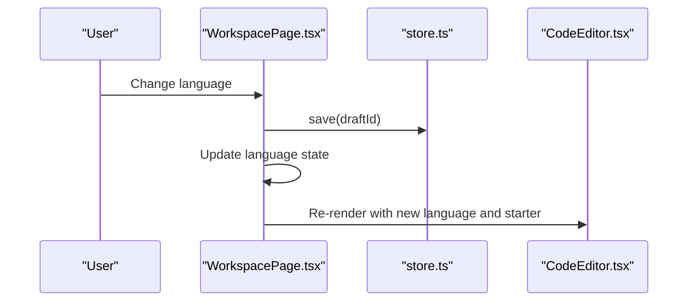
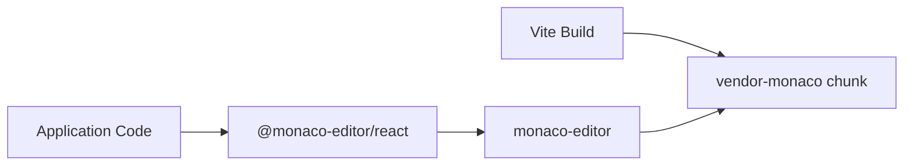

# Code Editor Integration

<cite>
**Referenced Files in This Document**
- [CodeEditor.tsx](file://frontend/src/features/workspace/CodeEditor.tsx)
- [WorkspacePage.tsx](file://frontend/src/features/workspace/WorkspacePage.tsx)
- [store.ts](file://frontend/src/features/workspace/store.ts)
- [package.json](file://frontend/package.json)
- [vite.config.ts](file://frontend/vite.config.ts)
- [workspace.e2e.ts](file://frontend/tests/workspace.e2e.ts)
</cite>

## Table of Contents
1. [Introduction](#introduction)
2. [Project Structure](#project-structure)
3. [Core Components](#core-components)
4. [Architecture Overview](#architecture-overview)
5. [Detailed Component Analysis](#detailed-component-analysis)
6. [Dependency Analysis](#dependency-analysis)
7. [Performance Considerations](#performance-considerations)
8. [Troubleshooting Guide](#troubleshooting-guide)
9. [Conclusion](#conclusion)
10. [Appendices](#appendices)

## Introduction
This document explains how the Monaco Editor is integrated into the workspace feature. It covers editor initialization, language support configuration, syntax highlighting setup, code editing features such as diagnostics and real-time validation, editor state management, file handling through drafts, multi-language switching, and customization options including themes, minimap behavior, and advanced editor settings.

The integration uses:
- `@monaco-editor/react` for React bindings
- `monaco-editor` for core editor capabilities
- A custom theme named `codepath-light`
- Language definitions for Python, C++, Java, C#, and JavaScript
- Zustand for editor state and draft persistence
- Vite for bundling and worker configuration

## Project Structure
The Monaco Editor integration lives under the workspace feature:
- The editor component initializes Monaco, registers languages, defines a theme, and manages diagnostics and decorations.
- The workspace page composes the editor with problem description, AI assistant, test cases, execution results, and keyboard shortcuts.
- A Zustand store manages drafts, save lifecycle, and execution phase transitions.
- Build configuration splits Monaco-related dependencies into a separate vendor chunk.

**Diagram sources**
- [WorkspacePage.tsx:1-170](file://frontend/src/features/workspace/WorkspacePage.tsx#L1-L170)
- [CodeEditor.tsx:1-47](file://frontend/src/features/workspace/CodeEditor.tsx#L1-L47)
- [store.ts:1-48](file://frontend/src/features/workspace/store.ts#L1-L48)
- [package.json:15-45](file://frontend/package.json#L15-L45)
- [vite.config.ts:8-41](file://frontend/vite.config.ts#L8-L41)

**Section sources**
- [WorkspacePage.tsx:1-170](file://frontend/src/features/workspace/WorkspacePage.tsx#L1-L170)
- [CodeEditor.tsx:1-47](file://frontend/src/features/workspace/CodeEditor.tsx#L1-L47)
- [store.ts:1-48](file://frontend/src/features/workspace/store.ts#L1-L48)
- [package.json:15-45](file://frontend/package.json#L15-L45)
- [vite.config.ts:8-41](file://frontend/vite.config.ts#L8-L41)

## Core Components
- CodeEditor component: Initializes Monaco, configures languages, defines a custom theme, sets editor options, applies diagnostics and decorations, and persists changes to the store.
- WorkspacePage component: Provides UI around the editor, handles language switching, runs and submits code, maps judge results to diagnostics, and wires keyboard shortcuts.
- Workspace store: Manages per-draft code, auto-save, storage fallbacks, and execution phases.

Key responsibilities:
- Editor initialization and lifecycle
- Language registration and syntax highlighting
- Theme definition and application
- Diagnostics mapping from judge results
- Decoration-based hint line highlighting
- Draft persistence and recovery
- Multi-language switching and starter templates

**Section sources**
- [CodeEditor.tsx:1-47](file://frontend/src/features/workspace/CodeEditor.tsx#L1-L47)
- [WorkspacePage.tsx:44-170](file://frontend/src/features/workspace/WorkspacePage.tsx#L44-L170)
- [store.ts:1-48](file://frontend/src/features/workspace/store.ts#L1-L48)

## Architecture Overview
The editor is embedded inside the workspace page. The page loads a problem, selects a starter template based on the chosen language, and renders the Monaco editor. When the user runs or submits code, the page sends requests to the judge API, receives results, and maps them to editor diagnostics. The editor also supports hint lines from the AI assistant via decorations.

**Diagram sources**
- [WorkspacePage.tsx:88-128](file://frontend/src/features/workspace/WorkspacePage.tsx#L88-L128)
- [CodeEditor.tsx:23-45](file://frontend/src/features/workspace/CodeEditor.tsx#L23-L45)
- [store.ts:16-37](file://frontend/src/features/workspace/store.ts#L16-L37)

## Detailed Component Analysis

### Editor Initialization and Configuration
- Monaco environment: A global worker is configured so that Monaco’s heavy tasks run off the main thread.
- Loader configuration: The React wrapper loader is configured with the Monaco instance.
- Language support: Python, C++, Java, C#, and JavaScript are registered by importing their language definition modules.
- Custom theme: A theme named `codepath-light` is defined before mount, extending the base VS theme with custom token colors and editor colors.
- Editor options: Minimap disabled, JetBrains Mono font, tab size varies by language, top padding, automatic layout, no scroll beyond last line, bracket pair colorization enabled, word wrap on, smooth scrolling respects reduced motion preference.

**Diagram sources**
- [CodeEditor.tsx:12-13](file://frontend/src/features/workspace/CodeEditor.tsx#L12-L13)
- [CodeEditor.tsx:4-8](file://frontend/src/features/workspace/CodeEditor.tsx#L4-L8)
- [CodeEditor.tsx:39-45](file://frontend/src/features/workspace/CodeEditor.tsx#L39-L45)

**Section sources**
- [CodeEditor.tsx:12-13](file://frontend/src/features/workspace/CodeEditor.tsx#L12-L13)
- [CodeEditor.tsx:4-8](file://frontend/src/features/workspace/CodeEditor.tsx#L4-L8)
- [CodeEditor.tsx:39-45](file://frontend/src/features/workspace/CodeEditor.tsx#L39-L45)

### Syntax Highlighting Setup
Syntax highlighting is provided by registering language definitions for each supported language. The editor’s `language` prop determines which language rules apply. Tab size is customized per language (JavaScript uses two spaces; others use four).

- Supported languages: Python, C++, Java, C#, JavaScript
- Token-level styling is controlled by the custom theme rules
- Bracket pair colorization is enabled for improved readability

**Section sources**
- [CodeEditor.tsx:4-8](file://frontend/src/features/workspace/CodeEditor.tsx#L4-L8)
- [CodeEditor.tsx:39-45](file://frontend/src/features/workspace/CodeEditor.tsx#L39-L45)

### Code Editing Features
- Auto-completion: Provided by Monaco’s built-in language services once the corresponding language definition is loaded. No additional completion provider is implemented in this integration.
- Error diagnostics: Judge results are mapped to Monaco model markers. Each diagnostic includes line number, optional column, message, and error severity. Markers are cleared when the editor content changes.
- Real-time validation: On every change, the editor clears previous markers and decorations. New diagnostics appear after running code and receiving judge results.
- Hint line highlighting: The AI assistant can highlight suspected lines using editor decorations with a custom CSS class.

**Diagram sources**
- [CodeEditor.tsx:30-38](file://frontend/src/features/workspace/CodeEditor.tsx#L30-L38)
- [CodeEditor.tsx:41-45](file://frontend/src/features/workspace/CodeEditor.tsx#L41-L45)
- [WorkspacePage.tsx:126-128](file://frontend/src/features/workspace/WorkspacePage.tsx#L126-L128)

**Section sources**
- [CodeEditor.tsx:30-38](file://frontend/src/features/workspace/CodeEditor.tsx#L30-L38)
- [CodeEditor.tsx:41-45](file://frontend/src/features/workspace/CodeEditor.tsx#L41-L45)
- [WorkspacePage.tsx:126-128](file://frontend/src/features/workspace/WorkspacePage.tsx#L126-L128)

### Editor State Management and File Handling
- Drafts: Each draft is keyed by user, problem, and language. The store opens a draft with a starter template if none exists.
- Auto-save: Edits trigger debounced saves to storage. Page hide and visibility change events also trigger saves.
- Storage fallback: If storage is unavailable, the editor remains usable and an error flag is set on the draft.
- Phase transitions: The store tracks running, submitting, queued, judging, done, and error states to disable actions during busy periods.

**Diagram sources**
- [store.ts:3-47](file://frontend/src/features/workspace/store.ts#L3-L47)

**Section sources**
- [store.ts:16-47](file://frontend/src/features/workspace/store.ts#L16-L47)

### Multi-Language Switching Capabilities
- Language selection: The workspace page provides a dropdown populated from the problem’s starter codes. Changing the language triggers a save of the current draft and resets suspected lines.
- Starter templates: Each language has its own starter template fetched from the problem data.
- Editor re-render: The editor component is keyed by draft ID, ensuring it re-initializes when the language changes.

**Diagram sources**
- [WorkspacePage.tsx:52-54](file://frontend/src/features/workspace/WorkspacePage.tsx#L52-L54)
- [WorkspacePage.tsx:156-157](file://frontend/src/features/workspace/WorkspacePage.tsx#L156-L157)

**Section sources**
- [WorkspacePage.tsx:52-54](file://frontend/src/features/workspace/WorkspacePage.tsx#L52-L54)
- [WorkspacePage.tsx:156-157](file://frontend/src/features/workspace/WorkspacePage.tsx#L156-L157)

### Customizing Editor Themes
- Custom theme: The editor defines a theme named `codepath-light` before mount, inheriting from the base VS theme.
- Token rules: Comments, keywords, and strings receive custom foreground colors and styles.
- Editor colors: Background, line highlight, line numbers, selection background, and cursor foreground are customized.

To add or modify themes:
- Define a new theme in the editor’s `beforeMount` callback.
- Apply the theme via the editor’s `theme` prop.
- Adjust token rules and editor colors to match design requirements.

**Section sources**
- [CodeEditor.tsx:39-40](file://frontend/src/features/workspace/CodeEditor.tsx#L39-L40)

### Adding New Language Support
To add a new language:
- Import the language definition module for the new language.
- Ensure the language name matches the editor’s `language` prop values used in the UI.
- Optionally customize tab size and other options for the new language.

Current supported languages include Python, C++, Java, C#, and JavaScript.

**Section sources**
- [CodeEditor.tsx:4-8](file://frontend/src/features/workspace/CodeEditor.tsx#L4-L8)

### Advanced Editor Features
- Code folding: Enabled by default through Monaco’s language-specific folding providers once language definitions are loaded. No explicit folding configuration is present.
- Minimap customization: The minimap is disabled globally for this editor instance.
- Bracket pair colorization: Enabled to improve readability.
- Word wrap: Enabled for better long-line handling.
- Smooth scrolling: Respects the user’s reduced motion preference.

If you need to enable the minimap or adjust folding behavior, update the editor options accordingly.

**Section sources**
- [CodeEditor.tsx:45](file://frontend/src/features/workspace/CodeEditor.tsx#L45)

## Dependency Analysis
Monaco-related dependencies are split into a dedicated vendor chunk during build to improve caching and load performance.

**Diagram sources**
- [package.json:24-33](file://frontend/package.json#L24-L33)
- [vite.config.ts:26-28](file://frontend/vite.config.ts#L26-L28)

**Section sources**
- [package.json:24-33](file://frontend/package.json#L24-L33)
- [vite.config.ts:26-28](file://frontend/vite.config.ts#L26-L28)

## Performance Considerations
- Worker isolation: Monaco’s editor worker runs in a separate context to avoid blocking the UI thread.
- Vendor chunking: Monaco and related packages are bundled into a separate chunk to reduce initial bundle size and improve cacheability.
- Minimap disabled: Disabling the minimap reduces rendering overhead.
- Reduced motion: Smooth scrolling is disabled when the user prefers reduced motion.
- Debounced saves: Drafts are saved after a short delay to avoid excessive storage writes.

[No sources needed since this section provides general guidance]

## Troubleshooting Guide
Common issues and resolutions:
- Diagnostics not appearing: Ensure judge results are mapped to diagnostics and passed to the editor. Verify that the editor’s model value matches the judged code before applying markers.
- Decorations not updating: Confirm that the decorations collection is cleared on content changes and recreated when hint lines change.
- Storage errors: If storage is unavailable, the store sets an error flag on the draft. The editor remains functional without persistent storage.
- Keyboard shortcuts: Shortcuts for run, submit, and save are handled at the window level. Ensure focus is not inside another input or the Monaco editor when triggering global shortcuts.

Validation examples:
- End-to-end tests verify compile diagnostics, reset confirmation, and reduced motion behavior.

**Section sources**
- [CodeEditor.tsx:30-45](file://frontend/src/features/workspace/CodeEditor.tsx#L30-L45)
- [store.ts:28-37](file://frontend/src/features/workspace/store.ts#L28-L37)
- [WorkspacePage.tsx:114-125](file://frontend/src/features/workspace/WorkspacePage.tsx#L114-L125)
- [workspace.e2e.ts:54-70](file://frontend/tests/workspace.e2e.ts#L54-L70)

## Conclusion
The Monaco Editor integration in the workspace provides a robust, customizable code editing experience. It supports multiple languages, a custom theme, diagnostics from judge results, and hint-based line highlighting. State management ensures drafts persist safely, while build configuration optimizes performance. The architecture cleanly separates editor concerns from workspace orchestration, making it straightforward to extend with new languages, themes, and advanced editor features.

[No sources needed since this section summarizes without analyzing specific files]

## Appendices

### Editor Options Summary
- Minimap: Disabled
- Font family: JetBrains Mono
- Tab size: Two spaces for JavaScript; four spaces for other languages
- Padding: Top padding applied
- Automatic layout: Enabled
- Scroll beyond last line: Disabled
- Bracket pair colorization: Enabled
- Word wrap: Enabled
- Smooth scrolling: Respects reduced motion preference

**Section sources**
- [CodeEditor.tsx:45](file://frontend/src/features/workspace/CodeEditor.tsx#L45)