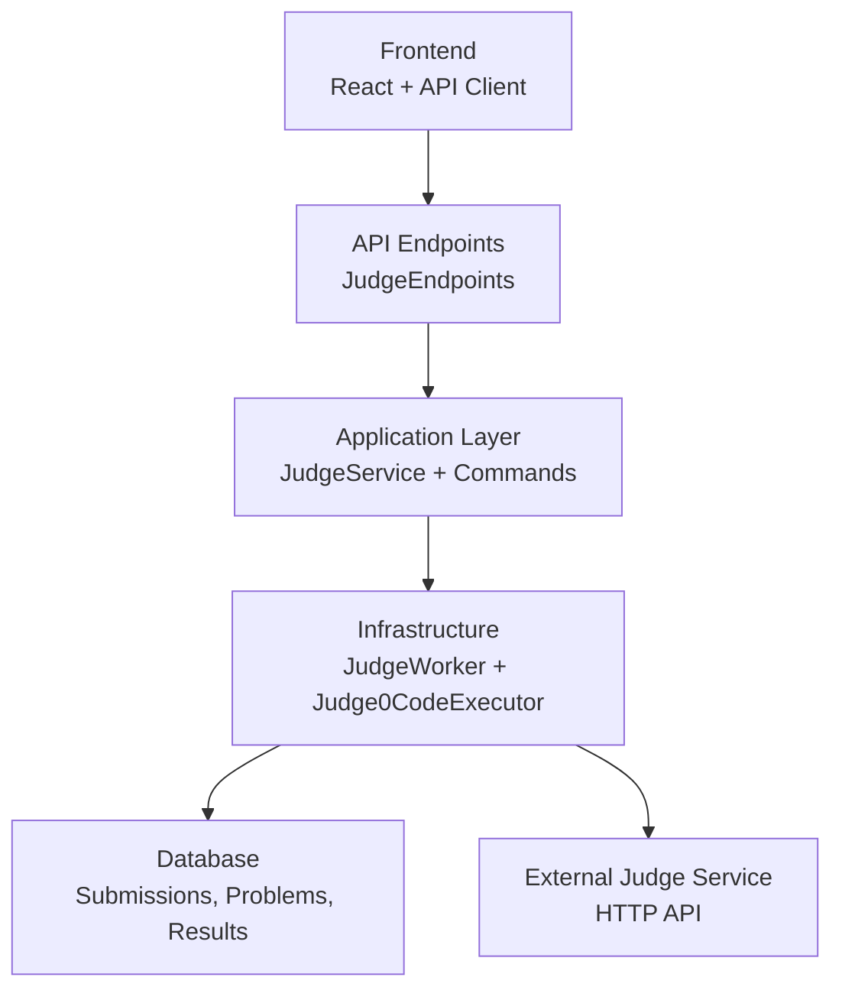
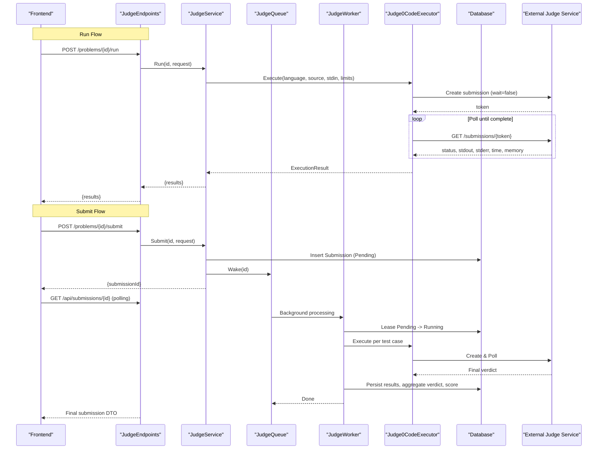
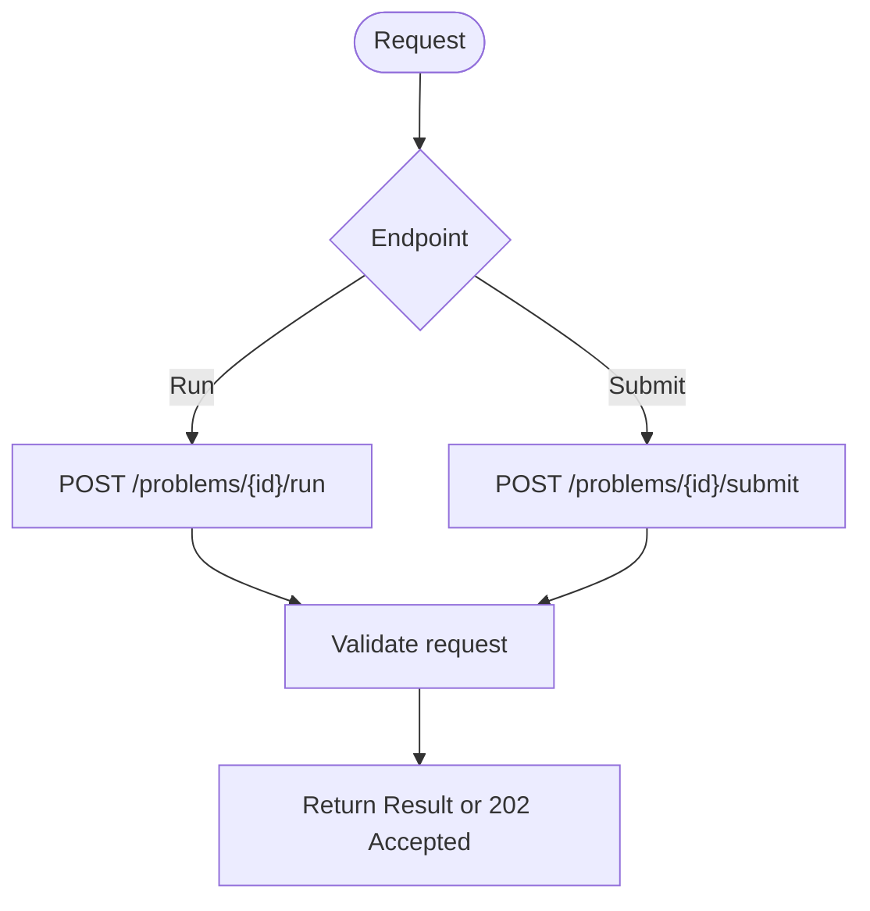
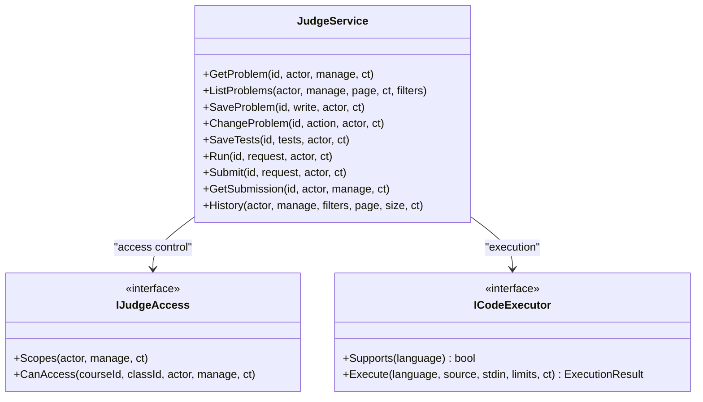
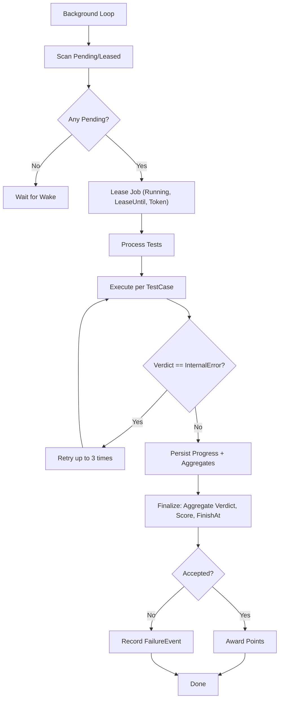
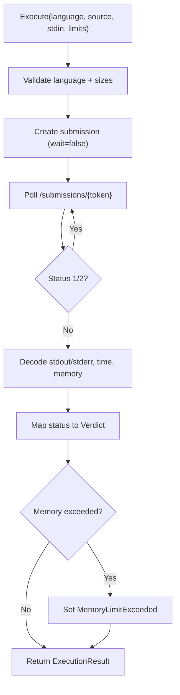
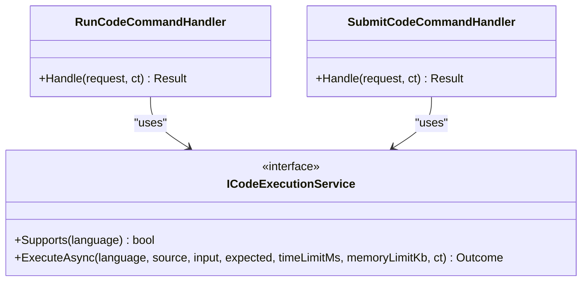
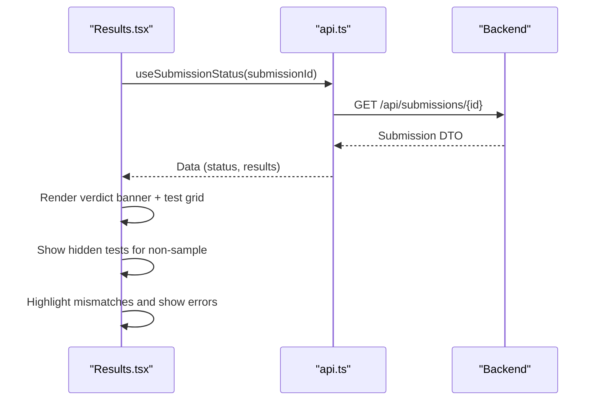
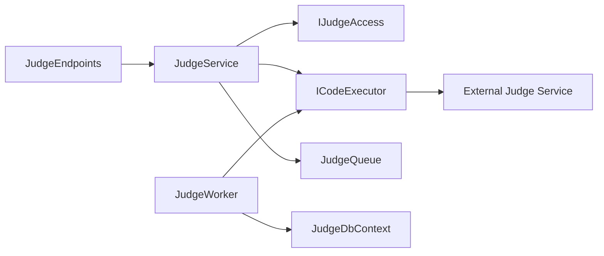

# Code Execution Pipeline

<cite>
**Referenced Files in This Document**
- [JudgeEndpoints.cs](file://api/src/Api/CodePath.Api/Endpoints/JudgeEndpoints.cs)
- [JudgeService.cs](file://api/src/Infrastructure/CodePath.Infrastructure/Judge/JudgeService.cs)
- [JudgeWorker.cs](file://api/src/Infrastructure/CodePath.Infrastructure/Judge/JudgeWorker.cs)
- [Judge0CodeExecutor.cs](file://api/src/Infrastructure/CodePath.Infrastructure/Judge/Judge0CodeExecutor.cs)
- [JudgeContracts.cs](file://api/src/Application/CodePath.Application/Judge/JudgeContracts.cs)
- [RunCodeCommand.cs](file://api/src/Application/CodePath.Application/Exercises/Commands/RunCodeCommand.cs)
- [SubmitCodeCommand.cs](file://api/src/Application/CodePath.Application/Exercises/Commands/SubmitCodeCommand.cs)
- [Submission.cs](file://api/src/Domain/CodePath.Domain/Exercises/Entities/Submission.cs)
- [ExerciseTestCase.cs](file://api/src/Domain/CodePath.Domain/Exercises/Entities/ExerciseTestCase.cs)
- [api.ts](file://frontend/src/features/code-judge/api.ts)
- [Results.tsx](file://frontend/src/features/workspace/Results.tsx)
</cite>

## Table of Contents
1. [Introduction](#introduction)
2. [Project Structure](#project-structure)
3. [Core Components](#core-components)
4. [Architecture Overview](#architecture-overview)
5. [Detailed Component Analysis](#detailed-component-analysis)
6. [Dependency Analysis](#dependency-analysis)
7. [Performance Considerations](#performance-considerations)
8. [Troubleshooting Guide](#troubleshooting-guide)
9. [Conclusion](#conclusion)
10. [Appendices](#appendices)

## Introduction
This document explains the end-to-end code execution pipeline that runs and submits user code to the judge service, from the frontend UI through the API layer to the background worker and external executor. It covers:
- The submission lifecycle (run vs submit), status tracking, and error handling
- Test case execution, output streaming, and result processing
- Integration with the external judge service
- How to extend language support, customize execution parameters, and add analysis features

## Project Structure
The code execution pipeline spans three layers:
- Frontend: React components and API client for problem browsing, running code, submitting code, and polling results
- API Application: MediatR commands for exercise execution and a judge service for problem management and submissions
- Infrastructure: Background worker queue, persistence, and an HTTP-based executor that talks to an external judge service

**Diagram sources**
- [JudgeEndpoints.cs:10-49](file://api/src/Api/CodePath.Api/Endpoints/JudgeEndpoints.cs#L10-L49)
- [JudgeService.cs:10-191](file://api/src/Infrastructure/CodePath.Infrastructure/Judge/JudgeService.cs#L10-L191)
- [JudgeWorker.cs:14-115](file://api/src/Infrastructure/CodePath.Infrastructure/Judge/JudgeWorker.cs#L14-L115)
- [Judge0CodeExecutor.cs:21-87](file://api/src/Infrastructure/CodePath.Infrastructure/Judge/Judge0CodeExecutor.cs#L21-L87)

**Section sources**
- [JudgeEndpoints.cs:10-49](file://api/src/Api/CodePath.Api/Endpoints/JudgeEndpoints.cs#L10-L49)
- [JudgeService.cs:10-191](file://api/src/Infrastructure/CodePath.Infrastructure/Judge/JudgeService.cs#L10-L191)
- [JudgeWorker.cs:14-115](file://api/src/Infrastructure/CodePath.Infrastructure/Judge/JudgeWorker.cs#L14-L115)
- [Judge0CodeExecutor.cs:21-87](file://api/src/Infrastructure/CodePath.Infrastructure/Judge/Judge0CodeExecutor.cs#L21-L87)

## Core Components
- API endpoints expose run and submit operations for problems and submissions
- Application layer validates requests, enforces access rules, and orchestrates execution or queuing
- Infrastructure layer implements:
  - A background worker that processes pending submissions concurrently
  - An executor that calls an external judge service and maps its responses to internal verdicts
- Frontend provides problem browsing, code execution, submission, and result display with polling

Key responsibilities:
- Run: Execute sample tests or custom input immediately and return results
- Submit: Persist a submission, enqueue it for background processing, and allow clients to poll for final results
- Executor: Enforce limits, call external judge service, sanitize outputs, and map statuses
- Worker: Lease jobs, execute test cases, aggregate verdicts, and persist outcomes

**Section sources**
- [JudgeEndpoints.cs:10-49](file://api/src/Api/CodePath.Api/Endpoints/JudgeEndpoints.cs#L10-L49)
- [JudgeService.cs:107-158](file://api/src/Infrastructure/CodePath.Infrastructure/Judge/JudgeService.cs#L107-L158)
- [JudgeWorker.cs:25-115](file://api/src/Infrastructure/CodePath.Infrastructure/Judge/JudgeWorker.cs#L25-L115)
- [Judge0CodeExecutor.cs:21-87](file://api/src/Infrastructure/CodePath.Infrastructure/Judge/Judge0CodeExecutor.cs#L21-L87)

## Architecture Overview
The system supports two flows:
- Immediate run flow for interactive feedback
- Asynchronous submit flow for full test suites and scoring

**Diagram sources**
- [JudgeEndpoints.cs:18-29](file://api/src/Api/CodePath.Api/Endpoints/JudgeEndpoints.cs#L18-L29)
- [JudgeService.cs:107-158](file://api/src/Infrastructure/CodePath.Infrastructure/Judge/JudgeService.cs#L107-L158)
- [JudgeWorker.cs:25-115](file://api/src/Infrastructure/CodePath.Infrastructure/Judge/JudgeWorker.cs#L25-L115)
- [Judge0CodeExecutor.cs:21-87](file://api/src/Infrastructure/CodePath.Infrastructure/Judge/Judge0CodeExecutor.cs#L21-L87)

## Detailed Component Analysis

### API Endpoints: Run and Submit
- Exposes:
  - Problem listing and details
  - Run endpoint for immediate execution of sample tests or custom input
  - Submit endpoint for asynchronous full evaluation
  - Submission retrieval and history
- Rate limiting is applied to run and submit endpoints
- Admin endpoints manage problems and submissions

**Diagram sources**
- [JudgeEndpoints.cs:10-49](file://api/src/Api/CodePath.Api/Endpoints/JudgeEndpoints.cs#L10-L49)

**Section sources**
- [JudgeEndpoints.cs:10-49](file://api/src/Api/CodePath.Api/Endpoints/JudgeEndpoints.cs#L10-L49)

### Application Layer: JudgeService
Responsibilities:
- Validate inputs and enforce access control
- Run: Execute sample tests or custom input via executor; optionally cache run snapshots
- Submit: Persist submission, enqueue for background processing, handle duplicate submission detection
- GetSubmission and History: Retrieve results and paginated history with role-based filtering

Key behaviors:
- Language support check before execution
- Sample-only constraints for run
- Topic context resolution when provided
- Redis caching of run snapshots (non-blocking on failure)

**Diagram sources**
- [JudgeService.cs:10-191](file://api/src/Infrastructure/CodePath.Infrastructure/Judge/JudgeService.cs#L10-L191)
- [JudgeContracts.cs:56-86](file://api/src/Application/CodePath.Application/Judge/JudgeContracts.cs#L56-L86)

**Section sources**
- [JudgeService.cs:10-191](file://api/src/Infrastructure/CodePath.Infrastructure/Judge/JudgeService.cs#L10-L191)
- [JudgeContracts.cs:8-86](file://api/src/Application/CodePath.Application/Judge/JudgeContracts.cs#L8-L86)

### Background Worker: Queue and Processing
- Uses a bounded channel to wake workers when new submissions arrive
- Concurrency controlled by options
- Leases submissions atomically to avoid double-processing
- Executes each test case up to three times on internal errors with backoff
- Persists per-test progress and aggregates final verdict and score
- Emits failure events for first failing test case

**Diagram sources**
- [JudgeWorker.cs:14-115](file://api/src/Infrastructure/CodePath.Infrastructure/Judge/JudgeWorker.cs#L14-L115)

**Section sources**
- [JudgeWorker.cs:14-115](file://api/src/Infrastructure/CodePath.Infrastructure/Judge/JudgeWorker.cs#L14-L115)

### External Executor: Judge0CodeExecutor
- Validates language support and payload sizes
- Creates a non-blocking submission to the external judge service
- Polls until completion, decoding base64 outputs safely
- Maps external statuses to internal verdicts
- Enforces memory/time limits and sanitizes errors
- Protects against oversized responses

**Diagram sources**
- [Judge0CodeExecutor.cs:21-87](file://api/src/Infrastructure/CodePath.Infrastructure/Judge/Judge0CodeExecutor.cs#L21-L87)

**Section sources**
- [Judge0CodeExecutor.cs:21-87](file://api/src/Infrastructure/CodePath.Infrastructure/Judge/Judge0CodeExecutor.cs#L21-L87)

### Exercise Execution Commands (Alternative Path)
For exercises (as opposed to judge problems), the application layer uses MediatR commands:
- RunCodeCommand: Executes sample tests or custom input and returns immediate results
- SubmitCodeCommand: Executes all tests, persists domain entities, and returns persisted results

These commands validate language support, enforce access, truncate outputs, and aggregate metrics.

**Diagram sources**
- [RunCodeCommand.cs:27-76](file://api/src/Application/CodePath.Application/Exercises/Commands/RunCodeCommand.cs#L27-L76)
- [SubmitCodeCommand.cs:28-107](file://api/src/Application/CodePath.Application/Exercises/Commands/SubmitCodeCommand.cs#L28-L107)

**Section sources**
- [RunCodeCommand.cs:10-76](file://api/src/Application/CodePath.Application/Exercises/Commands/RunCodeCommand.cs#L10-L76)
- [SubmitCodeCommand.cs:11-107](file://api/src/Application/CodePath.Application/Exercises/Commands/SubmitCodeCommand.cs#L11-L107)
- [Submission.cs:6-78](file://api/src/Domain/CodePath.Domain/Exercises/Entities/Submission.cs#L6-L78)
- [ExerciseTestCase.cs:6-48](file://api/src/Domain/CodePath.Domain/Exercises/Entities/ExerciseTestCase.cs#L6-L48)

### Frontend: Submission Lifecycle and Result Display
- API client exposes functions for listing problems, running code, submitting code, retrieving submissions, and polling active submissions
- Submission polling uses a refetch interval while the submission is active
- Results component renders verdict banners, hidden test indicators, and detailed per-test cards with diffs and error messages

**Diagram sources**
- [api.ts:14-33](file://frontend/src/features/code-judge/api.ts#L14-L33)
- [Results.tsx:6-31](file://frontend/src/features/workspace/Results.tsx#L6-L31)

**Section sources**
- [api.ts:1-37](file://frontend/src/features/code-judge/api.ts#L1-L37)
- [Results.tsx:1-32](file://frontend/src/features/workspace/Results.tsx#L1-L32)

## Dependency Analysis
- Endpoints depend on IJudgeService for business logic
- JudgeService depends on:
  - IJudgeAccess for authorization scopes
  - ICodeExecutor for execution
  - JudgeQueue for background processing
  - Optional Redis for run snapshot caching
- JudgeWorker depends on:
  - JudgeDbContext for persistence
  - ICodeExecutor for execution
  - MediatR IPublisher for failure notifications
- Judge0CodeExecutor depends on:
  - HttpClient to communicate with external judge service
  - Options for configuration

**Diagram sources**
- [JudgeEndpoints.cs:10-49](file://api/src/Api/CodePath.Api/Endpoints/JudgeEndpoints.cs#L10-L49)
- [JudgeService.cs:10-191](file://api/src/Infrastructure/CodePath.Infrastructure/Judge/JudgeService.cs#L10-L191)
- [JudgeWorker.cs:25-115](file://api/src/Infrastructure/CodePath.Infrastructure/Judge/JudgeWorker.cs#L25-L115)
- [Judge0CodeExecutor.cs:21-87](file://api/src/Infrastructure/CodePath.Infrastructure/Judge/Judge0CodeExecutor.cs#L21-L87)

**Section sources**
- [JudgeEndpoints.cs:10-49](file://api/src/Api/CodePath.Api/Endpoints/JudgeEndpoints.cs#L10-L49)
- [JudgeService.cs:10-191](file://api/src/Infrastructure/CodePath.Infrastructure/Judge/JudgeService.cs#L10-L191)
- [JudgeWorker.cs:25-115](file://api/src/Infrastructure/CodePath.Infrastructure/Judge/JudgeWorker.cs#L25-L115)
- [Judge0CodeExecutor.cs:21-87](file://api/src/Infrastructure/CodePath.Infrastructure/Judge/Judge0CodeExecutor.cs#L21-L87)

## Performance Considerations
- Concurrency:
  - Worker concurrency is configurable; tune based on CPU and judge service capacity
  - Executor polling interval is fixed; consider adjusting if external service latency varies
- Timeouts:
  - Job timeout controls lease duration and stale job cleanup
  - Execution timeout caps external judge polling
- Output Limits:
  - Input/output byte limits enforced at multiple layers to prevent abuse
  - Response size protection prevents large payloads from consuming memory
- Database:
  - Atomic leases and fencing updates reduce race conditions
  - Per-test progress commits enable partial result visibility

[No sources needed since this section provides general guidance]

## Troubleshooting Guide
Common issues and remedies:
- Invalid language or unsupported language:
  - Ensure language is registered in executor options
  - Verify client sends supported language codes
- Duplicate submission detected:
  - Backend rejects concurrent submissions for the same problem/user; wait and retry
- Execution timeouts:
  - Increase execution timeout or optimize code; verify external judge service health
- Output limit exceeded:
  - Reduce stdout/stderr volume; ensure no infinite loops printing
- Wrong answer despite accepted verdict:
  - Check comparison mode settings; ensure expected output matches actual output format
- Missing compile output:
  - Compile errors are only surfaced for sample tests; inspect sample test results

Operational checks:
- Confirm external judge service is reachable and responding
- Inspect worker logs for failed processing and lease expirations
- Validate database connectivity and transaction behavior

**Section sources**
- [Judge0CodeExecutor.cs:21-87](file://api/src/Infrastructure/CodePath.Infrastructure/Judge/Judge0CodeExecutor.cs#L21-L87)
- [JudgeService.cs:107-158](file://api/src/Infrastructure/CodePath.Infrastructure/Judge/JudgeService.cs#L107-L158)
- [JudgeWorker.cs:25-115](file://api/src/Infrastructure/CodePath.Infrastructure/Judge/JudgeWorker.cs#L25-L115)

## Conclusion
The pipeline separates immediate feedback (run) from durable evaluation (submit). The API layer validates and routes requests, the application layer enforces rules and orchestrates execution, and the infrastructure layer handles background processing and integration with the external judge service. The frontend polls for status and renders results, including hidden tests and diffs. Extensibility points include adding languages, tuning execution parameters, and integrating additional analysis features.

[No sources needed since this section summarizes without analyzing specific files]

## Appendices

### Extending Language Support
- Register new language mapping in executor options
- Ensure frontend includes the language identifier
- Optionally add starter templates in problem definitions

**Section sources**
- [Judge0CodeExecutor.cs:11-20](file://api/src/Infrastructure/CodePath.Infrastructure/Judge/Judge0CodeExecutor.cs#L11-L20)
- [JudgeService.cs:51-78](file://api/src/Infrastructure/CodePath.Infrastructure/Judge/JudgeService.cs#L51-L78)

### Customizing Execution Parameters
- Adjust worker concurrency and timeouts via options
- Tune external execution timeout and resource limits
- Modify input/output byte limits and response size protections

**Section sources**
- [Judge0CodeExecutor.cs:11-20](file://api/src/Infrastructure/CodePath.Infrastructure/Judge/Judge0CodeExecutor.cs#L11-L20)
- [JudgeWorker.cs:25-39](file://api/src/Infrastructure/CodePath.Infrastructure/Judge/JudgeWorker.cs#L25-L39)

### Implementing Additional Code Analysis Features
- Hook into run flow to capture snapshots (already cached in Redis when available)
- Integrate static analysis or linting before execution
- Emit additional telemetry or audit events during processing

**Section sources**
- [JudgeService.cs:126-136](file://api/src/Infrastructure/CodePath.Infrastructure/Judge/JudgeService.cs#L126-L136)
- [JudgeWorker.cs:41-47](file://api/src/Infrastructure/CodePath.Infrastructure/Judge/JudgeWorker.cs#L41-L47)