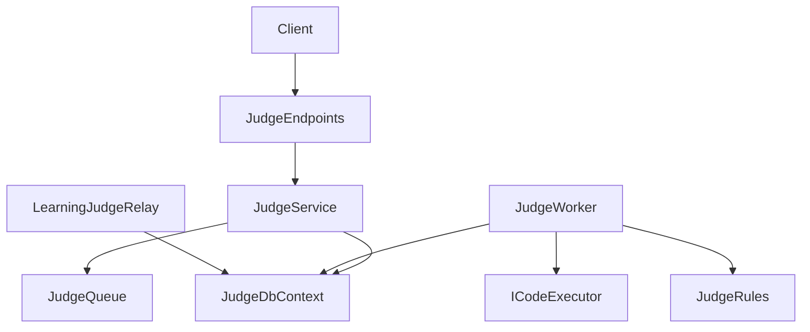
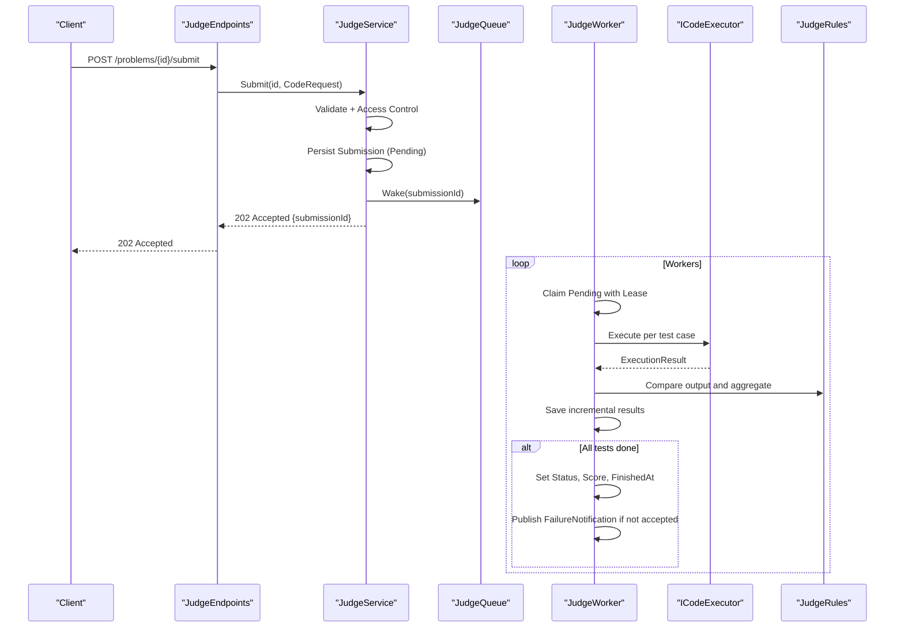
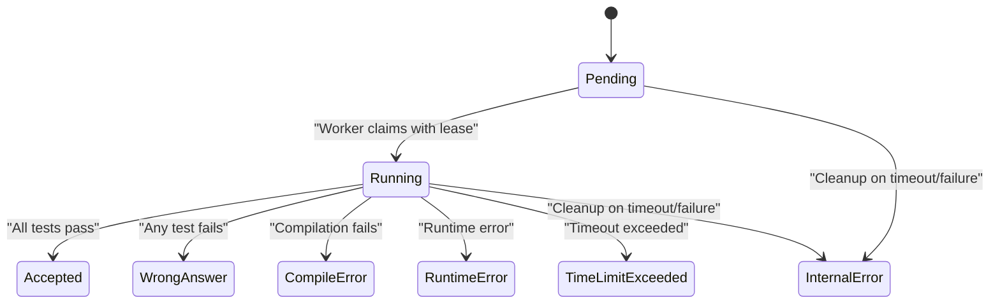
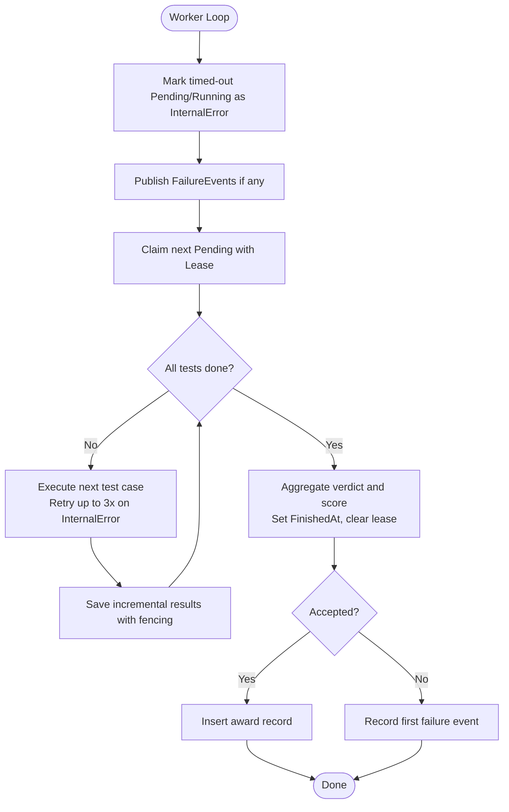
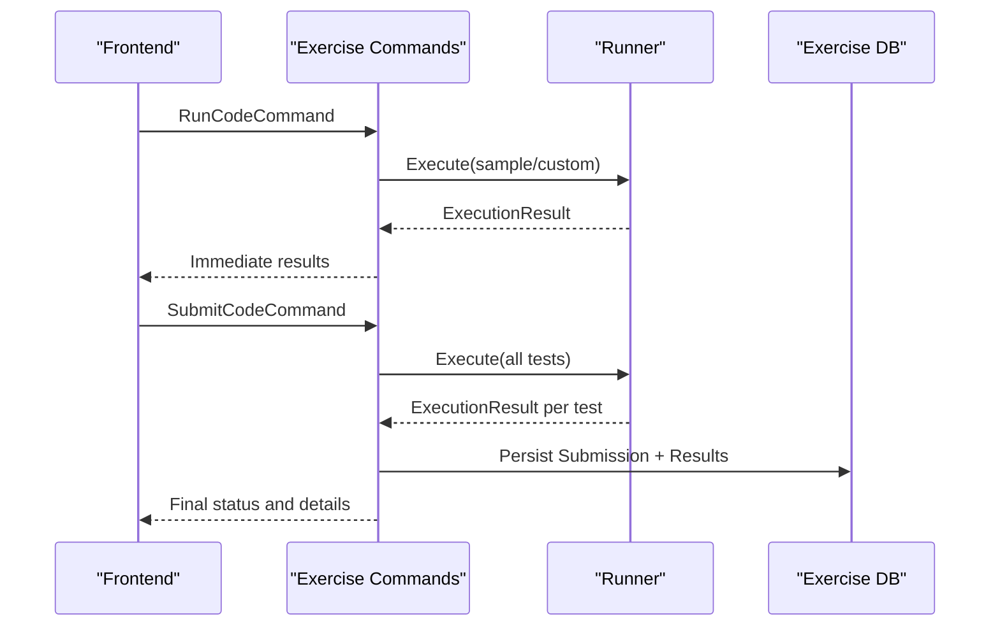
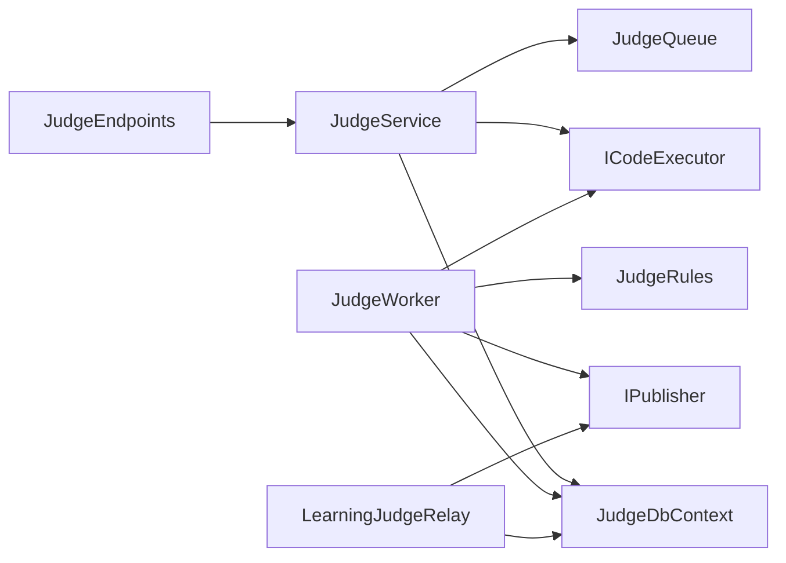

# Submission Management

<cite>
**Referenced Files in This Document**
- [JudgeEndpoints.cs](file://api/src/Api/CodePath.Api/Endpoints/JudgeEndpoints.cs)
- [JudgeService.cs](file://api/src/Infrastructure/CodePath.Infrastructure/Judge/JudgeService.cs)
- [JudgeWorker.cs](file://api/src/Infrastructure/CodePath.Infrastructure/Judge/JudgeWorker.cs)
- [Submission.cs](file://api/src/Domain/CodePath.Domain/Judge/Submission.cs)
- [JudgeRules.cs](file://api/src/Application/CodePath.Application/Judge/JudgeRules.cs)
- [JudgeContracts.cs](file://api/src/Application/CodePath.Application/Judge/JudgeContracts.cs)
- [LearningRegistration.cs](file://api/src/Infrastructure/CodePath.Infrastructure/Learning/LearningRegistration.cs)
- [RunCodeCommand.cs](file://api/src/Application/CodePath.Application/Exercises/Commands/RunCodeCommand.cs)
- [SubmitCodeCommand.cs](file://api/src/Application/CodePath.Application/Exercises/Commands/SubmitCodeCommand.cs)
- [SubmissionStatus.cs](file://api/src/domain/CodePath.Domain/Exercises/Enums/SubmissionStatus.cs)
</cite>

## Table of Contents
1. [Introduction](#introduction)
2. [Project Structure](#project-structure)
3. [Core Components](#core-components)
4. [Architecture Overview](#architecture-overview)
5. [Detailed Component Analysis](#detailed-component-analysis)
6. [Dependency Analysis](#dependency-analysis)
7. [Performance Considerations](#performance-considerations)
8. [Troubleshooting Guide](#troubleshooting-guide)
9. [Conclusion](#conclusion)

## Introduction
This document explains the submission management system for code submissions and their processing through the judge service. It covers how submissions are created, tracked, executed, and finalized; the state machine and transitions; error handling and recovery; polling and real-time updates; and practical examples for retry logic and customization.

The system has two related flows:
- Online Judge flow (asynchronous, durable): Submissions are queued, processed by background workers, and results are persisted incrementally. Clients poll or subscribe to status changes.
- Exercise Run/Submit flow (synchronous): For exercises, code is executed immediately and results are returned directly.

## Project Structure
The submission management spans API endpoints, application services, domain models, and infrastructure workers:
- API endpoints expose problem listing, run, submit, and submission retrieval.
- Application layer validates requests, enforces rules, and coordinates persistence and execution.
- Domain defines entities and enums for submissions and verdicts.
- Infrastructure implements the worker queue, executor integration, and database interactions.

**Diagram sources**
- [JudgeEndpoints.cs:10-49](file://api/src/Api/CodePath.Api/Endpoints/JudgeEndpoints.cs#L10-L49)
- [JudgeService.cs:10-191](file://api/src/Infrastructure/CodePath.Infrastructure/Judge/JudgeService.cs#L10-L191)
- [JudgeWorker.cs:14-115](file://api/src/Infrastructure/CodePath.Infrastructure/Judge/JudgeWorker.cs#L14-L115)
- [LearningRegistration.cs:44-64](file://api/src/Infrastructure/CodePath.Infrastructure/Learning/LearningRegistration.cs#L44-L64)

**Section sources**
- [JudgeEndpoints.cs:10-49](file://api/src/Api/CodePath.Api/Endpoints/JudgeEndpoints.cs#L10-L49)
- [JudgeService.cs:10-191](file://api/src/Infrastructure/CodePath.Infrastructure/Judge/JudgeService.cs#L10-L191)
- [JudgeWorker.cs:14-115](file://api/src/Infrastructure/CodePath.Infrastructure/Judge/JudgeWorker.cs#L14-L115)

## Core Components
- JudgeEndpoints: HTTP routes for problems, run, submit, and submissions.
- JudgeService: Validates inputs, persists submissions, and triggers background processing.
- JudgeWorker: Background processor that claims, executes, and finalizes submissions with retries and leases.
- Submission (domain): Persistent model for a submission and its test results.
- JudgeRules: Aggregation, scoring, comparison, and DTO mapping.
- JudgeContracts: Request/response contracts, rate limits, and executor interface.
- LearningJudgeRelay: Bridges finished submissions to learning features via events.

Key responsibilities:
- Input validation and access control.
- Atomic persistence and idempotency.
- Durable job processing with lease-based fencing.
- Incremental result updates and final aggregation.
- Error event publishing and optional learning integration.

**Section sources**
- [JudgeEndpoints.cs:10-49](file://api/src/Api/CodePath.Api/Endpoints/JudgeEndpoints.cs#L10-L49)
- [JudgeService.cs:10-191](file://api/src/Infrastructure/CodePath.Infrastructure/Judge/JudgeService.cs#L10-L191)
- [JudgeWorker.cs:14-115](file://api/src/Infrastructure/CodePath.Infrastructure/Judge/JudgeWorker.cs#L14-L115)
- [Submission.cs:3-58](file://api/src/Domain/CodePath.Domain/Judge/Submission.cs#L3-L58)
- [JudgeRules.cs:5-37](file://api/src/Application/CodePath.Application/Judge/JudgeRules.cs#L5-L37)
- [JudgeContracts.cs:56-86](file://api/src/Application/CodePath.Application/Judge/JudgeContracts.cs#L56-L86)
- [LearningRegistration.cs:44-64](file://api/src/Infrastructure/CodePath.Infrastructure/Learning/LearningRegistration.cs#L44-L64)

## Architecture Overview
The online judge uses an asynchronous pipeline:
- Client submits code via POST /problems/{id}/submit.
- JudgeService validates and persists a submission, then wakes the queue.
- JudgeWorker polls pending submissions, claims them with a lease, executes tests, and writes incremental results.
- Final verdict, score, and timestamps are set when all tests complete.
- Failure events are published for downstream consumers.

**Diagram sources**
- [JudgeEndpoints.cs:20-23](file://api/src/Api/CodePath.Api/Endpoints/JudgeEndpoints.cs#L20-L23)
- [JudgeService.cs:138-158](file://api/src/Infrastructure/CodePath.Infrastructure/Judge/JudgeService.cs#L138-L158)
- [JudgeWorker.cs:29-113](file://api/src/Infrastructure/CodePath.Infrastructure/Judge/JudgeWorker.cs#L29-L113)
- [JudgeRules.cs:20-36](file://api/src/Application/CodePath.Application/Judge/JudgeRules.cs#L20-L36)

## Detailed Component Analysis

### Submission Lifecycle and State Machine
States and transitions:
- Pending: Created by submission endpoint; waiting for worker.
- Running: Claimed by worker with a lease token and expiry.
- InternalError: Used for failed cleanup or unrecoverable conditions.
- Accepted/WrongAnswer/CompileError/RuntimeError/TimeLimitExceeded: Final states after aggregation.

Transitions:
- Pending → Running: Worker claims with lease update.
- Running → Final: After all test cases processed and aggregated.
- Pending/Running → InternalError: On timeout or failure cleanup.

**Diagram sources**
- [Submission.cs:14-26](file://api/src/Domain/CodePath.Domain/Judge/Submission.cs#L14-L26)
- [JudgeWorker.cs:37-39](file://api/src/Infrastructure/CodePath.Infrastructure/Judge/JudgeWorker.cs#L37-L39)
- [JudgeWorker.cs:96-111](file://api/src/Infrastructure/CodePath.Infrastructure/Judge/JudgeWorker.cs#L96-L111)

**Section sources**
- [Submission.cs:3-58](file://api/src/Domain/CodePath.Domain/Judge/Submission.cs#L3-L58)
- [JudgeWorker.cs:29-113](file://api/src/Infrastructure/CodePath.Infrastructure/Judge/JudgeWorker.cs#L29-L113)

### Submission Creation and Tracking
- Endpoint: POST /problems/{id}/submit returns 202 Accepted with submissionId.
- Service validates request, ensures language support, checks problem access, and persists a new submission with snapshot of problem definition.
- Duplicate submission protection prevents concurrent submissions for the same context.
- The queue is woken to process the new submission.

Polling:
- GET /api/submissions/{id} retrieves current status and results.
- History endpoints list submissions with filters.

Real-time updates:
- Failure events are published for first failing test case; subscribers can deduplicate by submissionId.
- Optional learning integration publishes SubmissionJudgedEvent after completion.

**Section sources**
- [JudgeEndpoints.cs:20-29](file://api/src/Api/CodePath.Api/Endpoints/JudgeEndpoints.cs#L20-L29)
- [JudgeService.cs:138-165](file://api/src/Infrastructure/CodePath.Infrastructure/Judge/JudgeService.cs#L138-L165)
- [JudgeWorker.cs:40-47](file://api/src/Infrastructure/CodePath.Infrastructure/Judge/JudgeWorker.cs#L40-L47)
- [LearningRegistration.cs:44-64](file://api/src/Infrastructure/CodePath.Infrastructure/Learning/LearningRegistration.cs#L44-L64)

### Processing Logic and Error Recovery
Processing:
- Worker loops claim pending submissions with a lease token and deadline.
- Each test case is executed up to three times with backoff on internal errors.
- Results are saved incrementally with fencing to prevent late writes from expired leases.
- Final aggregation computes overall verdict and score based on weights.

Error recovery:
- Leases expire automatically; timed-out submissions are marked InternalError.
- Failure events are persisted and published once.
- Duplicate key errors during submission creation return a specific error indicating an existing running submission.

**Diagram sources**
- [JudgeWorker.cs:29-113](file://api/src/Infrastructure/CodePath.Infrastructure/Judge/JudgeWorker.cs#L29-L113)
- [JudgeRules.cs:20-36](file://api/src/Application/CodePath.Application/Judge/JudgeRules.cs#L20-L36)

**Section sources**
- [JudgeWorker.cs:29-113](file://api/src/Infrastructure/CodePath.Infrastructure/Judge/JudgeWorker.cs#L29-L113)
- [JudgeRules.cs:20-36](file://api/src/Application/CodePath.Application/Judge/JudgeRules.cs#L20-L36)

### Polling Mechanism and Real-Time Updates
- Polling: Clients call GET /api/submissions/{id} repeatedly until status is final.
- Real-time: Consumers listen to FailureNotification events for early failure signals.
- Learning integration: SubmissionJudgedEvent is published after completion for topics linked to learning content.

Best practices:
- Use exponential backoff for polling.
- Deduplicate events by submissionId.
- Stop polling once status is final.

**Section sources**
- [JudgeEndpoints.cs:27-29](file://api/src/Api/CodePath.Api/Endpoints/JudgeEndpoints.cs#L27-L29)
- [JudgeWorker.cs:40-47](file://api/src/Infrastructure/CodePath.Infrastructure/Judge/JudgeWorker.cs#L40-L47)
- [LearningRegistration.cs:44-64](file://api/src/Infrastructure/CodePath.Infrastructure/Learning/LearningRegistration.cs#L44-L64)

### Handling Failures and Implementing Retry Logic
- Client-side retry: If submission creation returns SUBMISSION_IN_PROGRESS, wait and retry later or use the returned submissionId to poll.
- Worker-side retry: Test executions retry up to three times on InternalError with increasing delays.
- Idempotency: Fencing via lease token prevents duplicate writes from stale workers.

Example patterns:
- Exponential backoff for polling submission status.
- Circuit breaker for repeated failures in external executor calls.
- Dead-letter handling for persistent InternalError states.

**Section sources**
- [JudgeService.cs:153-157](file://api/src/Infrastructure/CodePath.Infrastructure/Judge/JudgeService.cs#L153-L157)
- [JudgeWorker.cs:74-80](file://api/src/Infrastructure/CodePath.Infrastructure/Judge/JudgeWorker.cs#L74-L80)
- [JudgeWorker.cs:82-97](file://api/src/Infrastructure/CodePath.Infrastructure/Judge/JudgeWorker.cs#L82-L97)

### Customizing Submission Behavior
- Language support: Extend ICodeExecutor to add languages; validators enforce supported languages.
- Comparison modes: Configure token vs whitespace-insensitive comparison via problem settings.
- Scoring: Adjust test weights and points to influence final score.
- Rate limiting: Apply per-endpoint rate limits for run and submit operations.
- Learning integration: Link submissions to topics to trigger learning workflows.

**Section sources**
- [JudgeContracts.cs:56-60](file://api/src/Application/CodePath.Application/Judge/JudgeContracts.cs#L56-L60)
- [JudgeRules.cs:12-19](file://api/src/Application/CodePath.Application/Judge/JudgeRules.cs#L12-L19)
- [JudgeRules.cs:25-36](file://api/src/Application/CodePath.Application/Judge/JudgeRules.cs#L25-L36)
- [JudgeEndpoints.cs:18-23](file://api/src/Api/CodePath.Api/Endpoints/JudgeEndpoints.cs#L18-L23)
- [LearningRegistration.cs:44-64](file://api/src/Infrastructure/CodePath.Infrastructure/Learning/LearningRegistration.cs#L44-L64)

### Exercise Run/Submit Flow (Synchronous)
For exercises, the system provides synchronous execution:
- Run: Executes sample tests or custom input and returns immediate results without persisting a long-running submission.
- Submit: Executes all test cases synchronously, persists the submission, and returns final results.

State model:
- Uses SubmissionStatus enum with values like Pending, Accepted, WrongAnswer, CompilationError, RuntimeError, TimeLimitExceeded, SystemError.

**Diagram sources**
- [RunCodeCommand.cs:27-76](file://api/src/Application/CodePath.Application/Exercises/Commands/RunCodeCommand.cs#L27-L76)
- [SubmitCodeCommand.cs:28-107](file://api/src/Application/CodePath.Application/Exercises/Commands/SubmitCodeCommand.cs#L28-L107)
- [SubmissionStatus.cs:3-12](file://api/src/domain/CodePath.Domain/Exercises/Enums/SubmissionStatus.cs#L3-L12)

**Section sources**
- [RunCodeCommand.cs:27-76](file://api/src/Application/CodePath.Application/Exercises/Commands/RunCodeCommand.cs#L27-L76)
- [SubmitCodeCommand.cs:28-107](file://api/src/Application/CodePath.Application/Exercises/Commands/SubmitCodeCommand.cs#L28-L107)
- [SubmissionStatus.cs:3-12](file://api/src/domain/CodePath.Domain/Exercises/Enums/SubmissionStatus.cs#L3-L12)

## Dependency Analysis
- JudgeEndpoints depends on IJudgeService and IJudgeAccess for authorization and scoping.
- JudgeService depends on JudgeDbContext, ICodeExecutor, JudgeQueue, and optionally Redis and Learning service.
- JudgeWorker depends on JudgeDbContext, ICodeExecutor, JudgeRules, and MediatR IPublisher.
- LearningJudgeRelay depends on JudgeDbContext and IPublisher to bridge to learning features.

**Diagram sources**
- [JudgeEndpoints.cs:10-49](file://api/src/Api/CodePath.Api/Endpoints/JudgeEndpoints.cs#L10-L49)
- [JudgeService.cs:10-191](file://api/src/Infrastructure/CodePath.Infrastructure/Judge/JudgeService.cs#L10-L191)
- [JudgeWorker.cs:14-115](file://api/src/Infrastructure/CodePath.Infrastructure/Judge/JudgeWorker.cs#L14-L115)
- [LearningRegistration.cs:44-64](file://api/src/Infrastructure/CodePath.Infrastructure/Learning/LearningRegistration.cs#L44-L64)

**Section sources**
- [JudgeEndpoints.cs:10-49](file://api/src/Api/CodePath.Api/Endpoints/JudgeEndpoints.cs#L10-L49)
- [JudgeService.cs:10-191](file://api/src/Infrastructure/CodePath.Infrastructure/Judge/JudgeService.cs#L10-L191)
- [JudgeWorker.cs:14-115](file://api/src/Infrastructure/CodePath.Infrastructure/Judge/JudgeWorker.cs#L14-L115)
- [LearningRegistration.cs:44-64](file://api/src/Infrastructure/CodePath.Infrastructure/Learning/LearningRegistration.cs#L44-L64)

## Performance Considerations
- Concurrency: Multiple workers process submissions concurrently; tune concurrency based on executor capacity.
- Bounded channel: Queue drops writes under heavy load; consider scaling workers or batching.
- Incremental saves: Saves per test case to provide progress; balance between latency and throughput.
- Output clipping: Limits stored output size to reduce storage and network overhead.
- Rate limiting: Protects endpoints from abuse; adjust limits per environment.

[No sources needed since this section provides general guidance]

## Troubleshooting Guide
Common issues and resolutions:
- Submission already running: Occurs when duplicate submission attempts collide; wait and poll using the returned submissionId.
- Timed-out jobs: Marked InternalError; verify executor health and increase job timeout if necessary.
- Late writes blocked: Fencing prevents stale workers from overwriting results; ensure proper lease configuration.
- Failure notifications not received: Ensure subscribers deduplicate by submissionId and handle transient publish failures.
- Learning integration not triggered: Confirm TopicId linkage and that LearningJudgeRelay is enabled.

Operational tips:
- Monitor worker logs for exceptions and lease expirations.
- Track submission counts by status to detect bottlenecks.
- Validate executor connectivity and resource limits.

**Section sources**
- [JudgeService.cs:153-157](file://api/src/Infrastructure/CodePath.Infrastructure/Judge/JudgeService.cs#L153-L157)
- [JudgeWorker.cs:37-39](file://api/src/Infrastructure/CodePath.Infrastructure/Judge/JudgeWorker.cs#L37-L39)
- [JudgeWorker.cs:82-97](file://api/src/Infrastructure/CodePath.Infrastructure/Judge/JudgeWorker.cs#L82-L97)
- [JudgeWorker.cs:40-47](file://api/src/Infrastructure/CodePath.Infrastructure/Judge/JudgeWorker.cs#L40-L47)
- [LearningRegistration.cs:44-64](file://api/src/Infrastructure/CodePath.Infrastructure/Learning/LearningRegistration.cs#L44-L64)

## Conclusion
The submission management system provides robust, scalable, and observable code execution with durable processing, incremental progress, and strong error recovery. Clients should poll for final status and leverage failure events for responsiveness. Extensibility points allow adding languages, adjusting scoring, and integrating with learning workflows. Proper tuning of concurrency, timeouts, and rate limits ensures reliable operation under load.

[No sources needed since this section summarizes without analyzing specific files]