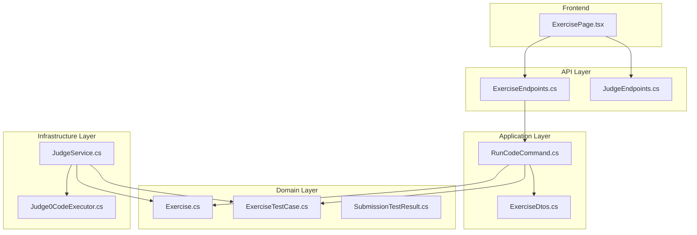
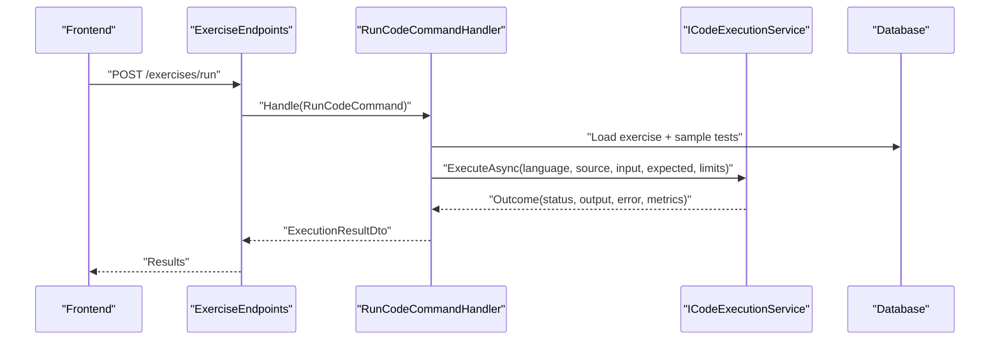
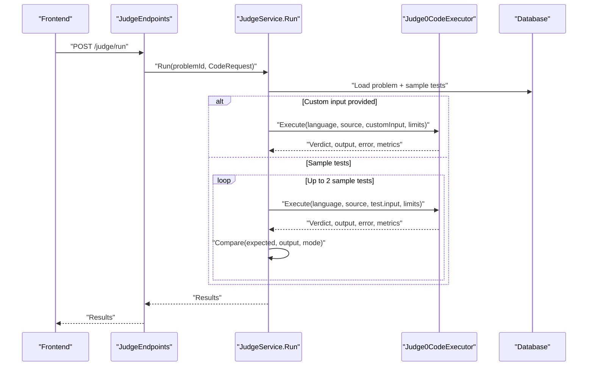
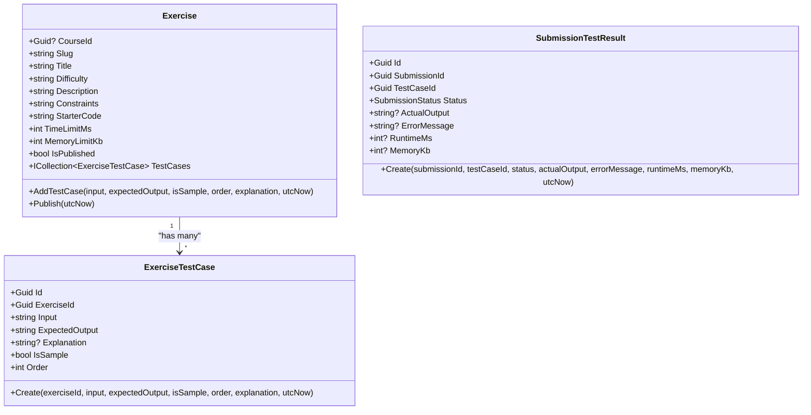
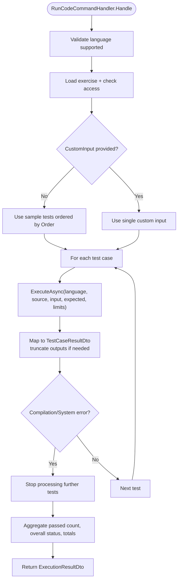
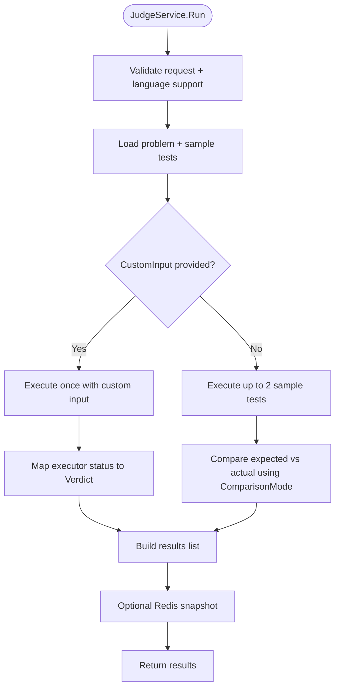
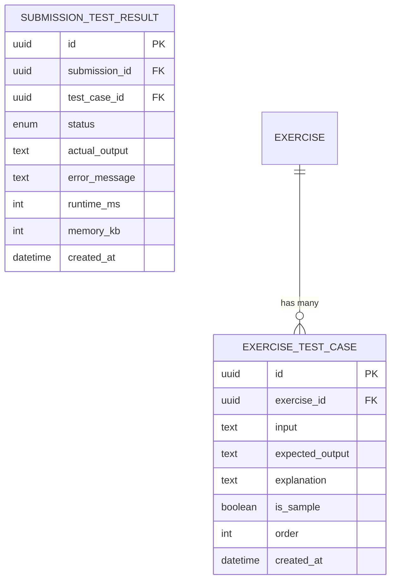
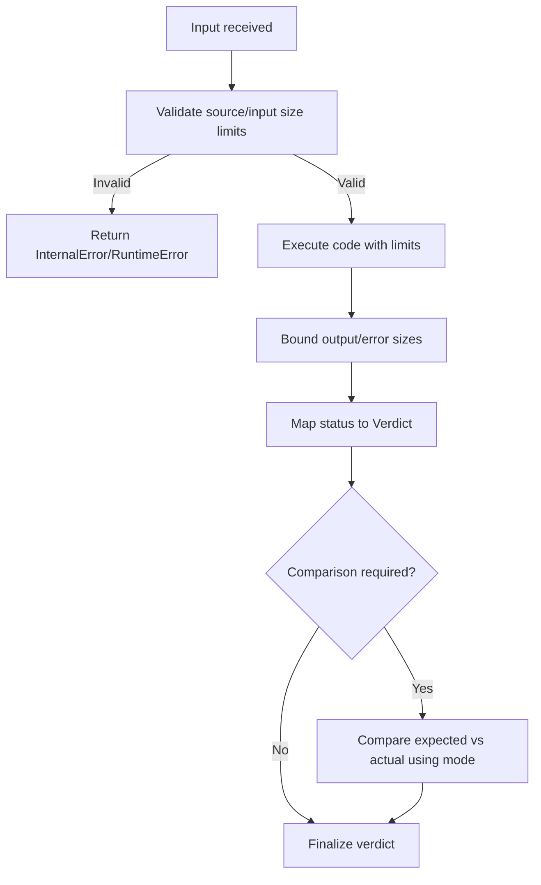
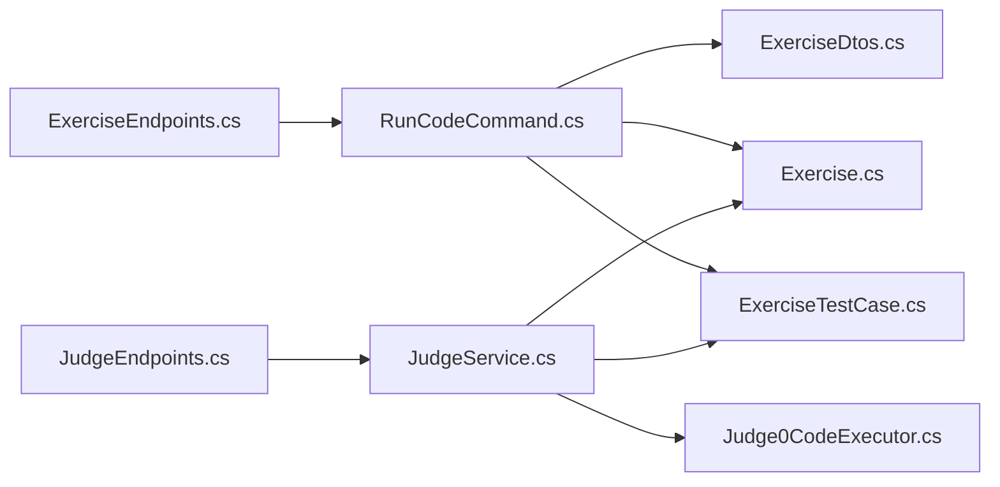

# Test Case Execution

<cite>
**Referenced Files in This Document**
- [RunCodeCommand.cs](file://api/src/Application/CodePath.Application/Exercises/Commands/RunCodeCommand.cs)
- [ExerciseDtos.cs](file://api/src/Application/CodePath.Application/Exercises/Dtos/ExerciseDtos.cs)
- [Exercise.cs](file://api/src/Domain/CodePath.Domain/Exercises/Entities/Exercise.cs)
- [ExerciseTestCase.cs](file://api/src/Domain/CodePath.Domain/Exercises/Entities/ExerciseTestCase.cs)
- [SubmissionTestResult.cs](file://api/src/Domain/CodePath.Domain/Exercises/Entities/SubmissionTestResult.cs)
- [JudgeService.cs](file://api/src/Infrastructure/CodePath.Infrastructure/Judge/JudgeService.cs)
- [Judge0CodeExecutor.cs](file://api/src/Infrastructure/CodePath.Infrastructure/Judge/Judge0CodeExecutor.cs)
- [ExerciseEndpoints.cs](file://api/src/Api/CodePath.Api/Endpoints/ExerciseEndpoints.cs)
- [JudgeEndpoints.cs](file://api/src/Api/CodePath.Api/Endpoints/JudgeEndpoints.cs)
- [ExercisePage.tsx](file://frontend/src/features/online-judge/pages/ExercisePage.tsx)
</cite>

## Table of Contents
1. [Introduction](#introduction)
2. [Project Structure](#project-structure)
3. [Core Components](#core-components)
4. [Architecture Overview](#architecture-overview)
5. [Detailed Component Analysis](#detailed-component-analysis)
6. [Dependency Analysis](#dependency-analysis)
7. [Performance Considerations](#performance-considerations)
8. [Troubleshooting Guide](#troubleshooting-guide)
9. [Conclusion](#conclusion)

## Introduction
This document explains the test case execution system that runs predefined sample tests and custom inputs for exercises and judge problems. It covers:
- How test cases are modeled and stored
- How inputs and outputs are handled during execution
- How results are compared and reported
- How to add new test cases, customize execution parameters, and implement advanced scenarios

The system supports two primary flows:
- Exercise run flow (application layer): Runs sample test cases or a single custom input against an exercise with per-exercise limits.
- Judge run flow (infrastructure layer): Runs sample tests or a single custom input against a judge problem with per-problem limits and comparison modes.

## Project Structure
The test execution spans application, domain, infrastructure, API endpoints, and frontend UI:
- Domain models define exercises, test cases, and submission results.
- Application command handles validation, authorization, selection of test cases, and orchestration of execution.
- Infrastructure provides code execution via an external judge service and result mapping.
- API endpoints expose run and submit operations.
- Frontend provides UI for custom inputs and displays results.

**Diagram sources**
- [ExerciseEndpoints.cs](file://api/src/Api/CodePath.Api/Endpoints/ExerciseEndpoints.cs)
- [JudgeEndpoints.cs](file://api/src/Api/CodePath.Api/Endpoints/JudgeEndpoints.cs)
- [RunCodeCommand.cs](file://api/src/Application/CodePath.Application/Exercises/Commands/RunCodeCommand.cs)
- [ExerciseDtos.cs](file://api/src/Application/CodePath.Application/Exercises/Dtos/ExerciseDtos.cs)
- [Exercise.cs](file://api/src/Domain/CodePath.Domain/Exercises/Entities/Exercise.cs)
- [ExerciseTestCase.cs](file://api/src/Domain/CodePath.Domain/Exercises/Entities/ExerciseTestCase.cs)
- [SubmissionTestResult.cs](file://api/src/Domain/CodePath.Domain/Exercises/Entities/SubmissionTestResult.cs)
- [JudgeService.cs](file://api/src/Infrastructure/CodePath.Infrastructure/Judge/JudgeService.cs)
- [Judge0CodeExecutor.cs](file://api/src/Infrastructure/CodePath.Infrastructure/Judge/Judge0CodeExecutor.cs)

**Section sources**
- [ExerciseEndpoints.cs](file://api/src/Api/CodePath.Api/Endpoints/ExerciseEndpoints.cs)
- [JudgeEndpoints.cs](file://api/src/Api/CodePath.Api/Endpoints/JudgeEndpoints.cs)
- [RunCodeCommand.cs](file://api/src/Application/CodePath.Application/Exercises/Commands/RunCodeCommand.cs)
- [JudgeService.cs](file://api/src/Infrastructure/CodePath.Infrastructure/Judge/JudgeService.cs)
- [ExercisePage.tsx](file://frontend/src/features/online-judge/pages/ExercisePage.tsx)

## Core Components
- Exercise model: Holds metadata, time/memory limits, starter code, and a collection of test cases.
- ExerciseTestCase model: Represents each test case with input, expected output, explanation, ordering, and whether it is a sample.
- SubmissionTestResult model: Records per-test outcome including status, actual output, error message, runtime, and memory usage.
- RunCodeCommand: Validates requests, selects sample or custom tests, executes them, aggregates results, and returns a structured response.
- JudgeService: Provides judge problem CRUD, test management, run/submit flows, and comparison logic using configured comparison modes.
- Judge0CodeExecutor: Executes code via an external judge service, enforces IO size limits, maps statuses to verdicts, and sanitizes errors.
- Dto types: Define payloads for sample test cases, per-test results, and overall execution results.

Key responsibilities:
- Input/output handling: Inputs and outputs are bounded by rules; outputs are truncated when necessary.
- Result comparison: For judge problems, output comparison uses a configurable mode; for exercises, accepted status is determined by the executor’s verdict.
- Custom input support: Both flows allow running a single custom input instead of sample tests.

**Section sources**
- [Exercise.cs:1-92](file://api/src/Domain/CodePath.Domain/Exercises/Entities/Exercise.cs#L1-L92)
- [ExerciseTestCase.cs:1-48](file://api/src/Domain/CodePath.Domain/Exercises/Entities/ExerciseTestCase.cs#L1-L48)
- [SubmissionTestResult.cs:1-45](file://api/src/Domain/CodePath.Domain/Exercises/Entities/SubmissionTestResult.cs#L1-L45)
- [RunCodeCommand.cs:1-77](file://api/src/Application/CodePath.Application/Exercises/Commands/RunCodeCommand.cs#L1-L77)
- [JudgeService.cs:1-191](file://api/src/Infrastructure/CodePath.Infrastructure/Judge/JudgeService.cs#L1-L191)
- [Judge0CodeExecutor.cs:1-87](file://api/src/Infrastructure/CodePath.Infrastructure/Judge/Judge0CodeExecutor.cs#L1-L87)
- [ExerciseDtos.cs:1-37](file://api/src/Application/CodePath.Application/Exercises/Dtos/ExerciseDtos.cs#L1-L37)

## Architecture Overview
Two execution paths exist:

- Exercise run path (application layer):
  - Client calls the exercise endpoint.
  - Command handler validates language and exercise access.
  - Selects sample test cases or a single custom input.
  - Executes code via ICodeExecutionService with per-exercise limits.
  - Aggregates per-test results and computes overall status.

- Judge run path (infrastructure layer):
  - Client calls the judge endpoint.
  - Service validates request and loads problem with sample tests.
  - Optionally runs a single custom input or up to two sample tests.
  - Executor runs code via Judge0 and maps verdicts.
  - Comparison mode determines WrongAnswer vs Accepted.

**Diagram sources**
- [ExerciseEndpoints.cs](file://api/src/Api/CodePath.Api/Endpoints/ExerciseEndpoints.cs)
- [RunCodeCommand.cs:27-70](file://api/src/Application/CodePath.Application/Exercises/Commands/RunCodeCommand.cs#L27-L70)

**Diagram sources**
- [JudgeEndpoints.cs](file://api/src/Api/CodePath.Api/Endpoints/JudgeEndpoints.cs)
- [JudgeService.cs:107-137](file://api/src/Infrastructure/CodePath.Infrastructure/Judge/JudgeService.cs#L107-L137)
- [Judge0CodeExecutor.cs:21-72](file://api/src/Infrastructure/CodePath.Infrastructure/Judge/Judge0CodeExecutor.cs#L21-L72)

## Detailed Component Analysis

### Domain Models
- Exercise: Defines limits (time/memory), starter code, and contains multiple test cases. Enforces publishing rules and uniqueness of test order.
- ExerciseTestCase: Stores input, expected output, optional explanation, ordering, and sample flag.
- SubmissionTestResult: Captures per-test execution details such as status, actual output, error message, runtime, and memory.

**Diagram sources**
- [Exercise.cs:1-92](file://api/src/Domain/CodePath.Domain/Exercises/Entities/Exercise.cs#L1-L92)
- [ExerciseTestCase.cs:1-48](file://api/src/Domain/CodePath.Domain/Exercises/Entities/ExerciseTestCase.cs#L1-L48)
- [SubmissionTestResult.cs:1-45](file://api/src/Domain/CodePath.Domain/Exercises/Entities/SubmissionTestResult.cs#L1-L45)

**Section sources**
- [Exercise.cs:1-92](file://api/src/Domain/CodePath.Domain/Exercises/Entities/Exercise.cs#L1-L92)
- [ExerciseTestCase.cs:1-48](file://api/src/Domain/CodePath.Domain/Exercises/Entities/ExerciseTestCase.cs#L1-L48)
- [SubmissionTestResult.cs:1-45](file://api/src/Domain/CodePath.Domain/Exercises/Entities/SubmissionTestResult.cs#L1-L45)

### Exercise Run Flow (Application Layer)
Responsibilities:
- Validate language support and request sizes.
- Load published exercise and enforce course access.
- Choose between sample tests and a single custom input.
- Execute code with per-exercise limits.
- Aggregate per-test results and compute overall status.

**Diagram sources**
- [RunCodeCommand.cs:27-70](file://api/src/Application/CodePath.Application/Exercises/Commands/RunCodeCommand.cs#L27-L70)

**Section sources**
- [RunCodeCommand.cs:1-77](file://api/src/Application/CodePath.Application/Exercises/Commands/RunCodeCommand.cs#L1-L77)
- [ExerciseDtos.cs:1-37](file://api/src/Application/CodePath.Application/Exercises/Dtos/ExerciseDtos.cs#L1-L37)

### Judge Run Flow (Infrastructure Layer)
Responsibilities:
- Validate request and load problem with sample tests.
- Allow running either a single custom input or up to two sample tests.
- Execute code via Judge0 and map statuses to verdicts.
- Compare outputs using configured comparison mode.
- Persist snapshots optionally and return results.

**Diagram sources**
- [JudgeService.cs:107-137](file://api/src/Infrastructure/CodePath.Infrastructure/Judge/JudgeService.cs#L107-L137)
- [Judge0CodeExecutor.cs:21-72](file://api/src/Infrastructure/CodePath.Infrastructure/Judge/Judge0CodeExecutor.cs#L21-L72)

**Section sources**
- [JudgeService.cs:1-191](file://api/src/Infrastructure/CodePath.Infrastructure/Judge/JudgeService.cs#L1-L191)
- [Judge0CodeExecutor.cs:1-87](file://api/src/Infrastructure/CodePath.Infrastructure/Judge/Judge0CodeExecutor.cs#L1-L87)

### Data Models and DTOs
- SampleTestCaseDto: Describes sample test data returned to clients.
- TestCaseResultDto: Per-test execution result including status, input, expected/actual outputs, error, runtime, and memory.
- ExecutionResultDto: Overall execution summary with counts, aggregated metrics, and per-test results.

**Diagram sources**
- [ExerciseTestCaseConfiguration.cs:1-28](file://api/src/Infrastructure/CodePath.Infrastructure/Persistence/Configurations/ExerciseTestCaseConfiguration.cs#L1-L28)
- [ExerciseTestCase.cs:1-48](file://api/src/Domain/CodePath.Domain/Exercises/Entities/ExerciseTestCase.cs#L1-L48)
- [SubmissionTestResult.cs:1-45](file://api/src/Domain/CodePath.Domain/Exercises/Entities/SubmissionTestResult.cs#L1-L45)

**Section sources**
- [ExerciseDtos.cs:1-37](file://api/src/Application/CodePath.Application/Exercises/Dtos/ExerciseDtos.cs#L1-L37)
- [ExerciseTestCaseConfiguration.cs:1-28](file://api/src/Infrastructure/CodePath.Infrastructure/Persistence/Configurations/ExerciseTestCaseConfiguration.cs#L1-L28)

### Input/Output Handling and Result Comparison
- Input/output bounds:
  - Source code and stdin are validated against byte-size limits before execution.
  - Output and error strings are bounded; responses are truncated to avoid oversized payloads.
- Verdict mapping:
  - Executor maps external statuses to internal verdicts (e.g., Accepted, WrongAnswer, TimeLimitExceeded, CompileError, RuntimeError, InternalError).
  - Memory limit exceeded overrides verdict accordingly.
- Comparison logic:
  - For judge problems, output comparison uses a configured mode; mismatch yields WrongAnswer even if executor reports success.
  - For exercises, accepted status is derived from executor’s verdict.

**Diagram sources**
- [Judge0CodeExecutor.cs:21-72](file://api/src/Infrastructure/CodePath.Infrastructure/Judge/Judge0CodeExecutor.cs#L21-L72)
- [JudgeService.cs:107-137](file://api/src/Infrastructure/CodePath.Infrastructure/Judge/JudgeService.cs#L107-L137)
- [RunCodeCommand.cs:41-70](file://api/src/Application/CodePath.Application/Exercises/Commands/RunCodeCommand.cs#L41-L70)

**Section sources**
- [Judge0CodeExecutor.cs:1-87](file://api/src/Infrastructure/CodePath.Infrastructure/Judge/Judge0CodeExecutor.cs#L1-L87)
- [JudgeService.cs:1-191](file://api/src/Infrastructure/CodePath.Infrastructure/Judge/JudgeService.cs#L1-L191)
- [RunCodeCommand.cs:1-77](file://api/src/Application/CodePath.Application/Exercises/Commands/RunCodeCommand.cs#L1-L77)

### Sample Test Cases and Custom Input Support
- Sample tests:
  - Exercises: The run command selects all sample tests marked as samples and orders them.
  - Judge: The run operation processes up to two sample tests unless a specific subset is requested.
- Custom input:
  - Both flows accept a single custom input to execute independently of sample tests.
  - Custom input does not require an expected output; results include actual output and error messages.

Frontend integration:
- The exercise page exposes a “Custom Input” field and tabs for test cases and results.

**Section sources**
- [RunCodeCommand.cs:41-55](file://api/src/Application/CodePath.Application/Exercises/Commands/RunCodeCommand.cs#L41-L55)
- [JudgeService.cs:107-137](file://api/src/Infrastructure/CodePath.Infrastructure/Judge/JudgeService.cs#L107-L137)
- [ExercisePage.tsx:217-239](file://frontend/src/features/online-judge/pages/ExercisePage.tsx#L217-L239)

### Execution Environment Configuration
- Judge options:
  - Base URL, API token, concurrency, job timeout, execution timeout, and language-to-language-id mappings.
- Limits:
  - Per-exercise time and memory limits are enforced at the application layer.
  - Per-problem time and memory limits are enforced at the judge layer.
- Language support:
  - Executor checks language support before execution.

**Section sources**
- [Judge0CodeExecutor.cs:11-23](file://api/src/Infrastructure/CodePath.Infrastructure/Judge/Judge0CodeExecutor.cs#L11-L23)
- [Exercise.cs:25-26](file://api/src/Domain/CodePath.Domain/Exercises/Entities/Exercise.cs#L25-L26)
- [JudgeService.cs:107-137](file://api/src/Infrastructure/CodePath.Infrastructure/Judge/JudgeService.cs#L107-L137)

## Dependency Analysis

**Diagram sources**
- [ExerciseEndpoints.cs](file://api/src/Api/CodePath.Api/Endpoints/ExerciseEndpoints.cs)
- [RunCodeCommand.cs:1-77](file://api/src/Application/CodePath.Application/Exercises/Commands/RunCodeCommand.cs#L1-L77)
- [ExerciseDtos.cs:1-37](file://api/src/Application/CodePath.Application/Exercises/Dtos/ExerciseDtos.cs#L1-L37)
- [Exercise.cs:1-92](file://api/src/Domain/CodePath.Domain/Exercises/Entities/Exercise.cs#L1-L92)
- [ExerciseTestCase.cs:1-48](file://api/src/Domain/CodePath.Domain/Exercises/Entities/ExerciseTestCase.cs#L1-L48)
- [JudgeEndpoints.cs](file://api/src/Api/CodePath.Api/Endpoints/JudgeEndpoints.cs)
- [JudgeService.cs:1-191](file://api/src/Infrastructure/CodePath.Infrastructure/Judge/JudgeService.cs#L1-L191)
- [Judge0CodeExecutor.cs:1-87](file://api/src/Infrastructure/CodePath.Infrastructure/Judge/Judge0CodeExecutor.cs#L1-L87)

**Section sources**
- [RunCodeCommand.cs:1-77](file://api/src/Application/CodePath.Application/Exercises/Commands/RunCodeCommand.cs#L1-L77)
- [JudgeService.cs:1-191](file://api/src/Infrastructure/CodePath.Infrastructure/Judge/JudgeService.cs#L1-L191)

## Performance Considerations
- Output truncation:
  - Application layer truncates standard output and error messages to a maximum length to reduce payload size.
- Bounded I/O:
  - Executor enforces strict byte limits on source code, stdin, and responses to prevent resource exhaustion.
- Concurrency and timeouts:
  - Judge options configure concurrency and execution timeouts to balance throughput and safety.
- Early exit on critical errors:
  - Exercise run stops processing additional tests upon compilation or system errors to save resources.

[No sources needed since this section provides general guidance]

## Troubleshooting Guide
Common issues and resolutions:
- Language not supported:
  - Ensure the selected language is configured in the executor’s language mappings.
- Exercise not found or unauthorized:
  - Verify exercise ID exists and student has access to the associated course exercise.
- Invalid request sizes:
  - Check source code and input sizes against configured limits.
- Output too large:
  - Reduce output volume or rely on truncation; verify backend output limits.
- Wrong answer despite accepted verdict:
  - For judge problems, review comparison mode settings; mismatches may be flagged as WrongAnswer after comparison.
- Execution timeouts:
  - Adjust execution timeout and per-test time limits appropriately.

**Section sources**
- [RunCodeCommand.cs:32-39](file://api/src/Application/CodePath.Application/Exercises/Commands/RunCodeCommand.cs#L32-L39)
- [Judge0CodeExecutor.cs:24-72](file://api/src/Infrastructure/CodePath.Infrastructure/Judge/Judge0CodeExecutor.cs#L24-L72)
- [JudgeService.cs:107-137](file://api/src/Infrastructure/CodePath.Infrastructure/Judge/JudgeService.cs#L107-L137)

## Conclusion
The test case execution system provides robust support for both predefined sample tests and custom inputs across exercises and judge problems. It enforces strict input/output bounds, applies appropriate comparison logic, and offers clear result reporting. By following the patterns described here, you can add new test cases, customize execution parameters, and implement advanced testing scenarios while maintaining performance and reliability.

[No sources needed since this section summarizes without analyzing specific files]