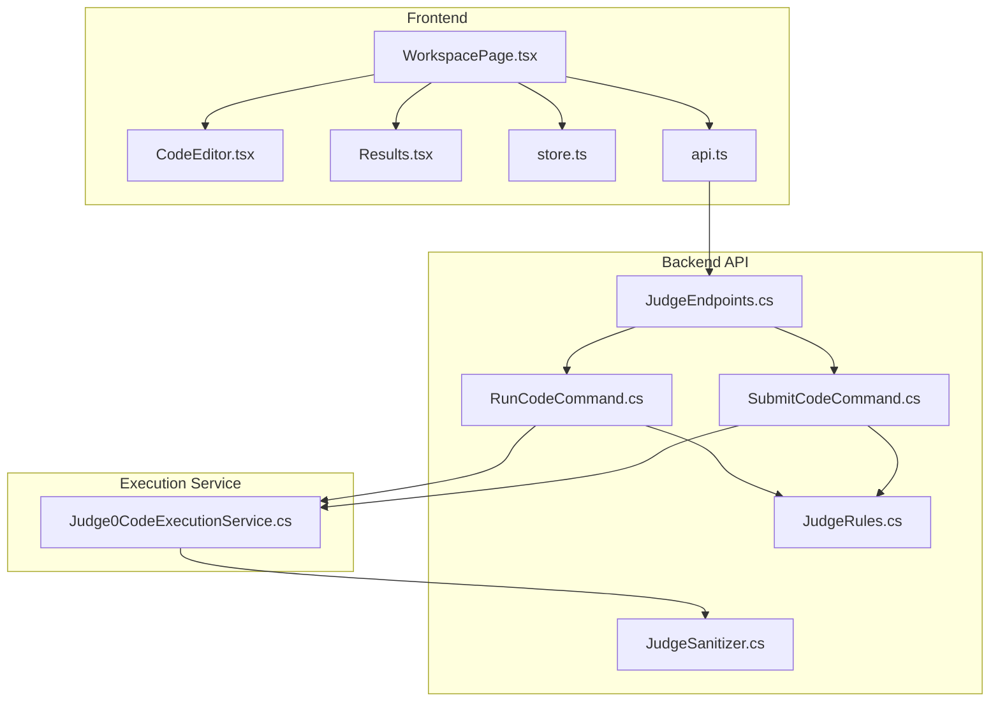
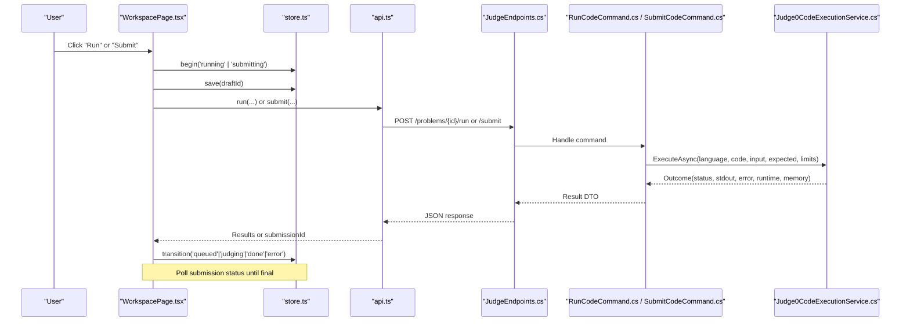
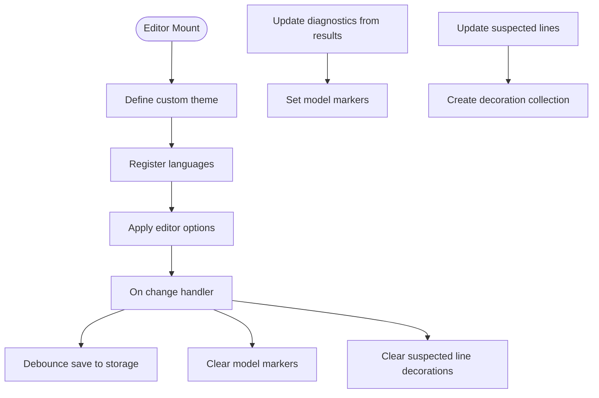
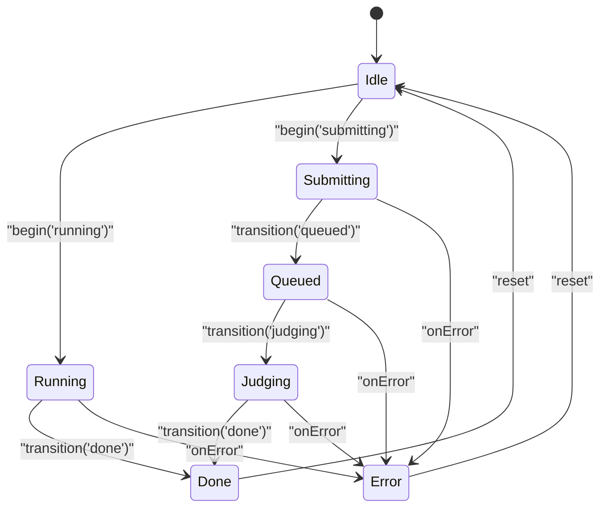
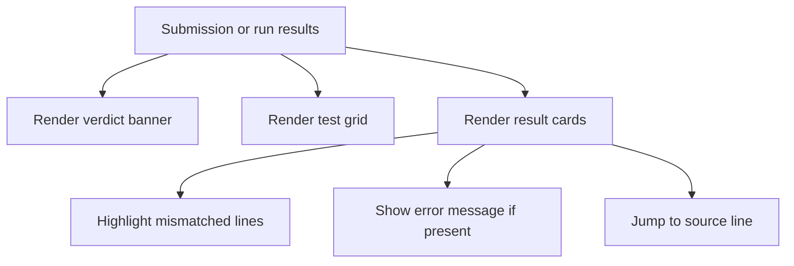
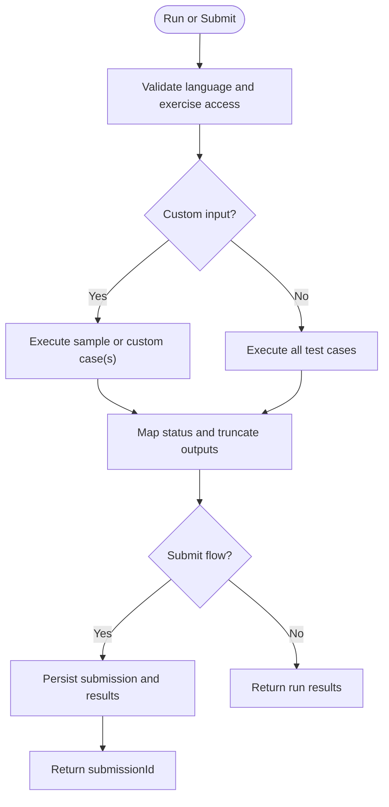
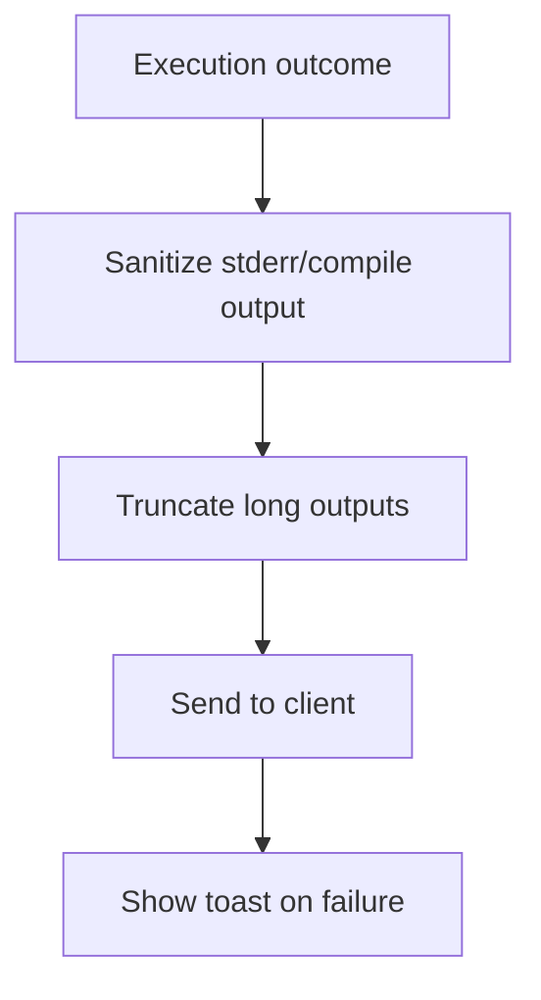
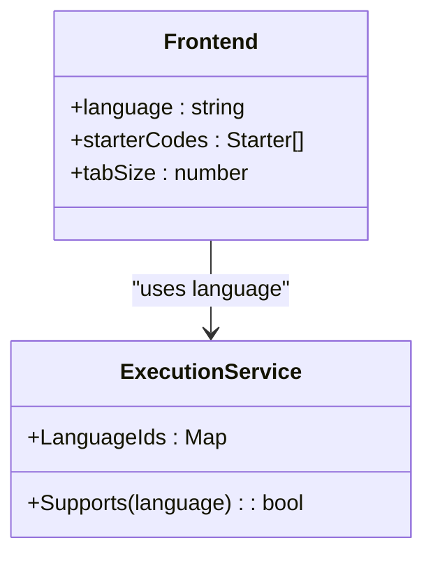
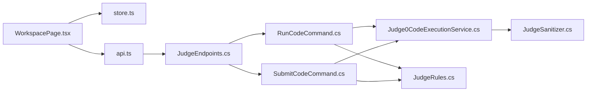

# Code Workspace & Editor

<cite>
**Referenced Files in This Document**
- [CodeEditor.tsx](file://frontend/src/features/workspace/CodeEditor.tsx)
- [Results.tsx](file://frontend/src/features/workspace/Results.tsx)
- [store.ts](file://frontend/src/features/workspace/store.ts)
- [WorkspacePage.tsx](file://frontend/src/features/workspace/WorkspacePage.tsx)
- [api.ts](file://frontend/src/features/code-judge/api.ts)
- [JudgeEndpoints.cs](file://api/src/Api/CodePath.Api/Endpoints/JudgeEndpoints.cs)
- [RunCodeCommand.cs](file://api/src/Application/CodePath.Application/Exercises/Commands/RunCodeCommand.cs)
- [SubmitCodeCommand.cs](file://api/src/Application/CodePath.Application/Exercises/Commands/SubmitCodeCommand.cs)
- [Judge0CodeExecutionService.cs](file://api/src/Infrastructure/CodePath.Infrastructure/CodeExecution/Judge0CodeExecutionService.cs)
- [JudgeSanitizer.cs](file://api/src/Application/CodePath.Application/Judge/JudgeSanitizer.cs)
- [JudgeRules.cs](file://api/src/Application/CodePath.Application/Judge/JudgeRules.cs)
- [workspace.css](file://frontend/src/features/workspace/workspace.css)
</cite>

## Table of Contents
1. [Introduction](#introduction)
2. [Project Structure](#project-structure)
3. [Core Components](#core-components)
4. [Architecture Overview](#architecture-overview)
5. [Detailed Component Analysis](#detailed-component-analysis)
6. [Dependency Analysis](#dependency-analysis)
7. [Performance Considerations](#performance-considerations)
8. [Troubleshooting Guide](#troubleshooting-guide)
9. [Conclusion](#conclusion)
10. [Appendices](#appendices)

## Introduction
This document explains the code workspace and editor functionality, focusing on Monaco Editor integration, the code execution pipeline, real-time result display, workspace state management, file handling, multi-language support, and integration with the code judge service. It also provides guidance for extending language support, customizing the editor theme, and implementing additional code analysis features.

## Project Structure
The workspace is implemented as a React feature under the frontend application, backed by a .NET API that integrates with an external code execution service (Judge0). The key pieces are:

- Frontend workspace UI: problem description, editor, console, results, and AI assistant panel.
- Frontend store: local draft persistence and phase transitions.
- Frontend API client: HTTP calls to run or submit code and poll submission status.
- Backend endpoints: route requests to application services.
- Application commands: validate inputs, fetch exercises, execute tests, and persist submissions.
- Execution service: communicate with Judge0 and map statuses.
- Sanitization and rules: protect against sensitive output and define comparison/scoring logic.

**Diagram sources**
- [WorkspacePage.tsx:1-170](file://frontend/src/features/workspace/WorkspacePage.tsx#L1-L170)
- [CodeEditor.tsx:1-47](file://frontend/src/features/workspace/CodeEditor.tsx#L1-L47)
- [Results.tsx:1-32](file://frontend/src/features/workspace/Results.tsx#L1-L32)
- [store.ts:1-48](file://frontend/src/features/workspace/store.ts#L1-L48)
- [api.ts:1-37](file://frontend/src/features/code-judge/api.ts#L1-L37)
- [JudgeEndpoints.cs:1-51](file://api/src/Api/CodePath.Api/Endpoints/JudgeEndpoints.cs#L1-L51)
- [RunCodeCommand.cs:1-77](file://api/src/Application/CodePath.Application/Exercises/Commands/RunCodeCommand.cs#L1-L77)
- [SubmitCodeCommand.cs:1-108](file://api/src/Application/CodePath.Application/Exercises/Commands/SubmitCodeCommand.cs#L1-L108)
- [Judge0CodeExecutionService.cs:1-154](file://api/src/Infrastructure/CodePath.Infrastructure/CodeExecution/Judge0CodeExecutionService.cs#L1-L154)
- [JudgeSanitizer.cs:1-45](file://api/src/Application/CodePath.Application/Judge/JudgeSanitizer.cs#L1-L45)
- [JudgeRules.cs:1-38](file://api/src/Application/CodePath.Application/Judge/JudgeRules.cs#L1-L38)

**Section sources**
- [WorkspacePage.tsx:1-170](file://frontend/src/features/workspace/WorkspacePage.tsx#L1-L170)
- [api.ts:1-37](file://frontend/src/features/code-judge/api.ts#L1-L37)
- [JudgeEndpoints.cs:1-51](file://api/src/Api/CodePath.Api/Endpoints/JudgeEndpoints.cs#L1-L51)

## Core Components
- Monaco Editor integration: Language definitions, worker configuration, custom theme, diagnostics, and suspected-line decorations.
- Workspace state: Drafts persisted to storage, debounced auto-save, and execution phases.
- Results display: Verdict banner, test grid, per-test cards, and hidden test masking.
- API client: Problem metadata, scopes, run/submit, submission polling, and error reporting.
- Backend execution pipeline: Run vs Submit flows, test iteration, limits, and persistence.
- Execution service: Judge0 communication, status mapping, and sanitization.

**Section sources**
- [CodeEditor.tsx:1-47](file://frontend/src/features/workspace/CodeEditor.tsx#L1-L47)
- [store.ts:1-48](file://frontend/src/features/workspace/store.ts#L1-L48)
- [Results.tsx:1-32](file://frontend/src/features/workspace/Results.tsx#L1-L32)
- [api.ts:1-37](file://frontend/src/features/code-judge/api.ts#L1-L37)
- [RunCodeCommand.cs:1-77](file://api/src/Application/CodePath.Application/Exercises/Commands/RunCodeCommand.cs#L1-L77)
- [SubmitCodeCommand.cs:1-108](file://api/src/Application/CodePath.Application/Exercises/Commands/SubmitCodeCommand.cs#L1-L108)
- [Judge0CodeExecutionService.cs:1-154](file://api/src/Infrastructure/CodePath.Infrastructure/CodeExecution/Judge0CodeExecutionService.cs#L1-L154)

## Architecture Overview
The workspace orchestrates user interactions, editor state, and execution flows across frontend and backend layers.

**Diagram sources**
- [WorkspacePage.tsx:100-125](file://frontend/src/features/workspace/WorkspacePage.tsx#L100-L125)
- [store.ts:38-43](file://frontend/src/features/workspace/store.ts#L38-L43)
- [api.ts:14-33](file://frontend/src/features/code-judge/api.ts#L14-L33)
- [JudgeEndpoints.cs:18-29](file://api/src/Api/CodePath.Api/Endpoints/JudgeEndpoints.cs#L18-L29)
- [RunCodeCommand.cs:27-70](file://api/src/Application/CodePath.Application/Exercises/Commands/RunCodeCommand.cs#L27-L70)
- [SubmitCodeCommand.cs:28-100](file://api/src/Application/CodePath.Application/Exercises/Commands/SubmitCodeCommand.cs#L28-L100)
- [Judge0CodeExecutionService.cs:39-107](file://api/src/Infrastructure/CodePath.Infrastructure/CodeExecution/Judge0CodeExecutionService.cs#L39-L107)

## Detailed Component Analysis

### Monaco Editor Integration
- Language support: Python, C++, Java, C#, JavaScript are registered via language definition modules.
- Worker setup: A dedicated editor worker is configured through Monaco environment.
- Theme: A custom theme named codepath-light is defined at editor mount time.
- Diagnostics: Model markers are applied from test results; they are cleared on edit.
- Suspected lines: Decorations highlight lines suggested by the AI assistant.
- Options: Minimap disabled, tab size varies by language, bracket pair colorization enabled, word wrap on, smooth scrolling respects reduced motion.

**Diagram sources**
- [CodeEditor.tsx:1-47](file://frontend/src/features/workspace/CodeEditor.tsx#L1-L47)

**Section sources**
- [CodeEditor.tsx:1-47](file://frontend/src/features/workspace/CodeEditor.tsx#L1-L47)

### Workspace State Management
- Drafts: Each draft stores code, optional saved timestamp, and optional error message.
- Persistence: Debounced auto-save to provided storage (default localStorage), resilient to storage errors.
- Phase machine: States include idle, running, submitting, queued, judging, done, error; guards prevent overlapping operations.
- Draft key: Deterministic key includes user id, problem id, and language.

**Diagram sources**
- [store.ts:3-45](file://frontend/src/features/workspace/store.ts#L3-L45)

**Section sources**
- [store.ts:1-48](file://frontend/src/features/workspace/store.ts#L1-L48)

### Real-Time Result Display
- Verdict banner: Shows overall status, mascot mood, queue position, and points awarded.
- Test grid: Visualizes pending/pass/fail for each test case index.
- Result card: Displays input, expected output, actual output, diff highlighting, error messages, and navigation to source line.
- Hidden tests: Non-sample tests hide payloads and diagnostics unless explicitly requested.

**Diagram sources**
- [Results.tsx:1-32](file://frontend/src/features/workspace/Results.tsx#L1-L32)

**Section sources**
- [Results.tsx:1-32](file://frontend/src/features/workspace/Results.tsx#L1-L32)

### Code Execution Pipeline
- Run flow: Executes sample test cases or a single custom input, returns immediate results without persistence.
- Submit flow: Executes all test cases, persists submission and results, returns submission ID for polling.
- Limits: Source length, IO length, maximum test cases, and output truncation are enforced.
- Status mapping: External service statuses are mapped to domain statuses.

**Diagram sources**
- [RunCodeCommand.cs:27-70](file://api/src/Application/CodePath.Application/Exercises/Commands/RunCodeCommand.cs#L27-L70)
- [SubmitCodeCommand.cs:28-100](file://api/src/Application/CodePath.Application/Exercises/Commands/SubmitCodeCommand.cs#L28-L100)
- [Judge0CodeExecutionService.cs:39-107](file://api/src/Infrastructure/CodePath.Infrastructure/CodeExecution/Judge0CodeExecutionService.cs#L39-L107)

**Section sources**
- [RunCodeCommand.cs:1-77](file://api/src/Application/CodePath.Application/Exercises/Commands/RunCodeCommand.cs#L1-L77)
- [SubmitCodeCommand.cs:1-108](file://api/src/Application/CodePath.Application/Exercises/Commands/SubmitCodeCommand.cs#L1-L108)
- [Judge0CodeExecutionService.cs:1-154](file://api/src/Infrastructure/CodePath.Infrastructure/CodeExecution/Judge0CodeExecutionService.cs#L1-L154)

### Output Streaming and Error Reporting
- Streaming: The current implementation uses synchronous execution with wait=true; results are returned after completion. For streaming, extend the execution service to use non-blocking submission and SSE/WebSocket updates.
- Error reporting: Errors are sanitized to remove internal paths, hostnames, and IPs; lengths are capped; toast notifications surface user-friendly messages.

**Diagram sources**
- [JudgeSanitizer.cs:1-45](file://api/src/Application/CodePath.Application/Judge/JudgeSanitizer.cs#L1-L45)
- [api.ts:34-36](file://frontend/src/features/code-judge/api.ts#L34-L36)

**Section sources**
- [JudgeSanitizer.cs:1-45](file://api/src/Application/CodePath.Application/Judge/JudgeSanitizer.cs#L1-L45)
- [api.ts:1-37](file://frontend/src/features/code-judge/api.ts#L1-L37)

### Multi-Language Support
- Frontend: Language selection drives starter template, editor language, and tab size.
- Backend: Language IDs map to supported languages in the execution service.
- Extensibility: Add new languages by registering Monaco language definitions and updating the language ID mapping.

**Diagram sources**
- [CodeEditor.tsx:4-8](file://frontend/src/features/workspace/CodeEditor.tsx#L4-L8)
- [Judge0CodeExecutionService.cs:14-21](file://api/src/Infrastructure/CodePath.Infrastructure/CodeExecution/Judge0CodeExecutionService.cs#L14-L21)

**Section sources**
- [CodeEditor.tsx:1-47](file://frontend/src/features/workspace/CodeEditor.tsx#L1-L47)
- [Judge0CodeExecutionService.cs:1-154](file://api/src/Infrastructure/CodePath.Infrastructure/CodeExecution/Judge0CodeExecutionService.cs#L1-L154)

## Dependency Analysis
- Frontend components depend on Zustand store, TanStack Query, Radix UI tabs/dialogs, react-resizable-panels, and Monaco Editor.
- API endpoints delegate to application commands which depend on database context and execution service.
- Execution service depends on HttpClient and external Judge0 service.
- Rules and sanitizer are shared utilities used by both run and submit flows.

**Diagram sources**
- [WorkspacePage.tsx:1-170](file://frontend/src/features/workspace/WorkspacePage.tsx#L1-L170)
- [store.ts:1-48](file://frontend/src/features/workspace/store.ts#L1-L48)
- [api.ts:1-37](file://frontend/src/features/code-judge/api.ts#L1-L37)
- [JudgeEndpoints.cs:1-51](file://api/src/Api/CodePath.Api/Endpoints/JudgeEndpoints.cs#L1-L51)
- [RunCodeCommand.cs:1-77](file://api/src/Application/CodePath.Application/Exercises/Commands/RunCodeCommand.cs#L1-L77)
- [SubmitCodeCommand.cs:1-108](file://api/src/Application/CodePath.Application/Exercises/Commands/SubmitCodeCommand.cs#L1-L108)
- [Judge0CodeExecutionService.cs:1-154](file://api/src/Infrastructure/CodePath.Infrastructure/CodeExecution/Judge0CodeExecutionService.cs#L1-L154)
- [JudgeRules.cs:1-38](file://api/src/Application/CodePath.Application/Judge/JudgeRules.cs#L1-L38)
- [JudgeSanitizer.cs:1-45](file://api/src/Application/CodePath.Application/Judge/JudgeSanitizer.cs#L1-L45)

**Section sources**
- [WorkspacePage.tsx:1-170](file://frontend/src/features/workspace/WorkspacePage.tsx#L1-L170)
- [api.ts:1-37](file://frontend/src/features/code-judge/api.ts#L1-L37)
- [JudgeEndpoints.cs:1-51](file://api/src/Api/CodePath.Api/Endpoints/JudgeEndpoints.cs#L1-L51)

## Performance Considerations
- Debounced saves reduce storage writes during typing.
- Minimap disabled and automatic layout tuned to balance responsiveness.
- Output truncation prevents large payloads.
- Submission polling interval adapts to active states and disables background refetching when inactive.
- Avoid unnecessary re-renders by memoizing diagnostics and snapshot comparisons.

[No sources needed since this section provides general guidance]

## Troubleshooting Guide
- Storage errors: The store catches storage exceptions and marks drafts with an error message while keeping the editor usable.
- Network errors: API errors trigger toast notifications; submission polling gracefully handles transient failures.
- Judge0 connectivity: Connection issues return system error statuses; logs record warnings/errors for diagnosis.
- Sensitive output: Sanitizer removes internal paths, hostnames, and IPs; long outputs are truncated.

**Section sources**
- [store.ts:28-37](file://frontend/src/features/workspace/store.ts#L28-L37)
- [api.ts:34-36](file://frontend/src/features/code-judge/api.ts#L34-L36)
- [Judge0CodeExecutionService.cs:76-106](file://api/src/Infrastructure/CodePath.Infrastructure/CodeExecution/Judge0CodeExecutionService.cs#L76-L106)
- [JudgeSanitizer.cs:24-43](file://api/src/Application/CodePath.Application/Judge/JudgeSanitizer.cs#L24-L43)

## Conclusion
The workspace combines a responsive Monaco-based editor, robust state management, and a secure execution pipeline. It supports multiple languages, provides clear feedback through verdict banners and test grids, and integrates safely with an external code judge. Extending language support, theming, and analysis features can be achieved by following the documented extension points.

[No sources needed since this section summarizes without analyzing specific files]

## Appendices

### How to Extend Language Support
- Frontend:
  - Import the language definition module for the new language.
  - Add the language to the selector and set appropriate tab size.
- Backend:
  - Add a new entry in the language ID mapping in the execution service.
  - Ensure the external service supports the language and limits are appropriate.

**Section sources**
- [CodeEditor.tsx:4-8](file://frontend/src/features/workspace/CodeEditor.tsx#L4-L8)
- [Judge0CodeExecutionService.cs:14-21](file://api/src/Infrastructure/CodePath.Infrastructure/CodeExecution/Judge0CodeExecutionService.cs#L14-L21)

### How to Customize the Editor Theme
- Define a new theme in the editor’s beforeMount hook with tokens and colors.
- Switch the editor theme prop to the new theme name.

**Section sources**
- [CodeEditor.tsx:39-41](file://frontend/src/features/workspace/CodeEditor.tsx#L39-L41)

### Implementing Additional Code Analysis Features
- Use Monaco model markers to show diagnostics based on static analysis or linter output.
- Use decoration collections to highlight suspicious ranges suggested by AI or rules.
- Integrate with the AI assistant panel to propose fixes and jump to relevant lines.

**Section sources**
- [CodeEditor.tsx:31-38](file://frontend/src/features/workspace/CodeEditor.tsx#L31-L38)
- [WorkspacePage.tsx:126-129](file://frontend/src/features/workspace/WorkspacePage.tsx#L126-L129)

### Styling and Layout Notes
- CSS variables and responsive breakpoints define consistent spacing, typography, and mobile behavior.
- Focus modes and resizable panels improve usability across devices.

**Section sources**
- [workspace.css:1-22](file://frontend/src/features/workspace/workspace.css#L1-L22)