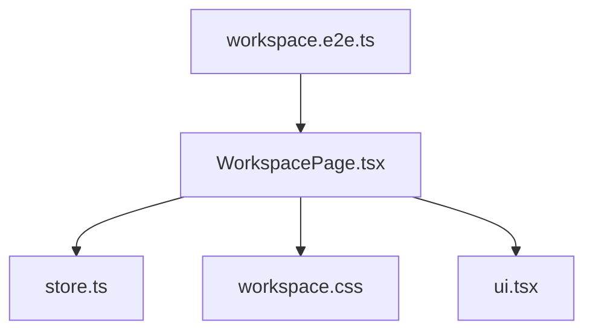
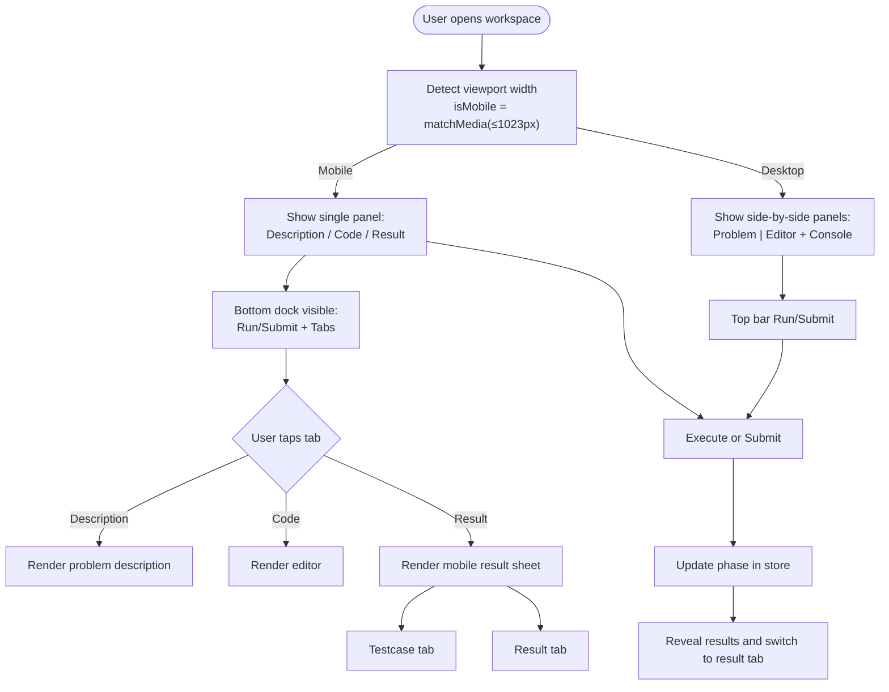
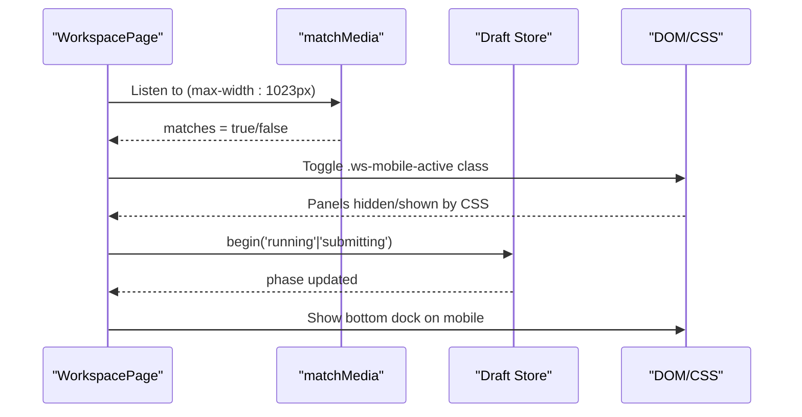
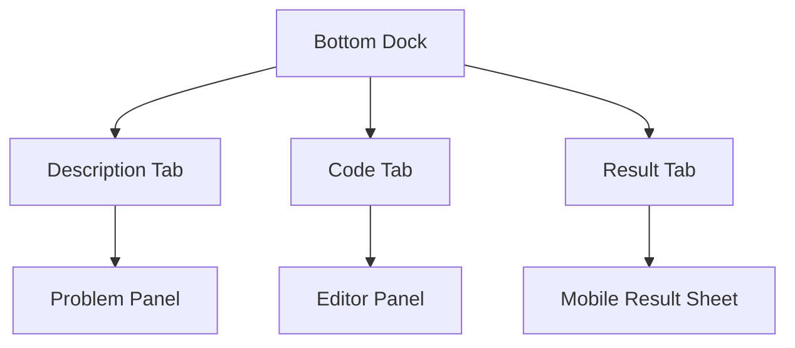
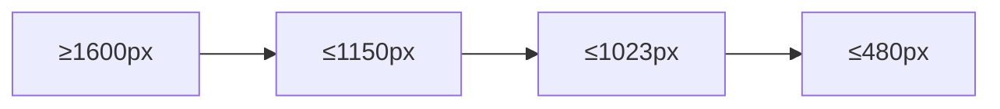
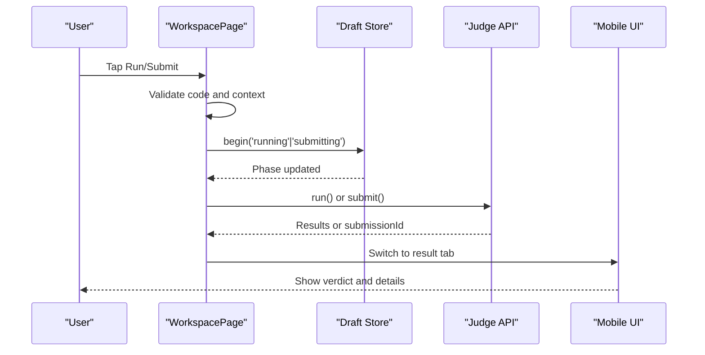
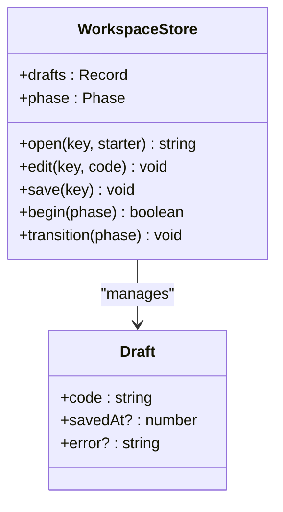
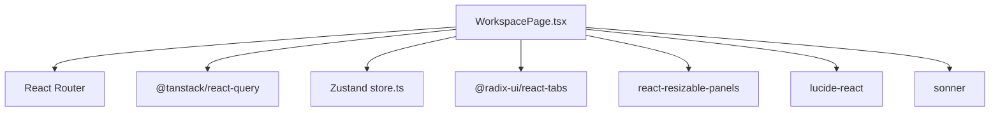

# Mobile Adaptation

<cite>
**Referenced Files in This Document**
- [WorkspacePage.tsx](file://frontend/src/features/workspace/WorkspacePage.tsx)
- [store.ts](file://frontend/src/features/workspace/store.ts)
- [workspace.css](file://frontend/src/features/workspace/workspace.css)
- [ui.tsx](file://frontend/src/features/workspace/ui.tsx)
- [workspace.e2e.ts](file://frontend/tests/workspace.e2e.ts)
</cite>

## Table of Contents
1. [Introduction](#introduction)
2. [Project Structure](#project-structure)
3. [Core Components](#core-components)
4. [Architecture Overview](#architecture-overview)
5. [Detailed Component Analysis](#detailed-component-analysis)
6. [Dependency Analysis](#dependency-analysis)
7. [Performance Considerations](#performance-considerations)
8. [Troubleshooting Guide](#troubleshooting-guide)
9. [Conclusion](#conclusion)
10. [Appendices](#appendices)

## Introduction
This document explains the mobile-specific adaptations of the workspace interface. It focuses on touch-friendly controls, simplified navigation, optimized content display for smaller screens, mobile tabs, bottom navigation, and responsive breakpoints. It also covers performance optimizations for mobile devices and provides guidance for enhancing mobile UX and adding mobile-only features.

The workspace is a code practice environment where users read problem descriptions, write code, run test cases, submit solutions, and review results. On mobile, the layout switches from a multi-panel desktop view to a single-column flow with a bottom dock for primary actions and a slide-up result sheet for outputs.

## Project Structure
The mobile adaptation lives primarily in the workspace feature:

- `WorkspacePage.tsx` implements the page logic, state, keyboard shortcuts, execution flows, and mobile-only UI sections.
- `workspace.css` defines responsive breakpoints, mobile-only styles, and animations.
- `store.ts` manages drafts, auto-save, and execution phases.
- `ui.tsx` provides shared UI primitives like loading states, empty states, modals, and error boundaries.
- `workspace.e2e.ts` contains end-to-end tests that validate mobile behavior such as the bottom dock and mobile result sheet.

**Diagram sources**
- [WorkspacePage.tsx:1-170](file://frontend/src/features/workspace/WorkspacePage.tsx#L1-L170)
- [store.ts:1-48](file://frontend/src/features/workspace/store.ts#L1-L48)
- [workspace.css:1-22](file://frontend/src/features/workspace/workspace.css#L1-L22)
- [ui.tsx:1-31](file://frontend/src/features/workspace/ui.tsx#L1-L31)
- [workspace.e2e.ts:35-53](file://frontend/tests/workspace.e2e.ts#L35-L53)

**Section sources**
- [WorkspacePage.tsx:1-170](file://frontend/src/features/workspace/WorkspacePage.tsx#L1-L170)
- [workspace.css:1-22](file://frontend/src/features/workspace/workspace.css#L1-L22)
- [store.ts:1-48](file://frontend/src/features/workspace/store.ts#L1-L48)
- [ui.tsx:1-31](file://frontend/src/features/workspace/ui.tsx#L1-L31)
- [workspace.e2e.ts:35-53](file://frontend/tests/workspace.e2e.ts#L35-L53)

## Core Components
- Workspace page component: orchestrates data fetching, user interactions, editor state, execution, and mobile layout switching.
- Draft store: persists code drafts, handles auto-save, and tracks execution phase transitions.
- Responsive CSS: hides desktop panels on small screens, shows mobile-only elements, and adjusts spacing and typography.
- Shared UI components: provide consistent loading, empty, modal, and error boundary behaviors across mobile and desktop.

Key mobile behaviors implemented in the workspace:
- Detects mobile viewport using a media query hook.
- Hides top action buttons and desktop panels on mobile.
- Shows a bottom dock with Run/Submit and three tabs: Description, Code, Result.
- Displays results in a full-width mobile sheet when active.
- Uses large touch targets and accessible labels.
- Respects safe area insets for notched devices.

**Section sources**
- [WorkspacePage.tsx:44-169](file://frontend/src/features/workspace/WorkspacePage.tsx#L44-L169)
- [workspace.css:4-21](file://frontend/src/features/workspace/workspace.css#L4-L21)
- [store.ts:5-45](file://frontend/src/features/workspace/store.ts#L5-L45)
- [ui.tsx:17-30](file://frontend/src/features/workspace/ui.tsx#L17-L30)

## Architecture Overview
The workspace adapts its layout based on screen width. On desktop, it uses resizable panels for problem description, code editor, and console. On mobile, it renders only one panel at a time and exposes a bottom dock for navigation and actions.

**Diagram sources**
- [WorkspacePage.tsx:48-49](file://frontend/src/features/workspace/WorkspacePage.tsx#L48-L49)
- [WorkspacePage.tsx:140-165](file://frontend/src/features/workspace/WorkspacePage.tsx#L140-L165)
- [workspace.css:4-21](file://frontend/src/features/workspace/workspace.css#L4-L21)

## Detailed Component Analysis

### Mobile Detection and Layout Switching
- The page detects mobile using a media query and updates an `isMobile` state.
- On mobile, the main layout container hides both desktop panels and only displays the panel marked as mobile-active.
- The bottom dock is shown only on mobile, providing quick access to Description, Code, and Result views.
- The result sheet appears above the dock and respects safe-area insets.

**Diagram sources**
- [WorkspacePage.tsx:48-49](file://frontend/src/features/workspace/WorkspacePage.tsx#L48-L49)
- [WorkspacePage.tsx:145-165](file://frontend/src/features/workspace/WorkspacePage.tsx#L145-L165)
- [workspace.css:4-21](file://frontend/src/features/workspace/workspace.css#L4-L21)

**Section sources**
- [WorkspacePage.tsx:48-49](file://frontend/src/features/workspace/WorkspacePage.tsx#L48-L49)
- [WorkspacePage.tsx:145-165](file://frontend/src/features/workspace/WorkspacePage.tsx#L145-L165)
- [workspace.css:4-21](file://frontend/src/features/workspace/workspace.css#L4-L21)

### Touch-Friendly Controls
- Buttons use explicit sizes and spacing suitable for fingers.
- The bottom dock groups Run/Submit and navigation tabs into easily tappable areas.
- Labels and aria attributes improve accessibility for screen readers and assistive technologies.
- Keyboard shortcuts remain available for desktop; on mobile, tap actions replace them.

Examples of mobile-friendly patterns:
- Bottom dock with large, spaced buttons.
- Tabbed navigation with clear active states.
- Full-screen focus mode hides non-essential chrome on mobile.

**Section sources**
- [WorkspacePage.tsx:140-165](file://frontend/src/features/workspace/WorkspacePage.tsx#L140-L165)
- [workspace.css:1-22](file://frontend/src/features/workspace/workspace.css#L1-L22)

### Simplified Navigation on Mobile
- Three primary tabs: Description, Code, Result.
- The active tab highlights visually and controls which panel is visible.
- The bottom dock remains fixed at the bottom, ensuring easy reachability.
- Breadcrumb and top actions are hidden on mobile to reduce clutter.

**Diagram sources**
- [WorkspacePage.tsx:163-165](file://frontend/src/features/workspace/WorkspacePage.tsx#L163-L165)
- [workspace.css:4-21](file://frontend/src/features/workspace/workspace.css#L4-L21)

**Section sources**
- [WorkspacePage.tsx:140-165](file://frontend/src/features/workspace/WorkspacePage.tsx#L140-L165)
- [workspace.css:4-21](file://frontend/src/features/workspace/workspace.css#L4-L21)

### Optimized Content Display for Smaller Screens
- Typography scales down and padding reduces to fit narrow screens.
- The editor label is shown on mobile to clarify context when the desktop label is hidden.
- The result sheet slides up with a subtle animation and occupies most of the viewport height.
- Safe-area insets ensure content is not obscured by device notches.

**Section sources**
- [workspace.css:4-21](file://frontend/src/features/workspace/workspace.css#L4-L21)

### Mobile Tabs and Bottom Navigation Bar
- Mobile tabs are implemented via Radix Tabs inside the mobile result sheet and the bottom dock.
- The bottom dock includes:
  - Primary actions: Run and Submit.
  - Navigation tabs: Description, Code, Result.
- Active state is managed through React state and reflected in aria attributes.

**Section sources**
- [WorkspacePage.tsx:147-165](file://frontend/src/features/workspace/WorkspacePage.tsx#L147-L165)

### Gesture-Based Interactions
- No custom gesture handlers are present in the workspace.
- Interaction relies on standard touch events for buttons and tabs.
- Focus management ensures keyboard-like accessibility for screen readers.

[No sources needed since this section summarizes existing behavior without analyzing specific files]

### Responsive Breakpoints
Breakpoints used in the workspace:
- ≥1600px: Larger padding and font sizes.
- ≤1150px: Compact toolbar and tabs.
- ≤1023px: Mobile layout with bottom dock and single-panel view.
- ≤480px: Extra-small screens with tighter spacing and smaller type.

**Diagram sources**
- [workspace.css:4-21](file://frontend/src/features/workspace/workspace.css#L4-L21)

**Section sources**
- [workspace.css:4-21](file://frontend/src/features/workspace/workspace.css#L4-L21)

### Mobile-Only Components
- Bottom dock: Fixed navigation and actions at the bottom of the screen.
- Mobile result sheet: Slide-up panel showing testcase and result tabs.
- Hidden desktop elements: Top actions, footer, and desktop panels are hidden on mobile.

**Section sources**
- [WorkspacePage.tsx:140-165](file://frontend/src/features/workspace/WorkspacePage.tsx#L140-L165)
- [workspace.css:4-21](file://frontend/src/features/workspace/workspace.css#L4-L21)

### Execution Flow on Mobile
When a user runs or submits code on mobile:
- The page validates input and prevents duplicate executions.
- The store transitions to running or submitting phase.
- Results are revealed by switching to the result tab and expanding the console panel on desktop or showing the mobile result sheet.

**Diagram sources**
- [WorkspacePage.tsx:100-112](file://frontend/src/features/workspace/WorkspacePage.tsx#L100-L112)
- [WorkspacePage.tsx:127-139](file://frontend/src/features/workspace/WorkspacePage.tsx#L127-L139)
- [store.ts:38-43](file://frontend/src/features/workspace/store.ts#L38-L43)

**Section sources**
- [WorkspacePage.tsx:100-112](file://frontend/src/features/workspace/WorkspacePage.tsx#L100-L112)
- [WorkspacePage.tsx:127-139](file://frontend/src/features/workspace/WorkspacePage.tsx#L127-L139)
- [store.ts:38-43](file://frontend/src/features/workspace/store.ts#L38-L43)

### Auto-Save and Draft Management
- Drafts are keyed by user, problem, and language.
- Editing triggers debounced auto-save to storage.
- Errors during save are captured and displayed to the user.

**Diagram sources**
- [store.ts:3-47](file://frontend/src/features/workspace/store.ts#L3-L47)

**Section sources**
- [store.ts:5-45](file://frontend/src/features/workspace/store.ts#L5-L45)

## Dependency Analysis
The workspace depends on:
- React Router for navigation between problems.
- TanStack Query for data fetching and caching.
- Zustand for local state and draft persistence.
- Radix Tabs for accessible tab interfaces.
- react-resizable-panels for desktop panel layout.
- Lucide icons for visual affordances.
- Sonner for toast notifications.

On mobile, these dependencies continue to work, but the layout and interaction model change to prioritize touch and limited screen real estate.

**Diagram sources**
- [WorkspacePage.tsx:1-18](file://frontend/src/features/workspace/WorkspacePage.tsx#L1-L18)
- [store.ts:1-48](file://frontend/src/features/workspace/store.ts#L1-L48)

**Section sources**
- [WorkspacePage.tsx:1-18](file://frontend/src/features/workspace/WorkspacePage.tsx#L1-L18)
- [store.ts:1-48](file://frontend/src/features/workspace/store.ts#L1-L48)

## Performance Considerations
- Lazy loading: The AI assistant panel and code editor are lazy-loaded to reduce initial bundle size.
- Debounced auto-save: Prevents excessive writes to storage while typing.
- Conditional rendering: Mobile-only elements are rendered only when needed.
- Reduced motion: Animations respect `prefers-reduced-motion`.
- Safe area handling: Avoids content overlap on devices with notches.

Recommendations:
- Keep lazy imports for heavy components.
- Avoid unnecessary re-renders by memoizing expensive computations.
- Use virtualization for long lists if history grows significantly.
- Prefer CSS-based visibility toggles over complex JS layouts on mobile.

**Section sources**
- [WorkspacePage.tsx:19-21](file://frontend/src/features/workspace/WorkspacePage.tsx#L19-L21)
- [store.ts:23-36](file://frontend/src/features/workspace/store.ts#L23-L36)
- [workspace.css:8-9](file://frontend/src/features/workspace/workspace.css#L8-L9)

## Troubleshooting Guide
Common mobile issues and resolutions:
- Bottom dock not visible: Ensure the viewport is ≤1023px and the `.ws-mobile-dock` class is applied.
- Result sheet overlapping dock: Check safe-area insets and the `.ws-mobile-results` positioning rules.
- Tabs not switching: Verify `mobileTab` state and `aria-current` attributes.
- Editor not visible on mobile: Confirm the `.ws-mobile-active` class is on the editor panel.

Validation via tests:
- End-to-end tests assert that the bottom dock exists and that tapping Code reveals the editor.
- Tests also verify that the mobile result sheet can be used to run custom inputs and display outputs.

**Section sources**
- [workspace.css:4-21](file://frontend/src/features/workspace/workspace.css#L4-L21)
- [workspace.e2e.ts:35-53](file://frontend/tests/workspace.e2e.ts#L35-L53)

## Conclusion
The workspace provides a robust mobile experience by switching to a single-panel layout, exposing a bottom dock for primary actions and navigation, and presenting results in a slide-up sheet. Responsive breakpoints ensure readability and usability across device sizes. The implementation leverages lazy loading, debounced saves, and accessible components to deliver a performant and inclusive mobile interface.

## Appendices

### Enhancing Mobile UX
- Increase touch target sizes for critical actions.
- Provide clear feedback for async operations (loading indicators, toasts).
- Use progressive disclosure to avoid overwhelming users on small screens.
- Add haptic feedback for key actions if supported by the platform.

### Adding Mobile-Specific Features
- Introduce swipe gestures to navigate between Description, Code, and Result.
- Implement pull-to-refresh for history and submissions.
- Add offline support for reading problem descriptions and cached drafts.

### Improving Touch Interactions
- Replace hover-dependent interactions with tap-friendly alternatives.
- Ensure focus order aligns with visual hierarchy.
- Test with screen readers and voice control tools.

[No sources needed since this section provides general guidance]