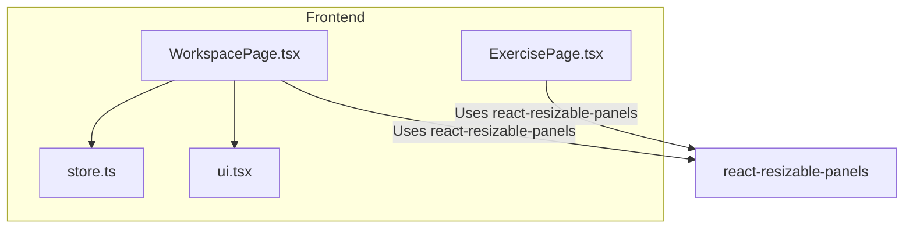
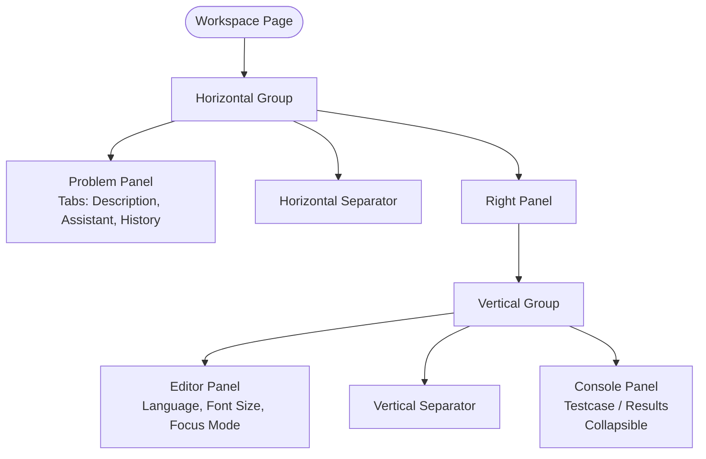
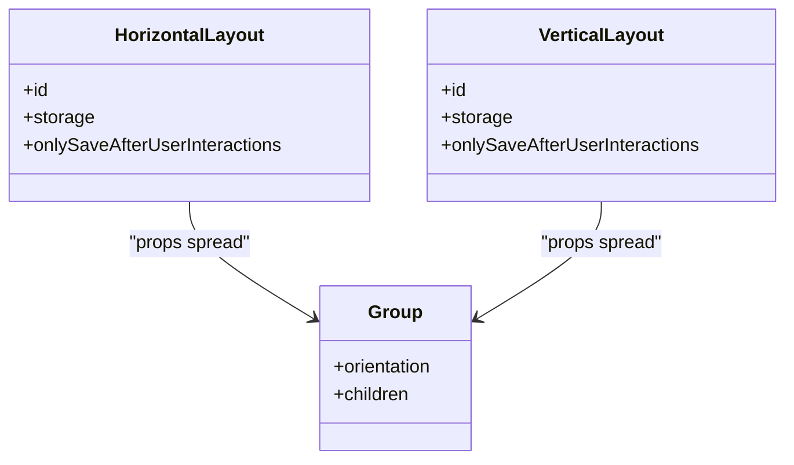
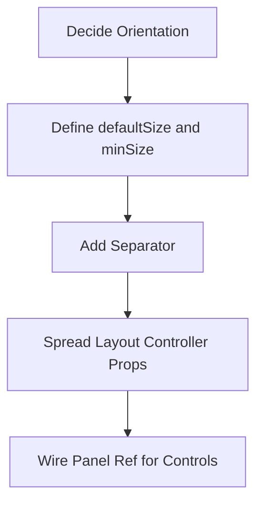
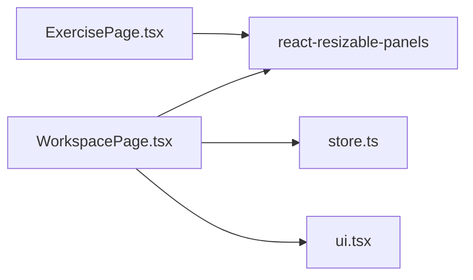

# Panel Resizing System

<cite>
**Referenced Files in This Document**
- [WorkspacePage.tsx](file://frontend/src/features/workspace/WorkspacePage.tsx)
- [store.ts](file://frontend/src/features/workspace/store.ts)
- [ui.tsx](file://frontend/src/features/workspace/ui.tsx)
- [ExercisePage.tsx](file://frontend/src/features/online-judge/pages/ExercisePage.tsx)
</cite>

## Table of Contents
1. [Introduction](#introduction)
2. [Project Structure](#project-structure)
3. [Core Components](#core-components)
4. [Architecture Overview](#architecture-overview)
5. [Detailed Component Analysis](#detailed-component-analysis)
6. [Dependency Analysis](#dependency-analysis)
7. [Performance Considerations](#performance-considerations)
8. [Troubleshooting Guide](#troubleshooting-guide)
9. [Conclusion](#conclusion)
10. [Appendices](#appendices)

## Introduction
This document explains the panel resizing system used to adjust the workspace layout. It covers how resizable panels are implemented, how horizontal and vertical arrangements work, size constraints, default sizes, minimum and maximum limits, layout persistence, and how to restore a default layout. It also includes guidance for adding new resizable panels, customizing resize behavior, and implementing advanced layout configurations.

The implementation is centered on the React-based workspace page that uses a resizable panel library to create a two-axis layout:
- A horizontal split between problem description and the editor/console area.
- A vertical split inside the right side between the code editor and the console/results area.

## Project Structure
The panel resizing logic lives primarily in the workspace feature. The relevant files are:
- Workspace page component that composes the resizable layout.
- A small store managing drafts and execution phases.
- Shared UI helpers including an error boundary for panels.
- An older online judge exercise page demonstrating another resizable layout pattern.



**Diagram sources**
- [WorkspacePage.tsx:1-162](file://frontend/src/features/workspace/WorkspacePage.tsx#L1-L162)
- [store.ts:1-48](file://frontend/src/features/workspace/store.ts#L1-L48)
- [ui.tsx:1-31](file://frontend/src/features/workspace/ui.tsx#L1-L31)
- [ExercisePage.tsx:180-215](file://frontend/src/features/online-judge/pages/ExercisePage.tsx#L180-L215)

**Section sources**
- [WorkspacePage.tsx:1-162](file://frontend/src/features/workspace/WorkspacePage.tsx#L1-L162)
- [store.ts:1-48](file://frontend/src/features/workspace/store.ts#L1-L48)
- [ui.tsx:1-31](file://frontend/src/features/workspace/ui.tsx#L1-L31)
- [ExercisePage.tsx:180-215](file://frontend/src/features/online-judge/pages/ExercisePage.tsx#L180-L215)

## Core Components
- Horizontal layout controller: manages left/right split between problem content and editor/console.
- Vertical layout controller: manages top/bottom split between editor and console.
- Problem panel: contains tabs for description, AI assistant, and submission history.
- Editor panel: contains language selection, font size control, reset-to-starter, focus mode toggle, and the code editor.
- Console panel: contains test case input/output and results; supports collapse/expand with a collapsed size.
- Layout persistence: persists user-adjusted sizes using a safe storage wrapper around local storage.

Key behaviors:
- Default sizes define initial proportions.
- Minimum sizes prevent panels from shrinking below usable thresholds.
- Collapsible console panel has a collapsed size when minimized.
- Layouts are persisted only after user interactions to avoid overwriting defaults during programmatic changes.

**Section sources**
- [WorkspacePage.tsx:72-75](file://frontend/src/features/workspace/WorkspacePage.tsx#L72-L75)
- [WorkspacePage.tsx:145-162](file://frontend/src/features/workspace/WorkspacePage.tsx#L145-L162)
- [WorkspacePage.tsx:154-159](file://frontend/src/features/workspace/WorkspacePage.tsx#L154-L159)

## Architecture Overview
The workspace uses a nested resizable layout:
- Outer Group (horizontal):
  - Left Panel: problem description and related tabs.
  - Separator: draggable divider.
  - Right Panel: inner Group (vertical).
    - Top Panel: code editor.
    - Separator: draggable divider.
    - Bottom Panel: console/results with collapsible state.



**Diagram sources**
- [WorkspacePage.tsx:145-162](file://frontend/src/features/workspace/WorkspacePage.tsx#L145-L162)

## Detailed Component Analysis

### Resizable Layout Controllers
- Horizontal layout controller:
  - Identifier: unique key for persistence.
  - Storage adapter: safe wrapper around local storage.
  - Save policy: only save after user interactions.
- Vertical layout controller:
  - Same persistence strategy as horizontal.

These controllers provide props spread into their respective Group components to enable automatic layout persistence and restoration.



**Diagram sources**
- [WorkspacePage.tsx:72-75](file://frontend/src/features/workspace/WorkspacePage.tsx#L72-L75)
- [WorkspacePage.tsx:145-162](file://frontend/src/features/workspace/WorkspacePage.tsx#L145-L162)

**Section sources**
- [WorkspacePage.tsx:72-75](file://frontend/src/features/workspace/WorkspacePage.tsx#L72-L75)

### Problem Panel
- Contains tabbed content:
  - Description: problem statement, examples, difficulty/time/memory metadata.
  - Assistant: AI assistant integration.
  - History: past submissions with pagination.
- Uses a minSize constraint to ensure enough space for reading and navigation.

Behavioral notes:
- Tabs switch active content without affecting panel sizing.
- Navigation buttons allow moving between problems within a scope.

**Section sources**
- [WorkspacePage.tsx:146-152](file://frontend/src/features/workspace/WorkspacePage.tsx#L146-L152)

### Editor Panel
- Toolbar controls:
  - Language selector.
  - Font size selector.
  - Reset-to-starter button.
  - Focus mode toggle.
- Code editor is rendered lazily with Suspense fallback.
- MinSize ensures editor remains usable even when resized down.

Interaction highlights:
- Changing language triggers draft save and resets suspected lines.
- Focus mode toggles fullscreen-like behavior via CSS classes.

**Section sources**
- [WorkspacePage.tsx:155-157](file://frontend/src/features/workspace/WorkspacePage.tsx#L155-L157)

### Console Panel
- Tabbed interface:
  - Testcase: sample inputs/outputs or custom input.
  - Results: verdict banner, progress, test grid, diagnostics.
- Collapsible:
  - Collapsed size defines minimal height when minimized.
  - Expand/collapse controlled programmatically via panel ref.
- MinSize prevents collapsing below a readable threshold.

Programmatic control:
- Panel ref allows expanding console when results appear.
- Tab switching expands the panel automatically.

**Section sources**
- [WorkspacePage.tsx:158-159](file://frontend/src/features/workspace/WorkspacePage.tsx#L158-L159)
- [WorkspacePage.tsx:72](file://frontend/src/features/workspace/WorkspacePage.tsx#L72)

### Layout Persistence
- Safe storage wrapper:
  - getItem/setItem methods wrapping localStorage.
  - Graceful handling of storage errors so layout preference is optional.
- Persisted per layout axis:
  - Horizontal layout ID.
  - Vertical layout ID.
- Only saves after user interactions to avoid persisting programmatic changes.

```mermaid
sequenceDiagram
participant User as "User"
participant Panel as "Resizable Panel"
participant Layout as "useDefaultLayout"
participant Storage as "safeLayoutStorage"
User->>Panel : Resize panel
Panel->>Layout : Update layout state
Layout->>Storage : setItem(layoutId, serializedLayout)
Note over Storage : Optional; errors are ignored
Storage-->>Layout : success
```

**Diagram sources**
- [WorkspacePage.tsx:23](file://frontend/src/features/workspace/WorkspacePage.tsx#L23)
- [WorkspacePage.tsx:72-75](file://frontend/src/features/workspace/WorkspacePage.tsx#L72-L75)

**Section sources**
- [WorkspacePage.tsx:23](file://frontend/src/features/workspace/WorkspacePage.tsx#L23)
- [WorkspacePage.tsx:72-75](file://frontend/src/features/workspace/WorkspacePage.tsx#L72-L75)

### Size Constraints and Defaults
- Horizontal arrangement:
  - Left panel default size and minimum size defined.
  - Right panel minimum size defined.
- Vertical arrangement:
  - Editor panel default size and minimum size defined.
  - Console panel default size, minimum size, collapsible flag, and collapsed size defined.

Constraints summary:
- Default sizes establish initial proportions.
- Minimum sizes enforce usability thresholds.
- Collapsed size applies when the console is minimized.

**Section sources**
- [WorkspacePage.tsx:146-159](file://frontend/src/features/workspace/WorkspacePage.tsx#L146-L159)

### Default Layout Restoration
- The layout controllers use default sizes and min sizes to reconstruct a sensible layout if no persisted state exists.
- Programmatic changes (e.g., expand console on results) do not immediately overwrite persisted layouts due to the save-after-user-interaction policy.

Practical guidance:
- To restore defaults, clear the corresponding layout entries in local storage or remove the persisted keys associated with the layout IDs.

**Section sources**
- [WorkspacePage.tsx:72-75](file://frontend/src/features/workspace/WorkspacePage.tsx#L72-L75)
- [WorkspacePage.tsx:23](file://frontend/src/features/workspace/WorkspacePage.tsx#L23)

### Adding New Resizable Panels
Steps to add a new resizable panel:
1. Decide orientation:
   - Add to existing horizontal group to introduce a third column.
   - Add to existing vertical group to introduce another row.
2. Define size constraints:
   - Set defaultSize for initial proportion.
   - Set minSize to ensure readability/usability.
   - Optionally set collapsible and collapsedSize for panels like console.
3. Provide a separator:
   - Insert a Separator between panels to enable dragging.
4. Integrate persistence:
   - Ensure the parent Group spreads the appropriate layout controller props.
5. Wire programmatic controls:
   - Use usePanelRef to expand/collapse programmatically when needed.

Example conceptual flow:


[No sources needed since this diagram shows conceptual workflow, not actual code structure]

### Customizing Resize Behavior
Common customizations:
- Adjust default sizes to favor one pane.
- Increase minSize to prevent overly small panels.
- Enable collapsible with collapsedSize for auxiliary panels.
- Change save policy by modifying layout controller options.
- Replace storage adapter to persist across devices or sessions.

Considerations:
- Larger minSize values reduce flexibility but improve readability.
- Collapsible panels should have a collapsedSize large enough to show essential controls.
- Avoid saving programmatic changes to prevent overwriting user preferences.

**Section sources**
- [WorkspacePage.tsx:72-75](file://frontend/src/features/workspace/WorkspacePage.tsx#L72-L75)
- [WorkspacePage.tsx:158-159](file://frontend/src/features/workspace/WorkspacePage.tsx#L158-L159)

### Advanced Layout Configurations
Patterns you can implement:
- Multi-column workspace:
  - Split horizontal group into three columns with different minSizes.
- Nested groups:
  - Combine horizontal and vertical groups to create complex grids.
- Conditional panels:
  - Render additional panels based on features or user roles.
- Dynamic sizing:
  - Compute defaultSize based on viewport or device type.
- Custom separators:
  - Style separators to match design system and accessibility needs.

Reference example:
- The online judge exercise page demonstrates a simpler two-panel layout with vertical grouping and separators.

**Section sources**
- [ExercisePage.tsx:180-215](file://frontend/src/features/online-judge/pages/ExercisePage.tsx#L180-L215)

## Dependency Analysis
The workspace layout depends on:
- react-resizable-panels for Group, Panel, Separator, useDefaultLayout, and usePanelRef.
- Zustand store for draft management and execution phase state.
- UI helpers for loading states, empty states, modals, and panel error boundaries.



**Diagram sources**
- [WorkspacePage.tsx:1-6](file://frontend/src/features/workspace/WorkspacePage.tsx#L1-L6)
- [store.ts:1-48](file://frontend/src/features/workspace/store.ts#L1-L48)
- [ui.tsx:1-31](file://frontend/src/features/workspace/ui.tsx#L1-L31)
- [ExercisePage.tsx:180-215](file://frontend/src/features/online-judge/pages/ExercisePage.tsx#L180-L215)

**Section sources**
- [WorkspacePage.tsx:1-6](file://frontend/src/features/workspace/WorkspacePage.tsx#L1-L6)
- [store.ts:1-48](file://frontend/src/features/workspace/store.ts#L1-L48)
- [ui.tsx:1-31](file://frontend/src/features/workspace/ui.tsx#L1-L31)
- [ExercisePage.tsx:180-215](file://frontend/src/features/online-judge/pages/ExercisePage.tsx#L180-L215)

## Performance Considerations
- Lazy loading:
  - Code editor and AI assistant are lazy-loaded to reduce initial bundle cost.
- Suspense fallbacks:
  - Provide loading indicators while heavy components load.
- Minimal re-renders:
  - Use memoization and selective state subscriptions where possible.
- Layout persistence:
  - Only save after user interactions to avoid unnecessary writes.

Recommendations:
- Keep default sizes reasonable to minimize frequent reflows.
- Avoid excessive nesting of Groups to reduce layout computation overhead.
- Debounce expensive operations triggered by resize events if needed.

[No sources needed since this section provides general guidance]

## Troubleshooting Guide
Common issues and resolutions:
- Panels not resizing:
  - Verify Group and Panel usage and ensure Separators are present between panels.
  - Check that layout controller props are spread into Group.
- Layout not persisting:
  - Confirm safeLayoutStorage is provided and localStorage is available.
  - Ensure onlySaveAfterUserInteractions is configured appropriately.
- Console panel not expanding:
  - Ensure panel ref is attached and expand() is called.
- Panel errors:
  - Use PanelBoundary to catch rendering errors and offer retry.

Operational tips:
- Clear local storage layout keys to restore defaults.
- Inspect browser developer tools for storage errors.
- Validate that panel refs are correctly wired before calling expand/collapse.

**Section sources**
- [WorkspacePage.tsx:23](file://frontend/src/features/workspace/WorkspacePage.tsx#L23)
- [WorkspacePage.tsx:72](file://frontend/src/features/workspace/WorkspacePage.tsx#L72)
- [ui.tsx:26-30](file://frontend/src/features/workspace/ui.tsx#L26-L30)

## Conclusion
The panel resizing system provides a flexible, persistent, and accessible workspace layout. It uses a horizontal and vertical arrangement with well-defined default sizes and minimum constraints. Layout preferences are saved only after user interactions, ensuring programmatic adjustments do not overwrite user choices. You can extend the layout by adding new panels, customizing sizes, enabling collapsible sections, and integrating advanced configurations while maintaining performance and usability.

[No sources needed since this section summarizes without analyzing specific files]

## Appendices

### Quick Reference: Key Properties and Behaviors
- Horizontal layout:
  - Identifier: unique key for persistence.
  - Storage: safe wrapper around local storage.
  - Save policy: only after user interactions.
- Vertical layout:
  - Same persistence strategy as horizontal.
- Panels:
  - defaultSize: initial proportion.
  - minSize: lower bound for usability.
  - collapsible/collapsedSize: for minimizing auxiliary panels.
- Programmatic control:
  - usePanelRef to expand/collapse panels.

**Section sources**
- [WorkspacePage.tsx:72-75](file://frontend/src/features/workspace/WorkspacePage.tsx#L72-L75)
- [WorkspacePage.tsx:146-159](file://frontend/src/features/workspace/WorkspacePage.tsx#L146-L159)