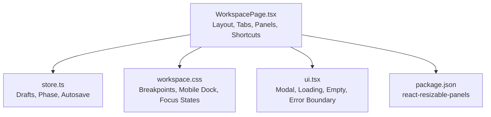
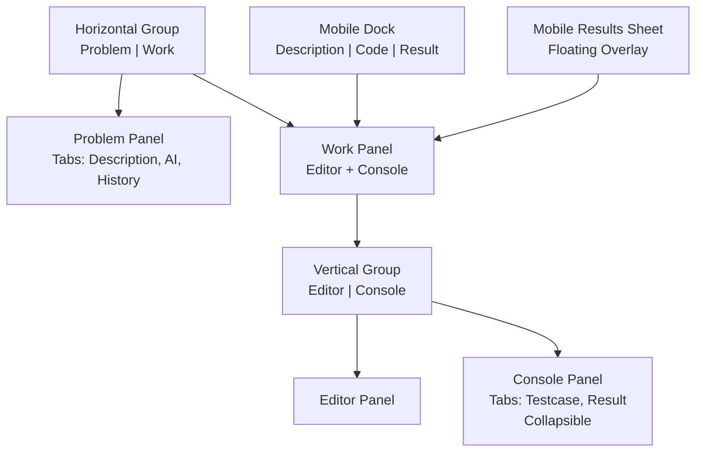
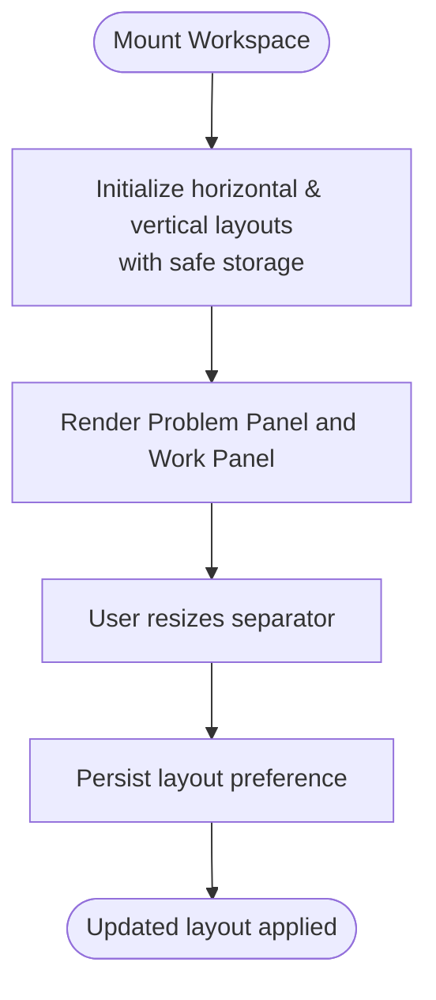
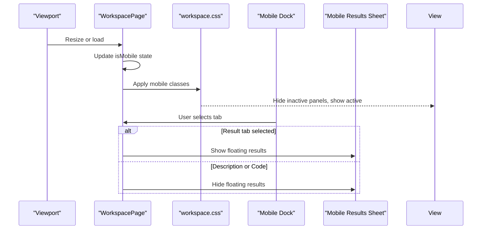
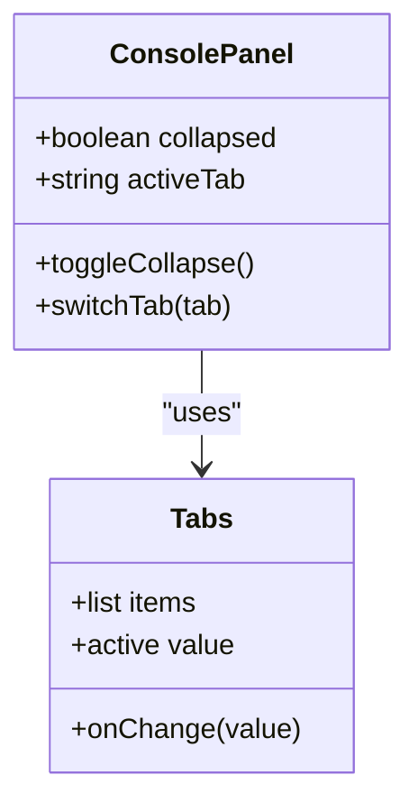
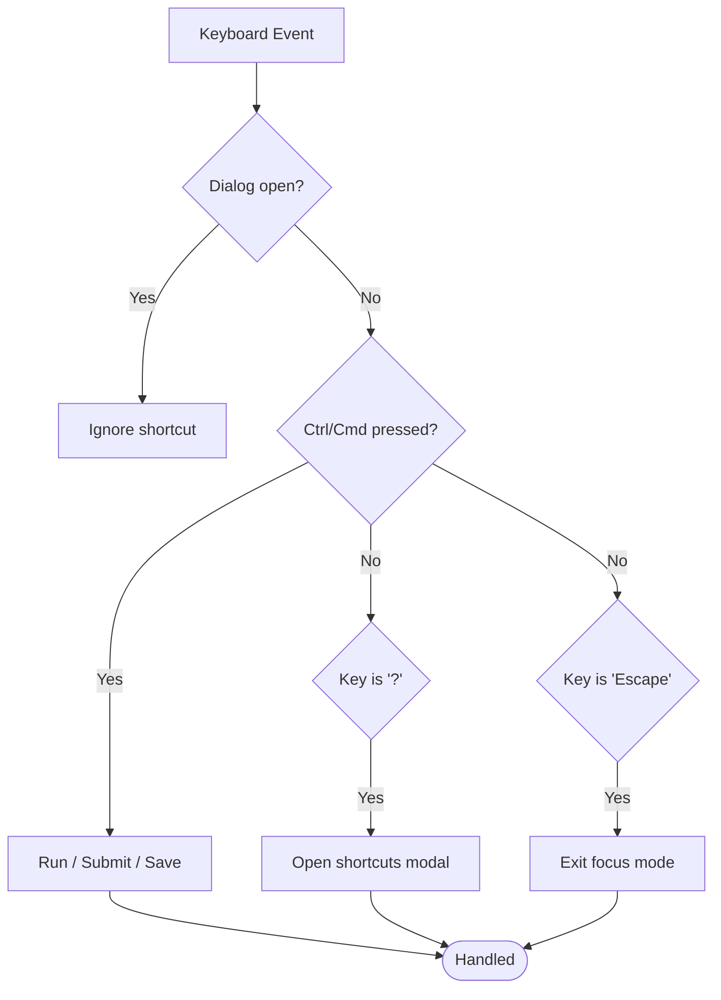
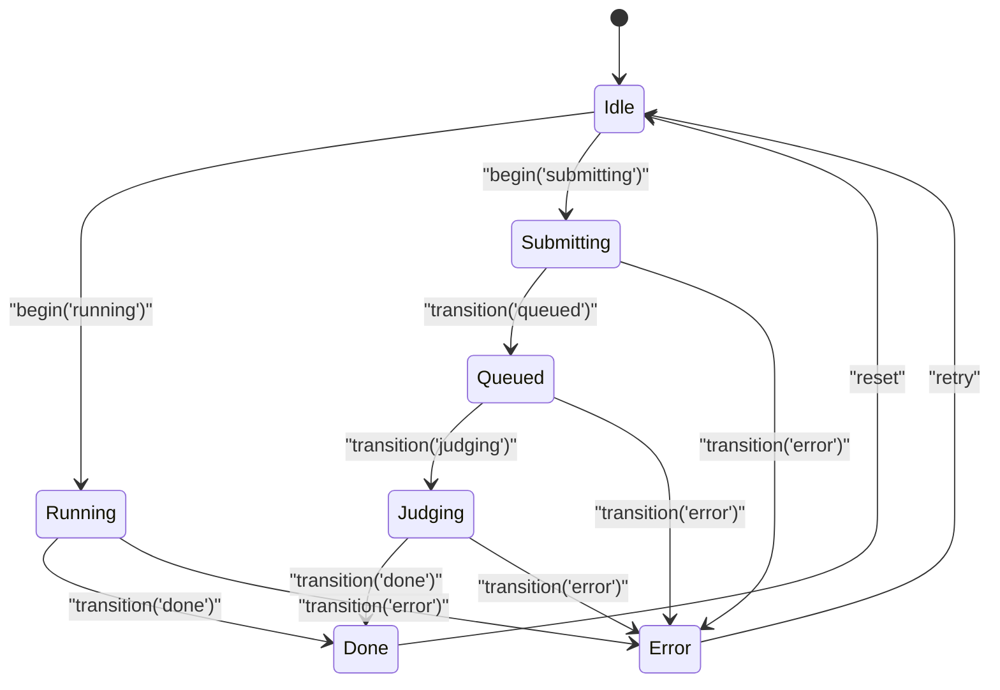
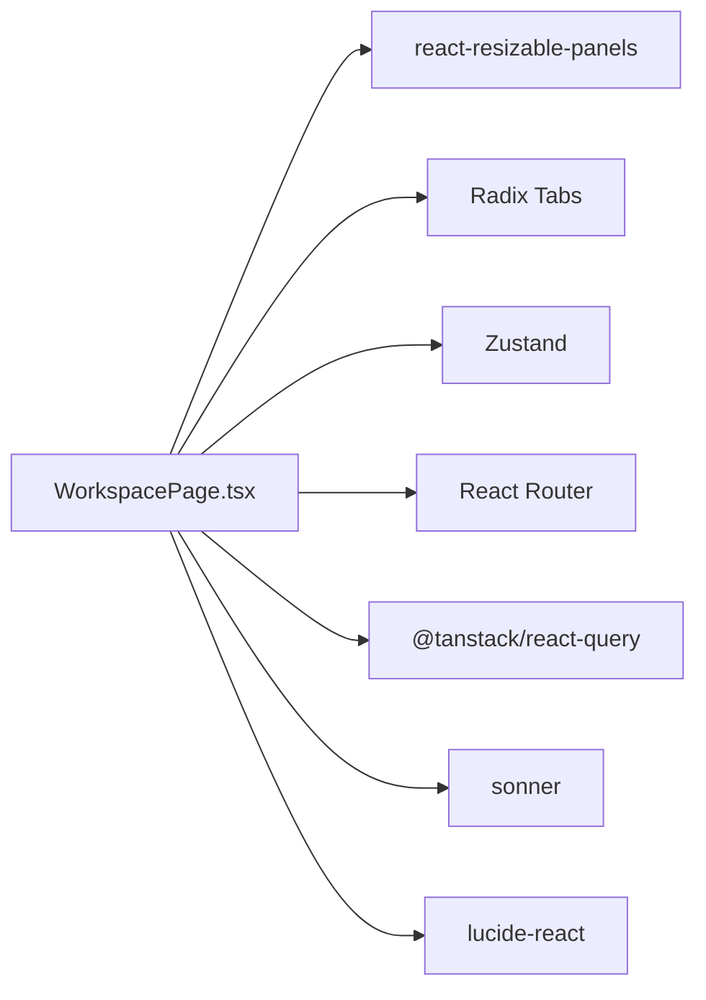

# Responsive Layout & UI

<cite>
**Referenced Files in This Document**   
- [WorkspacePage.tsx](file://frontend/src/features/workspace/WorkspacePage.tsx)
- [store.ts](file://frontend/src/features/workspace/store.ts)
- [workspace.css](file://frontend/src/features/workspace/workspace.css)
- [ui.tsx](file://frontend/src/features/workspace/ui.tsx)
- [package.json](file://frontend/package.json)
</cite>

## Table of Contents
1. [Introduction](#introduction)
2. [Project Structure](#project-structure)
3. [Core Components](#core-components)
4. [Architecture Overview](#architecture-overview)
5. [Detailed Component Analysis](#detailed-component-analysis)
6. [Dependency Analysis](#dependency-analysis)
7. [Performance Considerations](#performance-considerations)
8. [Troubleshooting Guide](#troubleshooting-guide)
9. [Conclusion](#conclusion)
10. [Appendices](#appendices)

## Introduction
This document explains the responsive layout system that adapts the workspace interface across screen sizes. It covers panel resizing, mobile navigation, touch-friendly interactions, collapsible panels, tab management, adaptive content display, keyboard shortcuts, accessibility features, and user experience optimizations. It also provides guidance for customizing layout behavior, adding new panels, and implementing additional responsive features.

The implementation is centered around a React-based workspace page that uses:
- A resizable panel layout with persistent configuration
- Mobile-first CSS breakpoints to switch between desktop and mobile layouts
- Tabbed interfaces for problem description, AI assistant, submission history, test cases, and results
- Keyboard shortcuts and accessible controls for efficient interaction

## Project Structure
The responsive layout lives primarily in the workspace feature under `frontend/src/features/workspace`. The key files are:
- `WorkspacePage.tsx`: Main layout, state, panel composition, tabs, keyboard handling, and mobile navigation
- `store.ts`: Draft persistence, execution phase state, and autosave logic
- `workspace.css`: Layout styles, breakpoints, focus states, animations, and mobile-specific rules
- `ui.tsx`: Shared UI primitives like modals, loading indicators, empty states, and error boundaries
- `package.json`: Declares the panel library used for resizable layouts

**Diagram sources**
- [WorkspacePage.tsx:1-170](file://frontend/src/features/workspace/WorkspacePage.tsx#L1-L170)
- [store.ts:1-48](file://frontend/src/features/workspace/store.ts#L1-L48)
- [workspace.css:1-22](file://frontend/src/features/workspace/workspace.css#L1-L22)
- [ui.tsx:1-31](file://frontend/src/features/workspace/ui.tsx#L1-L31)
- [package.json:39-45](file://frontend/package.json#L39-L45)

**Section sources**
- [WorkspacePage.tsx:1-170](file://frontend/src/features/workspace/WorkspacePage.tsx#L1-L170)
- [store.ts:1-48](file://frontend/src/features/workspace/store.ts#L1-L48)
- [workspace.css:1-22](file://frontend/src/features/workspace/workspace.css#L1-L22)
- [ui.tsx:1-31](file://frontend/src/features/workspace/ui.tsx#L1-L31)
- [package.json:39-45](file://frontend/package.json#L39-L45)

## Core Components
- Resizable Panel Layout:
  - Horizontal layout separates the problem description area from the editor/console area
  - Vertical layout splits the editor and console within the work area
  - Layout preferences persist via a safe storage wrapper around localStorage
- Mobile Navigation:
  - A bottom dock provides quick access to Description, Code, and Results on small screens
  - Active panel switching hides non-active panels and shows a floating results sheet when needed
- Collapsible Console:
  - The console panel can collapse to a thin bar and expand back on demand
- Tab Management:
  - Problem area tabs: Description, AI Assistant, Submission History
  - Console tabs: Testcase, Result
  - Mobile-only result sheet with its own tabs
- Keyboard Shortcuts:
  - Run code, submit code, save draft, open shortcuts help, exit focus mode
- Accessibility:
  - ARIA roles, labels, expanded states, focus-visible outlines, reduced motion support
- User Experience Optimizations:
  - Autosave drafts with debounced saves
  - Focus mode to hide distractions
  - Safe error boundaries for lazy-loaded panels
  - Touch-friendly buttons and inputs

**Section sources**
- [WorkspacePage.tsx:44-168](file://frontend/src/features/workspace/WorkspacePage.tsx#L44-L168)
- [workspace.css:1-22](file://frontend/src/features/workspace/workspace.css#L1-L22)
- [ui.tsx:23-30](file://frontend/src/features/workspace/ui.tsx#L23-L30)

## Architecture Overview
The workspace composes two nested resizable groups:
- Outer horizontal group: problem panel vs. work panel
- Inner vertical group: editor panel vs. console panel

On mobile, CSS hides inactive panels and promotes the active one to full height. A separate mobile results sheet appears as an overlay when needed.

**Diagram sources**
- [WorkspacePage.tsx:145-163](file://frontend/src/features/workspace/WorkspacePage.tsx#L145-L163)
- [workspace.css:14-21](file://frontend/src/features/workspace/workspace.css#L14-L21)

## Detailed Component Analysis

### Resizable Panel System
- Uses a default layout with unique IDs for horizontal and vertical configurations
- Persists layout changes only after user interactions to avoid unnecessary writes
- Provides min sizes and default sizes for balanced initial layouts
- Separators expose aria-labels for screen readers

**Diagram sources**
- [WorkspacePage.tsx:73-75](file://frontend/src/features/workspace/WorkspacePage.tsx#L73-L75)
- [workspace.css:1-22](file://frontend/src/features/workspace/workspace.css#L1-L22)

**Section sources**
- [WorkspacePage.tsx:73-75](file://frontend/src/features/workspace/WorkspacePage.tsx#L73-L75)
- [workspace.css:1-22](file://frontend/src/features/workspace/workspace.css#L1-L22)

### Mobile Navigation and Adaptive Content Display
- Detects mobile viewport using a media query listener
- On mobile:
  - Hides top action buttons and footer
  - Shows a bottom dock with three tabs: Description, Code, Result
  - Displays a floating results sheet when the Result tab is active
- Desktop:
  - Shows both problem and work panels side by side
  - Console is part of the work panel

**Diagram sources**
- [WorkspacePage.tsx:48-49](file://frontend/src/features/workspace/WorkspacePage.tsx#L48-L49)
- [WorkspacePage.tsx:163-165](file://frontend/src/features/workspace/WorkspacePage.tsx#L163-L165)
- [workspace.css:6-8](file://frontend/src/features/workspace/workspace.css#L6-L8)

**Section sources**
- [WorkspacePage.tsx:48-49](file://frontend/src/features/workspace/WorkspacePage.tsx#L48-L49)
- [WorkspacePage.tsx:163-165](file://frontend/src/features/workspace/WorkspacePage.tsx#L163-L165)
- [workspace.css:6-8](file://frontend/src/features/workspace/workspace.css#L6-L8)

### Collapsible Panels and Tabs
- Console panel supports collapse/expand with a chevron button
- Tabs control visibility of testcase and result content
- On mobile, console tabs are hidden inside the work panel; a separate mobile result sheet handles results

**Diagram sources**
- [WorkspacePage.tsx:158-160](file://frontend/src/features/workspace/WorkspacePage.tsx#L158-L160)
- [WorkspacePage.tsx:163-163](file://frontend/src/features/workspace/WorkspacePage.tsx#L163-L163)

**Section sources**
- [WorkspacePage.tsx:158-160](file://frontend/src/features/workspace/WorkspacePage.tsx#L158-L160)
- [WorkspacePage.tsx:163-163](file://frontend/src/features/workspace/WorkspacePage.tsx#L163-L163)

### Keyboard Shortcuts and Accessibility
- Global keyboard handler:
  - Run code: Ctrl/Cmd + '
  - Submit code: Ctrl/Cmd + Enter
  - Save draft: Ctrl/Cmd + S
  - Open shortcuts modal: ?
  - Exit focus mode: Escape
- Accessibility:
  - Buttons have aria-labels and aria-expanded where applicable
  - Focus-visible outlines ensure keyboard users see focus
  - Reduced motion preference disables animations and transitions

**Diagram sources**
- [WorkspacePage.tsx:114-125](file://frontend/src/features/workspace/WorkspacePage.tsx#L114-L125)
- [workspace.css:1-22](file://frontend/src/features/workspace/workspace.css#L1-L22)

**Section sources**
- [WorkspacePage.tsx:114-125](file://frontend/src/features/workspace/WorkspacePage.tsx#L114-L125)
- [workspace.css:1-22](file://frontend/src/features/workspace/workspace.css#L1-L22)

### State and Autosave
- Drafts are keyed by user, problem, and language
- Editing triggers debounced autosave to local storage
- Execution phases prevent concurrent runs/submits and reflect UI state

**Diagram sources**
- [store.ts:38-43](file://frontend/src/features/workspace/store.ts#L38-L43)

**Section sources**
- [store.ts:1-48](file://frontend/src/features/workspace/store.ts#L1-L48)

### Error Boundaries and Fallbacks
- Lazy-loaded components (AI assistant, editor, mocks) are wrapped in Suspense
- PanelBoundary catches errors inside panels and offers retry
- Safe storage wrappers catch localStorage failures gracefully

**Section sources**
- [WorkspacePage.tsx:19-21](file://frontend/src/features/workspace/WorkspacePage.tsx#L19-L21)
- [ui.tsx:26-30](file://frontend/src/features/workspace/ui.tsx#L26-L30)
- [WorkspacePage.tsx:23-23](file://frontend/src/features/workspace/WorkspacePage.tsx#L23-L23)

## Dependency Analysis
- react-resizable-panels: Provides Panel, Group, Separator, useDefaultLayout, and usePanelRef
- Radix Tabs: Used for accessible tab interfaces
- Zustand: Local store for workspace state
- React Router: Navigation between problems and learning pages
- React Query: Data fetching for problem details, scopes, peers, topic context, and submission history
- Sonner: Toast notifications
- Lucide Icons: Iconography throughout the UI

**Diagram sources**
- [WorkspacePage.tsx:1-18](file://frontend/src/features/workspace/WorkspacePage.tsx#L1-L18)
- [package.json:39-45](file://frontend/package.json#L39-L45)

**Section sources**
- [WorkspacePage.tsx:1-18](file://frontend/src/features/workspace/WorkspacePage.tsx#L1-L18)
- [package.json:39-45](file://frontend/package.json#L39-L45)

## Performance Considerations
- Debounced autosave reduces frequent storage writes during editing
- Layout persistence only saves after user interactions to minimize I/O
- Lazy loading of heavy components (editor, AI assistant) improves initial render time
- CSS avoids expensive animations when prefers-reduced-motion is enabled
- Mobile layout switches via CSS classes rather than re-rendering entire trees

[No sources needed since this section provides general guidance]

## Troubleshooting Guide
- Panel not resizing:
  - Ensure separators have proper aria-labels and are not overridden by CSS
  - Verify layout IDs are unique and storage is available
- Mobile view not switching:
  - Confirm media query listener is attached and isMobile state updates
  - Check that .ws-mobile-active classes are applied correctly
- Console not collapsing:
  - Verify collapsed state toggles and panelRef usage
- Keyboard shortcuts not working:
  - Ensure no dialog is open and event listeners are attached globally
- Storage errors:
  - Safe storage wrappers should handle exceptions; check for error messages in draft status

**Section sources**
- [WorkspacePage.tsx:73-75](file://frontend/src/features/workspace/WorkspacePage.tsx#L73-L75)
- [WorkspacePage.tsx:48-49](file://frontend/src/features/workspace/WorkspacePage.tsx#L48-L49)
- [WorkspacePage.tsx:158-160](file://frontend/src/features/workspace/WorkspacePage.tsx#L158-L160)
- [WorkspacePage.tsx:114-125](file://frontend/src/features/workspace/WorkspacePage.tsx#L114-L125)
- [store.ts:28-37](file://frontend/src/features/workspace/store.ts#L28-L37)

## Conclusion
The workspace layout combines a robust resizable panel system with mobile-first CSS to deliver a consistent, accessible, and performant experience across devices. It supports collapsible panels, tabbed content, keyboard shortcuts, and thoughtful UX patterns like autosave and focus mode. The modular structure makes it straightforward to customize behavior, add new panels, and extend responsive features.

[No sources needed since this section summarizes without analyzing specific files]

## Appendices

### Customizing Layout Behavior
- Change default sizes:
  - Adjust defaultSize props on Panel components
- Change min sizes:
  - Adjust minSize props to enforce minimum widths/heights
- Persist layout differently:
  - Replace the safe storage wrapper with your own storage strategy
- Add new panels:
  - Insert a new Panel inside the appropriate Group
  - Wire up mobile visibility via .ws-mobile-active class and state
  - Add corresponding tabs if needed

**Section sources**
- [WorkspacePage.tsx:145-163](file://frontend/src/features/workspace/WorkspacePage.tsx#L145-L163)
- [workspace.css:14-21](file://frontend/src/features/workspace/workspace.css#L14-L21)

### Adding New Panels
Steps:
1. Create a new component for the panel content
2. Add a Panel inside the horizontal or vertical Group
3. Set id, defaultSize, minSize, and optional collapsible/collapsedSize
4. If mobile, manage visibility through state and .ws-mobile-active
5. Optionally add a tab trigger and content
6. Provide aria-labels and keyboard support

**Section sources**
- [WorkspacePage.tsx:145-163](file://frontend/src/features/workspace/WorkspacePage.tsx#L145-L163)
- [workspace.css:1-22](file://frontend/src/features/workspace/workspace.css#L1-L22)

### Implementing Additional Responsive Features
- Breakpoints:
  - Extend existing media queries in workspace.css
- Mobile dock:
  - Add more navigation items to the mobile dock array
- Focus mode:
  - Toggle fullscreen state to hide distractions
- Reduced motion:
  - Respect prefers-reduced-motion for animations and transitions

**Section sources**
- [workspace.css:4-9](file://frontend/src/features/workspace/workspace.css#L4-L9)
- [WorkspacePage.tsx:61-61](file://frontend/src/features/workspace/WorkspacePage.tsx#L61-L61)
- [WorkspacePage.tsx:165-165](file://frontend/src/features/workspace/WorkspacePage.tsx#L165-L165)