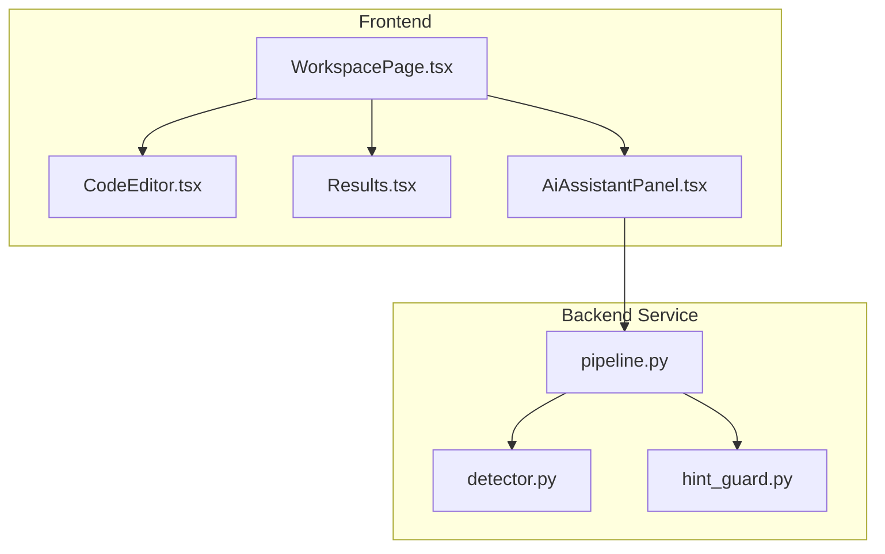
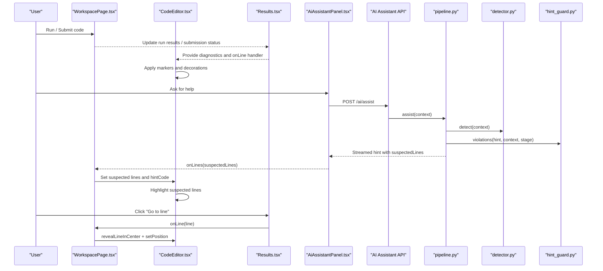
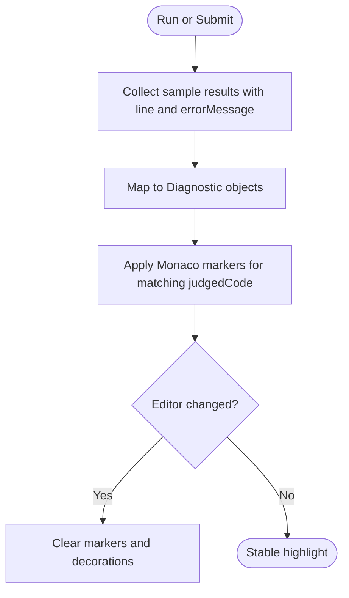
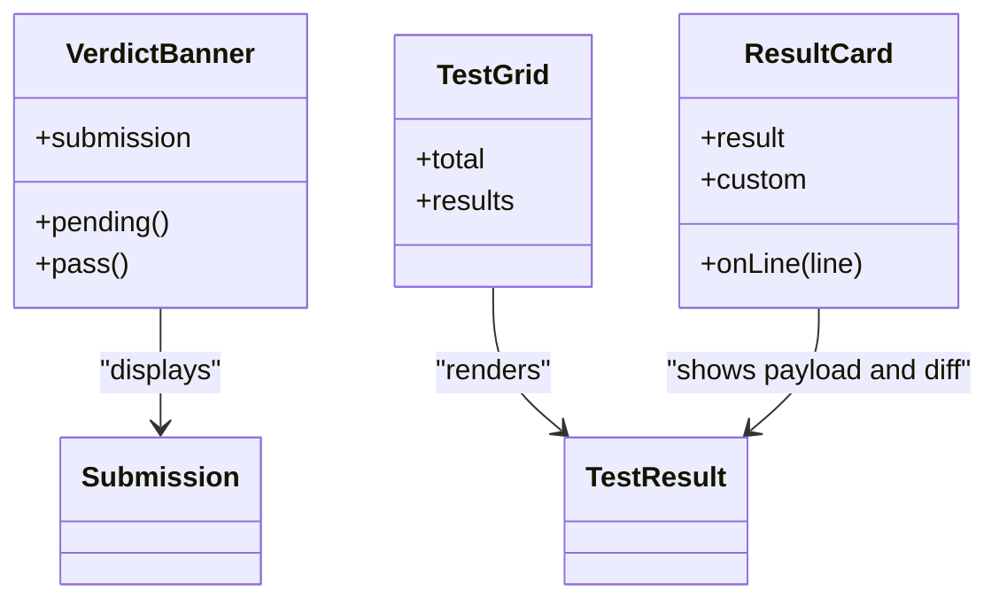
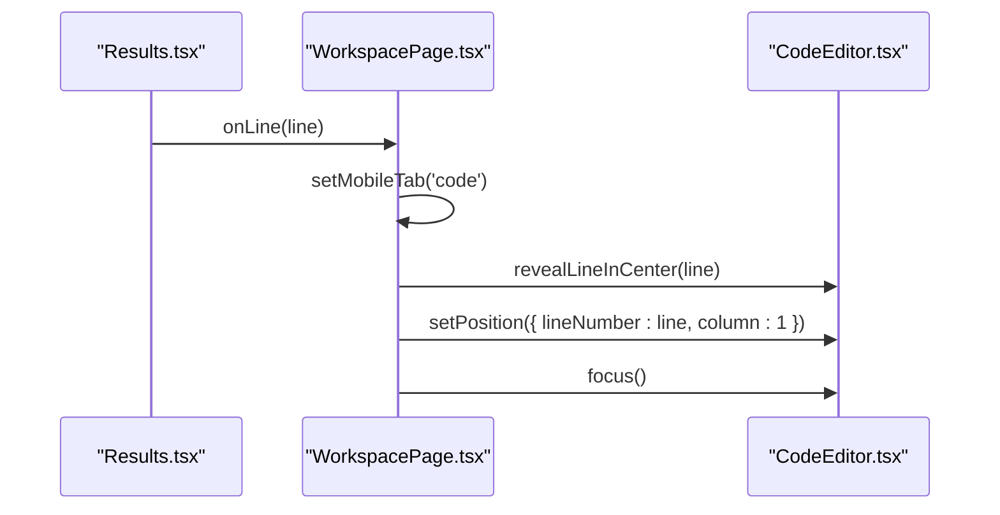
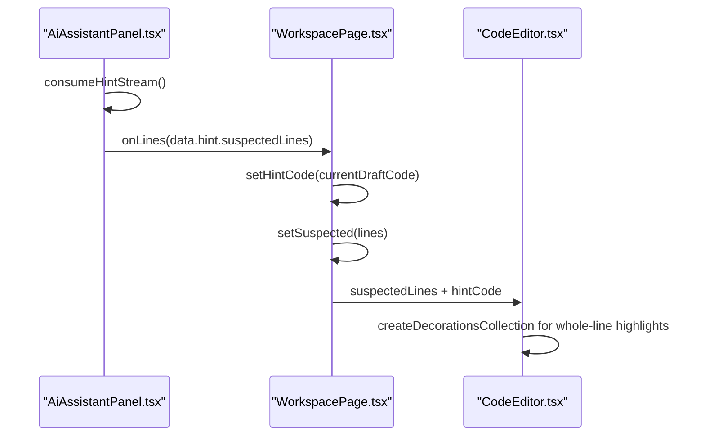
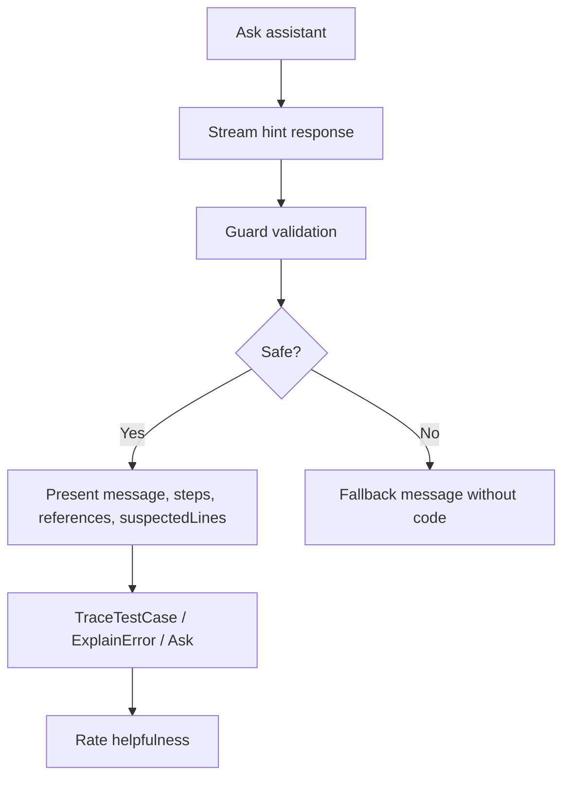
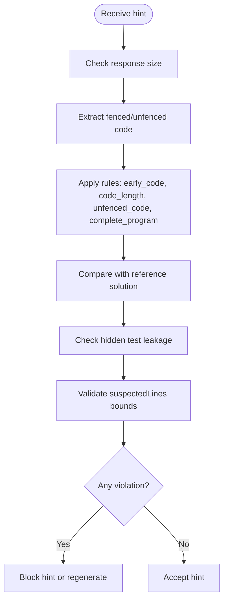
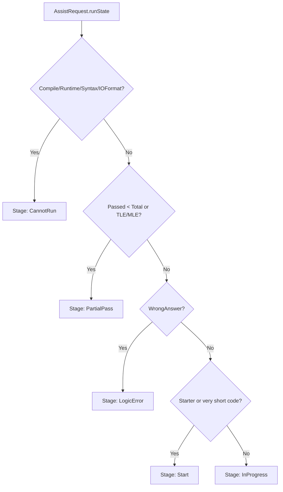
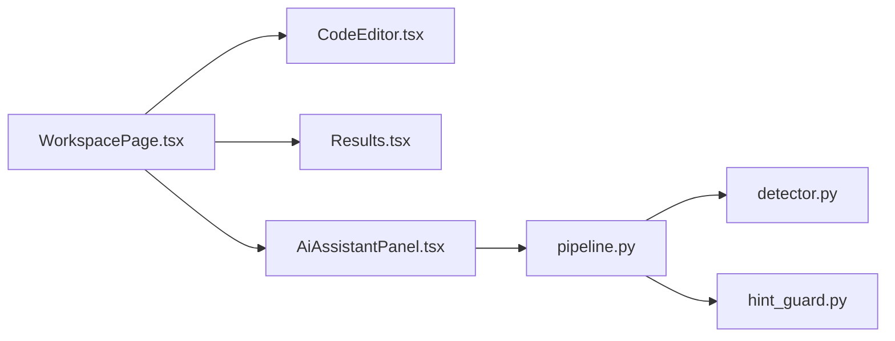

# Debugging Interface

<cite>
**Referenced Files in This Document**   
- [WorkspacePage.tsx](file://frontend/src/features/workspace/WorkspacePage.tsx)
- [CodeEditor.tsx](file://frontend/src/features/workspace/CodeEditor.tsx)
- [Results.tsx](file://frontend/src/features/workspace/Results.tsx)
- [AiAssistantPanel.tsx](file://frontend/src/features/ai-assistant/AiAssistantPanel.tsx)
- [pipeline.py](file://ai-service/app/api/pipeline.py)
- [hint_guard.py](file://ai-service/app/guard/hint_guard.py)
- [detector.py](file://ai-service/app/stage/detector.py)
</cite>

## Table of Contents
1. [Introduction](#introduction)
2. [Project Structure](#project-structure)
3. [Core Components](#core-components)
4. [Architecture Overview](#architecture-overview)
5. [Detailed Component Analysis](#detailed-component-analysis)
6. [Dependency Analysis](#dependency-analysis)
7. [Performance Considerations](#performance-considerations)
8. [Troubleshooting Guide](#troubleshooting-guide)
9. [Conclusion](#conclusion)
10. [Appendices](#appendices)

## Introduction
This document explains the debugging interface that helps users identify and fix code errors. It covers:
- Line-by-line error highlighting in the editor
- Diagnostic message display from test execution
- Interactive navigation to error locations
- Suspected line detection and hint integration
- Code suggestion features through the AI assistant
- Examples for enhancing debugging capabilities, adding diagnostic tools, and implementing advanced error analysis

The interface combines a Monaco-based code editor, a results panel, an AI assistant panel, and a Python-backed hint pipeline with guardrails.

## Project Structure
The debugging experience spans frontend React components and a Python service:
- Frontend workspace page orchestrates editor state, diagnostics, suspected lines, and navigation
- Editor component renders Monaco, applies markers and decorations, and clears them on edits
- Results component shows verdicts, diffs, and clickable “Go to line” actions
- AI assistant panel streams hints, displays steps, references, and suspected lines
- Python pipeline detects stage, generates guarded hints, and returns suspected lines and guidance

**Diagram sources**
- [WorkspacePage.tsx:126-128](file://frontend/src/features/workspace/WorkspacePage.tsx#L126-L128)
- [CodeEditor.tsx:30-38](file://frontend/src/features/workspace/CodeEditor.tsx#L30-L38)
- [Results.tsx:24-31](file://frontend/src/features/workspace/Results.tsx#L24-L31)
- [AiAssistantPanel.tsx:38-48](file://frontend/src/features/ai-assistant/AiAssistantPanel.tsx#L38-L48)
- [pipeline.py:10-40](file://ai-service/app/api/pipeline.py#L10-L40)
- [detector.py:11-37](file://ai-service/app/stage/detector.py#L11-L37)
- [hint_guard.py:22-47](file://ai-service/app/guard/hint_guard.py#L22-L47)

**Section sources**
- [WorkspacePage.tsx:27-170](file://frontend/src/features/workspace/WorkspacePage.tsx#L27-L170)
- [CodeEditor.tsx:1-47](file://frontend/src/features/workspace/CodeEditor.tsx#L1-L47)
- [Results.tsx:1-32](file://frontend/src/features/workspace/Results.tsx#L1-L32)
- [AiAssistantPanel.tsx:1-88](file://frontend/src/features/ai-assistant/AiAssistantPanel.tsx#L1-L88)
- [pipeline.py:1-41](file://ai-service/app/api/pipeline.py#L1-L41)
- [detector.py:1-38](file://ai-service/app/stage/detector.py#L1-L38)
- [hint_guard.py:1-48](file://ai-service/app/guard/hint_guard.py#L1-L48)

## Core Components
- WorkspacePage: central controller for running code, collecting diagnostics, managing suspected lines, and navigating to error locations
- CodeEditor: Monaco editor wrapper applying diagnostic markers and suspected-line decorations
- Results: verdict banner, test grid, per-test cards with diff view and “Go to line” buttons
- AiAssistantPanel: streaming hint UI, step list, guiding questions, references, suspected-line navigation, and contextual action buttons
- Pipeline (Python): stage detection, LLM hint generation, caching, and guard validation; returns suspected lines and safe fallback when needed
- Hint Guard: rule-based safety checks preventing leakage or unsafe suggestions
- Stage Detector: classifies user progress into stages like Start, InProgress, LogicError, CannotRun, PartialPass

Key responsibilities:
- Diagnostics flow from judge results to editor markers
- Suspected lines flow from AI hints to editor decorations and interactive navigation
- Error messages are surfaced in both editor markers and result cards
- Navigation is unified via jump-to-line helpers

**Section sources**
- [WorkspacePage.tsx:104-128](file://frontend/src/features/workspace/WorkspacePage.tsx#L104-L128)
- [CodeEditor.tsx:15-38](file://frontend/src/features/workspace/CodeEditor.tsx#L15-L38)
- [Results.tsx:6-31](file://frontend/src/features/workspace/Results.tsx#L6-L31)
- [AiAssistantPanel.tsx:12-48](file://frontend/src/features/ai-assistant/AiAssistantPanel.tsx#L12-L48)
- [pipeline.py:10-40](file://ai-service/app/api/pipeline.py#L10-L40)
- [detector.py:11-37](file://ai-service/app/stage/detector.py#L11-L37)
- [hint_guard.py:22-47](file://ai-service/app/guard/hint_guard.py#L22-L47)

## Architecture Overview
The debugging interface follows a layered architecture:
- Presentation layer: React components render editor, results, and assistant
- State coordination: WorkspacePage manages editor handle, diagnostics, suspected lines, and navigation
- Data flow: Judge results provide diagnostics; AI assistant provides suspected lines and hints
- Backend pipeline: Detects stage, generates hints, validates with guards, caches responses, and returns structured data

**Diagram sources**
- [WorkspacePage.tsx:126-128](file://frontend/src/features/workspace/WorkspacePage.tsx#L126-L128)
- [CodeEditor.tsx:30-38](file://frontend/src/features/workspace/CodeEditor.tsx#L30-L38)
- [Results.tsx:24-31](file://frontend/src/features/workspace/Results.tsx#L24-L31)
- [AiAssistantPanel.tsx:38-48](file://frontend/src/features/ai-assistant/AiAssistantPanel.tsx#L38-L48)
- [pipeline.py:10-40](file://ai-service/app/api/pipeline.py#L10-L40)
- [detector.py:11-37](file://ai-service/app/stage/detector.py#L11-L37)
- [hint_guard.py:22-47](file://ai-service/app/guard/hint_guard.py#L22-L47)

## Detailed Component Analysis

### Line-by-Line Error Highlighting
- Diagnostics are derived from sample test results containing line numbers and error messages
- The editor applies Monaco markers for each diagnostic, scoped to the current judged code snapshot
- Markers include severity, start/end line/column, and message text
- On editor changes, markers and decorations are cleared to avoid stale highlights

**Diagram sources**
- [WorkspacePage.tsx:126-128](file://frontend/src/features/workspace/WorkspacePage.tsx#L126-L128)
- [CodeEditor.tsx:30-38](file://frontend/src/features/workspace/CodeEditor.tsx#L30-L38)

**Section sources**
- [WorkspacePage.tsx:126-128](file://frontend/src/features/workspace/WorkspacePage.tsx#L126-L128)
- [CodeEditor.tsx:30-38](file://frontend/src/features/workspace/CodeEditor.tsx#L30-L38)

### Diagnostic Message Display
- Verdict banners summarize overall status and points
- Test grids show pass/fail indicators per test
- Result cards display input, expected output, actual output, runtime, and error messages
- Mismatches are highlighted inline using diff-like markup
- Hidden tests hide payloads but still show verdicts

**Diagram sources**
- [Results.tsx:6-31](file://frontend/src/features/workspace/Results.tsx#L6-L31)

**Section sources**
- [Results.tsx:6-31](file://frontend/src/features/workspace/Results.tsx#L6-L31)

### Interactive Navigation to Error Locations
- Each result card can trigger “Go to line” by calling onLine
- WorkspacePage implements jumpToLine to reveal the line in center, set position, and focus the editor
- Mobile-friendly tab switching ensures the editor panel is visible before navigation

**Diagram sources**
- [Results.tsx:24-31](file://frontend/src/features/workspace/Results.tsx#L24-L31)
- [WorkspacePage.tsx:126-128](file://frontend/src/features/workspace/WorkspacePage.tsx#L126-L128)

**Section sources**
- [Results.tsx:24-31](file://frontend/src/features/workspace/Results.tsx#L24-L31)
- [WorkspacePage.tsx:126-128](file://frontend/src/features/workspace/WorkspacePage.tsx#L126-L128)

### Suspected Line Detection and Hint Integration
- The AI assistant requests hints and receives suspectedLines
- WorkspacePage sets suspected lines and the corresponding hintCode snapshot
- CodeEditor decorates whole lines with a CSS class when the hintCode matches the editor content
- Users can click “View lines” in the assistant to navigate directly to suspected lines

**Diagram sources**
- [AiAssistantPanel.tsx:38-48](file://frontend/src/features/ai-assistant/AiAssistantPanel.tsx#L38-L48)
- [WorkspacePage.tsx:126-128](file://frontend/src/features/workspace/WorkspacePage.tsx#L126-L128)
- [CodeEditor.tsx:30-38](file://frontend/src/features/workspace/CodeEditor.tsx#L30-L38)

**Section sources**
- [AiAssistantPanel.tsx:38-48](file://frontend/src/features/ai-assistant/AiAssistantPanel.tsx#L38-L48)
- [WorkspacePage.tsx:126-128](file://frontend/src/features/workspace/WorkspacePage.tsx#L126-L128)
- [CodeEditor.tsx:30-38](file://frontend/src/features/workspace/CodeEditor.tsx#L30-L38)

### Code Suggestion Features
- The assistant provides guided steps, guiding questions, and references
- Contextual buttons offer specialized flows such as tracing failing samples or explaining errors
- Hints are streamed and sanitized; feedback collection allows improvement over time
- Guardrails prevent leaking hidden test data or providing overly complete solutions

**Diagram sources**
- [AiAssistantPanel.tsx:38-84](file://frontend/src/features/ai-assistant/AiAssistantPanel.tsx#L38-L84)
- [pipeline.py:10-40](file://ai-service/app/api/pipeline.py#L10-L40)
- [hint_guard.py:22-47](file://ai-service/app/guard/hint_guard.py#L22-L47)

**Section sources**
- [AiAssistantPanel.tsx:38-84](file://frontend/src/features/ai-assistant/AiAssistantPanel.tsx#L38-L84)
- [pipeline.py:10-40](file://ai-service/app/api/pipeline.py#L10-L40)
- [hint_guard.py:22-47](file://ai-service/app/guard/hint_guard.py#L22-L47)

### Suspected Lines Validation and Safety
- The guard checks for:
  - Excessive response size
  - Early code exposure in early stages
  - Overly long code snippets
  - Unfenced code blocks
  - Complete program templates
  - Similarity to reference solution
  - Leakage of hidden test inputs/outputs
  - Invalid suspected line indices

**Diagram sources**
- [hint_guard.py:22-47](file://ai-service/app/guard/hint_guard.py#L22-L47)

**Section sources**
- [hint_guard.py:22-47](file://ai-service/app/guard/hint_guard.py#L22-L47)

### Stage Detection and Category Classification
- The detector classifies user state into stages based on compile/runtime errors, passed counts, timeouts/memory limits, wrong answers, starter code presence, and history signals
- Categories refine the type of issue (e.g., Complexity, MissingEdgeCase, WrongAlgorithm)
- Confidence and stuck flags inform hint behavior and level unlocking

**Diagram sources**
- [detector.py:11-37](file://ai-service/app/stage/detector.py#L11-L37)

**Section sources**
- [detector.py:11-37](file://ai-service/app/stage/detector.py#L11-L37)

## Dependency Analysis
- WorkspacePage depends on:
  - CodeEditor for editor instance and decoration management
  - Results for rendering verdicts and triggering navigation
  - AiAssistantPanel for hint streaming and suspected lines
- CodeEditor depends on:
  - Monaco editor APIs for markers and decorations
  - Workspace store for draft persistence
- AiAssistantPanel depends on:
  - Axios and streaming utilities for hint delivery
  - WorkspacePage callback for line navigation
- Pipeline depends on:
  - Detector for stage classification
  - Guard for safety validation
  - Cache for hint deduplication

**Diagram sources**
- [WorkspacePage.tsx:126-128](file://frontend/src/features/workspace/WorkspacePage.tsx#L126-L128)
- [CodeEditor.tsx:30-38](file://frontend/src/features/workspace/CodeEditor.tsx#L30-L38)
- [Results.tsx:24-31](file://frontend/src/features/workspace/Results.tsx#L24-L31)
- [AiAssistantPanel.tsx:38-48](file://frontend/src/features/ai-assistant/AiAssistantPanel.tsx#L38-L48)
- [pipeline.py:10-40](file://ai-service/app/api/pipeline.py#L10-L40)
- [detector.py:11-37](file://ai-service/app/stage/detector.py#L11-L37)
- [hint_guard.py:22-47](file://ai-service/app/guard/hint_guard.py#L22-L47)

**Section sources**
- [WorkspacePage.tsx:126-128](file://frontend/src/features/workspace/WorkspacePage.tsx#L126-L128)
- [CodeEditor.tsx:30-38](file://frontend/src/features/workspace/CodeEditor.tsx#L30-L38)
- [Results.tsx:24-31](file://frontend/src/features/workspace/Results.tsx#L24-L31)
- [AiAssistantPanel.tsx:38-48](file://frontend/src/features/ai-assistant/AiAssistantPanel.tsx#L38-L48)
- [pipeline.py:10-40](file://ai-service/app/api/pipeline.py#L10-L40)
- [detector.py:11-37](file://ai-service/app/stage/detector.py#L11-L37)
- [hint_guard.py:22-47](file://ai-service/app/guard/hint_guard.py#L22-L47)

## Performance Considerations
- Marker and decoration updates are scoped to the active editor model and cleared on edits to avoid stale visuals
- Streaming hints reduce perceived latency and allow incremental reading
- Caching in the backend avoids repeated LLM calls for identical contexts and stages
- Guard checks are lightweight and deterministic, minimizing overhead
- Avoid unnecessary re-renders by passing only relevant diagnostics and suspected lines

[No sources needed since this section provides general guidance]

## Troubleshooting Guide
Common issues and resolutions:
- No markers appear after run:
  - Ensure diagnostics are filtered for sample tests and contain line numbers and error messages
  - Verify judgedCode matches the editor content so markers apply
- Suspected lines not highlighted:
  - Confirm hintCode matches the current editor content
  - Check suspectedLines are within valid bounds and non-empty
- AI assistant blocked:
  - Guard may block due to excessive code, early exposure, hidden test leakage, or similarity to reference solution
  - Use fallback mode or adjust prompt to avoid sensitive data
- Navigation fails:
  - Ensure jumpToLine runs after editor mount and uses requestAnimationFrame to ensure layout readiness
  - On mobile, switch to the code tab before revealing the line

**Section sources**
- [CodeEditor.tsx:30-38](file://frontend/src/features/workspace/CodeEditor.tsx#L30-L38)
- [WorkspacePage.tsx:126-128](file://frontend/src/features/workspace/WorkspacePage.tsx#L126-L128)
- [AiAssistantPanel.tsx:38-48](file://frontend/src/features/ai-assistant/AiAssistantPanel.tsx#L38-L48)
- [hint_guard.py:22-47](file://ai-service/app/guard/hint_guard.py#L22-L47)

## Conclusion
The debugging interface integrates editor-level diagnostics, result-driven navigation, and AI-powered hints with robust guardrails. It provides clear visual cues for errors, actionable steps for fixing issues, and safe, contextual assistance. Extending the system involves adding new diagnostic sources, refining stage detection, improving hint quality, and expanding guard rules while maintaining performance and safety.

[No sources needed since this section summarizes without analyzing specific files]

## Appendices

### Enhancing Debugging Capabilities
- Add new diagnostic tools:
  - Integrate static analyzers to produce additional diagnostics mapped to line/column ranges
  - Extend WorkspacePage to merge analyzer diagnostics with judge diagnostics
  - Render combined markers in CodeEditor with distinct severities
- Implement advanced error analysis:
  - Enrich detector categories with ML classifiers for deeper insights
  - Provide drill-down views linking suspected lines to AST nodes or call stacks
  - Offer automated patch suggestions validated by guards and tests

**Section sources**
- [WorkspacePage.tsx:126-128](file://frontend/src/features/workspace/WorkspacePage.tsx#L126-L128)
- [CodeEditor.tsx:30-38](file://frontend/src/features/workspace/CodeEditor.tsx#L30-L38)
- [detector.py:11-37](file://ai-service/app/stage/detector.py#L11-L37)
- [hint_guard.py:22-47](file://ai-service/app/guard/hint_guard.py#L22-L47)