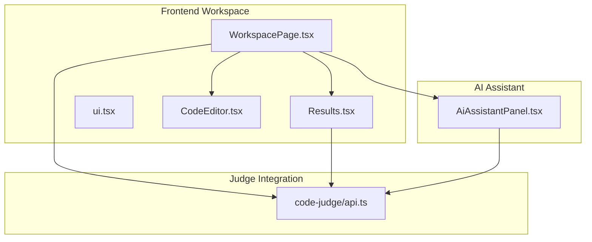
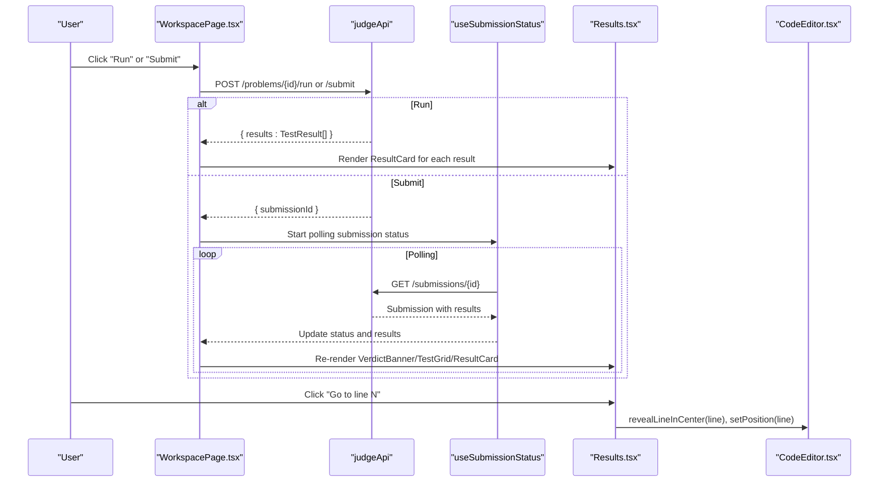
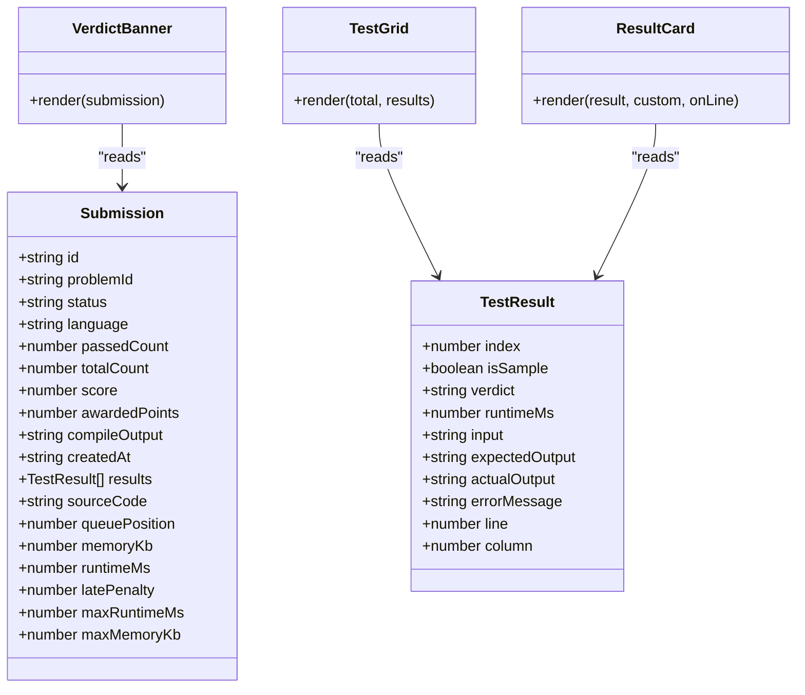

# Result Visualization

<cite>
**Referenced Files in This Document**
- [Results.tsx](file://frontend/src/features/workspace/Results.tsx)
- [WorkspacePage.tsx](file://frontend/src/features/workspace/WorkspacePage.tsx)
- [api.ts](file://frontend/src/features/code-judge/api.ts)
- [AiAssistantPanel.tsx](file://frontend/src/features/ai-assistant/AiAssistantPanel.tsx)
- [workspace.test.tsx](file://frontend/tests/workspace.test.tsx)
</cite>

## Table of Contents
1. [Introduction](#introduction)
2. [Project Structure](#project-structure)
3. [Core Components](#core-components)
4. [Architecture Overview](#architecture-overview)
5. [Detailed Component Analysis](#detailed-component-analysis)
6. [Dependency Analysis](#dependency-analysis)
7. [Performance Considerations](#performance-considerations)
8. [Troubleshooting Guide](#troubleshooting-guide)
9. [Conclusion](#conclusion)
10. [Appendices](#appendices)

## Introduction
This document explains the result visualization system that displays code execution outcomes in the workspace. It covers the verdict display, test result grids, performance metrics presentation, error highlighting, line-by-line debugging support, interactive navigation between results and code, responsive mobile behavior, and accessibility features. It also provides guidance for customizing result displays, adding new metrics, and implementing advanced debugging visualizations.

## Project Structure
The result visualization is implemented in the frontend workspace feature:
- The main result components live in a dedicated module.
- The workspace page composes these components with editor state, submission polling, and console panels.
- The judge API types define the data model for submissions and test results.
- The AI assistant panel integrates with result data to suggest targeted hints and suspected lines.
- Tests verify security, labeling, and rendering behavior.

**Diagram sources**
- [WorkspacePage.tsx:1-170](file://frontend/src/features/workspace/WorkspacePage.tsx#L1-L170)
- [Results.tsx:1-32](file://frontend/src/features/workspace/Results.tsx#L1-L32)
- [api.ts:1-37](file://frontend/src/features/code-judge/api.ts#L1-L37)
- [AiAssistantPanel.tsx:1-88](file://frontend/src/features/ai-assistant/AiAssistantPanel.tsx#L1-L88)

**Section sources**
- [WorkspacePage.tsx:1-170](file://frontend/src/features/workspace/WorkspacePage.tsx#L1-L170)
- [Results.tsx:1-32](file://frontend/src/features/workspace/Results.tsx#L1-L32)
- [api.ts:1-37](file://frontend/src/features/code-judge/api.ts#L1-L37)
- [AiAssistantPanel.tsx:1-88](file://frontend/src/features/ai-assistant/AiAssistantPanel.tsx#L1-L88)

## Core Components
- VerdictBanner: Displays the overall submission status, points, queue position, and friendly messaging. It adapts to pending, passing, failing, or time/memory limit states.
- TestGrid: Renders a compact grid showing per-test status (passed, failed, pending) with accessible labels and icons.
- ResultCard: Shows input, expected output, actual output, runtime, error messages, and optional line navigation. Hidden tests are masked for privacy.

Key responsibilities:
- VerdictBanner maps submission status to localized labels and moodful mascot feedback.
- TestGrid aggregates test statuses into an accessible overview.
- ResultCard highlights mismatches, renders errors, and supports jumping to specific source lines.

**Section sources**
- [Results.tsx:6-31](file://frontend/src/features/workspace/Results.tsx#L6-L31)

## Architecture Overview
The workspace orchestrates execution and result visualization:
- Users run or submit code from the workspace toolbar.
- Run returns immediate test results; Submit starts a background submission polled by the status hook.
- Results are rendered in the console panel, with tabs for test cases and results.
- Line navigation connects result diagnostics to the editor.
- AI assistant uses current results to infer a stage and provide step-by-step hints.

**Diagram sources**
- [WorkspacePage.tsx:100-138](file://frontend/src/features/workspace/WorkspacePage.tsx#L100-L138)
- [api.ts:19-33](file://frontend/src/features/code-judge/api.ts#L19-L33)
- [Results.tsx:24-31](file://frontend/src/features/workspace/Results.tsx#L24-L31)

## Detailed Component Analysis

### Verdict Display System
VerdictBanner presents:
- Overall status label mapped from submission status.
- Mascot mood reflecting success, thinking, or sadness.
- Points awarded on success.
- Queue position while pending.
- Optional confetti animation for successful submissions, respecting reduced motion preferences.

Accessibility and UX:
- Uses role="status" for screen readers.
- Localized labels via a verdict mapping.
- Animations are disabled when users prefer reduced motion.

Customization:
- Extend the verdict mapping to add new statuses.
- Replace mascot moods or add additional status-specific messaging.

**Section sources**
- [Results.tsx:6-17](file://frontend/src/features/workspace/Results.tsx#L6-L17)

### Test Result Grids
TestGrid renders:
- A numbered grid matching total test count.
- Icons for passed, failed, and pending states.
- Accessible aria-labels describing each test’s status.
- Tooltips with localized verdict text.

Design considerations:
- Pending tests show a clock icon until results arrive.
- Passed tests use a checkmark; failed tests use an alert icon.
- Labels remain meaningful even if colors change.

Extensibility:
- Add new badges or summary statistics by composing TestGrid with additional metadata.

**Section sources**
- [Results.tsx:18-23](file://frontend/src/features/workspace/Results.tsx#L18-L23)
- [workspace.test.tsx:51-56](file://frontend/tests/workspace.test.tsx#L51-L56)

### Performance Metrics Presentation
Performance metrics are shown at two levels:
- Submission-level metrics: runtime and memory usage appear in the result meta area.
- Per-test metrics: runtime milliseconds are displayed inside each ResultCard.

Data flow:
- Submission includes maxRuntimeMs, runtimeMs, and memoryKb.
- TestResult includes runtimeMs.
- WorkspacePage renders these values conditionally.

Adding new metrics:
- Extend the Submission type to include new fields.
- Render them in the result meta section alongside existing metrics.

**Section sources**
- [api.ts:11-12](file://frontend/src/features/code-judge/api.ts#L11-L12)
- [WorkspacePage.tsx:131-138](file://frontend/src/features/workspace/WorkspacePage.tsx#L131-L138)
- [Results.tsx:28-30](file://frontend/src/features/workspace/Results.tsx#L28-L30)

### Error Highlighting and Diagnostics
Error handling includes:
- Per-test error messages rendered in ResultCard.
- Compile output displayed at the submission level.
- Diagnostic aggregation from results with line and column information.
- Editor diagnostics bound to sample test results with errors.

Interactive navigation:
- Each ResultCard can include a line number; clicking navigates to that line in the editor.
- WorkspacePage reveals the line in the center and focuses the editor.

Advanced debugging:
- AI assistant infers stages like CannotRun, LogicError, PartialPass based on verdicts and suggests steps and suspected lines.
- Suspected lines can be highlighted in the editor and jumped to.

Security:
- Hidden test results never expose payloads, diagnostics, timing, or line numbers to the user.

**Section sources**
- [Results.tsx:24-31](file://frontend/src/features/workspace/Results.tsx#L24-L31)
- [WorkspacePage.tsx:126-128](file://frontend/src/features/workspace/WorkspacePage.tsx#L126-L128)
- [AiAssistantPanel.tsx:31-35](file://frontend/src/features/ai-assistant/AiAssistantPanel.tsx#L31-L35)
- [AiAssistantPanel.tsx:74-83](file://frontend/src/features/ai-assistant/AiAssistantPanel.tsx#L74-L83)
- [workspace.test.tsx:41-45](file://frontend/tests/workspace.test.tsx#L41-L45)

### Interactive Result Navigation
Navigation flows:
- From ResultCard: click “Go to line” to jump to the specified line in the editor.
- From AI assistant: click suggested suspected lines to highlight and navigate.
- Mobile: switching tabs automatically expands the console and switches to the relevant content.

Implementation details:
- WorkspacePage defines jumpToLine to reveal and focus the editor.
- Console panel tabs switch between test case inputs and results.
- Mobile-only bottom dock allows quick access to description, code, and results.

**Section sources**
- [WorkspacePage.tsx:127-128](file://frontend/src/features/workspace/WorkspacePage.tsx#L127-L128)
- [WorkspacePage.tsx:159-163](file://frontend/src/features/workspace/WorkspacePage.tsx#L159-L163)
- [AiAssistantPanel.tsx:80-83](file://frontend/src/features/ai-assistant/AiAssistantPanel.tsx#L80-L83)

### Responsive Design for Mobile Devices
Mobile behaviors:
- Detects viewport width to toggle mobile mode.
- Provides a separate mobile results section with tabs for test cases and results.
- Bottom dock navigation toggles between description, code, and results.
- Console panel collapses/expands and auto-expands when revealing results.

Best practices:
- Keep large panels collapsible on small screens.
- Use touch-friendly tab controls and clear labels.
- Avoid heavy animations on low-power devices.

**Section sources**
- [WorkspacePage.tsx:48-49](file://frontend/src/features/workspace/WorkspacePage.tsx#L48-L49)
- [WorkspacePage.tsx:159-163](file://frontend/src/features/workspace/WorkspacePage.tsx#L159-L163)

### Accessibility Features
- VerdictBanner uses role="status" for announcements.
- TestGrid sets aria-labels for each test item.
- Mascot SVG includes aria-labels based on mood.
- Modal dialogs use Radix primitives with titles and descriptions.
- Reduced motion preference disables confetti animations.
- Keyboard shortcuts are documented in a modal and exposed via buttons.

Recommendations:
- Ensure all interactive elements have descriptive labels.
- Provide keyboard navigation for tabs and panels.
- Announce dynamic updates with aria-live regions where appropriate.

**Section sources**
- [Results.tsx:16-22](file://frontend/src/features/workspace/Results.tsx#L16-L22)
- [ui.tsx:5-16](file://frontend/src/features/workspace/ui.tsx#L5-L16)
- [ui.tsx:23-25](file://frontend/src/features/workspace/ui.tsx#L23-L25)
- [workspace.test.tsx:57-60](file://frontend/tests/workspace.test.tsx#L57-L60)

## Dependency Analysis
The visualization layer depends on:
- Judge API types for TestResult and Submission.
- Workspace store for draft management and phase transitions.
- React Query for fetching problems, scopes, history, and submission status.
- AI assistant for contextual hints derived from test verdicts.

**Diagram sources**
- [api.ts:11-12](file://frontend/src/features/code-judge/api.ts#L11-L12)
- [Results.tsx:6-31](file://frontend/src/features/workspace/Results.tsx#L6-L31)

**Section sources**
- [api.ts:11-12](file://frontend/src/features/code-judge/api.ts#L11-L12)
- [Results.tsx:6-31](file://frontend/src/features/workspace/Results.tsx#L6-L31)

## Performance Considerations
- Avoid rendering heavy animations when reduced motion is preferred.
- Defer loading of non-critical components using lazy imports.
- Minimize re-renders by memoizing computed diagnostics and splitting large lists.
- Poll submission status only while active; stop polling when done or errored.
- On mobile, avoid rendering full result content until the tab is visible.

[No sources needed since this section provides general guidance]

## Troubleshooting Guide
Common issues and resolutions:
- No submission status received:
  - The workspace shows an inline error with a reconnect button.
  - Verify network connectivity and retry fetching the submission.
- Hidden test payload exposure:
  - Tests assert that hidden results do not render payloads, diagnostics, timing, or line numbers.
  - Ensure ResultCard enforces the hidden-result guard before rendering.
- Custom execution mislabeled as passing expected output:
  - Custom runs should not claim they matched expected outputs.
  - ResultCard distinguishes custom runs and omits expected output comparison.

Actions:
- Use the inline error component to prompt refetching.
- Validate that verdict mapping handles unknown statuses gracefully.
- Confirm that TestGrid aria-labels reflect correct statuses.

**Section sources**
- [WorkspacePage.tsx:131-134](file://frontend/src/features/workspace/WorkspacePage.tsx#L131-L134)
- [workspace.test.tsx:41-50](file://frontend/tests/workspace.test.tsx#L41-L50)

## Conclusion
The result visualization system provides a clear, accessible, and interactive experience for code execution outcomes. It combines a strong verdict display, a comprehensive test grid, precise performance metrics, robust error handling, and seamless line navigation. The design is responsive for mobile devices and accessible across assistive technologies. Extending the system involves updating types, adding metrics, and integrating with the AI assistant for advanced debugging workflows.

[No sources needed since this section summarizes without analyzing specific files]

## Appendices

### Customizing Result Displays
- Add new verdict labels by extending the verdict mapping.
- Customize mascot moods and messages for different statuses.
- Introduce new badges or summary cards around TestGrid.

**Section sources**
- [Results.tsx:6-17](file://frontend/src/features/workspace/Results.tsx#L6-L17)

### Adding New Metrics
- Extend Submission and TestResult types with new fields.
- Render new metrics in the result meta area and per-test cards.
- Include units and conditional rendering for missing values.

**Section sources**
- [api.ts:11-12](file://frontend/src/features/code-judge/api.ts#L11-L12)
- [WorkspacePage.tsx:131-138](file://frontend/src/features/workspace/WorkspacePage.tsx#L131-L138)

### Implementing Advanced Debugging Visualizations
- Aggregate diagnostics from results with line/column info.
- Highlight suspected lines in the editor and provide jump-to-line actions.
- Use AI assistant stages to tailor hints and trace failing samples.

**Section sources**
- [WorkspacePage.tsx:126-128](file://frontend/src/features/workspace/WorkspacePage.tsx#L126-L128)
- [AiAssistantPanel.tsx:31-35](file://frontend/src/features/ai-assistant/AiAssistantPanel.tsx#L31-L35)
- [AiAssistantPanel.tsx:74-83](file://frontend/src/features/ai-assistant/AiAssistantPanel.tsx#L74-L83)