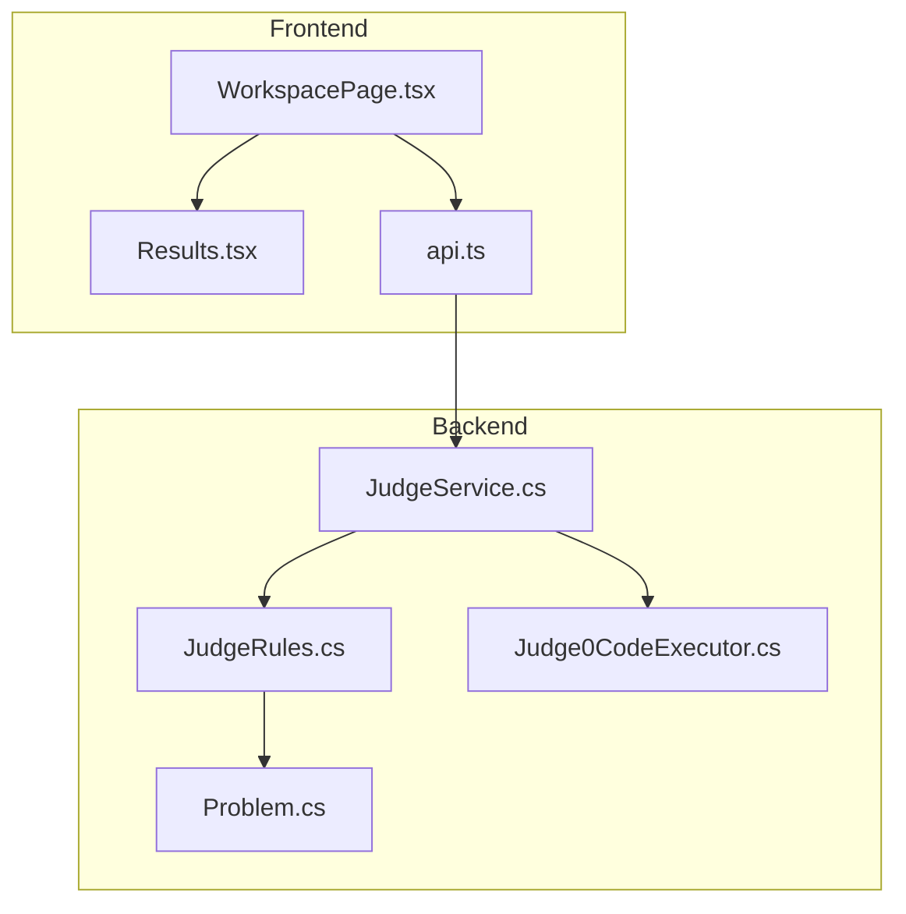
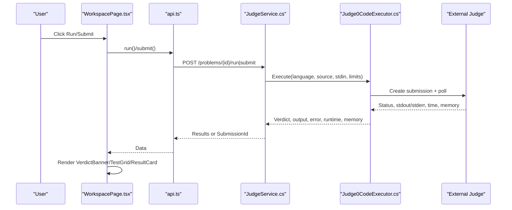
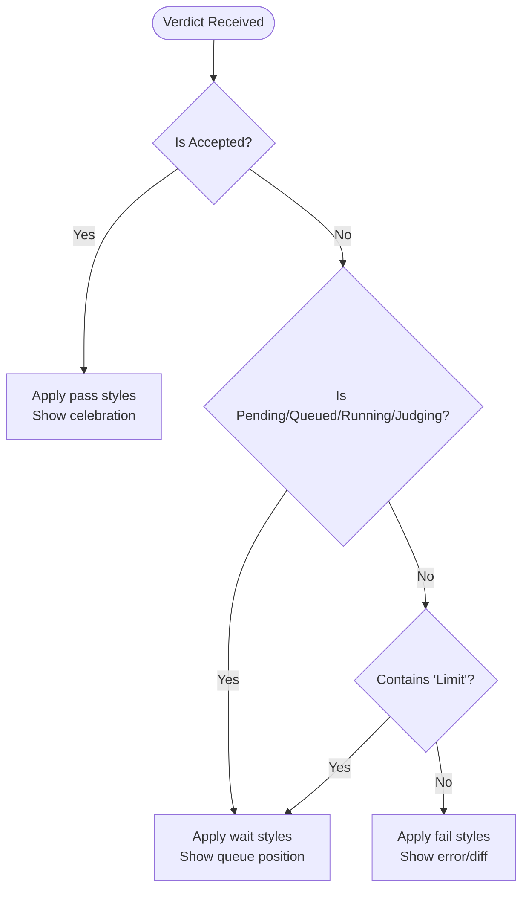
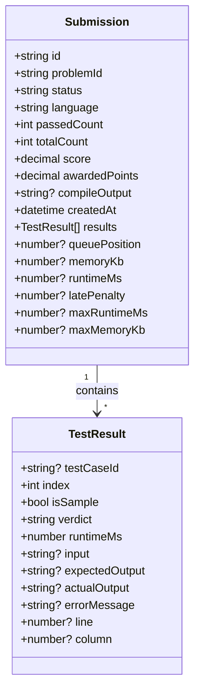
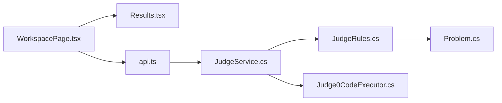

# Verdict Display System

<cite>
**Referenced Files in This Document**
- [Results.tsx](file://frontend/src/features/workspace/Results.tsx)
- [WorkspacePage.tsx](file://frontend/src/features/workspace/WorkspacePage.tsx)
- [api.ts](file://frontend/src/features/code-judge/api.ts)
- [Problem.cs](file://api/src/domain/codopath.domain/judge/problem.cs)
- [JudgeRules.cs](file://api/src/application/codopath.application/judge/judgerules.cs)
- [JudgeService.cs](file://api/src/infrastructure/codopath.infrastructure/judge/judgeservice.cs)
- [Judge0CodeExecutor.cs](file://api/src/infrastructure/codopath.infrastructure/judge/judge0codeexecutor.cs)
</cite>

## Table of Contents
1. [Introduction](#introduction)
2. [Project Structure](#project-structure)
3. [Core Components](#core-components)
4. [Architecture Overview](#architecture-overview)
5. [Detailed Component Analysis](#detailed-component-analysis)
6. [Dependency Analysis](#dependency-analysis)
7. [Performance Considerations](#performance-considerations)
8. [Troubleshooting Guide](#troubleshooting-guide)
9. [Conclusion](#conclusion)

## Introduction
This document explains the verdict display system that shows code execution outcomes with visual indicators, including verdict types, color coding, status badges, and performance metrics. It also provides guidance for customizing verdict appearances, adding new verdict types, and implementing advanced performance analytics.

The system spans:
- Frontend components that render verdict banners, test grids, and result cards.
- API contracts that define submission and test result shapes.
- Backend domain models and rules that define verdicts and scoring.
- Execution infrastructure that maps external judge statuses to internal verdicts and collects runtime and memory metrics.

## Project Structure
The verdict display system is composed of frontend UI components, API type definitions, backend domain enums and rules, and an executor that integrates with an external judge service.

**Diagram sources**
- [WorkspacePage.tsx:131-135](file://frontend/src/features/workspace/WorkspacePage.tsx#L131-L135)
- [Results.tsx:6-31](file://frontend/src/features/workspace/Results.tsx#L6-L31)
- [api.ts:11-12](file://frontend/src/features/code-judge/api.ts#L11-L12)
- [Problem.cs:3](file://api/src/domain/codopath.domain/judge/problem.cs#L3)
- [JudgeRules.cs:20-36](file://api/src/application/codopath.application/judge/judgerules.cs#L20-L36)
- [JudgeService.cs:107-137](file://api/src/infrastructure/codopath.infrastructure/judge/judgeservice.cs#L107-L137)
- [Judge0CodeExecutor.cs:24-66](file://api/src/infrastructure/codopath.infrastructure/judge/judge0codeexecutor.cs#L24-L66)

**Section sources**
- [WorkspacePage.tsx:131-135](file://frontend/src/features/workspace/WorkspacePage.tsx#L131-L135)
- [Results.tsx:6-31](file://frontend/src/features/workspace/Results.tsx#L6-L31)
- [api.ts:11-12](file://frontend/src/features/code-judge/api.ts#L11-L12)
- [Problem.cs:3](file://api/src/domain/codopath.domain/judge/problem.cs#L3)
- [JudgeRules.cs:20-36](file://api/src/application/codopath.application/judge/judgerules.cs#L20-L36)
- [JudgeService.cs:107-137](file://api/src/infrastructure/codopath.infrastructure/judge/judgeservice.cs#L107-L137)
- [Judge0CodeExecutor.cs:24-66](file://api/src/infrastructure/codopath.infrastructure/judge/judge0codeexecutor.cs#L24-L66)

## Core Components
- VerdictBanner: Displays a high-level verdict with mascot mood, pass/fail/wait states, optional queue position, and celebratory animation on success.
- TestGrid: Shows per-test status icons and numbers, with pending/pass/fail styling.
- ResultCard: Renders input/output diffs, error messages, line navigation, and per-test runtime.
- WorkspacePage: Orchestrates run/submit flows, aggregates overall metrics (passed count, runtime, memory), renders compile output, and navigates to next problem on success.
- api.ts: Defines Submission and TestResult types consumed by the UI.
- Problem.cs: Defines the core Verdict enum used across the backend.
- JudgeRules.cs: Aggregates verdicts, computes scores, and converts domain results to DTOs.
- JudgeService.cs: Executes code via executor, compares outputs, and returns test results or submissions.
- Judge0CodeExecutor.cs: Maps external judge statuses to internal verdicts and captures runtime/memory.

Key data structures:
- Submission: overall status, passed/total counts, score, awarded points, compile output, per-test results, runtime/memory, late penalty, queue position.
- TestResult: per-test index, sample flag, verdict, runtimeMs, input, expectedOutput, actualOutput, errorMessage, line/column.

**Section sources**
- [Results.tsx:6-31](file://frontend/src/features/workspace/Results.tsx#L6-L31)
- [WorkspacePage.tsx:131-135](file://frontend/src/features/workspace/WorkspacePage.tsx#L131-L135)
- [api.ts:11-12](file://frontend/src/features/code-judge/api.ts#L11-L12)
- [Problem.cs:3](file://api/src/domain/codopath.domain/judge/problem.cs#L3)
- [JudgeRules.cs:20-36](file://api/src/application/codopath.application/judge/judgerules.cs#L20-L36)
- [JudgeService.cs:107-137](file://api/src/infrastructure/codopath.infrastructure/judge/judgeservice.cs#L107-L137)
- [Judge0CodeExecutor.cs:24-66](file://api/src/infrastructure/codopath.infrastructure/judge/judge0codeexecutor.cs#L24-L66)

## Architecture Overview
The flow from user action to displayed verdict involves:
- User triggers Run or Submit in WorkspacePage.
- Frontend calls judgeApi.run or judgeApi.submit.
- JudgeService validates inputs, executes code through Judge0CodeExecutor, compares outputs, and returns results or persists a submission.
- Executor polls external judge, maps statuses to internal Verdict, and records runtime/memory.
- Frontend polls submission status until completion and renders verdict banner, test grid, and result cards.

**Diagram sources**
- [WorkspacePage.tsx:100-112](file://frontend/src/features/workspace/WorkspacePage.tsx#L100-L112)
- [api.ts:19-22](file://frontend/src/features/code-judge/api.ts#L19-L22)
- [JudgeService.cs:107-137](file://api/src/infrastructure/codopath.infrastructure/judge/judgeservice.cs#L107-L137)
- [Judge0CodeExecutor.cs:24-66](file://api/src/infrastructure/codopath.infrastructure/judge/judge0codeexecutor.cs#L24-L66)

## Detailed Component Analysis

### Verdict Types and Semantics
- Accepted: All tests passed; UI shows pass state and celebration.
- WrongAnswer: Output mismatch after normalization/token comparison.
- TimeLimitExceeded: Execution exceeded time limit.
- MemoryLimitExceeded: Execution exceeded memory limit.
- RuntimeError: Runtime failure during execution.
- CompileError: Compilation failed.
- InternalError: System or integration error.
- Pending/Queued/Running/Judging: Active processing states.

These are defined in the backend domain and mapped from external judge statuses.

**Section sources**
- [Problem.cs:3](file://api/src/domain/codopath.domain/judge/problem.cs#L3)
- [Judge0CodeExecutor.cs:64-66](file://api/src/infrastructure/codopath.infrastructure/judge/judge0codeexecutor.cs#L64-L66)

### Color Coding and Status Badges
- Pass state: Used for Accepted and successful samples; green-like theme via CSS classes.
- Fail state: Used for WrongAnswer, CompileError, RuntimeError, InternalError; red-like theme.
- Wait state: Used for Pending, Queued, Running, Judging, and any verdict containing “Limit”; amber-like theme.
- Badges: Per-test badges show pass/fail; hidden tests are masked unless explicitly shown.

**Diagram sources**
- [Results.tsx:8-16](file://frontend/src/features/workspace/Results.tsx#L8-L16)
- [Results.tsx:24-30](file://frontend/src/features/workspace/Results.tsx#L24-L30)

### Performance Metrics Display
- Overall metrics: Passed count vs total, max runtime or runtime, memory usage in KB.
- Per-test metrics: runtimeMs, optional errorMessage, optional line/column for diagnostics.
- Compile output: Shown when present.

**Diagram sources**
- [api.ts:11-12](file://frontend/src/features/code-judge/api.ts#L11-L12)
- [WorkspacePage.tsx:131-135](file://frontend/src/features/workspace/WorkspacePage.tsx#L131-L135)
- [Results.tsx:24-30](file://frontend/src/features/workspace/Results.tsx#L24-L30)

**Section sources**
- [WorkspacePage.tsx:131-135](file://frontend/src/features/workspace/WorkspacePage.tsx#L131-L135)
- [Results.tsx:24-30](file://frontend/src/features/workspace/Results.tsx#L24-L30)
- [api.ts:11-12](file://frontend/src/features/code-judge/api.ts#L11-L12)

### Customizing Verdict Appearances
- Update labels: Extend the label mapping to include additional verdicts or localize text.
- Styling: Adjust CSS classes for pass/fail/wait states and badge variants.
- Mascot moods: Map new verdicts to appropriate mascot expressions.
- Animations: Control confetti behavior based on reduced motion preferences.

Implementation anchors:
- Label mapping and banner logic.
- Test grid and result card rendering.
- Workspace page aggregation and compile output display.

**Section sources**
- [Results.tsx:6-16](file://frontend/src/features/workspace/Results.tsx#L6-L16)
- [Results.tsx:18-30](file://frontend/src/features/workspace/Results.tsx#L18-L30)
- [WorkspacePage.tsx:131-135](file://frontend/src/features/workspace/WorkspacePage.tsx#L131-L135)

### Adding New Verdict Types
Steps:
1. Define the new verdict in the backend domain enum.
2. Map external judge status to the new verdict in the executor.
3. Handle comparison or special logic in the service if needed.
4. Add label and styling support in the frontend.
5. Update aggregation and scoring rules if the new verdict affects overall status or score.

Reference points:
- Domain enum definition.
- Executor status-to-verdict mapping.
- Service output comparison and result creation.
- Frontend label mapping and UI rendering.

**Section sources**
- [Problem.cs:3](file://api/src/domain/codopath.domain/judge/problem.cs#L3)
- [Judge0CodeExecutor.cs:64-66](file://api/src/infrastructure/codopath.infrastructure/judge/judge0codeexecutor.cs#L64-L66)
- [JudgeService.cs:120-125](file://api/src/infrastructure/codopath.infrastructure/judge/judgeservice.cs#L120-L125)
- [Results.tsx:6-16](file://frontend/src/features/workspace/Results.tsx#L6-L16)

### Implementing Advanced Performance Analytics
- Track per-test runtime and memory, plus overall max values.
- Surface compile output and error diagnostics with line navigation.
- Integrate with AI assistant to highlight suspected lines based on diagnostics.
- Persist snapshots of runs for later analysis.

Relevant flows:
- Executor captures runtime and memory.
- Service attaches diagnostics and sanitizes errors.
- Workspace highlights diagnostic lines and navigates editor.

**Section sources**
- [Judge0CodeExecutor.cs:60-66](file://api/src/infrastructure/codopath.infrastructure/judge/judge0codeexecutor.cs#L60-L66)
- [JudgeService.cs:117-125](file://api/src/infrastructure/codopath.infrastructure/judge/judgeservice.cs#L117-L125)
- [WorkspacePage.tsx:126-128](file://frontend/src/features/workspace/WorkspacePage.tsx#L126-L128)

## Dependency Analysis
- Frontend depends on api.ts types and endpoints.
- WorkspacePage composes Results components and orchestrates queries/mutations.
- JudgeService depends on JudgeRules for comparison, aggregation, and DTO conversion.
- Judge0CodeExecutor depends on external judge service and maps statuses to Verdict.

**Diagram sources**
- [WorkspacePage.tsx:131-135](file://frontend/src/features/workspace/WorkspacePage.tsx#L131-L135)
- [Results.tsx:6-31](file://frontend/src/features/workspace/Results.tsx#L6-L31)
- [api.ts:11-12](file://frontend/src/features/code-judge/api.ts#L11-L12)
- [JudgeService.cs:107-137](file://api/src/infrastructure/codopath.infrastructure/judge/judgeservice.cs#L107-L137)
- [JudgeRules.cs:20-36](file://api/src/application/codopath.application/judge/judgerules.cs#L20-L36)
- [Judge0CodeExecutor.cs:24-66](file://api/src/infrastructure/codopath.infrastructure/judge/judge0codeexecutor.cs#L24-L66)
- [Problem.cs:3](file://api/src/domain/codopath.domain/judge/problem.cs#L3)

**Section sources**
- [WorkspacePage.tsx:131-135](file://frontend/src/features/workspace/WorkspacePage.tsx#L131-L135)
- [Results.tsx:6-31](file://frontend/src/features/workspace/Results.tsx#L6-L31)
- [api.ts:11-12](file://frontend/src/features/code-judge/api.ts#L11-L12)
- [JudgeService.cs:107-137](file://api/src/infrastructure/codopath.infrastructure/judge/judgeservice.cs#L107-L137)
- [JudgeRules.cs:20-36](file://api/src/application/codopath.application/judge/judgerules.cs#L20-L36)
- [Judge0CodeExecutor.cs:24-66](file://api/src/infrastructure/codopath.infrastructure/judge/judge0codeexecutor.cs#L24-L66)
- [Problem.cs:3](file://api/src/domain/codopath.domain/judge/problem.cs#L3)

## Performance Considerations
- Polling interval: Submission status polling uses short intervals while active, reducing latency without overloading the server.
- Output size limits: Executor enforces bounds on input/output sizes to prevent resource exhaustion.
- Comparison modes: Token-based or line-based comparison can affect correctness and performance; choose appropriately per problem.
- Caching: Optional Redis snapshotting for AI assistant context should be resilient to cache failures.

[No sources needed since this section provides general guidance]

## Troubleshooting Guide
Common issues and resolutions:
- No verdict received: The workspace shows a reconnect option; ensure network connectivity and retry.
- Compile errors: Inspect compile output in the result area; fix syntax or environment issues.
- Runtime errors: Use error message and line navigation to locate problematic code.
- Time/Memory limits: Optimize algorithmic complexity or reduce memory footprint.
- Hidden tests: Only sample tests reveal payloads; hidden tests mask details for security.

Operational anchors:
- Error handling and retry in workspace.
- Sanitization of error messages.
- Line navigation to editor.

**Section sources**
- [WorkspacePage.tsx:131-135](file://frontend/src/features/workspace/WorkspacePage.tsx#L131-L135)
- [Results.tsx:24-30](file://frontend/src/features/workspace/Results.tsx#L24-L30)
- [JudgeService.cs:117-125](file://api/src/infrastructure/codopath.infrastructure/judge/judgeservice.cs#L117-L125)

## Conclusion
The verdict display system combines clear UI components, robust backend verdict semantics, and precise performance metrics to provide actionable feedback. By following the customization and extension guidelines, teams can adapt verdict appearances, add new verdict types, and enhance analytics while maintaining consistency and reliability.

[No sources needed since this section summarizes without analyzing specific files]