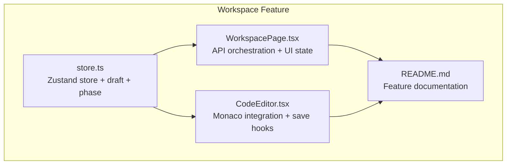
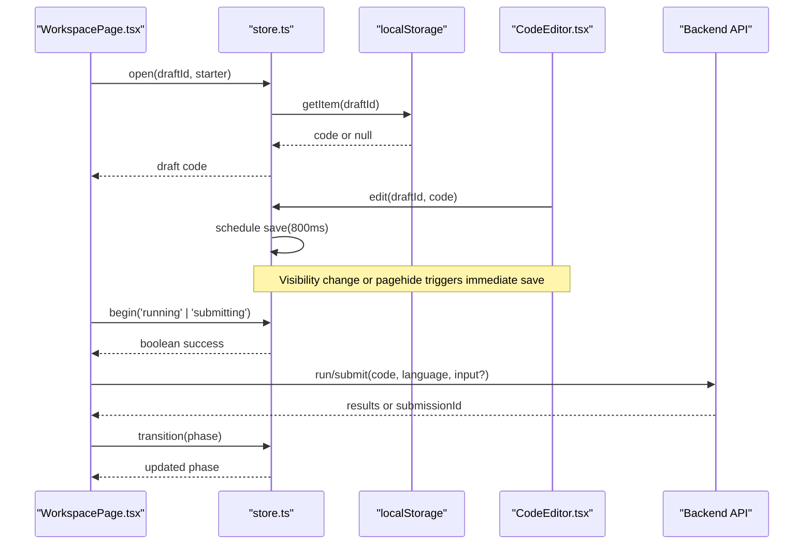
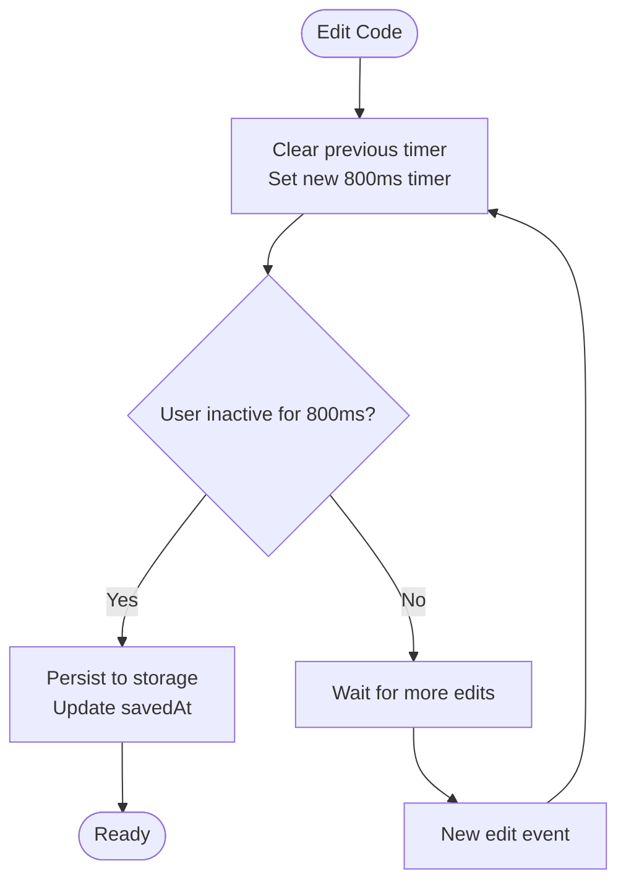
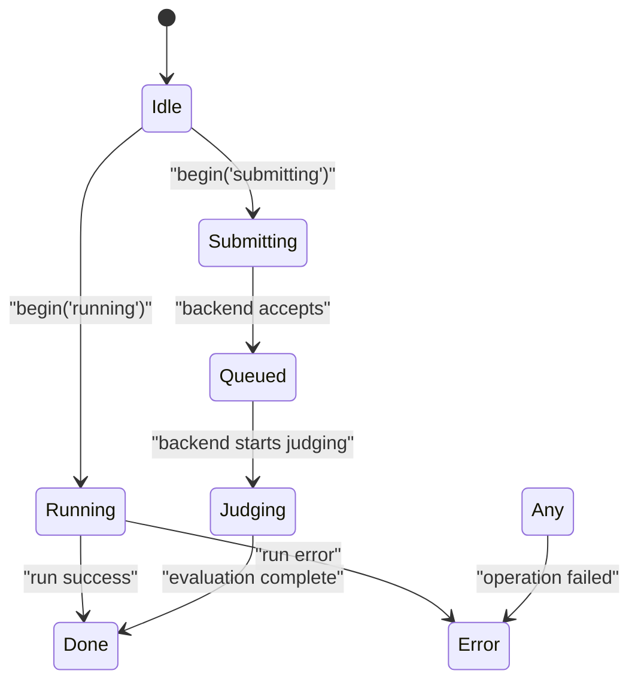
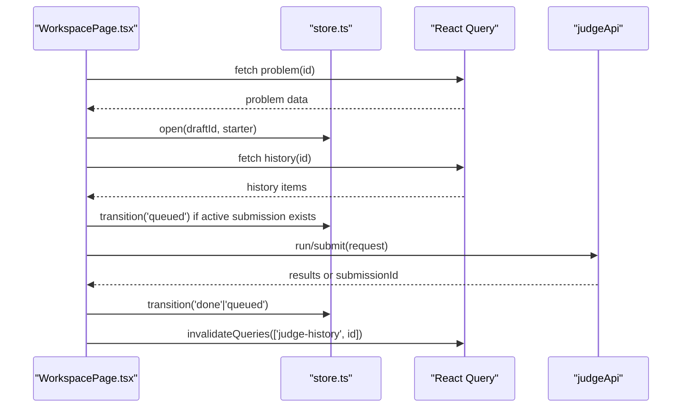
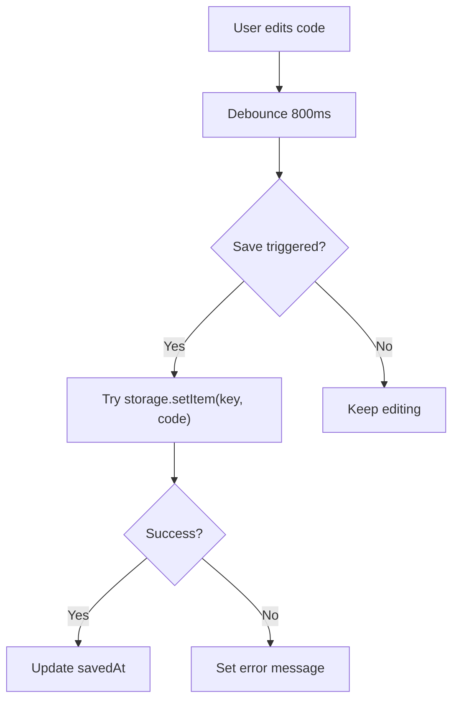
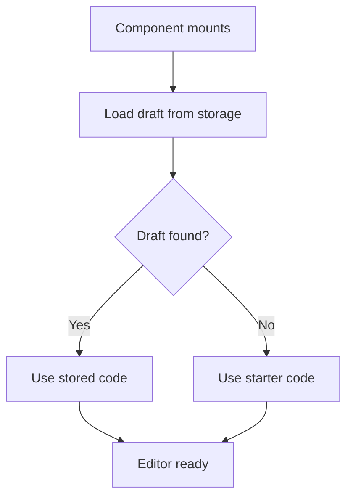
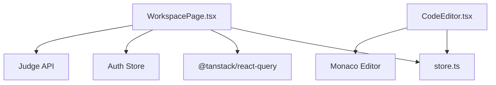

# Workspace State Management

<cite>
**Referenced Files in This Document**
- [store.ts](file://frontend/src/features/workspace/store.ts)
- [WorkspacePage.tsx](file://frontend/src/features/workspace/WorkspacePage.tsx)
- [CodeEditor.tsx](file://frontend/src/features/workspace/CodeEditor.tsx)
- [README.md](file://frontend/src/features/workspace/README.md)
</cite>

## Table of Contents
1. [Introduction](#introduction)
2. [Project Structure](#project-structure)
3. [Core Components](#core-components)
4. [Architecture Overview](#architecture-overview)
5. [Detailed Component Analysis](#detailed-component-analysis)
6. [Dependency Analysis](#dependency-analysis)
7. [Performance Considerations](#performance-considerations)
8. [Troubleshooting Guide](#troubleshooting-guide)
9. [Conclusion](#conclusion)
10. [Appendices](#appendices)

## Introduction
This document explains the workspace state management system built with Zustand. It covers the store structure, draft persistence, execution phases, data synchronization between UI and backend, local storage integration, auto-save behavior, and recovery strategies. It also provides practical guidance for extending the store, implementing custom persistence, and optimizing updates for performance.

The workspace is a code editor experience where users write code, run test cases, submit solutions, and receive results. The Zustand store owns two main responsibilities:
- Draft state: per-language, per-problem, per-user code drafts persisted to local storage.
- Execution state: a phase machine that prevents overlapping runs or submissions and reflects backend submission status.

## Project Structure
The workspace feature lives under `frontend/src/features/workspace`. The most relevant files for state management are:
- `store.ts`: Zustand vanilla store factory, draft types, phase type, and draft key helper.
- `WorkspacePage.tsx`: Orchestrates API calls, panel layout, keyboard shortcuts, and store usage.
- `CodeEditor.tsx`: Integrates Monaco editor with the store, handles visibility-based save, diagnostics, and decorations.
- `README.md`: Feature overview and implementation notes.

**Diagram sources**
- [store.ts:1-48](file://frontend/src/features/workspace/store.ts#L1-L48)
- [WorkspacePage.tsx:1-170](file://frontend/src/features/workspace/WorkspacePage.tsx#L1-L170)
- [CodeEditor.tsx:1-47](file://frontend/src/features/workspace/CodeEditor.tsx#L1-L47)
- [README.md:52-85](file://frontend/src/features/workspace/README.md#L52-L85)

**Section sources**
- [store.ts:1-48](file://frontend/src/features/workspace/store.ts#L1-L48)
- [WorkspacePage.tsx:1-170](file://frontend/src/features/workspace/WorkspacePage.tsx#L1-L170)
- [CodeEditor.tsx:1-47](file://frontend/src/features/workspace/CodeEditor.tsx#L1-L47)
- [README.md:52-85](file://frontend/src/features/workspace/README.md#L52-L85)

## Core Components
- Zustand store factory: creates an isolated store instance per workspace component.
- Draft model: stores code, last saved timestamp, and optional error message.
- Phase model: represents execution lifecycle states.
- Persistence layer: pluggable storage interface backed by `localStorage` by default.
- Auto-save mechanism: debounced edits flush to storage after user inactivity.
- Key strategy: deterministic keys per user, problem, and language.

Key behaviors:
- Opening a draft loads from storage if available; otherwise uses starter code.
- Editing clears previous timers and schedules a new save after 800ms.
- Manual save clears pending timer and persists immediately.
- Begin transitions guard against concurrent running/submission states.
- Transition allows arbitrary phase changes (e.g., from queued to judging).

**Section sources**
- [store.ts:1-48](file://frontend/src/features/workspace/store.ts#L1-L48)
- [README.md:69-73](file://frontend/src/features/workspace/README.md#L69-L73)

## Architecture Overview
The workspace integrates three layers:
- UI layer: React components manage panels, tabs, and user interactions.
- Store layer: Zustand holds draft and phase state, exposes imperative methods.
- Persistence layer: Local storage (or a custom storage object) persists drafts.

**Diagram sources**
- [WorkspacePage.tsx:88-112](file://frontend/src/features/workspace/WorkspacePage.tsx#L88-L112)
- [store.ts:16-43](file://frontend/src/features/workspace/store.ts#L16-L43)
- [CodeEditor.tsx:23-29](file://frontend/src/features/workspace/CodeEditor.tsx#L23-L29)

## Detailed Component Analysis

### Store Model and Lifecycle
The store defines:
- `Draft`: code, optional `savedAt`, optional `error`.
- `Phase`: idle, running, submitting, queued, judging, done, error.
- Methods:
  - `open(key, starter)`: load or initialize draft.
  - `edit(key, code)`: update in-memory draft and debounce save.
  - `save(key)`: persist draft to storage and update metadata.
  - `begin(phase)`: guarded transition into running or submitting.
  - `transition(phase)`: set any phase.

**Diagram sources**
- [store.ts:23-37](file://frontend/src/features/workspace/store.ts#L23-L37)

**Section sources**
- [store.ts:1-48](file://frontend/src/features/workspace/store.ts#L1-L48)

### Execution Phases and State Machine
Phases represent the lifecycle of code execution:
- Idle: no active operation.
- Running: local run in progress.
- Submitting: submission request sent.
- Queued: backend has accepted submission and it is waiting.
- Judging: backend is actively evaluating tests.
- Done: evaluation completed successfully.
- Error: failure occurred during operations.

Guarded transitions:
- `begin` only allows entering running or submitting when not already busy.
- `transition` can move from queued to judging, or to done/error based on backend status.

**Diagram sources**
- [store.ts:38-43](file://frontend/src/features/workspace/store.ts#L38-L43)
- [WorkspacePage.tsx:93-103](file://frontend/src/features/workspace/WorkspacePage.tsx#L93-L103)

**Section sources**
- [store.ts:38-43](file://frontend/src/features/workspace/store.ts#L38-L43)
- [WorkspacePage.tsx:93-103](file://frontend/src/features/workspace/WorkspacePage.tsx#L93-L103)

### Data Synchronization Between UI, Store, and Backend
The page coordinates:
- Loading problem data and initializing store draft.
- Detecting active submissions from history and setting queued phase.
- Mapping backend submission status to store phases.
- Invoking run/submit mutations and updating store accordingly.
- Invalidating query cache to refresh history.

**Diagram sources**
- [WorkspacePage.tsx:88-103](file://frontend/src/features/workspace/WorkspacePage.tsx#L88-L103)

**Section sources**
- [WorkspacePage.tsx:88-103](file://frontend/src/features/workspace/WorkspacePage.tsx#L88-L103)

### Local Storage Integration and Auto-Save
Persistence details:
- Default storage is `localStorage`.
- Draft key format includes user, problem, and language.
- Auto-save debounces edits by 800ms.
- Immediate saves occur on:
  - Language change.
  - Problem change.
  - Manual save via keyboard shortcut.
  - Page hide or tab visibility change.
- If storage fails, draft remains in memory and an error flag is set.

**Diagram sources**
- [store.ts:23-37](file://frontend/src/features/workspace/store.ts#L23-L37)
- [CodeEditor.tsx:23-29](file://frontend/src/features/workspace/CodeEditor.tsx#L23-L29)
- [README.md:69-73](file://frontend/src/features/workspace/README.md#L69-L73)

**Section sources**
- [store.ts:23-37](file://frontend/src/features/workspace/store.ts#L23-L37)
- [CodeEditor.tsx:23-29](file://frontend/src/features/workspace/CodeEditor.tsx#L23-L29)
- [README.md:69-73](file://frontend/src/features/workspace/README.md#L69-L73)

### State Recovery Features
Recovery mechanisms:
- On page reload, opening a draft attempts to read from storage; if unavailable, falls back to starter code.
- Active submission detection sets the store phase to queued so the UI reflects ongoing evaluation.
- If storage is blocked or full, the editor still works in memory and shows a non-persistent warning.

**Diagram sources**
- [store.ts:16-22](file://frontend/src/features/workspace/store.ts#L16-L22)
- [WorkspacePage.tsx:88-97](file://frontend/src/features/workspace/WorkspacePage.tsx#L88-L97)

**Section sources**
- [store.ts:16-22](file://frontend/src/features/workspace/store.ts#L16-L22)
- [WorkspacePage.tsx:88-97](file://frontend/src/features/workspace/WorkspacePage.tsx#L88-L97)

### Extending the Store with New State Properties
To add new state:
- Extend the store’s state shape with new fields.
- Add methods to update those fields safely using functional updates.
- Integrate persistence if needed by writing to storage inside save or dedicated setters.
- Expose selectors or derived values through components using `useStore`.

Example pattern:
- Add a field like `lastRunTime` to track recent executions.
- Update it in the run mutation’s success handler.
- Persist it alongside draft metadata if required.

**Section sources**
- [store.ts:7-14](file://frontend/src/features/workspace/store.ts#L7-L14)
- [WorkspacePage.tsx:100-103](file://frontend/src/features/workspace/WorkspacePage.tsx#L100-L103)

### Implementing Custom Persistence Strategies
The store accepts a storage-like object with `getItem` and `setItem`. To implement custom persistence:
- Provide an object that wraps IndexedDB, a cloud sync service, or encrypted storage.
- Ensure errors are thrown on failures so the store can set an error flag.
- Keep the same key format to maintain compatibility with existing drafts.

Example approach:
- Wrap `localStorage` with retry logic and fallbacks.
- Serialize large payloads safely and handle quota exceeded errors.
- Sync asynchronously without blocking UI updates.

**Section sources**
- [store.ts:5-5](file://frontend/src/features/workspace/store.ts#L5-L5)
- [store.ts:28-37](file://frontend/src/features/workspace/store.ts#L28-L37)

### Optimizing State Updates for Performance
Optimization techniques:
- Debounce edits to reduce storage writes and re-renders.
- Use functional updates to avoid unnecessary re-computations.
- Avoid deep cloning entire state; update only affected draft entries.
- Separate layout preferences from draft persistence to minimize contention.
- Use selective subscriptions (`useStore` with selectors) to limit re-renders.

Current optimizations:
- 800ms debounce for auto-save.
- Map-backed timers keyed by draft ID.
- Functional updates for draft patches.
- Optional storage for panel layout.

**Section sources**
- [store.ts:23-37](file://frontend/src/features/workspace/store.ts#L23-L37)
- [WorkspacePage.tsx:73-74](file://frontend/src/features/workspace/WorkspacePage.tsx#L73-L74)

## Dependency Analysis
The workspace feature depends on:
- Zustand for state management.
- React Query for server state and caching.
- Monaco Editor for code editing.
- Radix Tabs and Resizable Panels for UI composition.
- Auth store for current user context.
- Judge API for problems, runs, submissions, and history.

**Diagram sources**
- [WorkspacePage.tsx:1-17](file://frontend/src/features/workspace/WorkspacePage.tsx#L1-L17)
- [CodeEditor.tsx:1-11](file://frontend/src/features/workspace/CodeEditor.tsx#L1-L11)
- [store.ts:1-1](file://frontend/src/features/workspace/store.ts#L1-L1)

**Section sources**
- [WorkspacePage.tsx:1-17](file://frontend/src/features/workspace/WorkspacePage.tsx#L1-L17)
- [CodeEditor.tsx:1-11](file://frontend/src/features/workspace/CodeEditor.tsx#L1-L11)
- [store.ts:1-1](file://frontend/src/features/workspace/store.ts#L1-L1)

## Performance Considerations
- Debounced persistence reduces I/O overhead and UI churn.
- Selective subscriptions prevent unnecessary component re-renders.
- Storing layout preferences separately avoids conflicts with draft persistence.
- Using vanilla Zustand store avoids extra middleware overhead.
- Avoid heavy computations in render paths; compute diagnostics and hints only when needed.

[No sources needed since this section provides general guidance]

## Troubleshooting Guide
Common issues and resolutions:
- Draft not saving: check browser storage permissions and quota; verify error flag in draft state.
- Editor not loading: ensure Monaco worker is configured and languages are registered.
- Submission stuck in queued: refetch submission status and validate backend connectivity.
- Panel layout not persisting: confirm safe layout storage wrapper is functioning.

Operational tips:
- Use manual save shortcuts to force persistence when needed.
- Inspect draft key generation to ensure uniqueness across users and languages.
- Monitor visibility change events to guarantee saves before navigation.

**Section sources**
- [store.ts:28-37](file://frontend/src/features/workspace/store.ts#L28-L37)
- [CodeEditor.tsx:23-29](file://frontend/src/features/workspace/CodeEditor.tsx#L23-L29)
- [WorkspacePage.tsx:88-103](file://frontend/src/features/workspace/WorkspacePage.tsx#L88-L103)

## Conclusion
The workspace state management system combines a simple yet robust Zustand store with pluggable persistence and a clear execution phase model. It supports resilient draft handling, automatic background saves, and synchronized UI updates with backend submission status. By following the extension and optimization patterns described here, teams can safely evolve the store while maintaining performance and reliability.

[No sources needed since this section summarizes without analyzing specific files]

## Appendices

### Store API Reference
- `createWorkspaceStore(storage)`: Factory returning a Zustand store instance.
- `draftKey(userId, problemId, language)`: Generates unique draft keys.
- `open(key, starter)`: Loads or initializes draft code.
- `edit(key, code)`: Updates draft and schedules auto-save.
- `save(key)`: Persists draft and updates metadata.
- `begin(phase)`: Guarded transition to running or submitting.
- `transition(phase)`: Sets any phase.

**Section sources**
- [store.ts:1-48](file://frontend/src/features/workspace/store.ts#L1-L48)