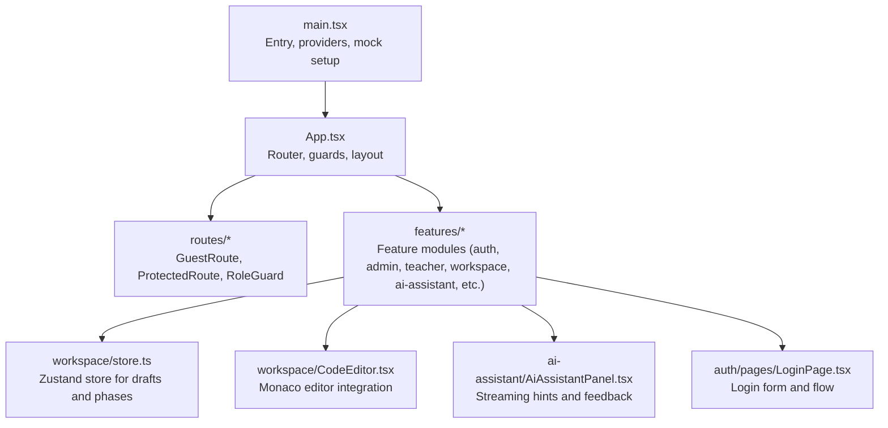
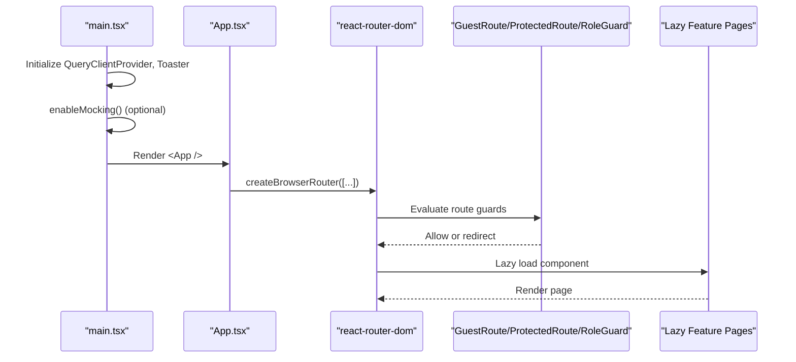
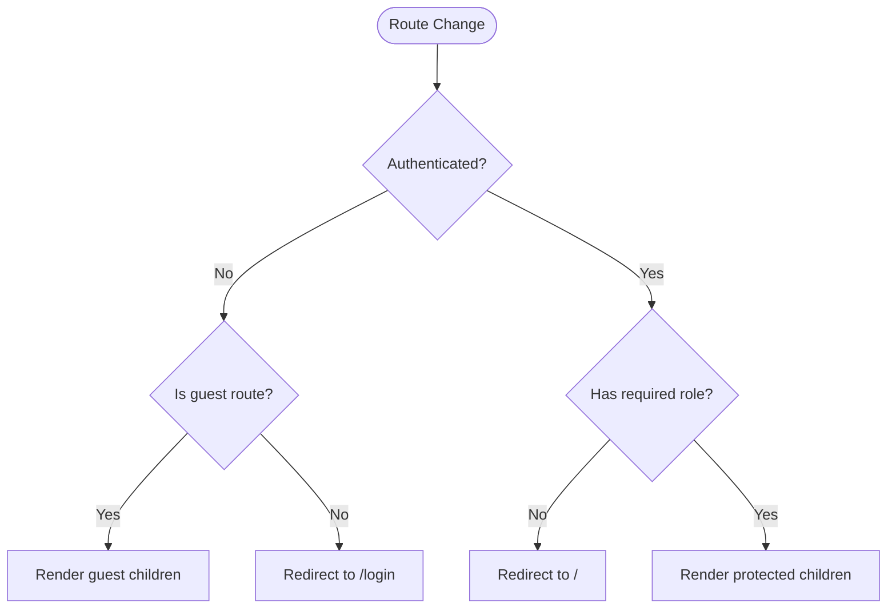
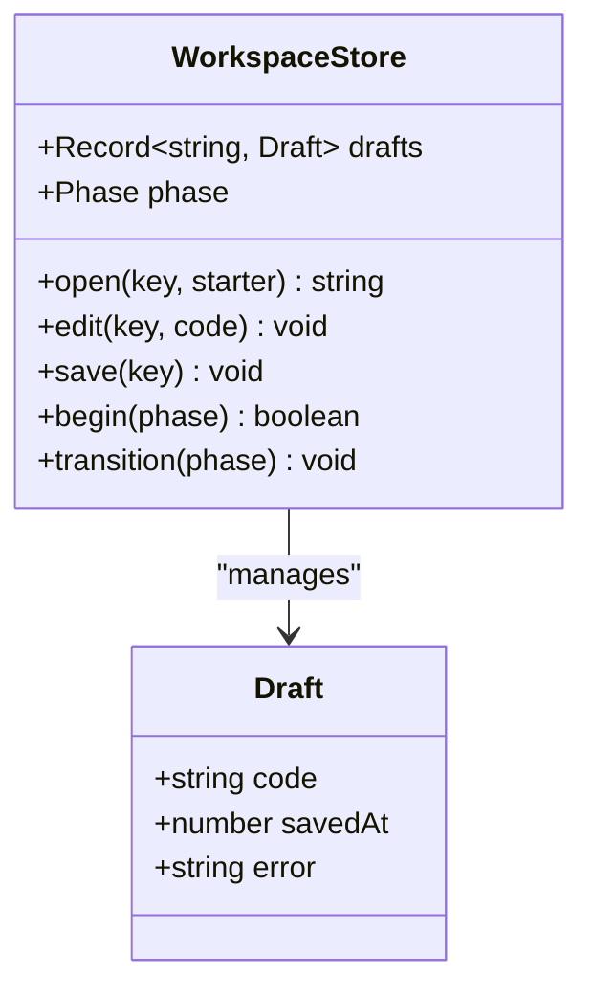
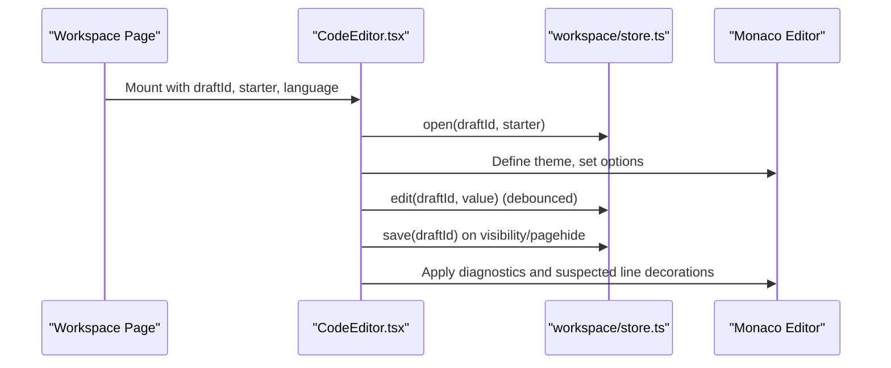
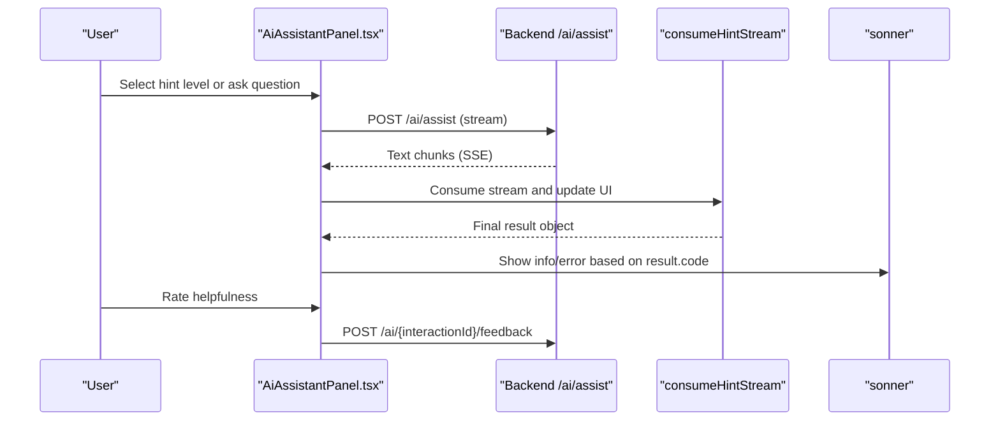
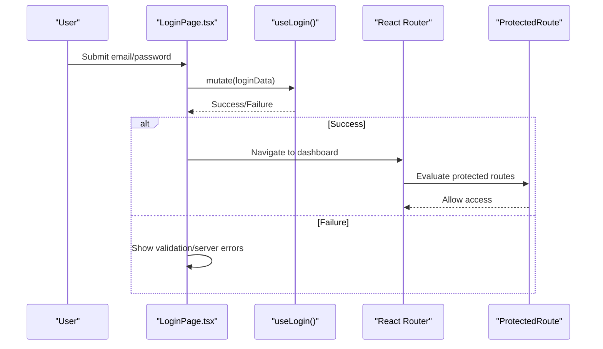
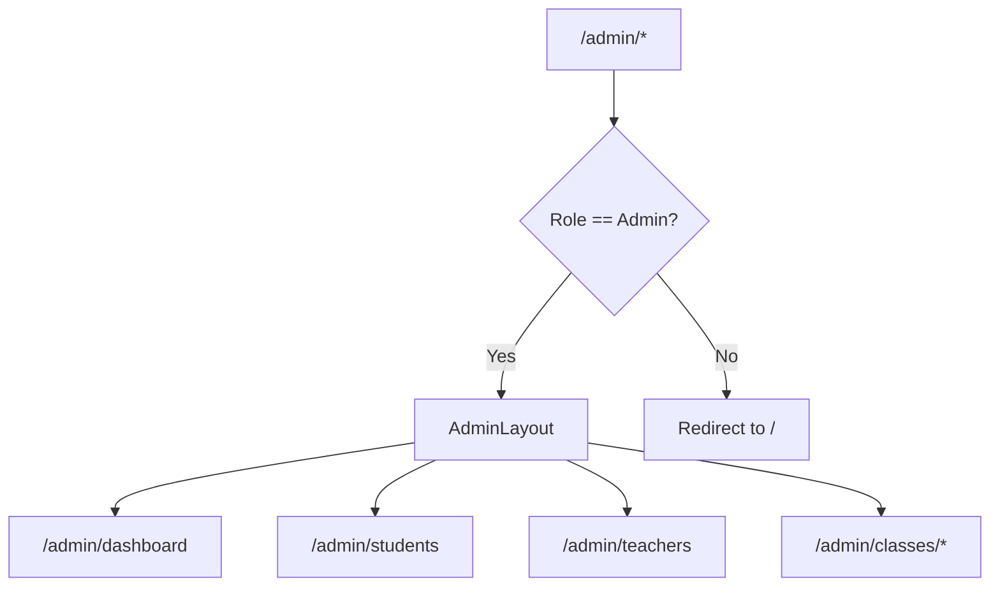
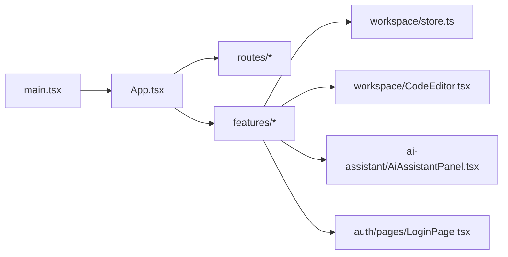

# Frontend Application Documentation

<cite>
**Referenced Files in This Document**
- [App.tsx](file://frontend/src/App.tsx)
- [main.tsx](file://frontend/src/main.tsx)
- [ProtectedRoute.tsx](file://frontend/src/routes/ProtectedRoute.tsx)
- [GuestRoute.tsx](file://frontend/src/routes/GuestRoute.tsx)
- [RoleGuard.tsx](file://frontend/src/routes/RoleGuard.tsx)
- [store.ts](file://frontend/src/features/workspace/store.ts)
- [CodeEditor.tsx](file://frontend/src/features/workspace/CodeEditor.tsx)
- [AiAssistantPanel.tsx](file://frontend/src/features/ai-assistant/AiAssistantPanel.tsx)
- [LoginPage.tsx](file://frontend/src/features/auth/pages/LoginPage.tsx)
</cite>

## Table of Contents
1. Introduction
2. Project Structure
3. Core Components
4. Architecture Overview
5. Detailed Component Analysis
6. Dependency Analysis
7. Performance Considerations
8. Troubleshooting Guide
9. Conclusion

## Introduction
This document explains the React frontend application with a focus on component architecture, feature-based organization, state management using Zustand stores, routing configuration, and key UI features such as the AI assistant panel, code editor workspace, authentication flows, and admin interfaces. It also covers backend API integration, real-time streaming patterns, responsive design approach, component composition, Tailwind CSS styling, accessibility considerations, and guidance for extending features and adding new components.

## Project Structure
The frontend is organized by features under src/features, each containing its own pages, components, hooks, types, styles, and optional mocks or APIs. Shared infrastructure lives in src/lib and src/routes. The app entry point initializes providers, optional mocking, and the router.

**Diagram sources**
- [main.tsx:1-35](file://frontend/src/main.tsx#L1-L35)
- [App.tsx:1-163](file://frontend/src/App.tsx#L1-L163)
- [store.ts:1-48](file://frontend/src/features/workspace/store.ts#L1-L48)
- [CodeEditor.tsx:1-47](file://frontend/src/features/workspace/CodeEditor.tsx#L1-L47)
- [AiAssistantPanel.tsx:1-88](file://frontend/src/features/ai-assistant/AiAssistantPanel.tsx#L1-L88)
- [LoginPage.tsx:1-26](file://frontend/src/features/auth/pages/LoginPage.tsx#L1-L26)

**Section sources**
- [main.tsx:1-35](file://frontend/src/main.tsx#L1-L35)
- [App.tsx:1-163](file://frontend/src/App.tsx#L1-L163)

## Core Components
- Router and route guards: Centralized routing with lazy-loaded routes and role-based access control.
- Feature modules: Each feature encapsulates its UI, data fetching, and local state.
- State management: Lightweight global state via Zustand for workspace drafts and execution phases.
- Editor: Monaco-based code editor with theme, diagnostics, and suspected-line decorations.
- AI Assistant Panel: Streaming hint delivery with feedback and RAG references.
- Authentication: Login page integrated with auth store and protected routes.

**Section sources**
- [App.tsx:22-139](file://frontend/src/App.tsx#L22-L139)
- [store.ts:1-48](file://frontend/src/features/workspace/store.ts#L1-L48)
- [CodeEditor.tsx:1-47](file://frontend/src/features/workspace/CodeEditor.tsx#L1-L47)
- [AiAssistantPanel.tsx:1-88](file://frontend/src/features/ai-assistant/AiAssistantPanel.tsx#L1-L88)
- [LoginPage.tsx:1-26](file://frontend/src/features/auth/pages/LoginPage.tsx#L1-L26)

## Architecture Overview
The application bootstraps providers and optional MSW-based mocking, then renders the router. Routes are grouped into guest-only, protected, and role-gated sections. Features are loaded lazily to reduce bundle size.

**Diagram sources**
- [main.tsx:10-34](file://frontend/src/main.tsx#L10-L34)
- [App.tsx:22-163](file://frontend/src/App.tsx#L22-L163)
- [ProtectedRoute.tsx:1-14](file://frontend/src/routes/ProtectedRoute.tsx#L1-L14)
- [GuestRoute.tsx:1-16](file://frontend/src/routes/GuestRoute.tsx#L1-L16)
- [RoleGuard.tsx:1-23](file://frontend/src/routes/RoleGuard.tsx#L1-L23)

## Detailed Component Analysis

### Routing and Access Control
- GuestRoute: Redirects authenticated users to their default dashboard based on role; otherwise renders child routes.
- ProtectedRoute: Requires user and access token; redirects to login if missing.
- RoleGuard: Restricts routes to specific roles; redirects unauthorized users.
- App router: Defines nested routes with lazy loading and role guards for Admin, Teacher, Student, and shared areas.

**Diagram sources**
- [GuestRoute.tsx:1-16](file://frontend/src/routes/GuestRoute.tsx#L1-L16)
- [ProtectedRoute.tsx:1-14](file://frontend/src/routes/ProtectedRoute.tsx#L1-L14)
- [RoleGuard.tsx:1-23](file://frontend/src/routes/RoleGuard.tsx#L1-L23)
- [App.tsx:22-139](file://frontend/src/App.tsx#L22-L139)

**Section sources**
- [GuestRoute.tsx:1-16](file://frontend/src/routes/GuestRoute.tsx#L1-L16)
- [ProtectedRoute.tsx:1-14](file://frontend/src/routes/ProtectedRoute.tsx#L1-L14)
- [RoleGuard.tsx:1-23](file://frontend/src/routes/RoleGuard.tsx#L1-L23)
- [App.tsx:22-139](file://frontend/src/App.tsx#L22-L139)

### Workspace Store (Zustand)
- Purpose: Manage per-draft code, save lifecycle, and execution phase transitions.
- Key behaviors:
  - open(key, starter): Load draft from storage or initialize with starter code.
  - edit(key, code): Debounced editing with auto-save.
  - save(key): Persist draft to storage and update timestamp/error state.
  - begin(phase): Guard against overlapping running/submitting states.
  - transition(phase): Update phase atomically.
- Storage: Uses provided storage interface (default localStorage) with error handling.

**Diagram sources**
- [store.ts:1-48](file://frontend/src/features/workspace/store.ts#L1-L48)

**Section sources**
- [store.ts:1-48](file://frontend/src/features/workspace/store.ts#L1-L48)

### Code Editor Integration
- Integrates Monaco Editor with custom theme and language registrations.
- Persists drafts via the workspace store on visibility changes and page hide.
- Applies diagnostics markers and highlights suspected lines returned by the AI assistant.
- Configures editor options for responsiveness and performance.

**Diagram sources**
- [CodeEditor.tsx:1-47](file://frontend/src/features/workspace/CodeEditor.tsx#L1-L47)
- [store.ts:1-48](file://frontend/src/features/workspace/store.ts#L1-L48)

**Section sources**
- [CodeEditor.tsx:1-47](file://frontend/src/features/workspace/CodeEditor.tsx#L1-L47)
- [store.ts:1-48](file://frontend/src/features/workspace/store.ts#L1-L48)

### AI Assistant Panel
- Streams hints from the backend via server-sent events.
- Infers stage based on test results and current code.
- Provides step-by-step guidance, suspected lines, and RAG references.
- Supports user feedback and handles various error codes with user-friendly messages.

**Diagram sources**
- [AiAssistantPanel.tsx:1-88](file://frontend/src/features/ai-assistant/AiAssistantPanel.tsx#L1-L88)

**Section sources**
- [AiAssistantPanel.tsx:1-88](file://frontend/src/features/ai-assistant/AiAssistantPanel.tsx#L1-L88)

### Authentication Flow
- LoginPage uses react-hook-form with Zod schema validation.
- Submits credentials via useLogin hook (from feature module).
- Protected routes enforce authentication and redirect appropriately.

**Diagram sources**
- [LoginPage.tsx:1-26](file://frontend/src/features/auth/pages/LoginPage.tsx#L1-L26)
- [ProtectedRoute.tsx:1-14](file://frontend/src/routes/ProtectedRoute.tsx#L1-L14)

**Section sources**
- [LoginPage.tsx:1-26](file://frontend/src/features/auth/pages/LoginPage.tsx#L1-L26)
- [ProtectedRoute.tsx:1-14](file://frontend/src/routes/ProtectedRoute.tsx#L1-L14)

### Admin Interfaces
- Admin routes are protected by RoleGuard with allowedRoles including Admin.
- AdminLayout wraps admin-specific pages like dashboard, students, teachers, and classes.
- Navigation and redirects ensure admins land on appropriate dashboards.

**Diagram sources**
- [App.tsx:68-96](file://frontend/src/App.tsx#L68-L96)

**Section sources**
- [App.tsx:68-96](file://frontend/src/App.tsx#L68-L96)

## Dependency Analysis
- main.tsx sets up providers and optional MSW handlers for development.
- App.tsx composes route guards and lazy feature modules.
- Features depend on shared libraries (axios, queryClient) and feature-local stores/hooks.
- Workspace store is consumed by editor and related components.
- AI assistant panel depends on streaming utilities and RAG sources.

**Diagram sources**
- [main.tsx:1-35](file://frontend/src/main.tsx#L1-L35)
- [App.tsx:1-163](file://frontend/src/App.tsx#L1-L163)
- [store.ts:1-48](file://frontend/src/features/workspace/store.ts#L1-L48)
- [CodeEditor.tsx:1-47](file://frontend/src/features/workspace/CodeEditor.tsx#L1-L47)
- [AiAssistantPanel.tsx:1-88](file://frontend/src/features/ai-assistant/AiAssistantPanel.tsx#L1-L88)
- [LoginPage.tsx:1-26](file://frontend/src/features/auth/pages/LoginPage.tsx#L1-L26)

**Section sources**
- [main.tsx:1-35](file://frontend/src/main.tsx#L1-L35)
- [App.tsx:1-163](file://frontend/src/App.tsx#L1-L163)

## Performance Considerations
- Lazy route loading reduces initial bundle size.
- Debounced autosave prevents excessive storage writes during typing.
- Monaco editor worker configured for background tasks; minimap disabled to improve performance.
- Streaming responses avoid long polling and provide immediate feedback.
- Conditional rendering and aria-live regions keep UI responsive and accessible.

[No sources needed since this section provides general guidance]

## Troubleshooting Guide
- Session initialization: On app start, session refresh is attempted if an indicator exists; otherwise, auth state is cleared.
- Mocking: In development, MSW can be enabled conditionally; ensure environment variables are set correctly.
- AI assistant errors: Various error codes map to user-friendly messages; quota and rate-limit scenarios are handled explicitly.
- Editor persistence: If storage is unavailable, editor remains usable but may show a localized error message for failed saves.

**Section sources**
- [App.tsx:142-163](file://frontend/src/App.tsx#L142-L163)
- [main.tsx:10-23](file://frontend/src/main.tsx#L10-L23)
- [AiAssistantPanel.tsx:42-61](file://frontend/src/features/ai-assistant/AiAssistantPanel.tsx#L42-L61)
- [store.ts:28-37](file://frontend/src/features/workspace/store.ts#L28-L37)

## Conclusion
The frontend follows a clear feature-based architecture with robust routing and role-based access control. Zustand manages lightweight global state for the workspace, while Monaco powers a responsive, themed code editor. The AI assistant integrates streaming hints and RAG references, providing guided learning experiences. Authentication flows are straightforward and secure behind protected routes. The structure supports easy extension of features and addition of new components while maintaining accessibility and performance.

[No sources needed since this section summarizes without analyzing specific files]