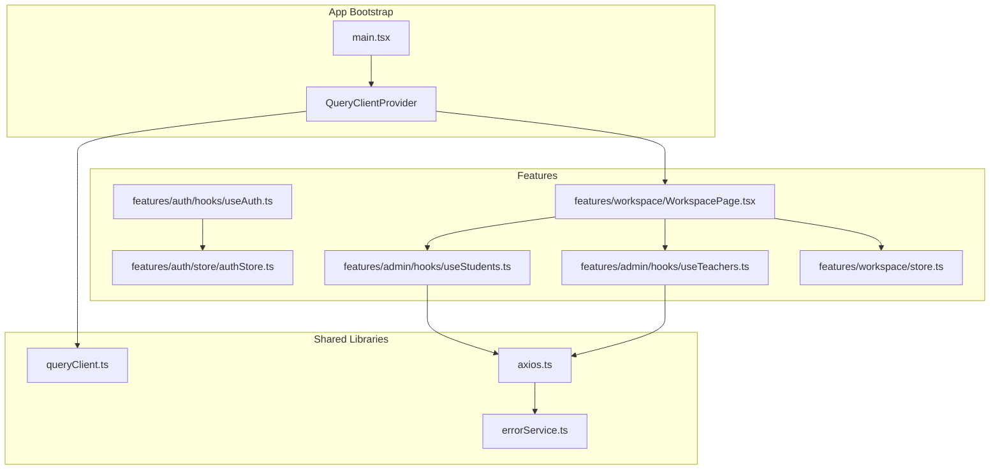
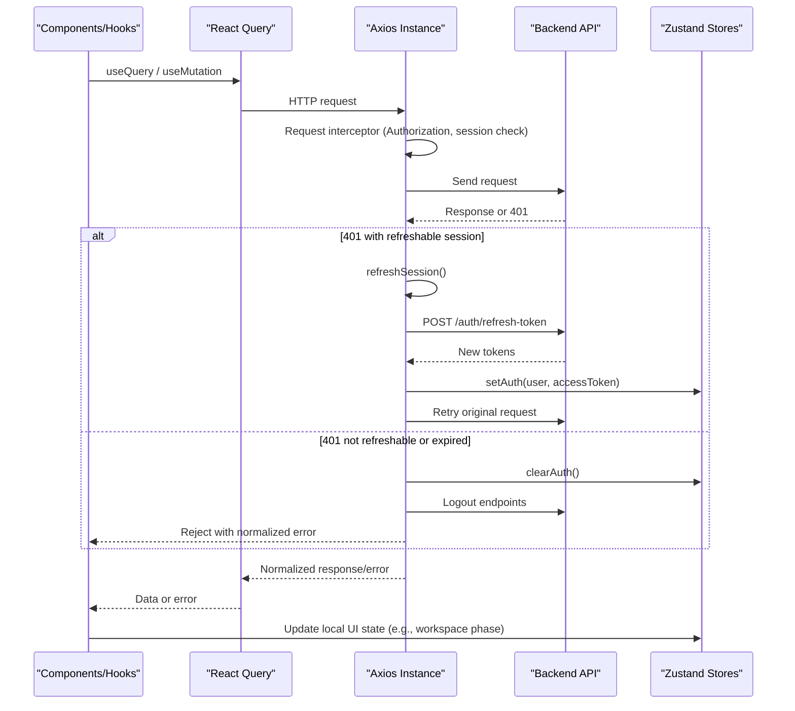
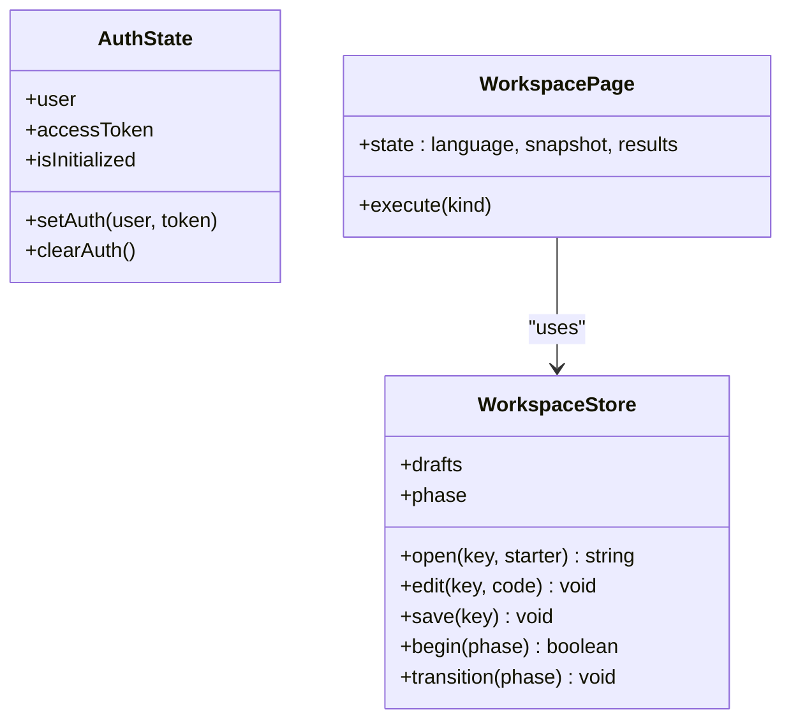
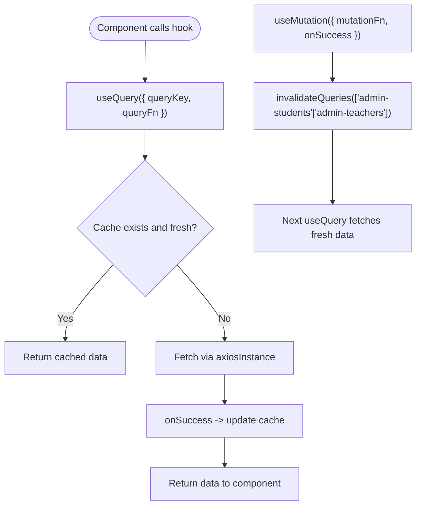
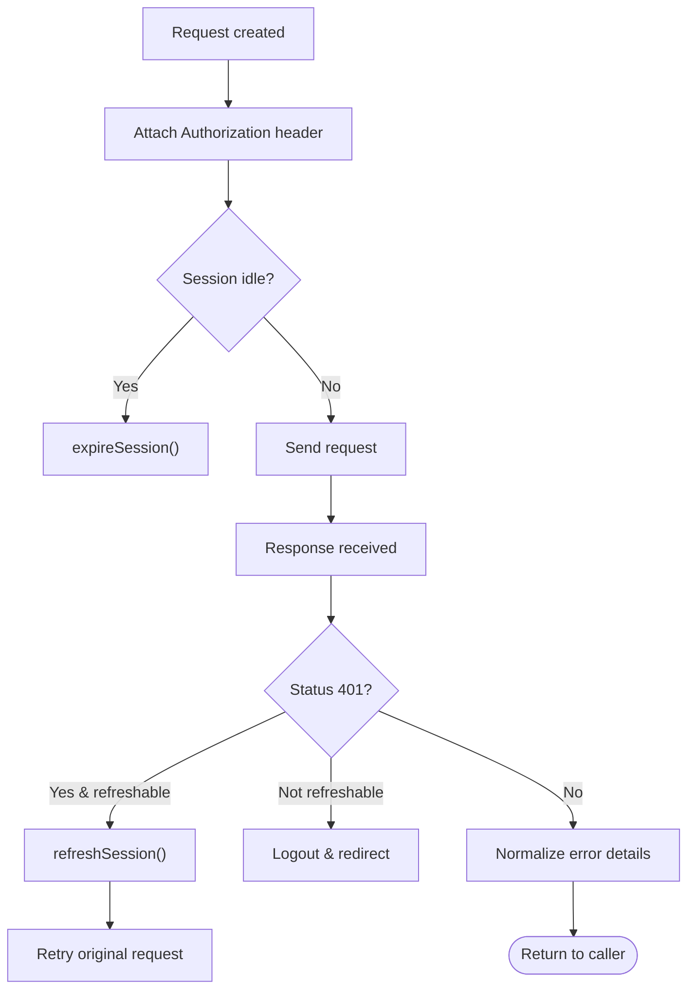
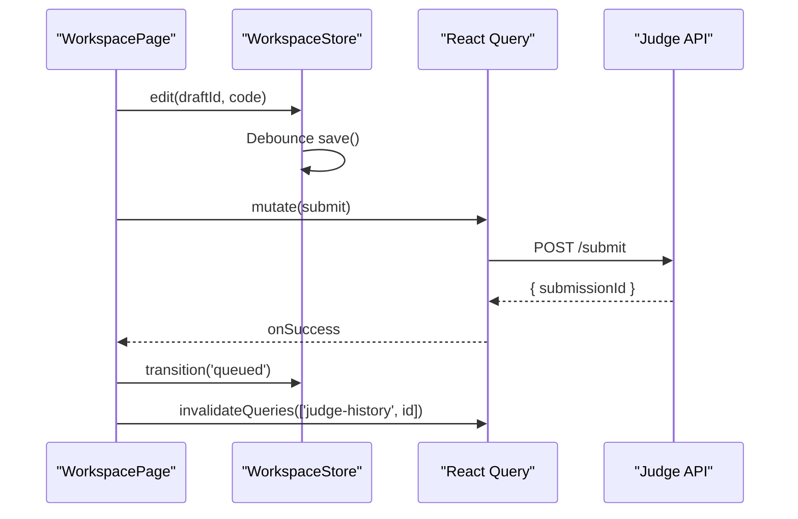
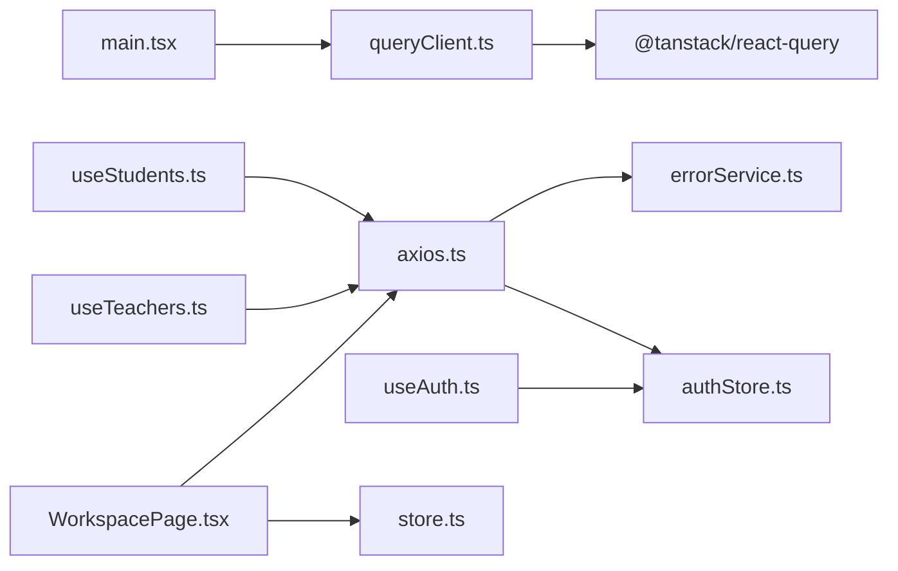

# State Management & Data Flow

<cite>
**Referenced Files in This Document**
- [main.tsx](file://frontend/src/main.tsx)
- [queryClient.ts](file://frontend/src/lib/queryClient.ts)
- [axios.ts](file://frontend/src/lib/axios.ts)
- [errorService.ts](file://frontend/src/lib/errorService.ts)
- [authStore.ts](file://frontend/src/features/auth/store/authStore.ts)
- [useAuth.ts](file://frontend/src/features/auth/hooks/useAuth.ts)
- [useStudents.ts](file://frontend/src/features/admin/hooks/useStudents.ts)
- [useTeachers.ts](file://frontend/src/features/admin/hooks/useTeachers.ts)
- [store.ts](file://frontend/src/features/workspace/store.ts)
- [WorkspacePage.tsx](file://frontend/src/features/workspace/WorkspacePage.tsx)
</cite>

## Table of Contents
1. [Introduction](#introduction)
2. [Project Structure](#project-structure)
3. [Core Components](#core-components)
4. [Architecture Overview](#architecture-overview)
5. [Detailed Component Analysis](#detailed-component-analysis)
6. [Dependency Analysis](#dependency-analysis)
7. [Performance Considerations](#performance-considerations)
8. [Troubleshooting Guide](#troubleshooting-guide)
9. [Conclusion](#conclusion)

## Introduction
This document explains the frontend state management architecture and data flow patterns across three layers:
- Local UI state via Zustand stores (global auth store and a vanilla workspace store).
- Server state via React Query with a centralized QueryClient configuration.
- HTTP layer via an Axios instance with request/response interceptors, token refresh, session handling, and normalized error mapping.

It also covers caching strategies, optimistic updates, synchronization between local and server state, and provides examples for creating new stores, implementing mutations, and handling complex interactions.

## Project Structure
The relevant frontend modules are organized by feature and shared libraries:
- Shared libraries:
  - API client and interceptors
  - Error normalization utilities
  - React Query client configuration
- Feature modules:
  - Auth: global user/session state and authentication hooks
  - Admin: query/mutation hooks for students and teachers
  - Workspace: a vanilla Zustand store for editor drafts and execution phases, used by the workspace page

**Diagram sources**
- [main.tsx:1-35](file://frontend/src/main.tsx#L1-L35)
- [queryClient.ts:1-12](file://frontend/src/lib/queryClient.ts#L1-L12)
- [axios.ts:1-128](file://frontend/src/lib/axios.ts#L1-L128)
- [errorService.ts:1-128](file://frontend/src/lib/errorService.ts#L1-L128)
- [authStore.ts:1-47](file://frontend/src/features/auth/store/authStore.ts#L1-L47)
- [useAuth.ts:1-150](file://frontend/src/features/auth/hooks/useAuth.ts#L1-L150)
- [useStudents.ts:1-54](file://frontend/src/features/admin/hooks/useStudents.ts#L1-L54)
- [useTeachers.ts:1-35](file://frontend/src/features/admin/hooks/useTeachers.ts#L1-L35)
- [store.ts:1-48](file://frontend/src/features/workspace/store.ts#L1-L48)
- [WorkspacePage.tsx:1-170](file://frontend/src/features/workspace/WorkspacePage.tsx#L1-L170)

**Section sources**
- [main.tsx:1-35](file://frontend/src/main.tsx#L1-L35)
- [queryClient.ts:1-12](file://frontend/src/lib/queryClient.ts#L1-L12)
- [axios.ts:1-128](file://frontend/src/lib/axios.ts#L1-L128)
- [errorService.ts:1-128](file://frontend/src/lib/errorService.ts#L1-L128)
- [authStore.ts:1-47](file://frontend/src/features/auth/store/authStore.ts#L1-L47)
- [useAuth.ts:1-150](file://frontend/src/features/auth/hooks/useAuth.ts#L1-L150)
- [useStudents.ts:1-54](file://frontend/src/features/admin/hooks/useStudents.ts#L1-L54)
- [useTeachers.ts:1-35](file://frontend/src/features/admin/hooks/useTeachers.ts#L1-L35)
- [store.ts:1-48](file://frontend/src/features/workspace/store.ts#L1-L48)
- [WorkspacePage.tsx:1-170](file://frontend/src/features/workspace/WorkspacePage.tsx#L1-L170)

## Core Components
- React Query client:
  - Centralized configuration with retry policy, stale time, garbage collection time, and focus refetch behavior.
- Axios instance:
  - Base URL, credentials, headers, request interceptor for Authorization header and session checks, response interceptor for 401 handling, token refresh, logout flow, and normalized error enrichment.
- Auth store (Zustand):
  - Holds current user, access token, initialization flag, and persists a simple session indicator to localStorage.
- Auth hooks:
  - Mutations for login, register, OTP verification, password reset, and logout; integrates toast notifications, navigation, and session activity tracking.
- Admin hooks:
  - Queries and mutations for students and teachers; invalidates lists on successful mutations.
- Workspace store (vanilla Zustand):
  - Manages per-draft code, auto-save with debounce, save status, and execution phase transitions.
- Workspace page:
  - Orchestrates queries for problem details, scopes, peers, topic context, history; mutations for run/submit; integrates with workspace store for draft persistence and phase control.

**Section sources**
- [queryClient.ts:1-12](file://frontend/src/lib/queryClient.ts#L1-L12)
- [axios.ts:1-128](file://frontend/src/lib/axios.ts#L1-L128)
- [errorService.ts:1-128](file://frontend/src/lib/errorService.ts#L1-L128)
- [authStore.ts:1-47](file://frontend/src/features/auth/store/authStore.ts#L1-L47)
- [useAuth.ts:1-150](file://frontend/src/features/auth/hooks/useAuth.ts#L1-L150)
- [useStudents.ts:1-54](file://frontend/src/features/admin/hooks/useStudents.ts#L1-L54)
- [useTeachers.ts:1-35](file://frontend/src/features/admin/hooks/useTeachers.ts#L1-L35)
- [store.ts:1-48](file://frontend/src/features/workspace/store.ts#L1-L48)
- [WorkspacePage.tsx:1-170](file://frontend/src/features/workspace/WorkspacePage.tsx#L1-L170)

## Architecture Overview
The application uses a layered approach:
- Presentation components call React Query hooks for server state and Zustand stores for local UI state.
- React Query manages caching, background refetching, and mutation lifecycle.
- Axios interceptors handle authentication, token refresh, and error normalization.
- Session activity is tracked to enforce idle timeouts and safe logout flows.

**Diagram sources**
- [axios.ts:19-77](file://frontend/src/lib/axios.ts#L19-L77)
- [axios.ts:79-127](file://frontend/src/lib/axios.ts#L79-L127)
- [authStore.ts:34-46](file://frontend/src/features/auth/store/authStore.ts#L34-L46)
- [WorkspacePage.tsx:44-112](file://frontend/src/features/workspace/WorkspacePage.tsx#L44-L112)

## Detailed Component Analysis

### Zustand Store Implementation
- Global auth store:
  - Provides user, access token, initialization flag, and methods to set/clear auth.
  - Persists a session indicator to localStorage to signal active sessions.
- Vanilla workspace store:
  - Encapsulates draft storage keyed by a stable identifier.
  - Debounced auto-save to storage with error feedback.
  - Phase machine for execution states with guarded transitions.

**Diagram sources**
- [authStore.ts:26-46](file://frontend/src/features/auth/store/authStore.ts#L26-L46)
- [store.ts:3-47](file://frontend/src/features/workspace/store.ts#L3-L47)
- [WorkspacePage.tsx:44-112](file://frontend/src/features/workspace/WorkspacePage.tsx#L44-L112)

**Section sources**
- [authStore.ts:1-47](file://frontend/src/features/auth/store/authStore.ts#L1-L47)
- [store.ts:1-48](file://frontend/src/features/workspace/store.ts#L1-L48)
- [WorkspacePage.tsx:44-112](file://frontend/src/features/workspace/WorkspacePage.tsx#L44-L112)

### React Query Integration for Server State
- QueryClient configuration:
  - Single retry, disabled window-focus refetch, 1-minute stale time, 5-minute GC time.
- Admin features:
  - List/detail queries with filters and IDs.
  - Mutations for create/update/action/bulk/delete that invalidate list queries on success.
- Auth hooks:
  - Mutations for login/register/OTP/password/reset/logout with navigation and toast UX.

**Diagram sources**
- [queryClient.ts:1-12](file://frontend/src/lib/queryClient.ts#L1-L12)
- [useStudents.ts:1-54](file://frontend/src/features/admin/hooks/useStudents.ts#L1-L54)
- [useTeachers.ts:1-35](file://frontend/src/features/admin/hooks/useTeachers.ts#L1-L35)

**Section sources**
- [queryClient.ts:1-12](file://frontend/src/lib/queryClient.ts#L1-L12)
- [useStudents.ts:1-54](file://frontend/src/features/admin/hooks/useStudents.ts#L1-L54)
- [useTeachers.ts:1-35](file://frontend/src/features/admin/hooks/useTeachers.ts#L1-L35)
- [useAuth.ts:1-150](file://frontend/src/features/auth/hooks/useAuth.ts#L1-L150)

### API Client Configuration, Interceptors, and Error Handling
- Axios instance:
  - Base URL from environment, httpOnly cookie support, JSON content type.
- Request interceptor:
  - Attaches Bearer token when present.
  - Blocks requests if session is idle; triggers logout flow.
- Response interceptor:
  - Handles 401 with specific session codes by expiring session.
  - Retries once after refreshing token; otherwise redirects to login.
  - Normalizes errors using error service and attaches safe message and trace ID.
- Error service:
  - Maps server error codes to user-friendly messages.
  - Extracts validation errors, technical vs non-technical titles, and common HTTP statuses.

**Diagram sources**
- [axios.ts:19-77](file://frontend/src/lib/axios.ts#L19-L77)
- [axios.ts:79-127](file://frontend/src/lib/axios.ts#L79-L127)
- [errorService.ts:1-128](file://frontend/src/lib/errorService.ts#L1-L128)

**Section sources**
- [axios.ts:1-128](file://frontend/src/lib/axios.ts#L1-L128)
- [errorService.ts:1-128](file://frontend/src/lib/errorService.ts#L1-L128)

### Caching Strategies, Optimistic Updates, and Data Synchronization
- Caching:
  - Stale time and GC time configured at QueryClient level.
  - Query keys include filters and IDs for precise invalidation.
- Optimistic updates:
  - Not implemented in the analyzed admin hooks; they rely on invalidation after successful mutations.
  - Workspace store performs optimistic local changes (draft edits) with debounced persistence.
- Synchronization:
  - Workspace page synchronizes submission status polling with local phase transitions.
  - History queries are invalidated after submit to reflect new submissions promptly.

**Diagram sources**
- [store.ts:17-43](file://frontend/src/features/workspace/store.ts#L17-L43)
- [WorkspacePage.tsx:88-112](file://frontend/src/features/workspace/WorkspacePage.tsx#L88-L112)

**Section sources**
- [queryClient.ts:1-12](file://frontend/src/lib/queryClient.ts#L1-L12)
- [useStudents.ts:28-53](file://frontend/src/features/admin/hooks/useStudents.ts#L28-L53)
- [useTeachers.ts:24-34](file://frontend/src/features/admin/hooks/useTeachers.ts#L24-L34)
- [store.ts:17-43](file://frontend/src/features/workspace/store.ts#L17-L43)
- [WorkspacePage.tsx:88-112](file://frontend/src/features/workspace/WorkspacePage.tsx#L88-L112)

### Examples: Creating New Stores, Implementing Mutations, and Complex Interactions

- Creating a new Zustand store:
  - Use `create` for React-aware stores or `createStore` for vanilla stores.
  - Define state shape and actions; expose selectors via `useStore` or custom hooks.
  - Persist critical fields to storage with try/catch to avoid blocking UI.

- Implementing data mutations with React Query:
  - Wrap API calls in `useMutation`.
  - Use `onSuccess` to invalidate related queries for consistency.
  - Provide user feedback via toast and navigate based on outcomes.

- Handling complex interactions:
  - Combine local phase state (Zustand) with server-driven status (React Query) to keep UI responsive and accurate.
  - Debounce expensive operations (auto-save) and guard against concurrent executions.

**Section sources**
- [authStore.ts:34-46](file://frontend/src/features/auth/store/authStore.ts#L34-L46)
- [store.ts:5-47](file://frontend/src/features/workspace/store.ts#L5-L47)
- [useStudents.ts:28-53](file://frontend/src/features/admin/hooks/useStudents.ts#L28-L53)
- [useTeachers.ts:24-34](file://frontend/src/features/admin/hooks/useTeachers.ts#L24-L34)
- [WorkspacePage.tsx:88-112](file://frontend/src/features/workspace/WorkspacePage.tsx#L88-L112)

## Dependency Analysis
The following diagram shows key dependencies among core files:

**Diagram sources**
- [main.tsx:1-35](file://frontend/src/main.tsx#L1-L35)
- [queryClient.ts:1-12](file://frontend/src/lib/queryClient.ts#L1-L12)
- [axios.ts:1-128](file://frontend/src/lib/axios.ts#L1-L128)
- [errorService.ts:1-128](file://frontend/src/lib/errorService.ts#L1-L128)
- [authStore.ts:1-47](file://frontend/src/features/auth/store/authStore.ts#L1-L47)
- [useAuth.ts:1-150](file://frontend/src/features/auth/hooks/useAuth.ts#L1-L150)
- [useStudents.ts:1-54](file://frontend/src/features/admin/hooks/useStudents.ts#L1-L54)
- [useTeachers.ts:1-35](file://frontend/src/features/admin/hooks/useTeachers.ts#L1-L35)
- [WorkspacePage.tsx:1-170](file://frontend/src/features/workspace/WorkspacePage.tsx#L1-L170)
- [store.ts:1-48](file://frontend/src/features/workspace/store.ts#L1-L48)

**Section sources**
- [main.tsx:1-35](file://frontend/src/main.tsx#L1-L35)
- [queryClient.ts:1-12](file://frontend/src/lib/queryClient.ts#L1-L12)
- [axios.ts:1-128](file://frontend/src/lib/axios.ts#L1-L128)
- [errorService.ts:1-128](file://frontend/src/lib/errorService.ts#L1-L128)
- [authStore.ts:1-47](file://frontend/src/features/auth/store/authStore.ts#L1-L47)
- [useAuth.ts:1-150](file://frontend/src/features/auth/hooks/useAuth.ts#L1-L150)
- [useStudents.ts:1-54](file://frontend/src/features/admin/hooks/useStudents.ts#L1-L54)
- [useTeachers.ts:1-35](file://frontend/src/features/admin/hooks/useTeachers.ts#L1-L35)
- [WorkspacePage.tsx:1-170](file://frontend/src/features/workspace/WorkspacePage.tsx#L1-L170)
- [store.ts:1-48](file://frontend/src/features/workspace/store.ts#L1-L48)

## Performance Considerations
- React Query:
  - Keep query keys granular to minimize unnecessary invalidations.
  - Tune staleTime/gcTime according to data volatility; consider background refetch only when needed.
- Axios:
  - Avoid redundant refresh attempts by serializing refresh requests.
  - Prefer httpOnly cookies for refresh tokens to reduce exposure.
- Zustand:
  - Select only necessary slices of state in components to prevent re-renders.
  - Debounce heavy operations like persistence to storage.
- Workspace:
  - Guard against concurrent runs/submits to prevent inconsistent states.
  - Use polling sparingly; rely on server events or explicit refetch where possible.

[No sources needed since this section provides general guidance]

## Troubleshooting Guide
Common issues and resolutions:
- 401 Unauthorized:
  - If refreshable, the system will attempt token refresh and retry the request.
  - If not refreshable or session expired due to inactivity, the app logs out and clears state.
- Session idle timeout:
  - Requests are blocked and the session is expired; users must log in again.
- Normalized error messages:
  - User-facing messages are derived from server error codes or friendly titles; technical stack traces are filtered out.
- Storage failures:
  - Draft persistence errors are captured locally without breaking the editor experience.

**Section sources**
- [axios.ts:22-77](file://frontend/src/lib/axios.ts#L22-L77)
- [axios.ts:92-127](file://frontend/src/lib/axios.ts#L92-L127)
- [errorService.ts:72-128](file://frontend/src/lib/errorService.ts#L72-L128)
- [store.ts:28-37](file://frontend/src/features/workspace/store.ts#L28-L37)

## Conclusion
The frontend employs a clear separation of concerns:
- Zustand for local UI state and ephemeral workflows.
- React Query for predictable server state caching and mutation orchestration.
- Axios interceptors for robust authentication, token refresh, and consistent error handling.

This design enables responsive UIs, resilient network interactions, and maintainable state logic. Extending the system involves adding new Query-based hooks for server data and small, focused Zustand stores for local interactions, while leveraging existing interceptors and error normalization for reliability.

[No sources needed since this section summarizes without analyzing specific files]