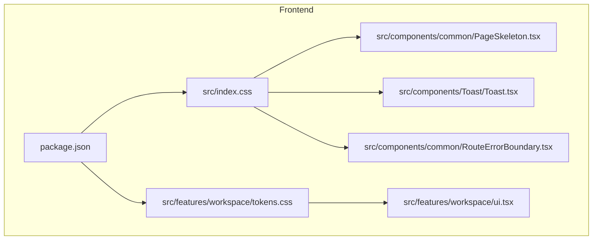
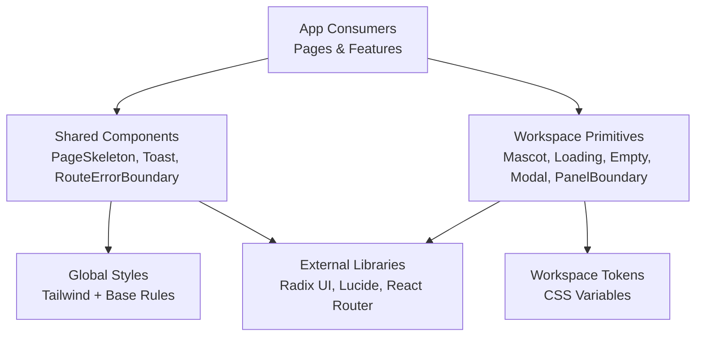
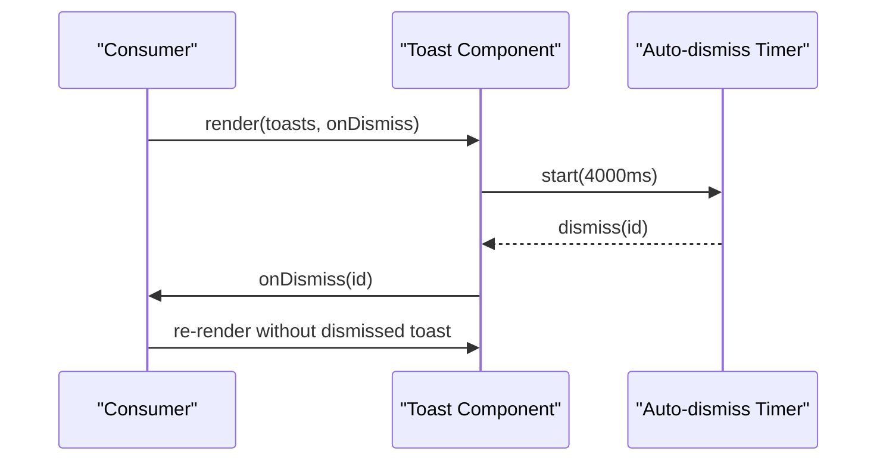
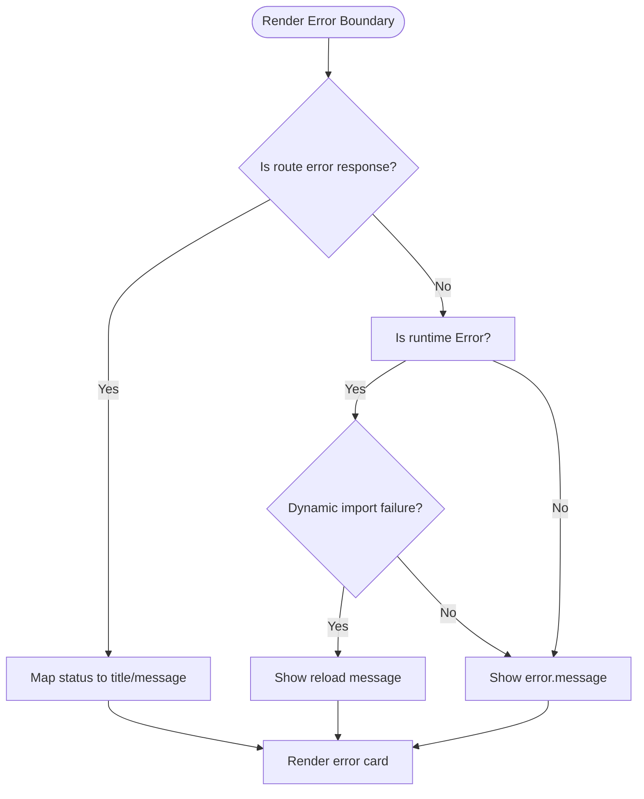
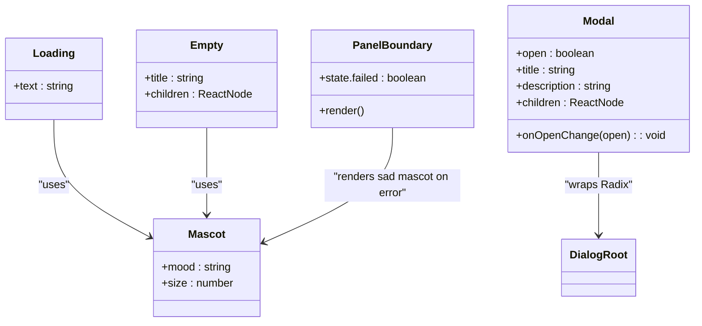
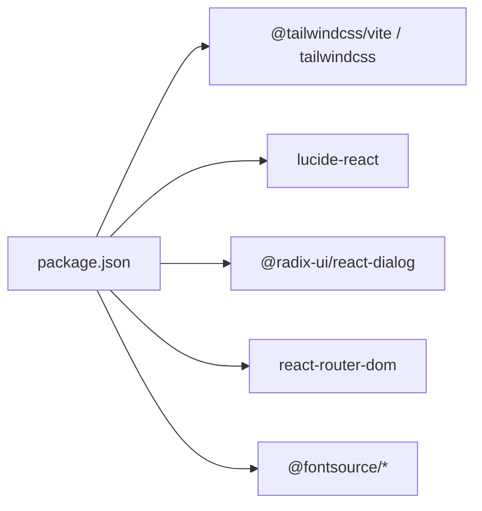

# UI Components & Design System

<cite>
**Referenced Files in This Document**
- [PageSkeleton.tsx](file://frontend/src/components/common/PageSkeleton.tsx)
- [Toast.tsx](file://frontend/src/components/Toast/Toast.tsx)
- [RouteErrorBoundary.tsx](file://frontend/src/components/common/RouteErrorBoundary.tsx)
- [index.css](file://frontend/src/index.css)
- [ui.tsx](file://frontend/src/features/workspace/ui.tsx)
- [tokens.css](file://frontend/src/features/workspace/tokens.css)
- [package.json](file://frontend/package.json)
</cite>

## Table of Contents
1. [Introduction](#introduction)
2. [Project Structure](#project-structure)
3. [Core Components](#core-components)
4. [Architecture Overview](#architecture-overview)
5. [Detailed Component Analysis](#detailed-component-analysis)
6. [Dependency Analysis](#dependency-analysis)
7. [Performance Considerations](#performance-considerations)
8. [Troubleshooting Guide](#troubleshooting-guide)
9. [Conclusion](#conclusion)
10. [Appendices](#appendices)

## Introduction
This document describes the reusable UI components and design system implementation in the frontend application. It focuses on component composition patterns, prop interfaces, styling with Tailwind CSS, responsive design, accessibility, theming, and guidelines for creating new components while maintaining consistency and cross-browser compatibility.

## Project Structure
The UI is organized into feature-based directories under src/features and shared UI primitives under src/components. The global styles are defined in index.css using Tailwind v4, and workspace-specific tokens live in a scoped CSS file.

**Diagram sources**
- [index.css:1-17](file://frontend/src/index.css#L1-L17)
- [PageSkeleton.tsx:1-41](file://frontend/src/components/common/PageSkeleton.tsx#L1-L41)
- [Toast.tsx:1-59](file://frontend/src/components/Toast/Toast.tsx#L1-L59)
- [RouteErrorBoundary.tsx:1-55](file://frontend/src/components/common/RouteErrorBoundary.tsx#L1-L55)
- [ui.tsx:1-31](file://frontend/src/features/workspace/ui.tsx#L1-L31)
- [tokens.css:1-24](file://frontend/src/features/workspace/tokens.css#L1-L24)
- [package.json:1-70](file://frontend/package.json#L1-L70)

**Section sources**
- [index.css:1-17](file://frontend/src/index.css#L1-L17)
- [package.json:1-70](file://frontend/package.json#L1-L70)

## Core Components
- PageSkeleton: A layout skeleton used to indicate loading states across pages. It uses Tailwind utility classes for structure, spacing, and subtle animation.
- Toast: A notification component that renders success, error, or info messages with auto-dismissal and manual dismissal.
- RouteErrorBoundary: A route-level error boundary that displays user-friendly error messages based on HTTP status codes and runtime errors.
- Workspace UI primitives: Mascot, Loading, Empty, Modal, PanelBoundary provide consistent UX within the workspace feature.

Key responsibilities:
- Provide consistent visual feedback during loading and error conditions.
- Centralize accessible messaging and interactions.
- Maintain consistent spacing, typography, and color via Tailwind utilities and scoped tokens.

**Section sources**
- [PageSkeleton.tsx:1-41](file://frontend/src/components/common/PageSkeleton.tsx#L1-L41)
- [Toast.tsx:1-59](file://frontend/src/components/Toast/Toast.tsx#L1-L59)
- [RouteErrorBoundary.tsx:1-55](file://frontend/src/components/common/RouteErrorBoundary.tsx#L1-L55)
- [ui.tsx:1-31](file://frontend/src/features/workspace/ui.tsx#L1-L31)

## Architecture Overview
The UI architecture follows a layered approach:
- Global styles and theme configuration via Tailwind v4 in index.css.
- Shared components under src/components/common and feature-scoped components under src/features.
- Scoped theming for the workspace via CSS custom properties in tokens.css.
- External libraries (Radix UI, Lucide icons, React Router) integrated through package dependencies.

**Diagram sources**
- [index.css:1-17](file://frontend/src/index.css#L1-L17)
- [tokens.css:1-24](file://frontend/src/features/workspace/tokens.css#L1-L24)
- [package.json:1-70](file://frontend/package.json#L1-L70)

## Detailed Component Analysis

### PageSkeleton
Purpose:
- Provides a lightweight placeholder layout to improve perceived performance during data fetching.

Composition pattern:
- Pure presentational component with no state.
- Uses Tailwind grid and flex utilities to mirror the final page structure.

Accessibility:
- Includes an aria-label to convey loading intent to assistive technologies.

Styling:
- Relies on Tailwind utilities for colors, spacing, shadows, and animations.

Responsive behavior:
- Grid adapts from single column to multi-column at md breakpoint.

Usage guidance:
- Render while async data is loading; replace with actual content when ready.

**Section sources**
- [PageSkeleton.tsx:1-41](file://frontend/src/components/common/PageSkeleton.tsx#L1-L41)

### Toast
Purpose:
- Displays transient notifications with clear visual cues for success, error, and info states.

Prop interface:
- toasts: Array of toast messages with id, title, message, and type.
- onDismiss: Callback to remove a toast by id.

Behavior:
- Auto-dismisses the first toast after a fixed duration.
- Supports manual dismissal via close button.

Accessibility:
- Each toast includes descriptive labels and semantic headings.

Styling:
- Fixed positioning, stacked layout, and iconography via Lucide.
- Consistent spacing and typography using Tailwind utilities.

**Diagram sources**
- [Toast.tsx:1-59](file://frontend/src/components/Toast/Toast.tsx#L1-L59)

**Section sources**
- [Toast.tsx:1-59](file://frontend/src/components/Toast/Toast.tsx#L1-L59)

### RouteErrorBoundary
Purpose:
- Captures route-level errors and presents localized, user-friendly messages.

Logic flow:
- Inspects whether the error is a route response with HTTP status codes.
- Handles dynamic import failures by prompting a reload.
- Falls back to generic error message for other cases.

Accessibility:
- Uses semantic HTML and readable text for screen readers.

Styling:
- Centered card layout with Tailwind utilities.

**Diagram sources**
- [RouteErrorBoundary.tsx:1-55](file://frontend/src/components/common/RouteErrorBoundary.tsx#L1-L55)

**Section sources**
- [RouteErrorBoundary.tsx:1-55](file://frontend/src/components/common/RouteErrorBoundary.tsx#L1-L55)

### Workspace UI Primitives
Components:
- Mascot: Accessible SVG illustration with mood variants and aria-label mapping.
- Loading: Combines Mascot with status semantics and animated dots.
- Empty: Presents empty-state messaging with Mascot.
- Modal: Wraps Radix Dialog with accessible title/description and close control.
- PanelBoundary: Class component that catches rendering errors and offers retry.

Accessibility:
- Uses role attributes (img, status, alert), aria-labels, and semantic elements.

Styling:
- Uses workspace-scoped CSS variables and Tailwind utilities.

**Diagram sources**
- [ui.tsx:1-31](file://frontend/src/features/workspace/ui.tsx#L1-L31)

**Section sources**
- [ui.tsx:1-31](file://frontend/src/features/workspace/ui.tsx#L1-L31)

## Dependency Analysis
- Tailwind CSS v4 is configured via @tailwindcss/vite and imported in index.css.
- Icons are provided by lucide-react.
- Dialog primitives come from @radix-ui/react-dialog.
- Routing integration uses react-router-dom.
- Fonts are loaded via @fontsource packages.

**Diagram sources**
- [package.json:1-70](file://frontend/package.json#L1-L70)

**Section sources**
- [package.json:1-70](file://frontend/package.json#L1-L70)

## Performance Considerations
- Prefer skeleton placeholders like PageSkeleton to reduce layout shifts during loading.
- Keep Toast auto-dismiss timers short and ensure cleanup on unmount to avoid memory leaks.
- Use lazy loading for heavy features and handle dynamic import errors gracefully.
- Minimize re-renders by memoizing expensive computations and avoiding unnecessary state updates.
- Leverage Tailwind’s JIT compilation for efficient CSS generation.

[No sources needed since this section provides general guidance]

## Troubleshooting Guide
Common issues and resolutions:
- Toast not dismissing: Verify onDismiss callback is wired and toasts array is updated.
- Error boundary not catching route errors: Ensure it wraps routes correctly and handles both route responses and runtime errors.
- Focus styles missing: Confirm global focus-visible rules are applied via index.css.
- Workspace theme not applied: Ensure .workspace container is present so CSS variables are available.

**Section sources**
- [Toast.tsx:1-59](file://frontend/src/components/Toast/Toast.tsx#L1-L59)
- [RouteErrorBoundary.tsx:1-55](file://frontend/src/components/common/RouteErrorBoundary.tsx#L1-L55)
- [index.css:1-17](file://frontend/src/index.css#L1-L17)
- [tokens.css:1-24](file://frontend/src/features/workspace/tokens.css#L1-L24)

## Conclusion
The UI layer combines shared components, feature-scoped primitives, and a cohesive design system built on Tailwind CSS and scoped tokens. Accessibility and responsiveness are prioritized throughout. Following the guidelines below will help maintain consistency and reliability as the system grows.

[No sources needed since this section summarizes without analyzing specific files]

## Appendices

### Styling Approach with Tailwind CSS
- Global base styles and focus-visible outlines are defined in index.css.
- Utility-first styling is used consistently across components.
- Custom font families are registered via @theme and @fontsource packages.

**Section sources**
- [index.css:1-17](file://frontend/src/index.css#L1-L17)
- [package.json:1-70](file://frontend/package.json#L1-L70)

### Responsive Design Patterns
- Use Tailwind breakpoints (e.g., md) to adapt layouts from single to multi-column grids.
- Employ flexible containers and min/max widths to ensure readability on small screens.
- Keep touch targets large enough and avoid hover-only interactions.

**Section sources**
- [PageSkeleton.tsx:1-41](file://frontend/src/components/common/PageSkeleton.tsx#L1-L41)

### Accessibility Implementation
- Provide meaningful aria-labels and roles for interactive elements and illustrations.
- Ensure keyboard navigation and visible focus indicators.
- Use semantic HTML for headings, paragraphs, and buttons.

**Section sources**
- [PageSkeleton.tsx:1-41](file://frontend/src/components/common/PageSkeleton.tsx#L1-L41)
- [Toast.tsx:1-59](file://frontend/src/components/Toast/Toast.tsx#L1-L59)
- [ui.tsx:1-31](file://frontend/src/features/workspace/ui.tsx#L1-L31)
- [index.css:1-17](file://frontend/src/index.css#L1-L17)

### Theming Strategy
- Global theme tokens and fonts are set in index.css.
- Workspace-specific palette and radii are defined as CSS variables in tokens.css.
- Components should consume these tokens rather than hardcoding colors.

**Section sources**
- [index.css:1-17](file://frontend/src/index.css#L1-L17)
- [tokens.css:1-24](file://frontend/src/features/workspace/tokens.css#L1-L24)

### Guidelines for Creating New Components
- Keep components pure and focused on a single responsibility.
- Define explicit props with TypeScript types for clarity and safety.
- Compose existing primitives (icons, dialogs, skeletons) instead of duplicating logic.
- Follow naming conventions: PascalCase for components and kebab-case for CSS classes if needed.
- Include accessibility attributes (aria-label, role) and test keyboard navigation.
- Use Tailwind utilities for styling and avoid inline styles unless necessary.
- Test responsive behavior across breakpoints and devices.
- Add error boundaries or fallbacks where appropriate.

[No sources needed since this section provides general guidance]

### Cross-Browser Compatibility
- Rely on widely supported Tailwind utilities and standard CSS features.
- Avoid experimental APIs; prefer stable browser capabilities.
- Validate focus styles and pointer interactions across browsers.
- Use polyfills only when necessary and document their usage.

[No sources needed since this section provides general guidance]