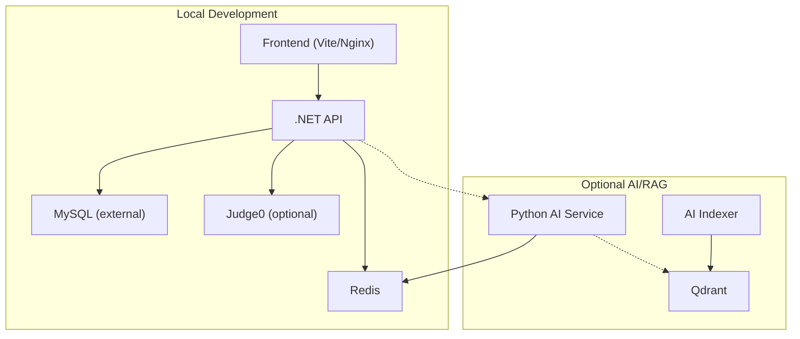
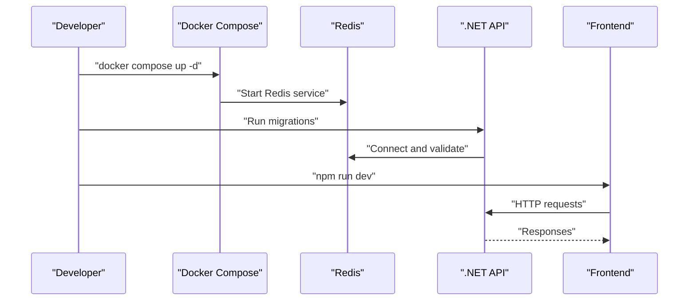
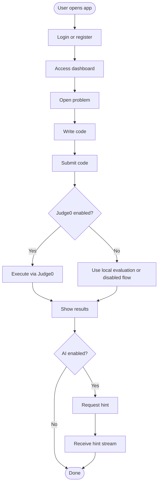

# Getting Started

<cite>
**Referenced Files in This Document**
- [docker-compose.yml](file://api/docker-compose.yml)
- [COMPOSE.md](file://api/docs/COMPOSE.md)
- [docker-compose.production.yml](file://api/docker-compose.production.yml)
- [Program.cs](file://api/src/Api/CodePath.Api/Program.cs)
- [appsettings.json](file://api/src/Api/CodePath.Api/appsettings.json)
- [Dockerfile (frontend)](file://frontend/Dockerfile)
- [package.json (frontend)](file://frontend/package.json)
- [README.md (ai-service)](file://ai-service/README.md)
</cite>

## Table of Contents
1. [Introduction](#introduction)
2. [Prerequisites](#prerequisites)
3. [Project Structure](#project-structure)
4. [Installation](#installation)
5. [Configuration](#configuration)
6. [Database Setup](#database-setup)
7. [Service Initialization](#service-initialization)
8. [Quick Start](#quick-start)
9. [Basic Usage Examples](#basic-usage-examples)
10. [Troubleshooting Guide](#troubleshooting-guide)
11. [Conclusion](#conclusion)

## Introduction
This guide helps you install and run CodePart locally for development, then perform basic operations such as registering a user and executing code. You will set up Docker, Node.js, .NET SDK, and Python environments, start the required services with docker-compose, configure environment variables, initialize the database, and access the web interface.

## Prerequisites
Install the following tools before starting:

- Docker Desktop or Docker Engine with Compose support
- Node.js 20+ (for frontend build and dev server)
- .NET 8 SDK (for API project)
- Python 3.11 (for AI assistant service)
- A MySQL-compatible database server (external to Compose)
- Optional: an external Judge0 instance for code execution
- Optional: LLM provider credentials for AI features (OpenAI, Gemini, Anthropic, or local VLLM)

Notes:
- The frontend is built with Node.js and served by Nginx in production.
- The API runs on .NET and uses Redis for caching and sessions.
- The AI assistant runs on Python and connects to Redis; it can optionally use Qdrant and embedding providers when RAG is enabled.

**Section sources**
- [docker-compose.yml:1-5](file://api/docker-compose.yml#L1-L5)
- [docker-compose.production.yml:1-3](file://api/docker-compose.production.yml#L1-L3)
- [package.json (frontend):6-13](file://frontend/package.json#L6-L13)
- [README.md (ai-service):9-11](file://ai-service/README.md#L9-L11)

## Project Structure
CodePart consists of three main parts:

- Frontend: React + TypeScript application built with Vite and served by Nginx in production.
- API: .NET Web API that exposes authentication, exercises, judge integration, admin, teacher, class, and learning endpoints.
- AI Service: Python FastAPI service providing AI-assisted hints and optional RAG indexing.

**Diagram sources**
- [docker-compose.yml:37-106](file://api/docker-compose.yml#L37-L106)
- [docker-compose.production.yml:37-215](file://api/docker-compose.production.yml#L37-L215)
- [Program.cs:368-374](file://api/src/Api/CodePath.Api/Program.cs#L368-L374)

**Section sources**
- [docker-compose.yml:1-112](file://api/docker-compose.yml#L1-L112)
- [docker-compose.production.yml:1-241](file://api/docker-compose.production.yml#L1-L241)
- [Program.cs:368-374](file://api/src/Api/CodePath.Api/Program.cs#L368-L374)

## Installation
Use docker-compose to start the core services for local development.

Steps:
1. Open a terminal in the `api` directory.
2. Ensure your `.env` file contains required variables for Redis and other services. If missing, add them from existing examples.
3. Start Redis:
   - `docker compose up -d`
4. Optionally start AI:
   - `docker compose --profile ai up -d --build`
5. Optionally start RAG (includes AI and Qdrant):
   - `docker compose --profile rag up -d --build`

Ports bound to localhost:
- Redis: 6379
- AI service: 8000
- AI indexer: 8001
- Qdrant: 6333

You can change these ports using environment variables: `REDIS_PORT`, `AI_PORT`, `AI_INDEXER_PORT`, `QDRANT_PORT`. Update host URLs accordingly if you modify defaults.

**Section sources**
- [COMPOSE.md:12-30](file://api/docs/COMPOSE.md#L12-L30)
- [docker-compose.yml:37-106](file://api/docker-compose.yml#L37-L106)

## Configuration
Configure environment variables for the API and optional AI/RAG features.

Core API configuration keys:
- `ConnectionStrings:Database`: MySQL connection string
- `ConnectionStrings:Redis`: Redis connection string
- `Jwt:SigningKey`: HMAC key at least 64 characters
- `Cors:AllowedOrigins`: Allowed frontend origins
- `AuthFrontend:PublicBaseUrl`: Public base URL for auth flows
- `Email:Smtp:*`: SMTP settings for email sending
- `CodeExecution:Judge0:*`: Judge0 integration settings
- `Judge:Enabled`: Enable external Judge0 integration
- `Ai:Enabled`: Enable AI assistant endpoints
- `Rag:Enabled`: Enable RAG features

AI service environment variables:
- `SERVICE_API_KEY`: Internal API key shared between .NET and Python
- `REDIS_URL`: Redis connection used by AI service
- `LLM_PROVIDER`, `LLM_API_KEY`, `LLM_MODEL`, `LLM_ADVANCED_MODEL`, `LLM_BASE_URL`: LLM provider configuration

RAG environment variables:
- `QDRANT_URL`, `QDRANT_API_KEY`
- `EMBEDDING_BASE_URL`, `EMBEDDING_MODEL`, `EMBEDDING_DIMENSIONS`, `EMBEDDING_API_KEY`
- `RAG_MIN_SCORE`, `RAG_ASSET_HOSTS`

Important notes:
- In development, the API loads `.env` and environment variables.
- Secrets can be mounted as files under `/run/secrets` and normalized into configuration.
- For production, use `docker-compose.production.yml` with `.env.production` and secrets files.

**Section sources**
- [Program.cs:28-58](file://api/src/Api/CodePath.Api/Program.cs#L28-L58)
- [appsettings.json:1-116](file://api/src/Api/CodePath.Api/appsettings.json#L1-L116)
- [docker-compose.yml:6-14](file://api/docker-compose.yml#L6-L14)
- [docker-compose.yml:60-92](file://api/docker-compose.yml#L60-L92)
- [docker-compose.production.yml:64-125](file://api/docker-compose.production.yml#L64-L125)
- [docker-compose.production.yml:144-206](file://api/docker-compose.production.yml#L144-L206)

## Database Setup
The API uses a MySQL-compatible database. Compose does not create or migrate the database automatically.

Steps:
1. Create a MySQL database named `codepath` (or another name configured via `Database__Name`).
2. Configure the connection string or individual database variables (`Database__Host`, `Database__Port`, `Database__User`, `Database__Password`, `Database__Name`).
3. Run migrations:
   - From the API project root: `dotnet run --project src/Api/CodePath.Api -- --migrate`
4. If enabling external Judge0 integration, also run its migration:
   - `dotnet run --project src/Api/CodePath.Api -- --migrate-judge`

Validation:
- The API validates required configuration and throws errors early if critical values are missing or invalid.
- Health endpoints help verify connectivity to Redis and overall readiness.

**Section sources**
- [Program.cs:377-384](file://api/src/Api/CodePath.Api/Program.cs#L377-L384)
- [appsettings.json:25-28](file://api/src/Api/CodePath.Api/appsettings.json#L25-L28)
- [docker-compose.production.yml:72-77](file://api/docker-compose.production.yml#L72-L77)

## Service Initialization
After configuration and database setup, start the API and frontend.

API initialization:
- The API configures Kestrel limits, forwards headers, CORS, authentication, authorization, rate limiting, health checks, and endpoint mapping.
- It conditionally enables AI and SignalR when `Ai:Enabled=true`.
- It maps auth, admin, exercise, judge, teacher, class, and learning endpoints.

Frontend initialization:
- Install dependencies and run the dev server:
  - `npm install --prefix frontend`
  - `npm run dev --prefix frontend`
- In production, the frontend is built and served by Nginx inside a container.

**Diagram sources**
- [Program.cs:28-58](file://api/src/Api/CodePath.Api/Program.cs#L28-L58)
- [Program.cs:368-374](file://api/src/Api/CodePath.Api/Program.cs#L368-L374)
- [Program.cs:419-423](file://api/src/Api/CodePath.Api/Program.cs#L419-L423)
- [Program.cs:502-509](file://api/src/Api/CodePath.Api/Program.cs#L502-L509)
- [package.json (frontend):6-13](file://frontend/package.json#L6-L13)

**Section sources**
- [Program.cs:28-58](file://api/src/Api/CodePath.Api/Program.cs#L28-L58)
- [Program.cs:368-374](file://api/src/Api/CodePath.Api/Program.cs#L368-L374)
- [Program.cs:419-423](file://api/src/Api/CodePath.Api/Program.cs#L419-L423)
- [Program.cs:502-509](file://api/src/Api/CodePath.Api/Program.cs#L502-L509)
- [package.json (frontend):6-13](file://frontend/package.json#L6-L13)

## Quick Start
Follow these steps to get CodePart running locally:

1. Start Redis:
   - `cd api && docker compose up -d`
2. Configure environment variables:
   - Add `ConnectionStrings:Database`, `ConnectionStrings:Redis`, `Jwt:SigningKey`, and other required keys to `.env`.
3. Run migrations:
   - `dotnet run --project src/Api/CodePath.Api -- --migrate`
4. Start the API:
   - `dotnet run --project src/Api/CodePath.Api`
5. Start the frontend:
   - `npm install --prefix frontend`
   - `npm run dev --prefix frontend`
6. Access the web interface:
   - Open the URL shown by Vite (typically `http://localhost:5173`).
7. Register a user:
   - Use the registration page or API endpoint to create a student account.
8. Execute code:
   - Navigate to an exercise/problem page and submit code. If Judge0 is enabled, results will be returned through the API.

Optional AI/RAG:
- Start AI: `docker compose --profile ai up -d --build`
- Start RAG: `docker compose --profile rag up -d --build`
- Set `Ai:Enabled=true` and `Rag:Enabled=true` in configuration.
- Provide LLM and embedding credentials as needed.

**Section sources**
- [COMPOSE.md:12-30](file://api/docs/COMPOSE.md#L12-L30)
- [Program.cs:377-384](file://api/src/Api/CodePath.Api/Program.cs#L377-L384)
- [package.json (frontend):6-13](file://frontend/package.json#L6-L13)
- [docker-compose.yml:60-92](file://api/docker-compose.yml#L60-L92)

## Basic Usage Examples
Authentication and user management:
- Register a new user via the frontend or API.
- Log in to receive a JWT token.
- Use protected routes to access exercises and teacher/admin areas based on roles.

Exercises and code execution:
- Browse problems and open the workspace/editor.
- Submit code; the API integrates with Judge0 when enabled.
- View test results and feedback.

AI assistance (optional):
- When enabled, the API calls the Python AI service to generate hints.
- Hints are streamed to the frontend via SSE or SignalR depending on implementation.
- Quotas and rate limits apply to hint generation.

**Diagram sources**
- [Program.cs:502-509](file://api/src/Api/CodePath.Api/Program.cs#L502-L509)
- [appsettings.json:93-99](file://api/src/Api/CodePath.Api/appsettings.json#L93-L99)
- [docker-compose.yml:60-92](file://api/docker-compose.yml#L60-L92)

**Section sources**
- [Program.cs:502-509](file://api/src/Api/CodePath.Api/Program.cs#L502-L509)
- [appsettings.json:93-99](file://api/src/Api/CodePath.Api/appsettings.json#L93-L99)
- [docker-compose.yml:60-92](file://api/docker-compose.yml#L60-L92)

## Troubleshooting Guide
Common issues and resolutions:

- Missing or invalid JWT signing key:
  - Ensure `Jwt:SigningKey` is present and at least 64 characters.
  - The API throws an error during startup if this validation fails.

- Redis connection failures:
  - Verify `ConnectionStrings:Redis` and `Ai__ServiceKey`/`SERVICE_API_KEY` alignment.
  - Check Redis health endpoint and logs.

- CORS errors from frontend:
  - Configure `Cors:AllowedOrigins` to include your frontend URL.
  - In development, CORS allows all origins by default unless explicitly restricted.

- AI service not reachable:
  - Confirm AI profile is started and `Ai:Enabled=true`.
  - Ensure `SERVICE_API_KEY` matches between .NET and Python.
  - Validate LLM provider variables and network egress.

- RAG/Qdrant not available:
  - Start RAG profile and provide `QDRANT_API_KEY` and embedding variables.
  - Verify Qdrant is healthy and accessible.

- Database migration errors:
  - Run migrations again after fixing configuration.
  - Ensure MySQL server is reachable and credentials are correct.

- Rate limiting responses:
  - Review rate limit policies and adjust permit limits if necessary.
  - Check retry-after headers on 429 responses.

Health checks:
- API root returns a simple status.
- `/health` provides detailed readiness checks.
- `/health/live` is a liveness probe.
- `/health/redis` verifies Redis connectivity.

**Section sources**
- [Program.cs:63-67](file://api/src/Api/CodePath.Api/Program.cs#L63-L67)
- [Program.cs:160-182](file://api/src/Api/CodePath.Api/Program.cs#L160-L182)
- [Program.cs:424-500](file://api/src/Api/CodePath.Api/Program.cs#L424-L500)
- [docker-compose.yml:37-58](file://api/docker-compose.yml#L37-L58)
- [docker-compose.yml:60-92](file://api/docker-compose.yml#L60-L92)

## Conclusion
You now have the essentials to install CodePart locally, configure environment variables, initialize the database, and run the services. Use the quick start steps to launch the application, access the web interface, register users, and execute code. For advanced scenarios, enable AI and RAG features by configuring the appropriate profiles and credentials. Refer to the troubleshooting section if you encounter common setup issues.