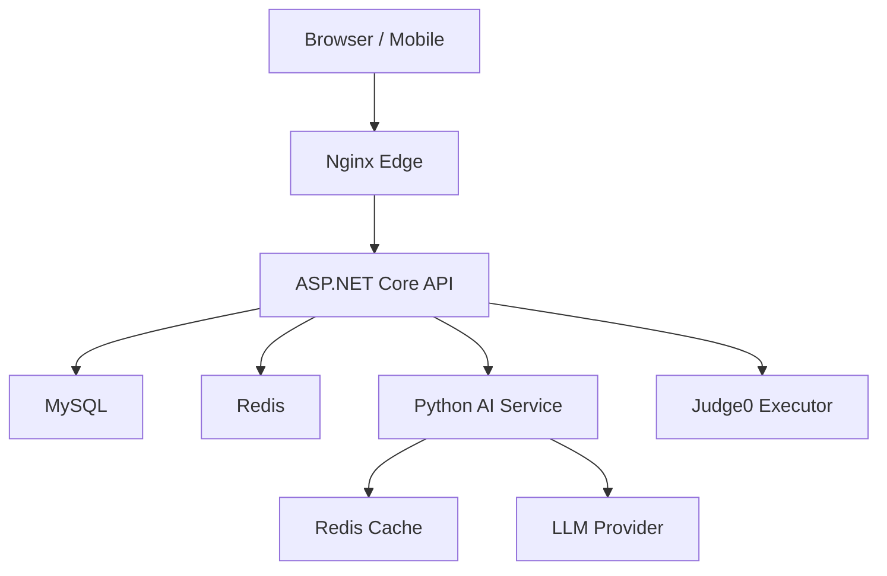
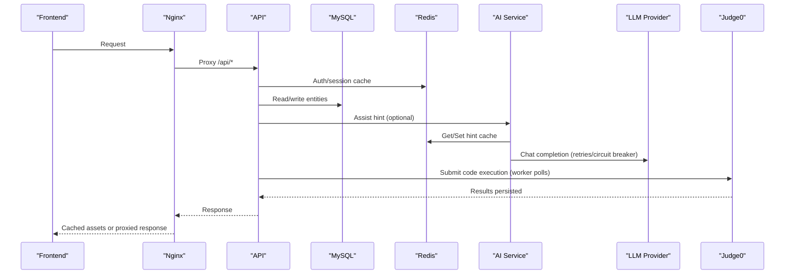
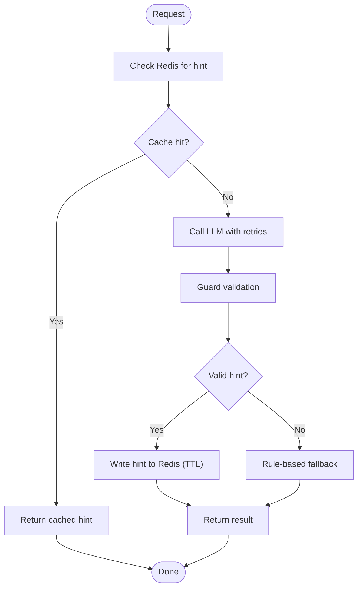
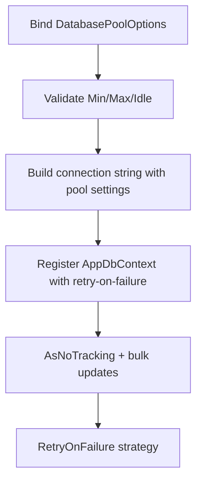
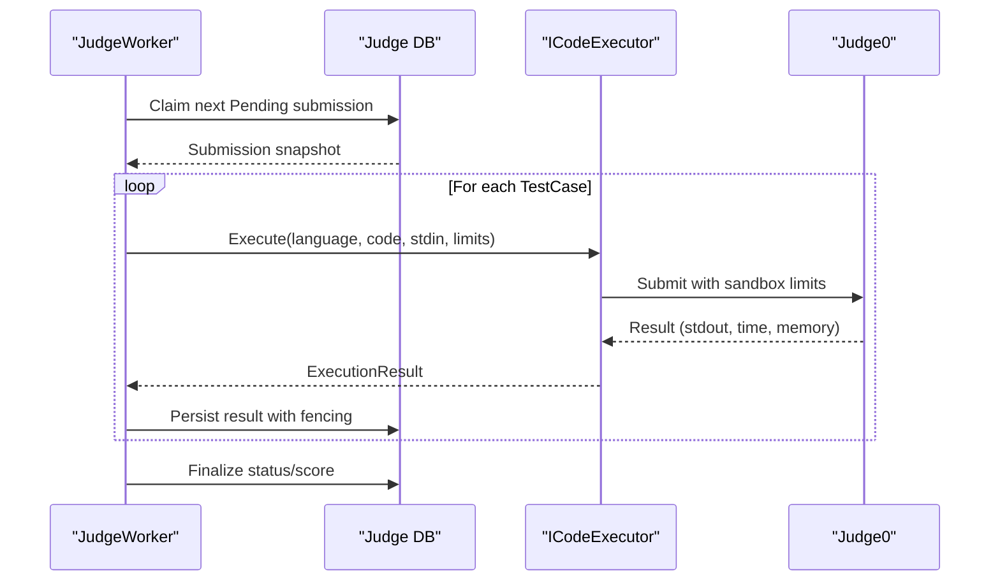
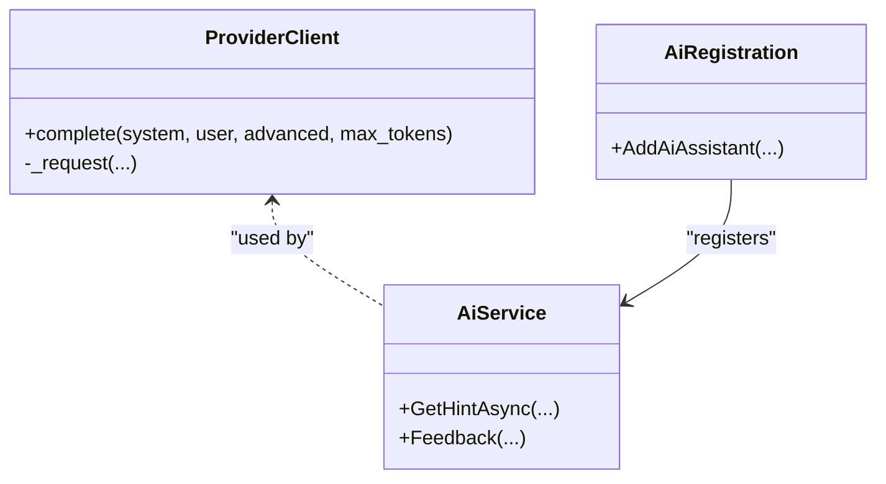
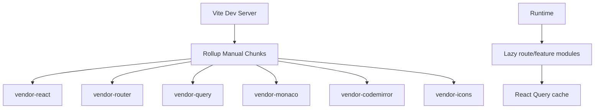
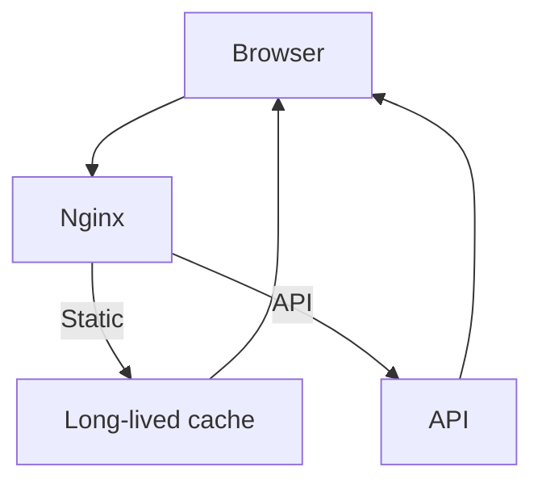
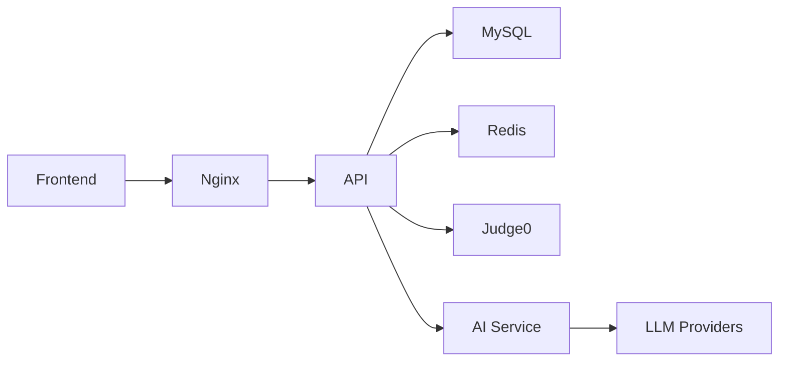

# Performance Optimization

<cite>
**Referenced Files in This Document**
- [Program.cs](file://api/src/Api/CodePath.Api/Program.cs)
- [DependencyInjection.cs](file://api/src/Infrastructure/CodePath.Infrastructure/DependencyInjection.cs)
- [DatabasePoolOptions.cs](file://api/src/Infrastructure/CodePath.Infrastructure/Persistence/DatabasePoolOptions.cs)
- [AppDbContext.cs](file://api/src/Infrastructure/CodePath.Infrastructure/Persistence/AppDbContext.cs)
- [RedisRegistration.cs](file://api/src/Infrastructure/CodePath.Infrastructure/Redis/RedisRegistration.cs)
- [RedisConnectionOptions.cs](file://api/src/Infrastructure/CodePath.Infrastructure/Redis/RedisConnectionOptions.cs)
- [AiService.cs](file://api/src/Infrastructure/CodePath.Infrastructure/Ai/AiService.cs)
- [AiRegistration.cs](file://api/src/Infrastructure/CodePath.Infrastructure/Ai/AiRegistration.cs)
- [RagService.cs](file://api/src/Infrastructure/CodePath.Infrastructure/Learning/RagService.cs)
- [JudgeWorker.cs](file://api/src/Infrastructure/CodePath.Infrastructure/Judge/JudgeWorker.cs)
- [Judge0CodeExecutor.cs](file://api/src/Infrastructure/CodePath.Infrastructure/Judge/Judge0CodeExecutor.cs)
- [appsettings.Judge.example.json](file://api/src/Api/CodePath.Api/appsettings.Judge.example.json)
- [main.py](file://ai-service/app/main.py)
- [pipeline.py](file://ai-service/app/api/pipeline.py)
- [redis_cache.py](file://ai-service/app/cache/redis_cache.py)
- [client.py](file://ai-service/app/llm/client.py)
- [vite.config.ts](file://frontend/vite.config.ts)
- [package.json](file://frontend/package.json)
- [sessionActivity.ts](file://frontend/src/features/auth/sessionActivity.ts)
- [default.conf](file://frontend/nginx/default.conf)
</cite>

## Table of Contents
1. [Introduction](#introduction)
2. [Project Structure](#project-structure)
3. [Core Components](#core-components)
4. [Architecture Overview](#architecture-overview)
5. [Detailed Component Analysis](#detailed-component-analysis)
6. [Dependency Analysis](#dependency-analysis)
7. [Performance Considerations](#performance-considerations)
8. [Troubleshooting Guide](#troubleshooting-guide)
9. [Conclusion](#conclusion)

## Introduction
This document explains CodePart’s performance optimization strategy across its distributed architecture. It covers Redis-backed caching for sessions and AI responses, database query and connection pooling tuning, code execution with Judge0 worker pools and resource limits, frontend performance techniques such as code splitting and lazy loading, API response optimization, compression, CDN usage, and monitoring/profiling to identify bottlenecks and measure improvements.

## Project Structure
The system consists of:
- ASP.NET Core API service (authentication, authorization, exercises, judge orchestration, learning features).
- Python AI assistant service (hint generation, RAG integration, LLM provider client).
- Frontend SPA (React + Vite) served via Nginx.
- External services: MySQL, Redis, Judge0, and LLM providers.

**Diagram sources**
- [Program.cs:386-422](file://api/src/Api/CodePath.Api/Program.cs#L386-L422)
- [main.py:17-44](file://ai-service/app/main.py#L17-L44)
- [Pipeline assist flow:10-40](file://ai-service/app/api/pipeline.py#L10-L40)
- [default.conf:50-87](file://frontend/nginx/default.conf#L50-L87)

**Section sources**
- [Program.cs:28-45](file://api/src/Api/CodePath.Api/Program.cs#L28-L45)
- [main.py:17-44](file://ai-service/app/main.py#L17-L44)
- [default.conf:50-87](file://frontend/nginx/default.conf#L50-L87)

## Core Components
- API server: request pipeline, rate limiting, health checks, authentication, and feature endpoints.
- AI service: hint generation pipeline with Redis caching and LLM provider client.
- Database layer: EF Core with MySQL connector, retry-on-failure, configurable pool sizing.
- Redis: connection multiplexer, health probe, session and token storage.
- Code execution: background workers polling submissions, sandboxed execution via Judge0.
- Frontend: Vite build with manual chunking, React Query, idle session tracking, Nginx caching rules.

**Section sources**
- [Program.cs:245-364](file://api/src/Api/CodePath.Api/Program.cs#L245-L364)
- [DependencyInjection.cs:61-104](file://api/src/Infrastructure/CodePath.Infrastructure/DependencyInjection.cs#L61-L104)
- [RedisRegistration.cs:13-68](file://api/src/Infrastructure/CodePath.Infrastructure/Redis/RedisRegistration.cs#L13-L68)
- [JudgeWorker.cs:25-63](file://api/src/Infrastructure/CodePath.Infrastructure/Judge/JudgeWorker.cs#L25-L63)
- [vite.config.ts:8-41](file://frontend/vite.config.ts#L8-L41)

## Architecture Overview
The API orchestrates user requests, applies rate limits and auth, persists data to MySQL, caches hot data in Redis, calls the AI service when enabled, and delegates code execution to Judge0 through a background worker. The AI service caches hints in Redis and retries LLM calls with circuit breaking at the API layer.

**Diagram sources**
- [Program.cs:386-422](file://api/src/Api/CodePath.Api/Program.cs#L386-L422)
- [AiRegistration.cs:15-23](file://api/src/Infrastructure/CodePath.Infrastructure/Ai/AiRegistration.cs#L15-L23)
- [pipeline.py:10-40](file://ai-service/app/api/pipeline.py#L10-L40)
- [JudgeWorker.cs:25-63](file://api/src/Infrastructure/CodePath.Infrastructure/Judge/JudgeWorker.cs#L25-L63)
- [default.conf:50-87](file://frontend/nginx/default.conf#L50-L87)

## Detailed Component Analysis

### Redis Caching Strategy
- Session management and tokens:
  - Redis is registered as a singleton multiplexer with configurable timeouts and keep-alive.
  - Authentication-related services (OTP, token blacklist, login attempts, password reset limiter) use Redis for fast, shared state.
  - Health endpoint exposes Redis connectivity and latency.
- AI response caching:
  - AI service computes a deterministic cache key from normalized inputs and model identity.
  - Pipeline reads cached hints; on miss, it calls LLM, validates guard constraints, then writes a short-lived cache entry.
- Frequently accessed data:
  - RAG service uses Redis Lua scripts for per-user rate limiting counters.

**Diagram sources**
- [redis_cache.py:5-10](file://ai-service/app/cache/redis_cache.py#L5-L10)
- [pipeline.py:10-40](file://ai-service/app/api/pipeline.py#L10-L40)
- [RedisRegistration.cs:13-68](file://api/src/Infrastructure/CodePath.Infrastructure/Redis/RedisRegistration.cs#L13-L68)

**Section sources**
- [RedisRegistration.cs:13-68](file://api/src/Infrastructure/CodePath.Infrastructure/Redis/RedisRegistration.cs#L13-L68)
- [RedisConnectionOptions.cs:3-11](file://api/src/Infrastructure/CodePath.Infrastructure/Redis/RedisConnectionOptions.cs#L3-L11)
- [Program.cs:455-500](file://api/src/Api/CodePath.Api/Program.cs#L455-L500)
- [redis_cache.py:5-10](file://ai-service/app/cache/redis_cache.py#L5-L10)
- [pipeline.py:10-40](file://ai-service/app/api/pipeline.py#L10-L40)
- [RagService.cs:25-37](file://api/src/Infrastructure/CodePath.Infrastructure/Learning/RagService.cs#L25-L37)

### Database Query Optimization and Connection Pooling
- Connection pooling:
  - MySQL connector configured with min/max pool sizes and idle lifetime via options.
  - Validation ensures sane ranges and ordering constraints.
- Query patterns:
  - EF Core queries use AsNoTracking for read-heavy paths.
  - Bulk updates and atomic operations reduce round-trips.
  - Retry-on-failure strategy improves resilience under transient failures.
- Indexing and schema:
  - Collation and charset set for efficient string comparisons.
  - Migrations define entity schemas; indexes should be added based on query profiles.

**Diagram sources**
- [DatabasePoolOptions.cs:3-10](file://api/src/Infrastructure/CodePath.Infrastructure/Persistence/DatabasePoolOptions.cs#L3-L10)
- [DependencyInjection.cs:61-104](file://api/src/Infrastructure/CodePath.Infrastructure/DependencyInjection.cs#L61-L104)
- [AppDbContext.cs:342-380](file://api/src/Infrastructure/CodePath.Infrastructure/Persistence/AppDbContext.cs#L342-L380)

**Section sources**
- [DatabasePoolOptions.cs:3-10](file://api/src/Infrastructure/CodePath.Infrastructure/Persistence/DatabasePoolOptions.cs#L3-L10)
- [DependencyInjection.cs:61-104](file://api/src/Infrastructure/CodePath.Infrastructure/DependencyInjection.cs#L61-L104)
- [AppDbContext.cs:342-380](file://api/src/Infrastructure/CodePath.Infrastructure/Persistence/AppDbContext.cs#L342-L380)

### Code Execution Optimization with Judge0 Worker Pools
- Background workers:
  - Multiple workers run concurrently based on configuration.
  - Workers claim pending submissions atomically, lease them, and process test cases with fencing to prevent late writes.
- Resource limits:
  - Executor enforces language support, input size limits, and passes sandbox constraints to Judge0.
  - Job and execution timeouts are enforced to avoid long-running tasks.
- Reliability:
  - Per-test-case retries with backoff.
  - Failure events published after durable completion.

**Diagram sources**
- [JudgeWorker.cs:25-63](file://api/src/Infrastructure/CodePath.Infrastructure/Judge/JudgeWorker.cs#L25-L63)
- [JudgeWorker.cs:64-113](file://api/src/Infrastructure/CodePath.Infrastructure/Judge/JudgeWorker.cs#L64-L113)
- [Judge0CodeExecutor.cs:21-32](file://api/src/Infrastructure/CodePath.Infrastructure/Judge/Judge0CodeExecutor.cs#L21-L32)
- [appsettings.Judge.example.json:1-11](file://api/src/Api/CodePath.Api/appsettings.Judge.example.json#L1-L11)

**Section sources**
- [JudgeWorker.cs:25-63](file://api/src/Infrastructure/CodePath.Infrastructure/Judge/JudgeWorker.cs#L25-L63)
- [JudgeWorker.cs:64-113](file://api/src/Infrastructure/CodePath.Infrastructure/Judge/JudgeWorker.cs#L64-L113)
- [Judge0CodeExecutor.cs:21-32](file://api/src/Infrastructure/CodePath.Infrastructure/Judge/Judge0CodeExecutor.cs#L21-L32)
- [appsettings.Judge.example.json:1-11](file://api/src/Api/CodePath.Api/appsettings.Judge.example.json#L1-L11)

### AI Service Performance and Resilience
- LLM client:
  - Supports multiple providers with normalized request bodies.
  - Retries transient transport errors; fails fast after repeated failures with a cooldown window.
- API-side resilience:
  - HttpClient for AI service wrapped with circuit breaker and wait-and-retry policies.
- Caching:
  - Deterministic keys ensure cache correctness across models and stages.
  - Short TTL avoids stale hints while reducing LLM load.

**Diagram sources**
- [client.py:22-83](file://ai-service/app/llm/client.py#L22-L83)
- [AiService.cs:118-124](file://api/src/Infrastructure/CodePath.Infrastructure/Ai/AiService.cs#L118-L124)
- [AiRegistration.cs:9-23](file://api/src/Infrastructure/CodePath.Infrastructure/Ai/AiRegistration.cs#L9-L23)

**Section sources**
- [client.py:22-83](file://ai-service/app/llm/client.py#L22-L83)
- [AiRegistration.cs:9-23](file://api/src/Infrastructure/CodePath.Infrastructure/Ai/AiRegistration.cs#L9-L23)
- [pipeline.py:10-40](file://ai-service/app/api/pipeline.py#L10-L40)
- [redis_cache.py:5-10](file://ai-service/app/cache/redis_cache.py#L5-L10)

### Frontend Performance Techniques
- Code splitting:
  - Vite manualChunks splits vendor libraries (React, Router, Query, Monaco, CodeMirror, icons) into separate chunks for better caching and parallel loading.
- Lazy loading:
  - Route-level and feature-level lazy imports can be combined with React.lazy and Suspense to defer heavy UI until needed.
- Efficient state management:
  - React Query provides server-state caching, deduplication, and background refetching.
  - Local activity tracking minimizes unnecessary session refreshes.
- Build and dev tooling:
  - Visualizer plugin available for bundle analysis.

**Diagram sources**
- [vite.config.ts:8-41](file://frontend/vite.config.ts#L8-L41)
- [package.json:59-62](file://frontend/package.json#L59-L62)
- [sessionActivity.ts:1-27](file://frontend/src/features/auth/sessionActivity.ts#L1-L27)

**Section sources**
- [vite.config.ts:8-41](file://frontend/vite.config.ts#L8-L41)
- [package.json:59-62](file://frontend/package.json#L59-L62)
- [sessionActivity.ts:1-27](file://frontend/src/features/auth/sessionActivity.ts#L1-L27)

### API Response Optimization, Compression, and CDN Usage
- Security and caching headers:
  - Auth endpoints explicitly disable caching and add security headers.
  - HSTS enabled in non-development environments.
- Nginx edge:
  - Static assets served with long-term caching and immutable headers.
  - API routes proxied with appropriate timeouts and WebSocket upgrade headers.
- CDN readiness:
  - Static assets are cacheable and versioned by build output; CDN can serve them directly.
  - API responses should enable gzip/brotli at the reverse proxy or application level.

**Diagram sources**
- [Program.cs:394-415](file://api/src/Api/CodePath.Api/Program.cs#L394-L415)
- [default.conf:43-87](file://frontend/nginx/default.conf#L43-L87)

**Section sources**
- [Program.cs:394-415](file://api/src/Api/CodePath.Api/Program.cs#L394-L415)
- [default.conf:43-87](file://frontend/nginx/default.conf#L43-L87)

## Dependency Analysis
Key runtime dependencies and their roles:
- MySQL: primary persistence with EF Core and retry-on-failure.
- Redis: session state, tokens, rate limits, AI cache.
- Judge0: sandboxed code execution.
- LLM providers: external AI completions.
- Nginx: reverse proxy, static asset serving, TLS termination.

**Diagram sources**
- [DependencyInjection.cs:95-104](file://api/src/Infrastructure/CodePath.Infrastructure/DependencyInjection.cs#L95-L104)
- [RedisRegistration.cs:65-66](file://api/src/Infrastructure/CodePath.Infrastructure/Redis/RedisRegistration.cs#L65-L66)
- [JudgeWorker.cs:25-63](file://api/src/Infrastructure/CodePath.Infrastructure/Judge/JudgeWorker.cs#L25-L63)
- [AiRegistration.cs:15-23](file://api/src/Infrastructure/CodePath.Infrastructure/Ai/AiRegistration.cs#L15-L23)
- [default.conf:50-87](file://frontend/nginx/default.conf#L50-L87)

**Section sources**
- [DependencyInjection.cs:95-104](file://api/src/Infrastructure/CodePath.Infrastructure/DependencyInjection.cs#L95-L104)
- [RedisRegistration.cs:65-66](file://api/src/Infrastructure/CodePath.Infrastructure/Redis/RedisRegistration.cs#L65-L66)
- [JudgeWorker.cs:25-63](file://api/src/Infrastructure/CodePath.Infrastructure/Judge/JudgeWorker.cs#L25-L63)
- [AiRegistration.cs:15-23](file://api/src/Infrastructure/CodePath.Infrastructure/Ai/AiRegistration.cs#L15-L23)
- [default.conf:50-87](file://frontend/nginx/default.conf#L50-L87)

## Performance Considerations
- Redis
  - Tune connect/retry/sync timeouts and keep-alive to match network conditions.
  - Use short TTLs for volatile AI hints; consider larger TTLs for stable reference data.
- MySQL
  - Set MinPoolSize to warm connections during peak hours; cap MaxPoolSize to avoid overloading the database.
  - Prefer AsNoTracking for read-only queries; batch updates where possible.
  - Add indexes on frequently filtered columns (e.g., email, slug, created timestamps).
- AI Service
  - Keep model identity consistent in cache keys to avoid collisions.
  - Monitor LLM provider error rates; adjust circuit breaker thresholds if needed.
- Judge0
  - Scale worker concurrency based on CPU and I/O capacity.
  - Enforce strict job and execution timeouts; monitor average runtime and memory usage.
- Frontend
  - Leverage manualChunks for large libraries; split feature routes lazily.
  - Use React Query cache and stale-time settings to reduce redundant requests.
  - Serve static assets via CDN with immutable caching.
- API
  - Apply rate limiting per endpoint and per user/IP to protect resources.
  - Enable compression at the reverse proxy or application layer.
  - Keep auth endpoints no-cache and secure with HSTS.

[No sources needed since this section provides general guidance]

## Troubleshooting Guide
- Redis connectivity issues:
  - Use the Redis health endpoint to verify connectivity and latency.
  - Review Redis connection options and environment variables for correct host/password.
- High AI latency:
  - Inspect LLM provider error codes and throttling; check circuit breaker behavior.
  - Validate cache hit ratio for hints; adjust TTLs if necessary.
- Slow database queries:
  - Profile slow queries and add missing indexes.
  - Verify pool sizes are not too small or too large for workload.
- Code execution stalls:
  - Check worker logs for timeout or executor failures.
  - Ensure Judge0 is reachable and within configured timeouts.
- Frontend bundle bloat:
  - Use the visualizer plugin to analyze chunk sizes and remove unused dependencies.

**Section sources**
- [Program.cs:455-500](file://api/src/Api/CodePath.Api/Program.cs#L455-L500)
- [RedisConnectionOptions.cs:3-11](file://api/src/Infrastructure/CodePath.Infrastructure/Redis/RedisConnectionOptions.cs#L3-L11)
- [client.py:22-83](file://ai-service/app/llm/client.py#L22-L83)
- [DependencyInjection.cs:61-104](file://api/src/Infrastructure/CodePath.Infrastructure/DependencyInjection.cs#L61-L104)
- [JudgeWorker.cs:25-63](file://api/src/Infrastructure/CodePath.Infrastructure/Judge/JudgeWorker.cs#L25-L63)
- [package.json:59-62](file://frontend/package.json#L59-L62)

## Conclusion
CodePart’s performance strategy combines fast in-memory caches (Redis), resilient database access (EF Core with MySQL pooling and retries), robust code execution (Judge0 workers with timeouts and fencing), and an optimized frontend (code splitting, lazy loading, and CDN-ready assets). Monitoring and profiling tools should be used continuously to validate improvements and detect regressions.

[No sources needed since this section summarizes without analyzing specific files]