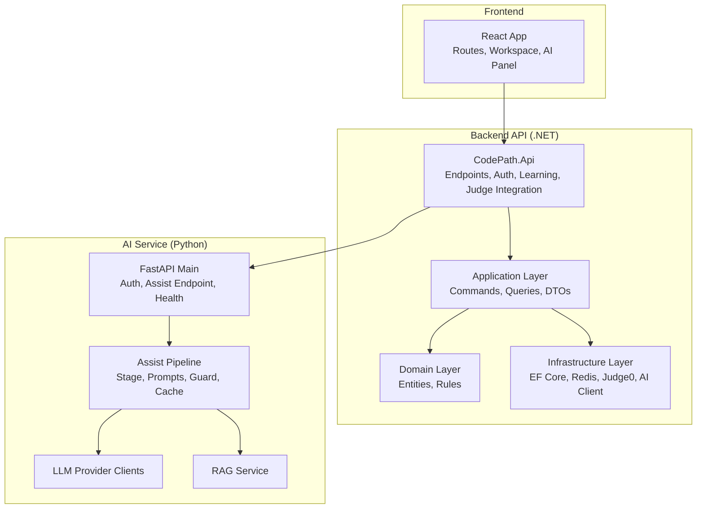
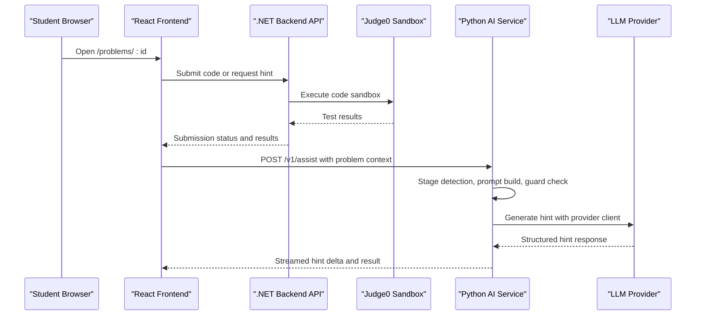
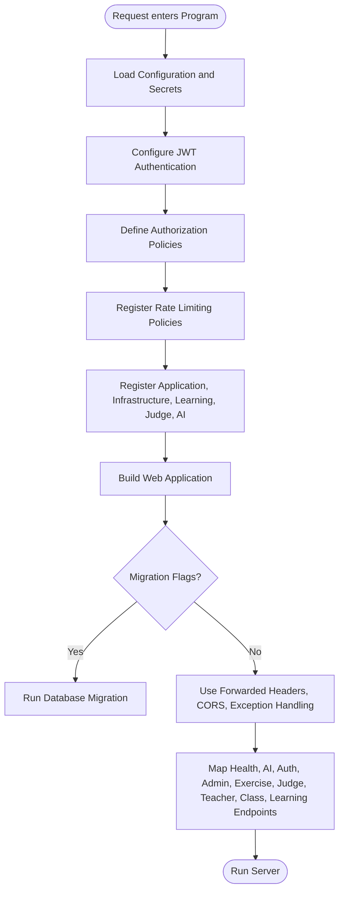
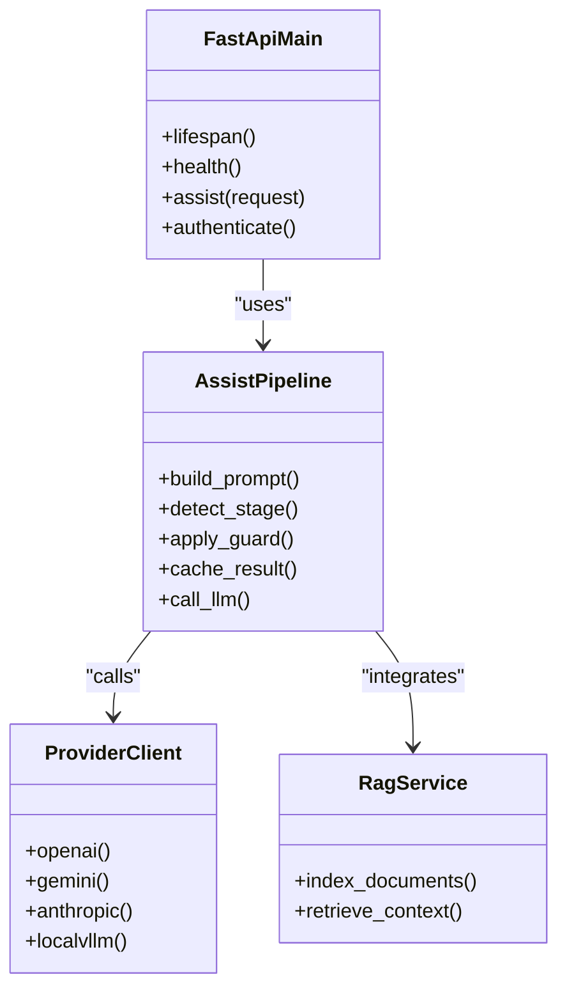
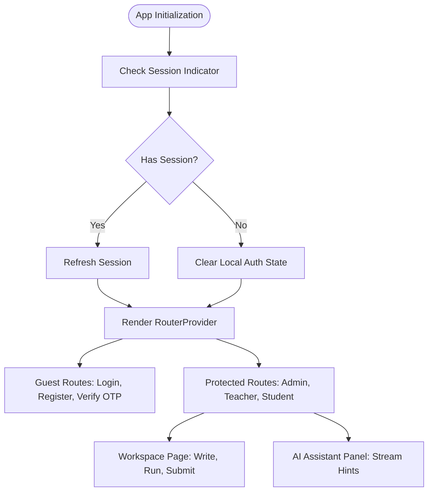
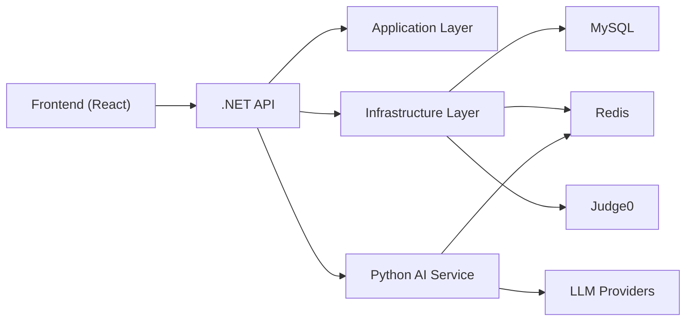

# Project Overview

<cite>
**Referenced Files in This Document**   
- [Program.cs](file://api/src/Api/CodePath.Api/Program.cs)
- [main.py](file://ai-service/app/main.py)
- [App.tsx](file://frontend/src/App.tsx)
- [package.json](file://frontend/package.json)
- [ARCHITECTURE.md](file://api/docs/ARCHITECTURE.md)
- [AI_ASSISTANT.md](file://api/docs/AI_ASSISTANT.md)
- [ai-service README.md](file://ai-service/README.md)
- [SystemFeatures.tsx](file://frontend/src/features/landing/components/SystemFeatures.tsx)
- [content.ts](file://frontend/src/features/landing/data/content.ts)
</cite>

## Table of Contents
1. [Introduction](#introduction)
2. [Project Structure](#project-structure)
3. [Core Components](#core-components)
4. [Architecture Overview](#architecture-overview)
5. [Detailed Component Analysis](#detailed-component-analysis)
6. [Dependency Analysis](#dependency-analysis)
7. [Performance Considerations](#performance-considerations)
8. [Troubleshooting Guide](#troubleshooting-guide)
9. [Conclusion](#conclusion)

## Introduction
CodePart is an integrated learning environment that brings together interactive code execution, AI-powered assistance, and structured curriculum management. Its mission is to make programming education more practical, guided, and measurable by connecting students, teachers, and administrators in one cohesive platform.

For beginners, CodePart exists to remove friction from learning to code: students can read assignments, write and run code in the browser, receive intelligent hints, and track progress within their class or course. Teachers can assign problems, monitor submissions, and provide feedback. Administrators can manage classes, users, and system-wide settings. The landing content frames this as a single platform that connects assignments, a coding environment, and classroom management so teaching and learning become simpler.

For experienced developers, CodePart follows a three-tier microservices-style architecture:
- .NET backend API providing authentication, learning management, exercise handling, code execution orchestration, and integration with external services.
- Python AI service providing RAG-enabled hint generation, stage detection, prompt construction, guard-based safety checks, and provider abstraction for multiple LLM backends.
- React frontend providing role-based navigation, workspace editing, code judge interaction, and streaming AI assistant responses.

The platform’s core value proposition is clear across roles:
- Students get a browser-based code execution sandbox, automated test feedback, and contextual AI hints without installing local toolchains.
- Teachers gain assignment distribution, submission visibility, and a structured workflow for guiding student progress.
- Administrators obtain user and class lifecycle controls, auditability, and operational health endpoints for deployment confidence.

**Section sources**
- [ARCHITECTURE.md:5-18](file://api/docs/ARCHITECTURE.md#L5-L18)
- [ai-service README.md:1-5](file://ai-service/README.md#L1-L5)
- [SystemFeatures.tsx:10-13](file://frontend/src/features/landing/components/SystemFeatures.tsx#L10-L13)
- [content.ts:21-25](file://frontend/src/features/landing/data/content.ts#L21-L25)

## Project Structure
At the repository root, CodePart is organized into three main application areas plus shared documentation and configuration:

- `api`: ASP.NET Core backend implementing Clean Architecture with Domain, Application, Infrastructure, Shared kernel, and Web layers. It exposes REST endpoints, handles authentication, manages learning data, orchestrates code execution through Judge0, and integrates with the Python AI service.
- `ai-service`: FastAPI-based Python service responsible for the AI assistant pipeline, including RAG, stage detection, prompt strategies, guard validation, caching, and LLM provider clients.
- `frontend`: React + TypeScript application built with Vite, Tailwind CSS, Monaco Editor, React Query, and Zustand. It implements role-based routes, workspace pages, code judge UI, and the AI assistant panel.

**Diagram sources**
- [Program.cs:28-374](file://api/src/Api/CodePath.Api/Program.cs#L28-L374)
- [main.py:17-84](file://ai-service/app/main.py#L17-L84)
- [App.tsx:22-139](file://frontend/src/App.tsx#L22-L139)

**Section sources**
- [ARCHITECTURE.md:5-18](file://api/docs/ARCHITECTURE.md#L5-L18)
- [ai-service README.md:1-5](file://ai-service/README.md#L1-L5)
- [package.json:15-45](file://frontend/package.json#L15-L45)

## Core Components
CodePart’s educational platform is composed of several interconnected components:

- **Learning Management**: Manages classes, courses, enrollments, curriculum, and learning extras. It provides APIs for teachers and students to navigate structured learning paths and track progress.
- **Code Execution Sandbox**: Orchestrates running and submitting code through Judge0. It enforces limits, persists submissions, and returns test results while keeping sensitive hidden tests out of client-facing DTOs.
- **AI Assistant**: Provides staged, level-aware hints generated by LLMs, validated by a guard layer, cached via Redis, and streamed to the frontend. It also supports RAG over learning materials.
- **Authentication and Authorization**: JWT-based sessions with refresh tokens, role policies, active-user requirements, rate limiting, and session activity tracking.
- **Frontend Workspaces**: Role-aware routing, workspace editor, problem list, code judge interface, and streaming AI assistant panel.

These components work together to deliver a complete learning loop: select a problem, write code, execute it safely, receive feedback, optionally ask the AI assistant for guidance, and improve the solution under teacher oversight.

**Section sources**
- [ARCHITECTURE.md:44-65](file://api/docs/ARCHITECTURE.md#L44-L65)
- [AI_ASSISTANT.md:1-22](file://api/docs/AI_ASSISTANT.md#L1-L22)
- [App.tsx:111-133](file://frontend/src/App.tsx#L111-L133)

## Architecture Overview
CodePart uses a three-tier architecture aligned with its educational goals:

1. **.NET Backend API**: Entry point for HTTP requests. It configures authentication, authorization, CORS, rate limiting, health checks, and endpoint mapping. It delegates business logic to the Application layer, domain rules to the Domain layer, and external concerns to Infrastructure.
2. **Python AI Service**: A separate FastAPI process that validates assist requests, builds prompts, detects problem-solving stages, applies guard heuristics, caches results, and calls LLM providers. It exposes internal contracts secured by a service key.
3. **React Frontend**: A SPA that renders landing pages, authenticated dashboards, workspace editors, and AI assistant panels. It communicates with the .NET API and streams AI hints using SSE.

**Diagram sources**
- [Program.cs:368-374](file://api/src/Api/CodePath.Api/Program.cs#L368-L374)
- [Program.cs:502-510](file://api/src/Api/CodePath.Api/Program.cs#L502-L510)
- [main.py:64-81](file://ai-service/app/main.py#L64-L81)
- [App.tsx:129-133](file://frontend/src/App.tsx#L129-L133)

## Detailed Component Analysis

### .NET Backend API
The backend is the central coordination point for learning management, authentication, exercises, code execution, and AI integration. It sets up Kestrel, loads configuration, configures JWT authentication, authorization policies, CORS, rate limiting, health checks, and endpoint mapping. Optional features such as Judge0 and the AI assistant are enabled through configuration flags.

Key responsibilities include:
- Authentication and session security with JWT, token blacklisting, and active-user policies.
- Rate limiting for auth flows, code execution, learning heartbeats, and public reads.
- Conditional registration of code judge and AI assistant services.
- Health endpoints for readiness and liveness checks.
- Mapping of admin, teacher, class, exercise, judge, learning, and AI endpoints.

**Diagram sources**
- [Program.cs:28-374](file://api/src/Api/CodePath.Api/Program.cs#L28-L374)
- [Program.cs:376-510](file://api/src/Api/CodePath.Api/Program.cs#L376-L510)

**Section sources**
- [Program.cs:28-374](file://api/src/Api/CodePath.Api/Program.cs#L28-L374)
- [Program.cs:376-510](file://api/src/Api/CodePath.Api/Program.cs#L376-L510)
- [ARCHITECTURE.md:44-65](file://api/docs/ARCHITECTURE.md#L44-L65)

### Python AI Service
The AI service is a FastAPI application focused on generating safe, staged, and level-aware hints for learners. It validates requests, constructs prompts based on strategy files, detects the current problem-solving stage, applies guard heuristics to prevent unsafe or leaking outputs, caches results in Redis, and calls LLM providers through an abstract client.

Important behaviors include:
- Startup validation requiring a secure service key and optional model classifier.
- Strict contract enforcement for assist requests.
- Deadline-controlled processing to avoid long-running requests.
- Guard fallback signaling via headers when heuristic safety checks trigger.
- RAG router inclusion for learning material retrieval.

**Diagram sources**
- [main.py:17-84](file://ai-service/app/main.py#L17-L84)
- [ai-service README.md:39-68](file://ai-service/README.md#L39-L68)

**Section sources**
- [main.py:17-84](file://ai-service/app/main.py#L17-L84)
- [ai-service README.md:39-68](file://ai-service/README.md#L39-L68)

### React Frontend
The frontend is a React application that provides role-based navigation, workspace editing, and AI assistant interaction. It uses lazy-loaded routes for performance, protected routes for authentication, and role guards for access control. The workspace and code judge features support the learning loop where students write, run, submit, and refine code.

Key aspects include:
- Route definitions for guest, protected, admin, teacher, and student areas.
- Workspace page mounted at `/problems/:id` and related class/topic/problem routes.
- AI assistant panel integration for streaming hints.
- Dependencies on Monaco Editor, React Query, Zustand, and Tailwind CSS.

**Diagram sources**
- [App.tsx:142-160](file://frontend/src/App.tsx#L142-L160)
- [App.tsx:22-139](file://frontend/src/App.tsx#L22-L139)

**Section sources**
- [App.tsx:22-139](file://frontend/src/App.tsx#L22-L139)
- [App.tsx:142-160](file://frontend/src/App.tsx#L142-L160)
- [package.json:15-45](file://frontend/package.json#L15-L45)

## Dependency Analysis
The project’s dependencies follow a layered design:

- Frontend depends on the .NET API for all authenticated operations and on the AI service indirectly through the API’s AI endpoints.
- .NET API depends on Application and Infrastructure layers; Infrastructure depends on EF Core, MySQL, Redis, Judge0, and the Python AI service client.
- Python AI service depends on LLM providers, Redis cache, and optionally a classifier model.

**Diagram sources**
- [ARCHITECTURE.md:5-18](file://api/docs/ARCHITECTURE.md#L5-L18)
- [ai-service README.md:70-83](file://ai-service/README.md#L70-L83)

**Section sources**
- [ARCHITECTURE.md:5-18](file://api/docs/ARCHITECTURE.md#L5-L18)
- [ai-service README.md:70-83](file://ai-service/README.md#L70-L83)

## Performance Considerations
Several architectural choices affect performance and reliability:

- The .NET API uses rate limiting per route category to protect auth flows, code execution, and learning heartbeats.
- The AI service enforces a 19-second deadline and uses Redis caching to reduce repeated LLM calls.
- The frontend uses lazy loading for routes and streaming SSE for AI hints to keep the UI responsive.
- Code execution is delegated to Judge0, avoiding in-process execution risks and allowing controlled resource usage.

[No sources needed since this section provides general guidance]

## Troubleshooting Guide
Common operational issues and their indicators:

- **AI Unavailable**: When the Python service fails or times out, the backend may return a fallback hint and mark the interaction with a specific code indicating AI unavailability.
- **Guard Fallback**: If the guard heuristic detects unsafe output, the AI service signals a fallback via headers, and the backend surfaces a guarded fallback state.
- **Quota and Rate Limits**: Excessive hint requests or rapid submissions trigger quota or rate limit responses. These are enforced by Redis and .NET rate limiting policies.
- **Health Checks**: Use `/health/live` for liveness and `/health` for readiness, which includes MySQL and Redis checks.

Practical steps:
- Verify AI service startup requires a valid service key and configured LLM provider.
- Ensure Judge0 is enabled and configured before enabling AI, as the backend enforces this dependency.
- Confirm Redis connectivity through the backend’s Redis health endpoint.
- Review error codes and ProblemDetails responses for standardized diagnostics.

**Section sources**
- [ai-service README.md:39-54](file://ai-service/README.md#L39-L54)
- [Program.cs:427-500](file://api/src/Api/CodePath.Api/Program.cs#L427-L500)

## Conclusion
CodePart is an integrated learning platform that combines interactive code execution, AI-powered assistance, and structured curriculum management. Its three-tier architecture separates concerns between the React frontend, the .NET backend API, and the Python AI service, enabling scalable, maintainable, and secure delivery of educational functionality. For students, it offers a guided path from problem selection to refined solutions. For teachers, it provides assignment control and insight into learner progress. For administrators, it delivers operational visibility and policy-driven governance. Together, these components create a cohesive environment where learning to code becomes practical, supported, and measurable.

[No sources needed since this section summarizes without analyzing specific files]