# Security Considerations

<cite>
**Referenced Files in This Document**
- [Program.cs](file://api/src/Api/CodePath.Api/Program.cs)
- [ActiveUserAuthorization.cs](file://api/src/Api/CodePath.Api/Authorization/ActiveUserAuthorization.cs)
- [AuthEndpoints.cs](file://api/src/Api/CodePath.Api/Endpoints/AuthEndpoints.cs)
- [SessionActivityMiddleware.cs](file://api/src/Api/CodePath.Api/Middleware/SessionActivityMiddleware.cs)
- [SessionActivityService.cs](file://api/src/Application/CodePath.Application/Auth/Services/SessionActivityService.cs)
- [JwtOptions.cs](file://api/src/Infrastructure/CodePath.Infrastructure/Auth/Options/JwtOptions.cs)
- [RedisPasswordResetRateLimiter.cs](file://api/src/Infrastructure/CodePath.Infrastructure/Auth/Services/LoginProtection/RedisPasswordResetRateLimiter.cs)
- [InMemoryLoginAttemptService.cs](file://api/src/Infrastructure/CodePath.Infrastructure/Auth/Services/LoginProtection/InMemoryLoginAttemptService.cs)
- [RedisLoginAttemptService.cs](file://api/src/Infrastructure/CodePath.Infrastructure/Auth/Services/LoginProtection/RedisLoginAttemptService.cs)
- [LoginConcurrencyLimiter.cs](file://api/src/Infrastructure/CodePath.Infrastructure/Auth/Services/LoginProtection/LoginConcurrencyLimiter.cs)
- [ForwardedHeadersSecurityTests.cs](file://api/tests/CodePath.Unit.Tests/Auth/ForwardedHeadersSecurityTests.cs)
- [AuditLogConfiguration.cs](file://api/src/Infrastructure/CodePath.Infrastructure/Persistence/Configurations/AuditLogConfiguration.cs)
- [AuditLog.cs](file://api/src/Domain/CodePath.Domain/Auditing/Entities/AuditLog.cs)
- [ListAuditLogsQuery.cs](file://api/src/Application/CodePath.Application/Admin/Queries/ListAuditLogsQuery.cs)
- [main.py](file://ai-service/app/main.py)
- [hint_guard.py](file://ai-service/app/guard/hint_guard.py)
- [prompts.py](file://ai-service/app/hints/prompts.py)
- [detector.py](file://ai-service/app/stage/detector.py)
- [default.conf](file://frontend/nginx/default.conf)
- [axios.ts](file://frontend/src/lib/axios.ts)
- [sessionActivity.ts](file://frontend/src/features/auth/sessionActivity.ts)
</cite>

## Table of Contents
1. [Introduction](#introduction)
2. [Project Structure](#project-structure)
3. [Core Components](#core-components)
4. [Architecture Overview](#architecture-overview)
5. [Detailed Component Analysis](#detailed-component-analysis)
6. [Dependency Analysis](#dependency-analysis)
7. [Performance Considerations](#performance-considerations)
8. [Troubleshooting Guide](#troubleshooting-guide)
9. [Conclusion](#conclusion)
10. [Appendices](#appendices)

## Introduction
This document describes CodePart’s multi-layered security model across the API, AI service, and frontend. It covers authentication with JWT, role-based authorization, session management, input validation, SQL injection prevention, XSS protection, CSRF mitigation, AI guard rails against prompt injection and unsafe content generation, rate limiting and brute-force protection, audit logging, encryption at rest and in transit, secure coding practices, vulnerability assessment procedures, configuration guidelines, and incident response.

## Project Structure
The security-relevant code spans three layers:
- API (ASP.NET Core): Authentication, authorization, rate limiting, session lifecycle, input validation, audit logging, and reverse proxy trust.
- AI Service (FastAPI): Internal API key authentication, request validation, prompt sanitization, and guard rail checks before LLM calls.
- Frontend (React + Nginx): Secure cookies, CSP/HSTS headers, idle session handling, and safe HTTP client behavior.

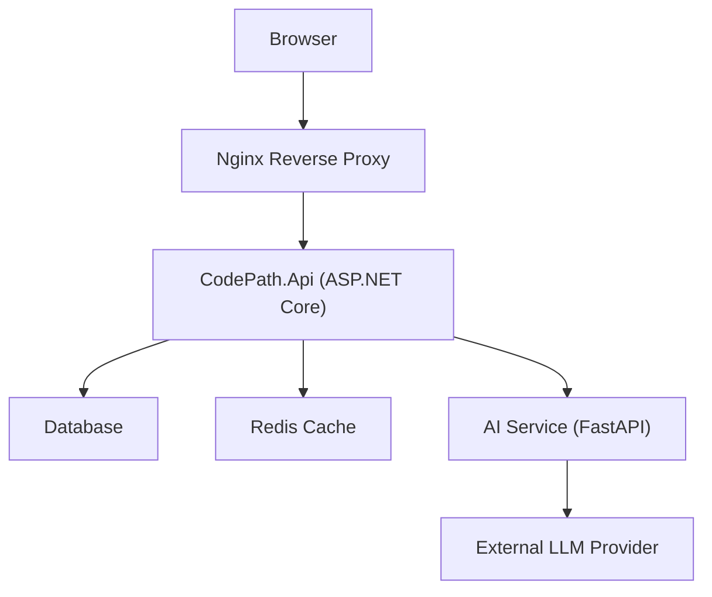

**Diagram sources**
- [Program.cs:28-33](file://api/src/Api/CodePath.Api/Program.cs#L28-L33)
- [Program.cs:386-422](file://api/src/Api/CodePath.Api/Program.cs#L386-L422)
- [main.py:17-44](file://ai-service/app/main.py#L17-L44)
- [default.conf:43-69](file://frontend/nginx/default.conf#L43-L69)

**Section sources**
- [Program.cs:28-33](file://api/src/Api/CodePath.Api/Program.cs#L28-L33)
- [Program.cs:386-422](file://api/src/Api/CodePath.Api/Program.cs#L386-L422)
- [main.py:17-44](file://ai-service/app/main.py#L17-L44)
- [default.conf:43-69](file://frontend/nginx/default.conf#L43-L69)

## Core Components
- JWT-based authentication with strict token validation, blacklist revocation, and session version checks.
- Role-based authorization policies with an active-user requirement to ensure users are active and authorized.
- Session management via refresh tokens, idle timeout enforcement, and activity tracking middleware.
- Input validation using FluentValidation for commands and DTOs; database access uses parameterized queries through EF Core.
- AI service internal authentication via HMAC-safe header comparison and prompt sanitization to prevent prompt injection and leakage of sensitive data.
- Rate limiting and brute-force protection with per-IP and per-email strategies, concurrency limits, and exponential backoff.
- Audit logging with structured JSON payloads and indexed queries for investigation.
- Transport security enforced by HSTS, HTTPS redirection, secure cookies, and CSP headers.

**Section sources**
- [Program.cs:63-158](file://api/src/Api/CodePath.Api/Program.cs#L63-L158)
- [ActiveUserAuthorization.cs:6-35](file://api/src/Api/CodePath.Api/Authorization/ActiveUserAuthorization.cs#L6-L35)
- [SessionActivityMiddleware.cs:14-41](file://api/src/Api/CodePath.Api/Middleware/SessionActivityMiddleware.cs#L14-L41)
- [SessionActivityService.cs:6-38](file://api/src/Application/CodePath.Application/Auth/Services/SessionActivityService.cs#L6-L38)
- [main.py:45-84](file://ai-service/app/main.py#L45-L84)
- [hint_guard.py:22-47](file://ai-service/app/guard/hint_guard.py#L22-L47)
- [prompts.py:13-29](file://ai-service/app/hints/prompts.py#L13-L29)
- [AuditLog.cs:7-46](file://api/src/Domain/CodePath.Domain/Auditing/Entities/AuditLog.cs#L7-L46)

## Architecture Overview
The API enforces a layered security pipeline:
- Request enters Nginx with security headers and is forwarded to the API.
- The API validates forwarded headers, applies CORS, exception handling, authentication, session activity checks, rate limiting, and authorization.
- Endpoints execute application logic with validated inputs and persist audit events.
- The AI service authenticates internal requests, sanitizes prompts, runs guard rails, and returns guarded hints or fallback responses.

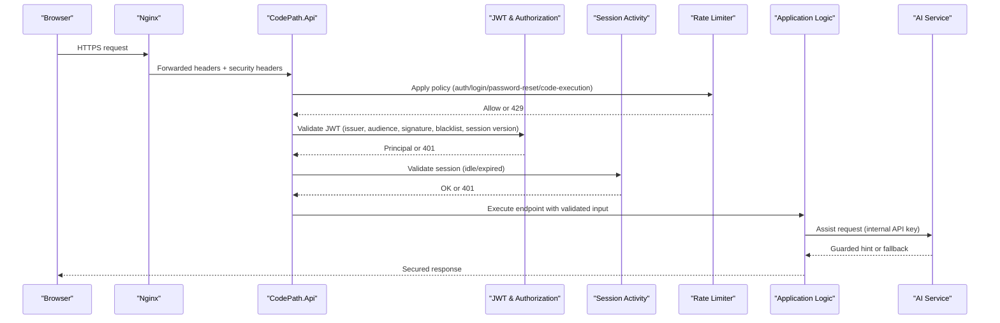

**Diagram sources**
- [Program.cs:386-422](file://api/src/Api/CodePath.Api/Program.cs#L386-L422)
- [Program.cs:71-158](file://api/src/Api/CodePath.Api/Program.cs#L71-L158)
- [SessionActivityMiddleware.cs:14-41](file://api/src/Api/CodePath.Api/Middleware/SessionActivityMiddleware.cs#L14-L41)
- [main.py:56-84](file://ai-service/app/main.py#L56-L84)

**Section sources**
- [Program.cs:386-422](file://api/src/Api/CodePath.Api/Program.cs#L386-L422)
- [Program.cs:71-158](file://api/src/Api/CodePath.Api/Program.cs#L71-L158)
- [SessionActivityMiddleware.cs:14-41](file://api/src/Api/CodePath.Api/Middleware/SessionActivityMiddleware.cs#L14-L41)
- [main.py:56-84](file://ai-service/app/main.py#L56-L84)

## Detailed Component Analysis

### JWT-Based Authentication
- Token validation enforces issuer, audience, lifetime, signing key, algorithm whitelist, and clock skew.
- On token validation, the API checks token blacklist and user session state (active status and security version).
- Challenge and forbidden responses return standardized ProblemDetails with trace identifiers.

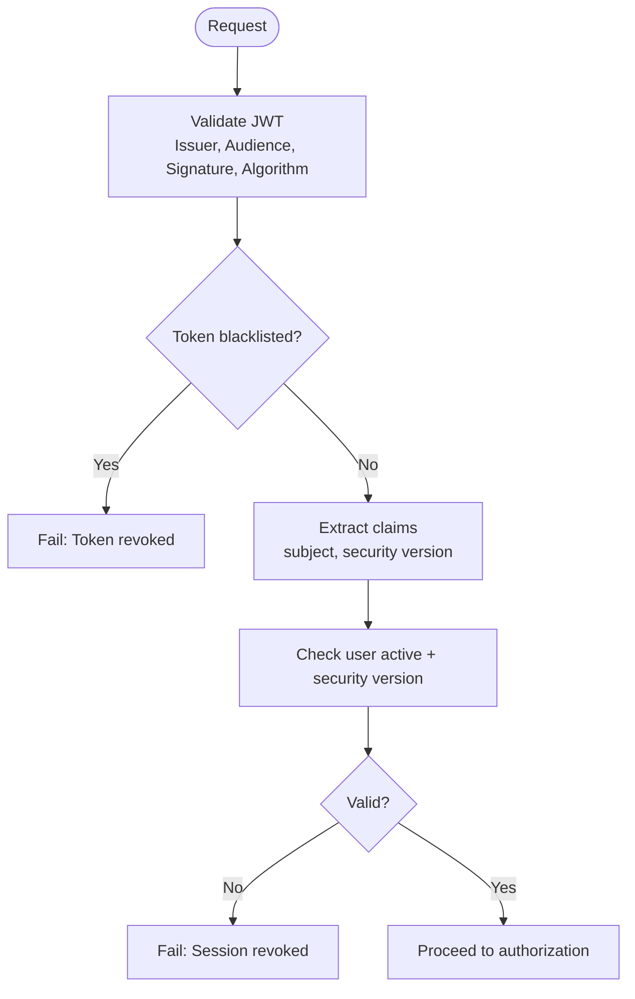

**Diagram sources**
- [Program.cs:71-118](file://api/src/Api/CodePath.Api/Program.cs#L71-L118)

**Section sources**
- [Program.cs:63-158](file://api/src/Api/CodePath.Api/Program.cs#L63-L158)
- [JwtOptions.cs:8-24](file://api/src/Infrastructure/CodePath.Infrastructure/Auth/Options/JwtOptions.cs#L8-L24)

### Role-Based Authorization
- Policies enforce authenticated users plus optional roles (Admin, Teacher, Student).
- ActiveUserRequirement ensures users are active; handlers avoid extra DB queries by relying on prior authentication checks.

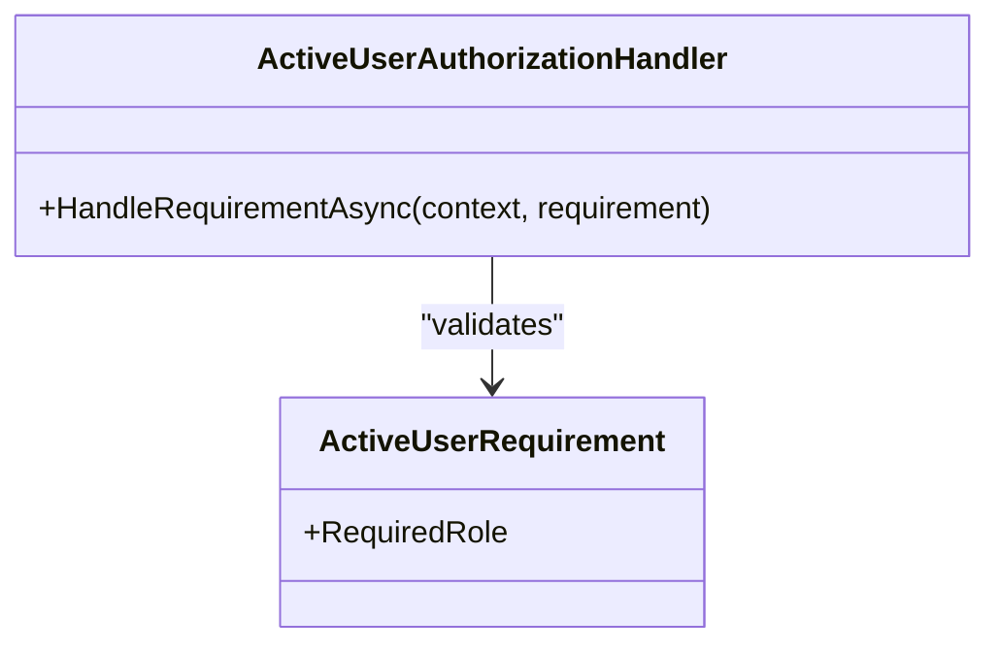

**Diagram sources**
- [ActiveUserAuthorization.cs:6-35](file://api/src/Api/CodePath.Api/Authorization/ActiveUserAuthorization.cs#L6-L35)

**Section sources**
- [Program.cs:184-200](file://api/src/Api/CodePath.Api/Program.cs#L184-L200)
- [ActiveUserAuthorization.cs:6-35](file://api/src/Api/CodePath.Api/Authorization/ActiveUserAuthorization.cs#L6-L35)

### Session Management
- Refresh tokens are stored in HttpOnly, Secure cookies with SameSite controls.
- SessionActivityMiddleware validates sessions per request, enforcing idle timeouts and activity throttling.
- Frontend tracks last activity, performs coordinated refreshes, and clears auth state on expiration.

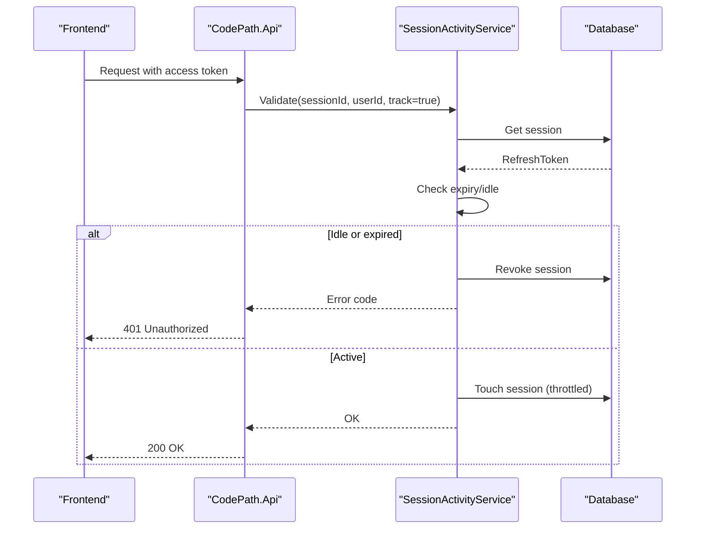

**Diagram sources**
- [SessionActivityMiddleware.cs:14-41](file://api/src/Api/CodePath.Api/Middleware/SessionActivityMiddleware.cs#L14-L41)
- [SessionActivityService.cs:11-37](file://api/src/Application/CodePath.Application/Auth/Services/SessionActivityService.cs#L11-L37)
- [AuthEndpoints.cs:63-87](file://api/src/Api/CodePath.Api/Endpoints/AuthEndpoints.cs#L63-L87)
- [axios.ts:25-77](file://frontend/src/lib/axios.ts#L25-L77)
- [sessionActivity.ts:1-27](file://frontend/src/features/auth/sessionActivity.ts#L1-L27)

**Section sources**
- [AuthEndpoints.cs:63-87](file://api/src/Api/CodePath.Api/Endpoints/AuthEndpoints.cs#L63-L87)
- [SessionActivityMiddleware.cs:14-41](file://api/src/Api/CodePath.Api/Middleware/SessionActivityMiddleware.cs#L14-L41)
- [SessionActivityService.cs:6-38](file://api/src/Application/CodePath.Application/Auth/Services/SessionActivityService.cs#L6-L38)
- [axios.ts:25-77](file://frontend/src/lib/axios.ts#L25-L77)
- [sessionActivity.ts:1-27](file://frontend/src/features/auth/sessionActivity.ts#L1-L27)

### Input Validation and SQL Injection Prevention
- Commands and DTOs are validated with FluentValidation rules (length, format, enum constraints, cross-field validations).
- Database interactions use EF Core parameterized queries; no raw SQL concatenation observed in referenced files.
- Learning content includes HTML sanitization and magic-type validation to mitigate XSS and file spoofing.

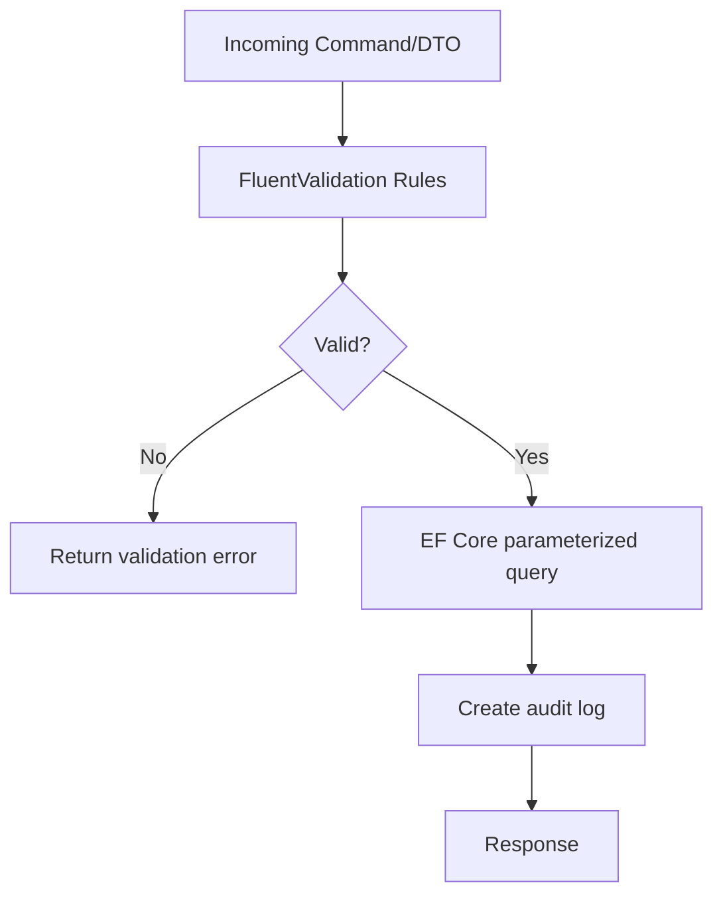

**Diagram sources**
- [ClassCommands.cs:17-32](file://api/src/Application/CodePath.Application/Classes/ClassCommands.cs#L17-L32)
- [TeacherCommands.cs:23-48](file://api/src/Application/CodePath.Application/Admin/Commands/TeacherCommands.cs#L23-L48)
- [AuditLog.cs:18-46](file://api/src/Domain/CodePath.Domain/Auditing/Entities/AuditLog.cs#L18-L46)

**Section sources**
- [ClassCommands.cs:17-32](file://api/src/Application/CodePath.Application/Classes/ClassCommands.cs#L17-L32)
- [TeacherCommands.cs:23-48](file://api/src/Application/CodePath.Application/Admin/Commands/TeacherCommands.cs#L23-L48)
- [AuditLog.cs:18-46](file://api/src/Domain/CodePath.Domain/Auditing/Entities/AuditLog.cs#L18-L46)

### XSS Protection and CSRF Mitigation
- Nginx sets HSTS, X-Content-Type-Options, X-Frame-Options, Referrer-Policy, Permissions-Policy, and CSP headers.
- API sets security headers on auth endpoints and disables server header exposure.
- Cookies for refresh tokens are HttpOnly, Secure, and SameSite-controlled; origin checks applied when SameSite=None.

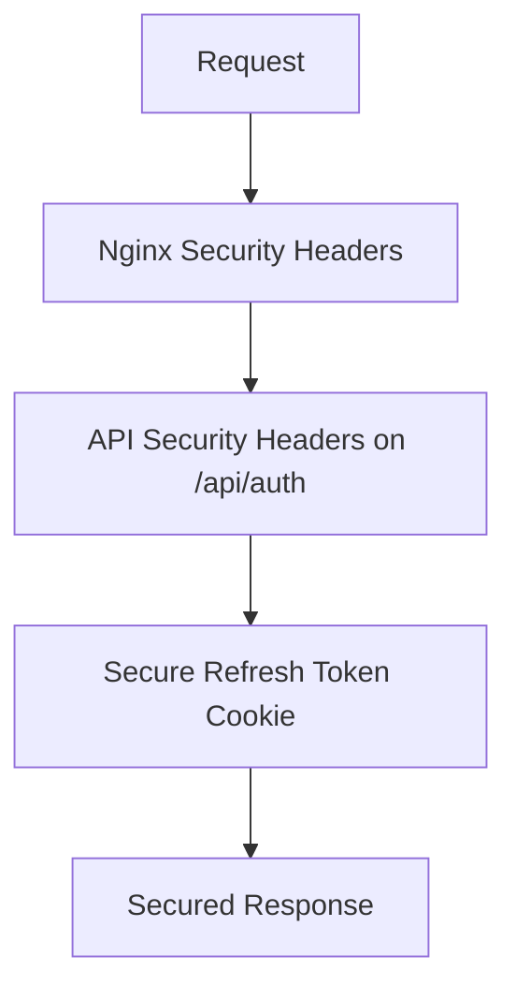

**Diagram sources**
- [default.conf:43-48](file://frontend/nginx/default.conf#L43-L48)
- [Program.cs:29-33](file://api/src/Api/CodePath.Api/Program.cs#L29-L33)
- [Program.cs:394-405](file://api/src/Api/CodePath.Api/Program.cs#L394-L405)
- [AuthEndpoints.cs:63-87](file://api/src/Api/CodePath.Api/Endpoints/AuthEndpoints.cs#L63-L87)

**Section sources**
- [default.conf:43-48](file://frontend/nginx/default.conf#L43-L48)
- [Program.cs:29-33](file://api/src/Api/CodePath.Api/Program.cs#L29-L33)
- [Program.cs:394-405](file://api/src/Api/CodePath.Api/Program.cs#L394-L405)
- [AuthEndpoints.cs:63-87](file://api/src/Api/CodePath.Api/Endpoints/AuthEndpoints.cs#L63-L87)

### CSRF Mitigation Strategy
- CSRF risk is mitigated primarily by using bearer tokens for API calls and secure, SameSite-controlled cookies for refresh tokens.
- Cross-origin cookie requests are restricted based on SameSite settings and Origin header validation.

**Section sources**
- [AuthEndpoints.cs:84-96](file://api/src/Api/CodePath.Api/Endpoints/AuthEndpoints.cs#L84-L96)
- [Program.cs:160-182](file://api/src/Api/CodePath.Api/Program.cs#L160-L182)

### AI Service Guard Rails and Prompt Injection Prevention
- Internal authentication requires a strong SERVICE_API_KEY header compared safely using HMAC constant-time comparison.
- Prompt builder removes sensitive fields (student reference, requestId), strips hidden test data, and enforces payload size limits.
- Guard rails detect early code exposure, oversized snippets, complete programs, reference similarity, hidden tests, and invalid line references.

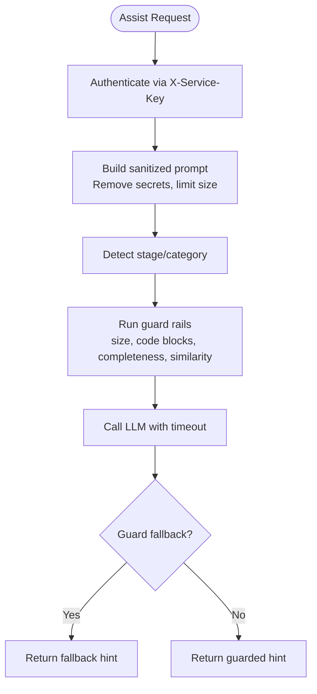

**Diagram sources**
- [main.py:45-84](file://ai-service/app/main.py#L45-L84)
- [prompts.py:13-29](file://ai-service/app/hints/prompts.py#L13-L29)
- [detector.py:11-37](file://ai-service/app/stage/detector.py#L11-L37)
- [hint_guard.py:22-47](file://ai-service/app/guard/hint_guard.py#L22-L47)

**Section sources**
- [main.py:45-84](file://ai-service/app/main.py#L45-L84)
- [prompts.py:13-29](file://ai-service/app/hints/prompts.py#L13-L29)
- [detector.py:11-37](file://ai-service/app/stage/detector.py#L11-L37)
- [hint_guard.py:22-47](file://ai-service/app/guard/hint_guard.py#L22-L47)

### Rate Limiting and Brute Force Protection
- Global rate limiter defines policies for auth flows, login attempts, password reset, health checks, public reads, and code execution.
- Login attempt protection supports in-memory and Redis implementations with exponential backoff and pair-scoped counters.
- Concurrency limiter caps global and per-IP concurrent login attempts.

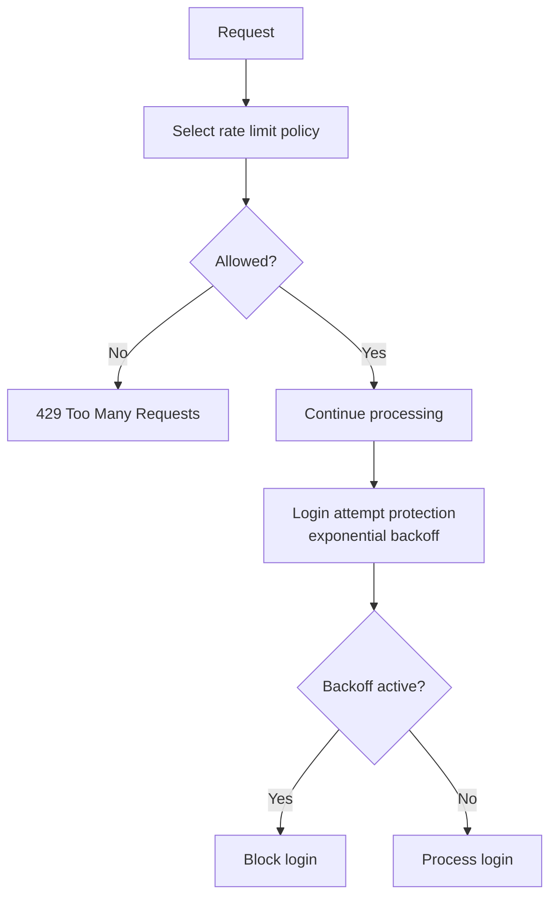

**Diagram sources**
- [Program.cs:245-359](file://api/src/Api/CodePath.Api/Program.cs#L245-L359)
- [RedisLoginAttemptService.cs:16-35](file://api/src/Infrastructure/CodePath.Infrastructure/Auth/Services/LoginProtection/RedisLoginAttemptService.cs#L16-L35)
- [InMemoryLoginAttemptService.cs:20-37](file://api/src/Infrastructure/CodePath.Infrastructure/Auth/Services/LoginProtection/InMemoryLoginAttemptService.cs#L20-L37)
- [LoginConcurrencyLimiter.cs:16-34](file://api/src/Infrastructure/CodePath.Infrastructure/Auth/Services/LoginProtection/LoginConcurrencyLimiter.cs#L16-L34)

**Section sources**
- [Program.cs:245-359](file://api/src/Api/CodePath.Api/Program.cs#L245-L359)
- [RedisPasswordResetRateLimiter.cs:6-47](file://api/src/Infrastructure/CodePath.Infrastructure/Auth/Services/LoginProtection/RedisPasswordResetRateLimiter.cs#L6-L47)
- [InMemoryLoginAttemptService.cs:1-37](file://api/src/Infrastructure/CodePath.Infrastructure/Auth/Services/LoginProtection/InMemoryLoginAttemptService.cs#L1-L37)
- [RedisLoginAttemptService.cs:1-35](file://api/src/Infrastructure/CodePath.Infrastructure/Auth/Services/LoginProtection/RedisLoginAttemptService.cs#L1-L35)
- [LoginConcurrencyLimiter.cs:1-34](file://api/src/Infrastructure/CodePath.Infrastructure/Auth/Services/LoginProtection/LoginConcurrencyLimiter.cs#L1-L34)

### Audit Logging Mechanisms
- AuditLog entity captures actor, action, target user, timestamp, IP address, and structured JSON data.
- Configuration maps table schema, indexes, and relationships for efficient querying.
- Admin queries paginate audit logs with cursor pagination and parse JSON payloads safely.

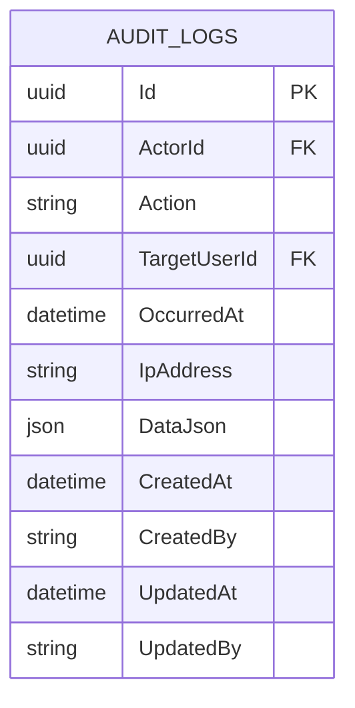

**Diagram sources**
- [AuditLog.cs:7-46](file://api/src/Domain/CodePath.Domain/Auditing/Entities/AuditLog.cs#L7-L46)
- [AuditLogConfiguration.cs:10-60](file://api/src/Infrastructure/CodePath.Infrastructure/Persistence/Configurations/AuditLogConfiguration.cs#L10-L60)

**Section sources**
- [AuditLog.cs:7-46](file://api/src/Domain/CodePath.Domain/Auditing/Entities/AuditLog.cs#L7-L46)
- [AuditLogConfiguration.cs:10-60](file://api/src/Infrastructure/CodePath.Infrastructure/Persistence/Configurations/AuditLogConfiguration.cs#L10-L60)
- [ListAuditLogsQuery.cs:40-70](file://api/src/Application/CodePath.Application/Admin/Queries/ListAuditLogsQuery.cs#L40-L70)

### Encryption at Rest and In Transit
- In transit: HSTS, HTTPS redirection, secure cookies, and CSP headers ensure encrypted transport and safe browser behavior.
- At rest: Database connection strings and secrets are loaded from environment variables or mounted secrets; passwords are hashed with configurable work factor.

**Section sources**
- [Program.cs:386-422](file://api/src/Api/CodePath.Api/Program.cs#L386-L422)
- [default.conf:43-69](file://frontend/nginx/default.conf#L43-L69)
- [Program.cs:47-58](file://api/src/Api/CodePath.Api/Program.cs#L47-L58)
- [PasswordHashingOptions.cs:3-8](file://api/src/Infrastructure/CodePath.Infrastructure/Auth/Options/PasswordHashingOptions.cs#L3-L8)

### Secure Coding Practices
- Strict algorithms and signed tokens only for JWT.
- Constant-time comparison for API keys.
- Parameterized queries via EF Core.
- Input validation and output sanitization.
- Minimal error details exposed to clients; technical patterns filtered in error catalog.

**Section sources**
- [Program.cs:71-87](file://api/src/Api/CodePath.Api/Program.cs#L71-L87)
- [main.py:56-59](file://ai-service/app/main.py#L56-L59)
- [ErrorCatalog.cs:5-9](file://api/src/Shared/CodePath.Shared.Kernel/Common/ErrorCatalog.cs#L5-L9)

### Vulnerability Assessment Procedures
- Unit and integration tests cover login timing, concurrency, forwarded headers, session idle behavior, and rate limiting.
- Load scenarios simulate distributed login traffic to validate thresholds and server error rates.

**Section sources**
- [ForwardedHeadersSecurityTests.cs:12-39](file://api/tests/CodePath.Unit.Tests/Auth/ForwardedHeadersSecurityTests.cs#L12-L39)
- [SessionIdleSpecifications.cs:15-33](file://api/tests/CodePath.Integration.Tests/Auth/SessionIdleSpecifications.cs#L15-L33)
- [LoginTimingSpecifications.cs:11-37](file://api/tests/CodePath.Integration.Tests/Auth/LoginTimingSpecifications.cs#L11-L37)
- [scenario-b-distributed.js:8-31](file://api/tests/load/scenario-b-distributed.js#L8-L31)

## Dependency Analysis
Security components depend on configuration, Redis, and EF Core. The API orchestrates authentication, authorization, rate limiting, and session management; the AI service depends on internal API key authentication and prompt sanitization.

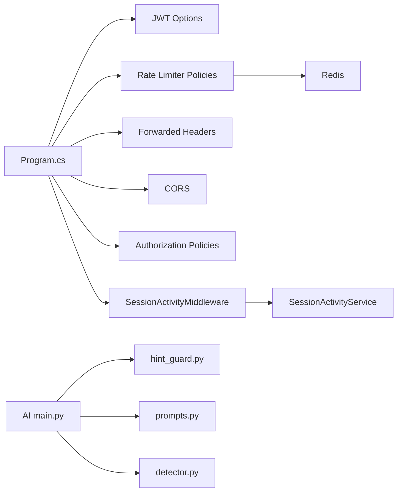

**Diagram sources**
- [Program.cs:63-158](file://api/src/Api/CodePath.Api/Program.cs#L63-L158)
- [Program.cs:245-359](file://api/src/Api/CodePath.Api/Program.cs#L245-L359)
- [SessionActivityMiddleware.cs:14-41](file://api/src/Api/CodePath.Api/Middleware/SessionActivityMiddleware.cs#L14-L41)
- [SessionActivityService.cs:6-38](file://api/src/Application/CodePath.Application/Auth/Services/SessionActivityService.cs#L6-L38)
- [main.py:45-84](file://ai-service/app/main.py#L45-L84)
- [hint_guard.py:22-47](file://ai-service/app/guard/hint_guard.py#L22-L47)
- [prompts.py:13-29](file://ai-service/app/hints/prompts.py#L13-L29)
- [detector.py:11-37](file://ai-service/app/stage/detector.py#L11-L37)

**Section sources**
- [Program.cs:63-158](file://api/src/Api/CodePath.Api/Program.cs#L63-L158)
- [Program.cs:245-359](file://api/src/Api/CodePath.Api/Program.cs#L245-L359)
- [SessionActivityMiddleware.cs:14-41](file://api/src/Api/CodePath.Api/Middleware/SessionActivityMiddleware.cs#L14-L41)
- [SessionActivityService.cs:6-38](file://api/src/Application/CodePath.Application/Auth/Services/SessionActivityService.cs#L6-L38)
- [main.py:45-84](file://ai-service/app/main.py#L45-L84)
- [hint_guard.py:22-47](file://ai-service/app/guard/hint_guard.py#L22-L47)
- [prompts.py:13-29](file://ai-service/app/hints/prompts.py#L13-L29)
- [detector.py:11-37](file://ai-service/app/stage/detector.py#L11-L37)

## Performance Considerations
- Rate limiting policies use fixed-window and token-bucket strategies to balance throughput and protection.
- Session activity updates are throttled to reduce DB writes while maintaining accurate idle detection.
- AI assistant calls include timeouts and classifier fallbacks to maintain responsiveness under load.

[No sources needed since this section provides general guidance]

## Troubleshooting Guide
- 401 Unauthorized: Check JWT validity, blacklist status, and session idle/expired codes returned by SessionActivityMiddleware.
- 429 Too Many Requests: Review rate limit policy configuration and per-IP/per-user partitions.
- AI Unavailable: Verify SERVICE_API_KEY length and Redis connectivity; check AI service health endpoint.
- Audit Logs: Use admin queries to inspect actor, action, timestamps, and IP addresses for incidents.

**Section sources**
- [Program.cs:120-157](file://api/src/Api/CodePath.Api/Program.cs#L120-L157)
- [Program.cs:257-281](file://api/src/Api/CodePath.Api/Program.cs#L257-L281)
- [main.py:48-54](file://ai-service/app/main.py#L48-L54)
- [ListAuditLogsQuery.cs:40-70](file://api/src/Application/CodePath.Application/Admin/Queries/ListAuditLogsQuery.cs#L40-L70)

## Conclusion
CodePart implements a comprehensive security posture combining robust authentication, fine-grained authorization, resilient session management, strict input validation, transport and storage protections, AI guard rails, rate limiting, brute-force defenses, and thorough audit logging. Continuous testing and secure configuration practices further strengthen the system against evolving threats.

[No sources needed since this section summarizes without analyzing specific files]

## Appendices

### Security Configuration Guidelines
- JWT: Ensure SigningKey meets minimum length and algorithm restrictions; configure Issuer and Audience appropriately.
- Reverse Proxy Trust: Define KnownNetworks and KnownProxies strictly; set ForwardLimit conservatively.
- Rate Limits: Tune AuthPermitLimit, login burst capacity/refill, and code execution limits based on workload.
- AI Service: Set SERVICE_API_KEY with sufficient entropy; configure REDIS_URL and MODEL_PATH securely.
- Frontend: Keep HSTS, CSP, and cookie SameSite settings aligned with deployment environment.

**Section sources**
- [JwtOptions.cs:8-24](file://api/src/Infrastructure/CodePath.Infrastructure/Auth/Options/JwtOptions.cs#L8-L24)
- [Program.cs:212-243](file://api/src/Api/CodePath.Api/Program.cs#L212-L243)
- [Program.cs:245-359](file://api/src/Api/CodePath.Api/Program.cs#L245-L359)
- [main.py:17-44](file://ai-service/app/main.py#L17-L44)
- [default.conf:43-69](file://frontend/nginx/default.conf#L43-L69)

### Incident Response Procedures
- Detect anomalies via audit logs and health endpoints.
- Revoke sessions and tokens; update token blacklist if necessary.
- Isolate affected users and rotate credentials.
- Analyze rate limit rejections and login attempt backoffs to identify attack patterns.
- Update guard rails and prompt sanitization rules if prompt injection is detected.

**Section sources**
- [Program.cs:91-118](file://api/src/Api/CodePath.Api/Program.cs#L91-L118)
- [SessionActivityService.cs:18-37](file://api/src/Application/CodePath.Application/Auth/Services/SessionActivityService.cs#L18-L37)
- [ListAuditLogsQuery.cs:40-70](file://api/src/Application/CodePath.Application/Admin/Queries/ListAuditLogsQuery.cs#L40-L70)
- [hint_guard.py:22-47](file://ai-service/app/guard/hint_guard.py#L22-L47)