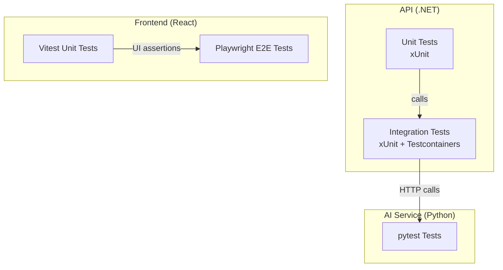
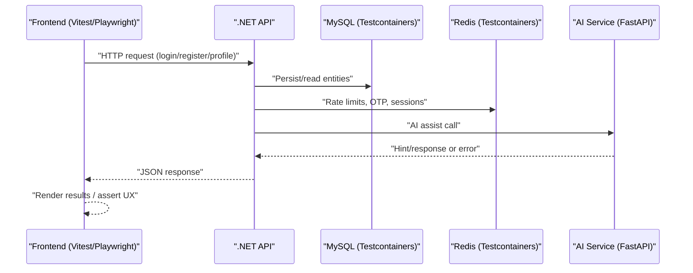
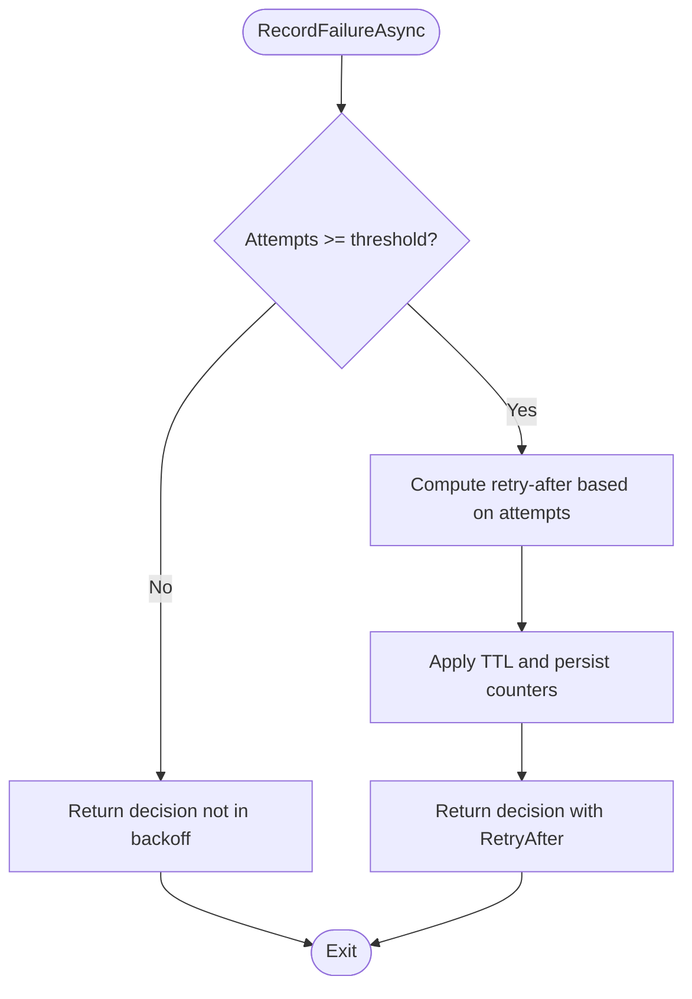
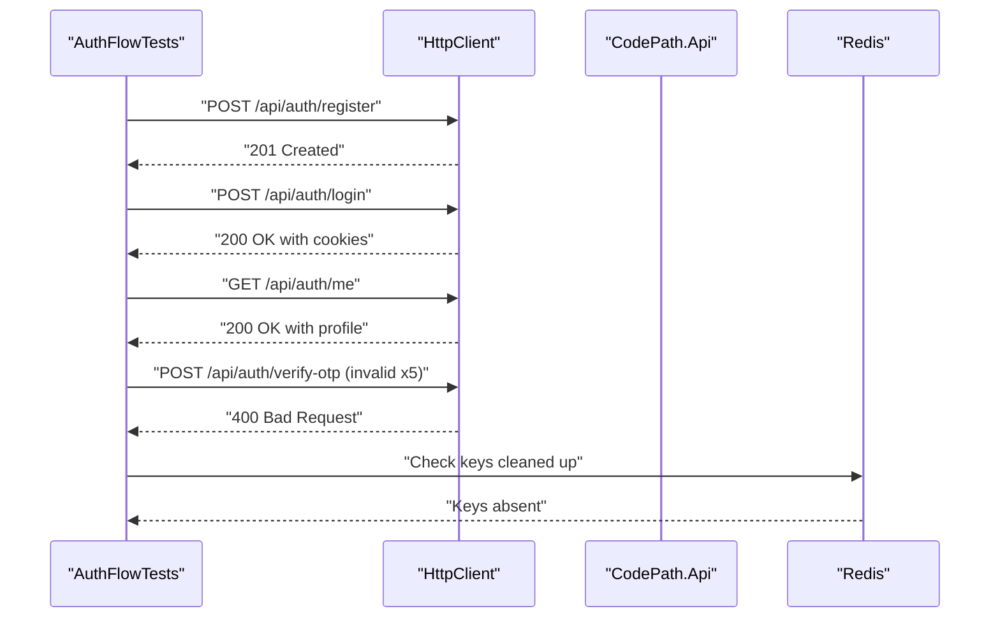
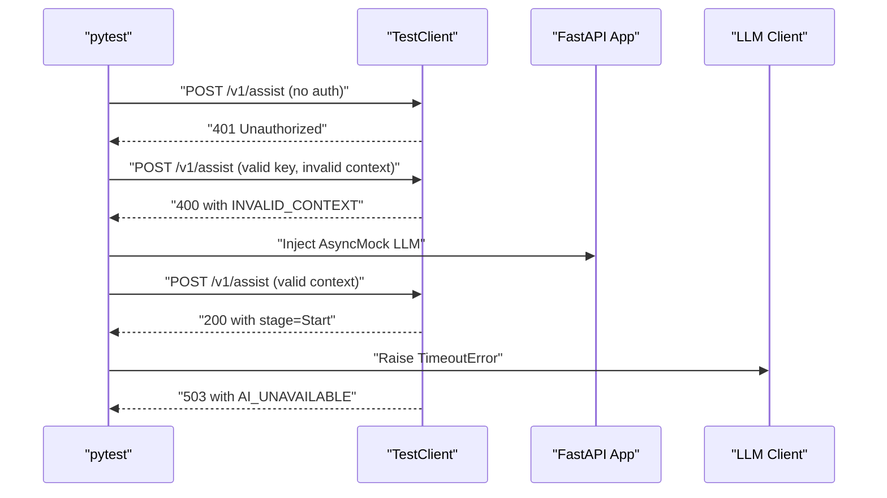
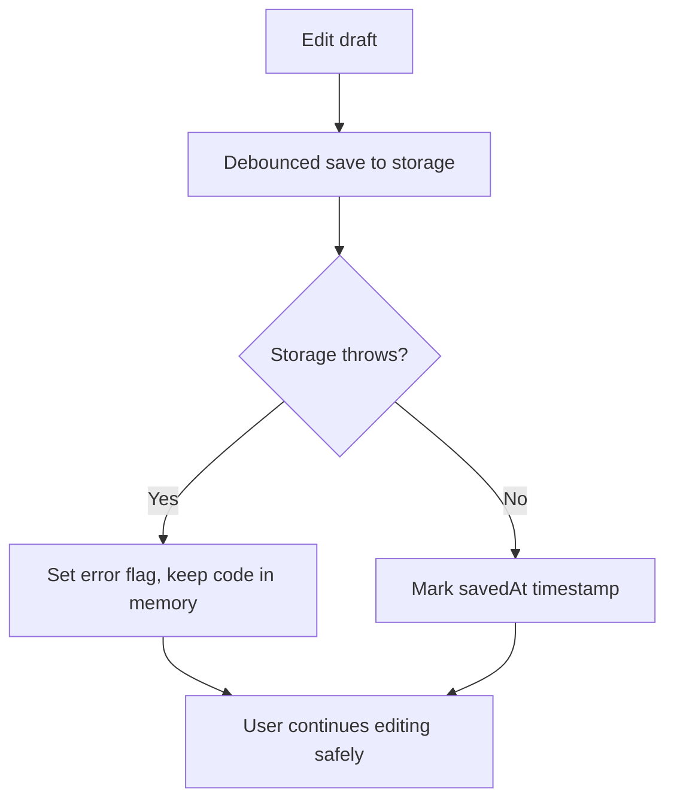
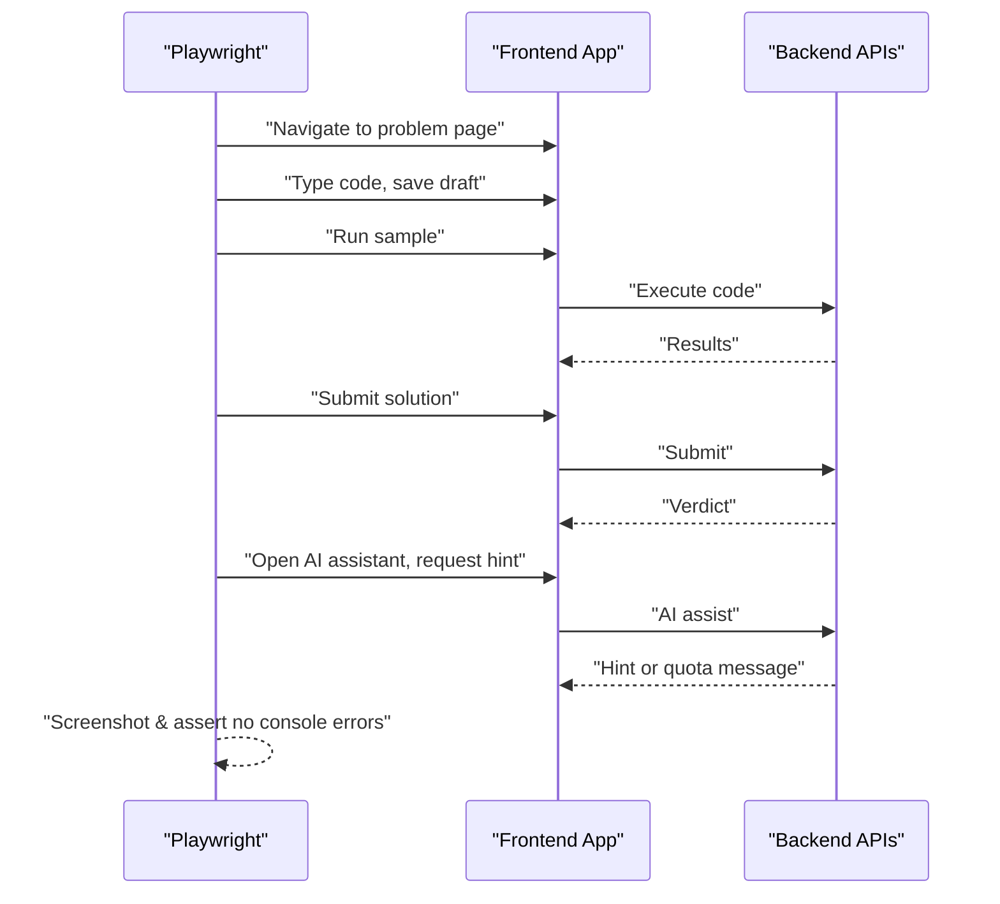
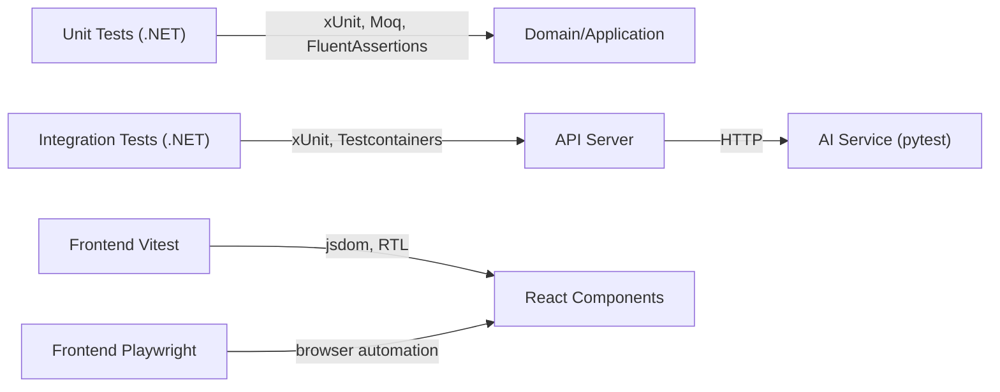

# Testing Strategy

<cite>
**Referenced Files in This Document**
- [CodePath.Unit.Tests.csproj](file://api/tests/CodePath.Unit.Tests/CodePath.Unit.Tests.csproj)
- [CodePath.Integration.Tests.csproj](file://api/tests/CodePath.Integration.Tests/CodePath.Integration.Tests.csproj)
- [LoginAttemptProtectionTests.cs](file://api/tests/CodePath.Unit.Tests/Auth/LoginAttemptProtectionTests.cs)
- [AuthFlowTests.cs](file://api/tests/CodePath.Integration.Tests/Auth/AuthFlowTests.cs)
- [pyproject.toml](file://ai-service/pyproject.toml)
- [test_api.py](file://ai-service/tests/test_api.py)
- [vitest.config.ts](file://frontend/vitest.config.ts)
- [workspace.test.tsx](file://frontend/tests/workspace.test.tsx)
- [workspace.e2e.ts](file://frontend/tests/workspace.e2e.ts)
</cite>

## Table of Contents
1. [Introduction](#introduction)
2. [Project Structure](#project-structure)
3. [Core Components](#core-components)
4. [Architecture Overview](#architecture-overview)
5. [Detailed Component Analysis](#detailed-component-analysis)
6. [Dependency Analysis](#dependency-analysis)
7. [Performance Considerations](#performance-considerations)
8. [Troubleshooting Guide](#troubleshooting-guide)
9. [Conclusion](#conclusion)

## Introduction
This document explains CodePart’s multi-layered testing strategy across the .NET API, Python AI service, and React frontend. It covers unit tests for domain logic, integration tests for API endpoints, and end-to-end tests for user workflows. It also documents the frameworks used (xUnit for .NET, pytest for Python, Vitest for React), test organization patterns, mocking strategies, authentication flow validation, AI response verification, CI pipeline considerations, coverage expectations, and performance testing approaches.

## Project Structure
The repository organizes tests by layer and language:
- .NET API: xUnit-based unit and integration tests under api/tests
- Python AI Service: pytest-based tests under ai-service/tests
- React Frontend: Vitest component/unit tests and Playwright E2E tests under frontend/tests

**Diagram sources**
- [CodePath.Unit.Tests.csproj:1-20](file://api/tests/CodePath.Unit.Tests/CodePath.Unit.Tests.csproj#L1-L20)
- [CodePath.Integration.Tests.csproj:1-20](file://api/tests/CodePath.Integration.Tests/CodePath.Integration.Tests.csproj#L1-L20)
- [pyproject.toml:1-19](file://ai-service/pyproject.toml#L1-L19)
- [vitest.config.ts:1-4](file://frontend/vitest.config.ts#L1-L4)

**Section sources**
- [CodePath.Unit.Tests.csproj:1-20](file://api/tests/CodePath.Unit.Tests/CodePath.Unit.Tests.csproj#L1-L20)
- [CodePath.Integration.Tests.csproj:1-20](file://api/tests/CodePath.Integration.Tests/CodePath.Integration.Tests.csproj#L1-L20)
- [pyproject.toml:1-19](file://ai-service/pyproject.toml#L1-L19)
- [vitest.config.ts:1-4](file://frontend/vitest.config.ts#L1-L4)

## Core Components
- .NET Unit Tests: Validate domain logic, security controls, and infrastructure components using xUnit, FluentAssertions, Moq, and in-memory databases.
- .NET Integration Tests: Exercise full HTTP pipelines with real dependencies via Testcontainers (MySQL, Redis).
- Python AI Service Tests: Validate FastAPI endpoints, authentication, timeouts, and LLM client behavior using pytest and TestClient.
- Frontend Unit Tests: Validate workspace store behavior, result rendering, and AI hint UI using Vitest and React Testing Library.
- Frontend E2E Tests: Validate complete user workflows (edit, run, submit, AI hints, responsive layout) using Playwright.

**Section sources**
- [LoginAttemptProtectionTests.cs:1-89](file://api/tests/CodePath.Unit.Tests/Auth/LoginAttemptProtectionTests.cs#L1-L89)
- [AuthFlowTests.cs:1-128](file://api/tests/CodePath.Integration.Tests/Auth/AuthFlowTests.cs#L1-L128)
- [test_api.py:1-34](file://ai-service/tests/test_api.py#L1-L34)
- [workspace.test.tsx:1-75](file://frontend/tests/workspace.test.tsx#L1-L75)
- [workspace.e2e.ts:1-92](file://frontend/tests/workspace.e2e.ts#L1-L92)

## Architecture Overview
The testing pyramid spans three layers:
- Unit tests isolate business logic and security mechanisms.
- Integration tests validate API contracts and cross-service interactions.
- End-to-end tests simulate real user journeys across the frontend and backend.

**Diagram sources**
- [AuthFlowTests.cs:1-128](file://api/tests/CodePath.Integration.Tests/Auth/AuthFlowTests.cs#L1-L128)
- [test_api.py:1-34](file://ai-service/tests/test_api.py#L1-L34)

## Detailed Component Analysis

### .NET Unit Tests (Domain Logic and Security)
Focus areas:
- Login attempt protection with exponential backoff and isolation per email/IP pair.
- Fallback to in-memory implementation when Redis is unavailable.
- Time control via a custom TimeProvider to deterministically verify backoff intervals.

Key patterns:
- Use Moq to simulate Redis failures and force fallback behavior.
- Use FluentAssertions for expressive assertions on decisions and timing.
- Isolate external state by injecting TimeProvider and Options.

**Diagram sources**
- [LoginAttemptProtectionTests.cs:14-35](file://api/tests/CodePath.Unit.Tests/Auth/LoginAttemptProtectionTests.cs#L14-L35)
- [LoginAttemptProtectionTests.cs:37-67](file://api/tests/CodePath.Unit.Tests/Auth/LoginAttemptProtectionTests.cs#L37-L67)

**Section sources**
- [LoginAttemptProtectionTests.cs:1-89](file://api/tests/CodePath.Unit.Tests/Auth/LoginAttemptProtectionTests.cs#L1-L89)

### .NET Integration Tests (API Endpoints)
Focus areas:
- Full authentication flows: register, verify, login, profile retrieval.
- Security headers and cookie attributes for refresh tokens.
- Stable error codes for unverified emails and exhausted OTP attempts.
- Health endpoints reporting API and Redis status.

Key patterns:
- Use xUnit collections and fixtures to share Testcontainers-backed services.
- Use HttpClient to exercise real endpoints against an in-process server.
- Assert both status codes and structured JSON responses.

**Diagram sources**
- [AuthFlowTests.cs:19-41](file://api/tests/CodePath.Integration.Tests/Auth/AuthFlowTests.cs#L19-L41)
- [AuthFlowTests.cs:81-116](file://api/tests/CodePath.Integration.Tests/Auth/AuthFlowTests.cs#L81-L116)

**Section sources**
- [AuthFlowTests.cs:1-128](file://api/tests/CodePath.Integration.Tests/Auth/AuthFlowTests.cs#L1-L128)

### Python AI Service Tests (FastAPI Endpoints and LLM Mocking)
Focus areas:
- Authentication schema enforcement via service key header.
- Context validation and error codes for invalid payloads.
- LLM client mocking to simulate successful hints and provider errors/timeouts.
- Deadline handling to return appropriate availability errors.

Key patterns:
- Use FastAPI TestClient for synchronous endpoint testing.
- Use unittest.mock.AsyncMock to replace async LLM calls.
- Use environment variables and monkeypatch to configure runtime behavior.

**Diagram sources**
- [test_api.py:8-20](file://ai-service/tests/test_api.py#L8-L20)
- [test_api.py:22-33](file://ai-service/tests/test_api.py#L22-L33)

**Section sources**
- [test_api.py:1-34](file://ai-service/tests/test_api.py#L1-L34)
- [pyproject.toml:1-19](file://ai-service/pyproject.toml#L1-L19)

### Frontend Unit Tests (Vitest + React Testing Library)
Focus areas:
- Workspace store debouncing and independent draft storage per language/user.
- Storage failure resilience without losing code.
- Submission state machine guards preventing concurrent submissions.
- Result rendering privacy and accessibility labels.
- AI hint stepper quota and level locking behavior.

Key patterns:
- Use vi.fn() and vi.useFakeTimers() to control time and spies.
- Render components and assert DOM text and roles.
- Verify that sensitive data is never exposed in rendered output.

**Diagram sources**
- [workspace.test.tsx:9-29](file://frontend/tests/workspace.test.tsx#L9-L29)

**Section sources**
- [workspace.test.tsx:1-75](file://frontend/tests/workspace.test.tsx#L1-L75)
- [vitest.config.ts:1-4](file://frontend/vitest.config.ts#L1-L4)

### Frontend E2E Tests (Playwright)
Focus areas:
- Desktop workflow: editor interaction, run, submit, AI hints, resizable panes.
- Mobile layouts: tab navigation, custom input, viewport constraints.
- Compile diagnostics, reset confirmation dialog, rate limiting, and AI quota messages.
- Topic context preservation across problem navigation.

Key patterns:
- Use page.locator and role-based queries for robust selectors.
- Assert visual states and accessibility landmarks.
- Capture screenshots for regression baselines.

**Diagram sources**
- [workspace.e2e.ts:2-29](file://frontend/tests/workspace.e2e.ts#L2-L29)
- [workspace.e2e.ts:54-83](file://frontend/tests/workspace.e2e.ts#L54-L83)

**Section sources**
- [workspace.e2e.ts:1-92](file://frontend/tests/workspace.e2e.ts#L1-L92)

## Dependency Analysis
Testing dependencies are explicit per project:
- .NET Unit Tests: xUnit, FluentAssertions, Moq, InMemory EF Core.
- .NET Integration Tests: xUnit, ASP.NET MVC Testing, Testcontainers for MySQL and Redis.
- Python AI Service: pytest, pytest-asyncio, FastAPI TestClient.
- Frontend: Vitest with jsdom environment; Playwright for E2E.

**Diagram sources**
- [CodePath.Unit.Tests.csproj:1-20](file://api/tests/CodePath.Unit.Tests/CodePath.Unit.Tests.csproj#L1-L20)
- [CodePath.Integration.Tests.csproj:1-20](file://api/tests/CodePath.Integration.Tests/CodePath.Integration.Tests.csproj#L1-L20)
- [pyproject.toml:1-19](file://ai-service/pyproject.toml#L1-L19)
- [vitest.config.ts:1-4](file://frontend/vitest.config.ts#L1-L4)

**Section sources**
- [CodePath.Unit.Tests.csproj:1-20](file://api/tests/CodePath.Unit.Tests/CodePath.Unit.Tests.csproj#L1-L20)
- [CodePath.Integration.Tests.csproj:1-20](file://api/tests/CodePath.Integration.Tests/CodePath.Integration.Tests.csproj#L1-L20)
- [pyproject.toml:1-19](file://ai-service/pyproject.toml#L1-L19)
- [vitest.config.ts:1-4](file://frontend/vitest.config.ts#L1-L4)

## Performance Considerations
- Use in-memory stores and mocks for unit tests to keep them fast and deterministic.
- Limit integration test scope to critical paths (auth, health, core workflows) to reduce container startup overhead.
- For AI service tests, mock LLM calls to avoid network latency and flakiness.
- Frontend E2E tests should be selective and use stable selectors; capture screenshots for regression tracking.
- Consider adding load/performance tests for hot endpoints (login, code execution) using dedicated tools outside the normal test suite.

[No sources needed since this section provides general guidance]

## Troubleshooting Guide
Common issues and resolutions:
- Redis dependency failures in unit tests: ensure fallback implementations are exercised and verified, as shown in login attempt protection tests.
- Flaky integration tests due to shared state: use isolated containers per test collection and clean up keys after tests.
- AI service timeouts: mock LLM clients to simulate timeouts and verify error codes like AI_UNAVAILABLE.
- Frontend storage errors: confirm that store sets error flags while preserving in-memory code during write failures.

**Section sources**
- [LoginAttemptProtectionTests.cs:37-67](file://api/tests/CodePath.Unit.Tests/Auth/LoginAttemptProtectionTests.cs#L37-L67)
- [AuthFlowTests.cs:81-116](file://api/tests/CodePath.Integration.Tests/Auth/AuthFlowTests.cs#L81-L116)
- [test_api.py:15-33](file://ai-service/tests/test_api.py#L15-L33)
- [workspace.test.tsx:23-29](file://frontend/tests/workspace.test.tsx#L23-L29)

## Conclusion
CodePart’s testing strategy combines fast, isolated unit tests with realistic integration and end-to-end scenarios. The .NET layer uses xUnit with strong mocking and containerized dependencies; the Python AI service leverages pytest with mocked LLMs; the React frontend employs Vitest for component logic and Playwright for user journeys. Together, these layers provide confidence in domain correctness, API reliability, and user experience, while enabling continuous integration, coverage tracking, and performance validation.

[No sources needed since this section summarizes without analyzing specific files]