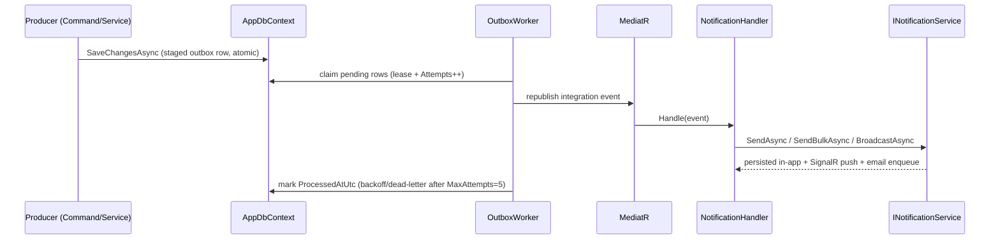
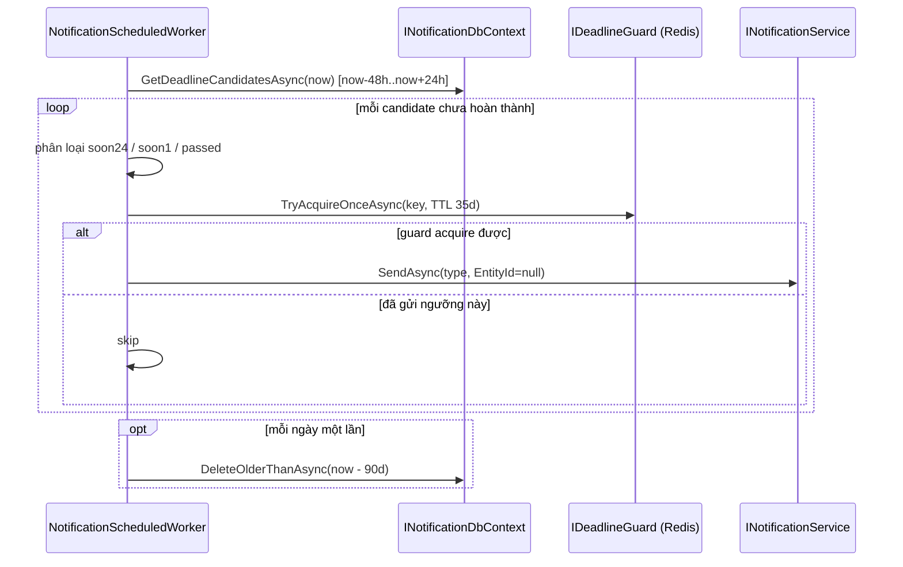

# Thông báo (Notifications)

Tài liệu liên quan: [Kiến trúc](ARCHITECTURE.md) · [Quản lý lớp](CLASS.md) · [Hai cấu hình Compose](COMPOSE.md).

## Tổng quan

Module thông báo gửi ba kênh tới người nhận: **in-app** (bảng `notifications`), **realtime** (SignalR) và **email**. mọi phát tán sự kiện nghiệp vụ đều đi qua **transactional outbox** để không bao giờ mất thông báo khi tiến trình/API restart.

Luồng chính: một hành động nghiệp vụ (đăng ký giáo viên, vào lớp, xuất bản bài, ...) gọi `IEventBus.PublishAsync` trong **cùng đơn vị công tác** với `SaveChangesAsync`, nên dòng outbox commit nguyên tử cùng dữ liệu nghiệp vụ. `OutboxWorker` (BackgroundService) quét outbox, phát lại qua MediatR, và các `INotificationHandler` gọi `INotificationService.SendAsync`/`SendBulkAsync`/`BroadcastAsync` để ghi in-app, đẩy SignalR và xếp hàng email.

Toàn bộ nền tảng tuân thủ nguyên tắc thư viện tối thiểu: polling + outbox + BackgroundService, không thêm Polly hay hàng chờ ngoài. Redis chỉ dùng cho cache số chưa đọc và guard chống trùng deadline.

## Luồng (sequence diagrams)

### (a) Outbox: publish → drain → dispatch



### (b) Deadline scanner (NotificationScheduledWorker, poll 5 phút)



### (c) Email qua outbox (at-least-once)

```mermaid
sequenceDiagram
    participant NS as INotificationService
    participant EB as IEventBus (OutboxEventBus)
    participant DB as AppDbContext
    participant OW as OutboxWorker
    participant EH as EmailDispatchHandler
    participant ES as IEmailSender
    NS->>EB: PublishAsync(EmailDispatchNotification) (no SaveChanges)
    DB-->>EB: committed với UoW của producer
    OW->>EH: republish qua MediatR
    EH->>ES: send (retry/backoff; at-least-once, có thể trùng ở MVP)
```

## Bảng kênh (channel matrix)

Kênh in-app và email bật/tắt theo `NotificationPreference` từng người dùng/từng loại (mặc định bật). Realtime luôn đẩy qua SignalR khi có kết nối. `AccountVerifiedOtp` là email-only, không lưu in-app.

| Loại | Người nhận | Kênh | Nguồn phát (producer) | Trạng thái |
| --- | --- | --- | --- | --- |
| SubmissionGraded | Học viên | in-app, email, realtime | hoàn tất chấm trong `JudgeDbContext` | Chưa nối (see Khoảng trống) |
| AiHintReady | Học viên | in-app, email, realtime | `AiService.Assist` đồng bộ | Chưa nối |
| TopicDeadlineSoon | Học viên (còn nợ, hạn ≤24h/≤1h) | in-app, email, realtime | `NotificationScheduledWorker` | Đã nối (Phase 5.1) |
| TopicDeadlinePassed | Học viên (đã quá hạn ≤48h) | in-app, email, realtime | `NotificationScheduledWorker` | Đã nối (Phase 5.1) |
| NewTopicPublished | Học viên của lớp | in-app, email, realtime | `LearningService.Edit`/`CreateFullTopic` | Đã nối |
| RemovedFromCourse | Học viên bị loại | in-app, email, realtime | `ClassCommands` RemoveStudent | Đã nối |
| ScoreUpdated | Học viên | in-app, email, realtime | `Enrollment.UpdateScores` (không có lệnh gọi) | Chưa nối |
| StudentJoinedCourse | Giáo viên của lớp | in-app, email, realtime | `ClassCommands` JoinClass | Đã nối |
| StudentSubmitted | Giáo viên | in-app, email, realtime | đường nộp bài cross-context | Chưa nối (Phase 5.4, see Khoảng trống) |
| TeacherAccountApproved / Rejected | Giáo viên | in-app, email, realtime | `TeacherCommands` duyệt tài khoản | Đã nối |
| NewTeacherPendingApproval | Admin | in-app, email, realtime | `Auth/Commands/RegisterCommand` (role Teacher) | Đã nối |
| NewMessage | Người nhận | in-app, email, realtime | chưa có module chat | Chưa nối |
| SystemBroadcast | AllUsers/Role/Course | in-app, email, realtime | `AdminNotificationEndpoints` | Đã nối (kèm audit, Phase 5.3) |
| AccountVerifiedOtp | Người nhận | email-only | luồng OTP xác minh | Đã nối |

`CourseId` trong `RemovedFromCourseNotification` mang **ClassId** theo quyết định "mô hình Class là nguồn thật" (bảng `Course`/`Enrollment` cũ không còn được thông báo dùng).

## Job định kỳ (Phase 5)

`NotificationScheduledWorker` (BackgroundService, một scope DI mới mỗi tick) mô phỏng hình dạng `OutboxWorker`. Chu kỳ poll 5 phút.

**Quét deadline (5.1).** Mỗi tick gọi `INotificationDbContext.GetDeadlineCandidatesAsync(now)` trả bản ghi `DeadlineCandidate(StudentId, TopicId, ClassId, Title, EffectiveDueAt, Completed)`. Truy vấn nối `Topics` (Published, có `DueAt`) × `Classes` (Active, không template, Mode=Managed) × `ClassEnrollments` (Active), left-join `TopicProgress` (đã hoàn thành) và `DeadlineExtension` (`NewDueAt` ghi đè `DueAt`); giới hạn cửa sổ `[now-48h, now+24h]` để giữ ít dòng. Với ứng viên chưa hoàn thành, phân loại theo thời gian còn lại:

- `(23h..24h]` → `TopicDeadlineSoon` (nhãn guard `soon24`)
- `(0..1h]` → `TopicDeadlineSoon` (nhãn guard `soon1`)
- `EffectiveDueAt < now` (trong 48h) → `TopicDeadlinePassed` (nhãn `passed`)

Vì khóa chống trùng của DB là `type:recipient:entityId` và hai mốc soon dùng chung loại `TopicDeadlineSoon`, thông báo deadline gửi với `EntityId = null` và dựa vào guard Redis `notifications:deadline:{studentId}:{topicId}:{tag}` (SET NX EX, TTL 35 ngày) để **một lần cho mỗi ngưỡng**. Khi gửi thất bại, guard được giải phóng để tick sau thử lại. `IDeadlineGuard` fail-open khi Redis lỗi (không âm thầm bỏ thông báo).

**Dọn dẹp (5.2).** Mỗi lần chạy worker tối đa một lần/ngày (theo mốc trong-bộ-nhớ), gọi `DeleteOlderThanAsync(now - 90 ngày)` và ghi số dòng đã xóa vào log. `ExecuteDeleteAsync` nên idempotent; chạy trùng trên nhiều replica vô hại.

Không có endpoint thủ công cho các job này.

## Audit phát tán admin (Phase 5.3)

`BroadcastAsync` nhận thêm `ipAddress` (từ `http.Connection?.RemoteIpAddress`). Trước `SaveChangesAsync` duy nhất, nó staged một `AuditLog.Create(actorId, AuditAction.NotificationBroadcast, ...)` chứa metadata (phạm vi + số người nhận), nên audit commit nguyên tử cùng các dòng thông báo.

## Khoảng trống đã ghi nhận (chưa có producer sạch)

Những loại dưới đây có handler sẵn nhưng chưa được nối, vì không có móc nối transactional trong `AppDbContext`; làm theo chúng sẽ là chắp vá cross-context, trái nguyên tắc đã chốt.

| Loại | Lý do chưa nối | Hướng thiết kế dự kiến |
| --- | --- | --- |
| SubmissionGraded | Chấm hoàn tất trong `JudgeDbContext` riêng, ngoài đơn vị công tác của thông báo | Publish từ JudgeDbContext qua cùng outbox, hoặc hook sau SaveChanges |
| StudentSubmitted (+ gộp theo giáo viên) | Đường nộp bài maps sang bảng `Course` cũ, không resolve được giáo viên trong một UoW của `AppDbContext` | Giữ tập hợp per-teacher trong Redis (set), `NotificationScheduledWorker` flush theo cửa sổ 1–5 phút (Phase 5.4, **tạm hoãn**) |
| ScoreUpdated | `Enrollment.UpdateScores` không có caller/command | Nối khi có command cập nhật điểm thật |
| AiHintReady | `AiService.Assist` đồng bộ, không có callback bất đồng bộ | Nối khi có luồng hint async |
| NewMessage | Chưa có module chat | Nối khi module chat ra đời |

Handler của các loại trên giữ nguyên (no-op tới khi có producer).

## SignalR và scale-out

Hub tại `/hubs/notifications?access_token=...` (JWT qua query string, yêu cầu policy `ActiveUser`). Compose dev chỉ chạy Redis (và AI/Qdrant tùy chọn); API chạy trên host một instance nên **không cần backplane**. Khi scale ra nhiều replica, cần thêm `Microsoft.AspNetCore.SignalR.StackExchangeRedis` và `AddStackExchangeRedis(...)` để đẩy realtime nhất quán giữa các instance — cố ý chưa thêm theo nguyên tắc thư viện tối thiểu.

## Kiểm thử

Unit test trong `api/tests/CodePath.Unit.Tests/Notifications` phủ: phân loại ngưỡng + guard một-lần + cutoff dọn dẹp của worker (mock `IDeadlineGuard`); producer đăng ký-giáo-viên/vào-lớp/loại-xuất-bản publish đúng event; `BroadcastAsync` ghi đúng một dòng audit; fan-out `StudentJoinedCourse` (giáo viên) và `NewTopicPublished` (học viên của lớp). Integration test phụ thuộc Docker (Testcontainers) — biên dịch, chỉ chạy khi có daemon.

## Mã nguồn

- Application: `Notifications/{Abstractions,Contracts,Events,Handlers,Validation}`; producers ở `Auth/Commands/RegisterCommand.cs`, `Classes/ClassCommands.cs`.
- Domain: `Notifications/{Entities,Enums}`; `Auditing/Enums/AuditAction.cs`.
- Infrastructure: `Notifications/{NotificationService,OutboxWorker,OutboxEventBus,NotificationScheduledWorker,RedisNotificationCache,RedisDeadlineGuard}`; `Learning/LearningService*.cs`; `Persistence/AppDbContext.Notifications.cs`.
- Api: `Endpoints/{NotificationEndpoints,AdminNotificationEndpoints,NotificationsHub}.cs`.
- Thủ công: `api/notifications.http`.
